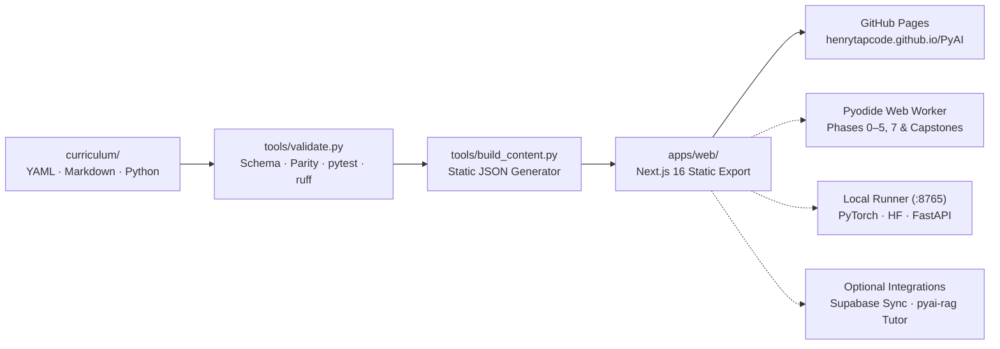

<div align="center">

# PyAI Path

**An interactive, bilingual (EN / VI) Python-to-AI-Engineer learning platform — running directly in your browser.**
<br />
**Nền tảng học Python tương tác song ngữ (EN / VI) theo lộ trình AI Engineer — chạy trực tiếp trên trình duyệt.**

[](https://github.com/henrytapcode/PyAI/actions/workflows/pages.yml)


<p>
  <a href="https://henrytapcode.github.io/PyAI/"><strong>Live App ↗</strong></a>
  &nbsp;·&nbsp;
  <a href="#english">English</a>
  &nbsp;·&nbsp;
  <a href="#tiếng-việt">Tiếng Việt</a>
  &nbsp;·&nbsp;
  <a href="#curriculum">Curriculum</a>
  &nbsp;·&nbsp;
  <a href="#quick-start">Quick Start</a>
</p>

</div>

---

## English

**PyAI Path** takes learners from zero-setup terminal basics to shipping production LLM systems, RAG pipelines, and tool-using AI agents — all in a fast, zero-backend static web application. Every lesson is tested as code: runnable examples, guaranteed-failing starters, verified solutions, and strict EN/VI content parity enforced in CI.

### At a Glance

| Metric | Count | Details |
|---|---:|---|
| **Curriculum Phases** | **9 + 2** | Phases 0–8 + 2 end-to-end Capstones (`100%` complete) |
| **Interactive Lessons** | **60** | Split-pane theory, Mermaid diagrams, trace tables & live Monaco editor |
| **Hands-On Exercises** | **122** | Failing `starter.py`, verified `solution.py`, `pytest` suite & 3-tier hints |
| **Quiz Questions** | **958** | MCQ, predict-the-output, fill-in-the-blank, and Parsons code reordering |
| **Timed Assessments** | **14** | 1 Placement Test, 9 Phase Tests, and 4 full-length Mock Exams |
| **Career & Reference** | **396** | 299 bilingual glossary terms, 87 interview Q&As, 10 portfolio briefs |

---

### Key Capabilities

- **In-Browser Python Execution (Pyodide Web Worker):** Run code and `pytest`-compatible test suites locally in the browser with zero setup and an instant **Stop** button for infinite loops.
- **Hybrid Local Runner for Heavy ML/API Workloads:** Seamlessly switches to a lightweight FastAPI local runner (`127.0.0.1:8765`) for PyTorch, Hugging Face Transformers (offline-cached), and FastAPI `TestClient` lessons.
- **Deterministic Offline LLM Simulation (`pyai_llm`):** Practice prompting, structured outputs, RAG, evals, and agent tool-calling in Phases 7–8 and Capstones with zero API keys or network calls.
- **Split Lesson Workbench & Step Visualizer:** Theory + Mermaid diagrams on the left, Monaco Editor on the right, plus a **Visualize** mode that steps through Python execution and inspects variable state line by line.
- **Spaced Repetition (SM-2) & Adaptive Dashboard:** Missed quiz items automatically feed your SM-2 review queue, alongside streaks, daily XP goals, a 9-phase skill tree, weak-topic radar, and activity heatmap.
- **Offline Print & PDF Publishing:** Generate complete bilingual textbooks, phase cheat sheets, and printable exam papers (with separate answer keys) via headless Chrome/Edge.
- **Privacy-First & Zero-Backend by Default:** Progress is stored locally in `localStorage` with one-click JSON export/import. Optional Supabase cloud sync and optional RAG AI teaching assistant degrade gracefully when unconfigured.

---

### Architecture



---

### Curriculum

| Phase | Focus Area | Lessons | Exercises | Execution Runtime |
|---|---|---:|---:|---|
| **Phase 0** | Environment Setup: Terminal, `uv`, Git, VS Code | 4 | 8 | Browser (Pyodide) |
| **Phase 1** | Python Core: Types, Control Flow, Functions, Files, Exceptions | 10 | 20 | Browser (Pyodide) |
| **Phase 2** | Intermediate Python: OOP, Dataclasses, Typing, Generators, Decorators | 9 | 18 | Browser (Pyodide) |
| **Phase 3** | Code Quality: `pytest`, `ruff`, Logging, Debugging, Profiling | 5 | 10 | Browser (Pyodide) |
| **Phase 4** | Data Engineering: NumPy, Pandas, SQL, Visualization | 6 | 12 | Browser (Pyodide) |
| **Phase 5** | Machine Learning Foundations: scikit-learn, Pipelines, Evaluation | 5 | 10 | Browser (Pyodide) |
| **Phase 6** | Deep Learning: PyTorch Tensors, Autograd, Training Loops, Fine-Tuning | 4 | 8 | Local Runner |
| **Phase 7** | LLM & GenAI: Prompting, Structured Output, Embeddings, RAG, Agents, Evals | 10 | 20 | Browser (`pyai_llm`) |
| **Phase 8** | AI Engineering in Production: FastAPI, Async, Guardrails, Observability, Deployment | 5 | 10 | Browser + Local Runner |
| **Capstones** | `cap-01-rag-chatbot` & `cap-02-tool-agent` | 2 | 6 | Browser + Local Runner |
| **Total** | **Complete Track + 14 Exams** (`placement`, 9 phase tests, 4 mock exams) | **60** | **122** | — |

> [!TIP]
> Already know Python fundamentals? Start with the **Placement Test** — passing unlocks **Track B**, letting you skip Phases 0–1 and jump straight into Intermediate Python & AI Engineering.

---

### Quick Start

#### Prerequisites
- **Node.js** `20+` and **pnpm** `10+` (via `corepack enable`)
- **Python** `3.11–3.13` (`3.13` pinned in `.python-version` for prebuilt scientific wheels) and **[uv](https://docs.astral.sh/uv/)**

#### Run Locally

```bash
git clone https://github.com/henrytapcode/PyAI.git
cd PyAI

pnpm install          # Install web workspace dependencies
uv sync               # Create .venv and install Python curriculum/tooling deps
pnpm dev              # Build content JSON and start dev server at http://localhost:3000
```

> [!NOTE]
> **Windows PowerShell users:** Invoke `pnpm.cmd` instead of `pnpm` if script execution policy blocks `pnpm.ps1`, and run `uv run python -m pytest` (instead of `uv run pytest`). Stop any running dev server before running `pnpm build`.

#### Static Production Build

```bash
pnpm build                    # Exports static site to apps/web/out/
pnpm --filter web start       # Serves apps/web/out/ locally at http://localhost:3000
```

The first visit fetches Pyodide and Monaco assets from CDN and caches them in the browser for subsequent sessions.

---

### Local Runner (Phase 6 & Local Exercises)

Lessons that depend on native C/C++ packages (PyTorch, Hugging Face `transformers`, or FastAPI `TestClient` in `cap-01` `ex03`) execute through the bundled local runner:

```bash
# 1. Pre-cache lightweight Hugging Face models once for offline execution
uv run python tools/localrunner/fetch_models.py

# 2. Start the local execution server (listens on http://127.0.0.1:8765)
uv run python tools/localrunner/serve.py
```

### Printable Textbooks, Cheat Sheets & Exams (HTML / PDF)

Export the curriculum for offline reading or classroom printing using pure Python stdlib + headless Chrome/Edge:

```bash
uv run python tools/export_pdf.py --only all --lang both              # Generate HTML + PDF (EN & VI)
uv run python tools/export_pdf.py --only book --lang both --html-only # Generate HTML textbooks only
```

---

### Quality Gates & Verification

Every piece of content is validated as code before deployment:

```bash
uv run python tools/validate.py      # Full gate: JSON schemas, EN/VI parity, runnable outputs, starter fail / solution pass, quiz answers, ruff
uv run python -m pytest curriculum   # Runs all 122 exercise test suites against their reference solutions
uv run python -m pytest tools packages # Unit tests for content tooling, pyrunner, and pyai_llm
pnpm typecheck                       # Builds content, runs TypeScript strict check, verifies en.json / vi.json key parity
```

For fast iteration on a single lesson during authoring:

```bash
uv run python tools/validate.py --path curriculum/phase-01-python-core/p1-01-variables
```

---

### Project Structure

```text
PyAI/
├── apps/web/                   # Next.js 16 static web app (App Router, Tailwind v4, next-intl, Monaco, Pyodide)
│   ├── messages/               # Bilingual UI strings (en.json, vi.json)
│   ├── public/                 # Pyodide Web Worker & static assets
│   └── src/                    # Pages, Dose design tokens, workbench, SRS, exam runner, storage
├── curriculum/                 # Source-of-truth content (YAML, EN/VI Markdown, starter/solution/tests)
│   ├── phase-00-environment/ … phase-08-production/
│   ├── capstones/              # cap-01-rag-chatbot, cap-02-tool-agent
│   ├── exams/                  # 4 full-length timed mock exams
│   ├── interview/              # 87 bilingual AI/Python interview Q&As
│   └── placement/              # Adaptive placement exam
├── packages/pyai_llm/          # Deterministic zero-network FakeLLM & structured-output helpers
├── tools/                      # Content pipeline & execution infrastructure
│   ├── validate.py             # Automated curriculum CI gate
│   ├── build_content.py        # Compiles curriculum/ -> apps/web/src/generated/
│   ├── export_pdf.py           # Printable HTML/PDF exporter
│   ├── pyrunner/               # pytest-compatible runner & step tracer for Pyodide & CPython
│   └── localrunner/            # FastAPI server (:8765) + offline Hugging Face model fetcher
├── supabase/                   # Optional SQL schema (RLS-protected progress sync)
└── .github/workflows/pages.yml # Automated CI validation, static build & GitHub Pages deployment
```

---

### Deployment & Optional Integrations

Every push to `main` runs [`.github/workflows/pages.yml`](.github/workflows/pages.yml): caches Hugging Face models, executes the full `validate.py` gate on Python 3.13, builds the Next.js static export, and deploys to GitHub Pages. Enable **Settings → Pages → Source: GitHub Actions** when forking.

<details>
<summary><strong>Optional: Cloud Sync & Accounts (Supabase + Google OAuth)</strong></summary>

Without environment variables, PyAI Path runs in **guest mode** using browser `localStorage`. To enable optional sign-in and cross-device sync:

1. Create a [Supabase](https://supabase.com) project and run [`supabase/schema.sql`](supabase/schema.sql) in the SQL Editor (single table protected by Row Level Security).
2. Under **Authentication → Providers**, enable **Google** with a Web OAuth 2.0 client from Google Cloud Console and register `https://<project>.supabase.co/auth/v1/callback`.
3. Under **Authentication → URL Configuration**, set Site URL to `https://henrytapcode.github.io/PyAI/` (and `http://localhost:3000/` for local dev).
4. Configure repository **Variables** (`Settings → Secrets and variables → Actions → Variables`): `NEXT_PUBLIC_SUPABASE_URL` and `NEXT_PUBLIC_SUPABASE_ANON_KEY` (or copy `apps/web/.env.example` to `apps/web/.env.local` locally).

On sign-in, conflict resolution automatically keeps the progress snapshot with higher XP.

</details>

<details>
<summary><strong>Optional: AI Teaching Assistant (<code>pyai-rag</code> Backend)</strong></summary>

PyAI Path supports an optional context-aware AI tutor powered by [`pyai-rag`](https://github.com/henrytapcode/pyai-rag), providing lesson Q&A and 3-tier progressive exercise hints without spoiling full solutions.

- **Enable:** Set `NEXT_PUBLIC_RAG_URL` (e.g., `http://127.0.0.1:8000` locally or a Cloudflare Tunnel URL in GitHub Actions Variables).
- **Graceful Degradation:** When `NEXT_PUBLIC_RAG_URL` is unset or empty, the chat widget is completely hidden and the app operates as a pure static site.
- **CORS:** Whitelist `https://henrytapcode.github.io` (and `http://localhost:3000` for dev) in `pyai-rag/config.yaml` (`api.cors_origins`).

</details>

---

### Contributing

1. Keep EN and VI files in strict structural parity (matching headings, Mermaid blocks, code blocks, and YAML IDs).
2. Ensure `starter.py` fails tests (`EXERCISE_TARGET=starter`), while `solution.py` passes under both CPython `pytest` and `tools/pyrunner/runner.py`.
3. Run all quality gates (`validate.py`, `pytest`, `typecheck`) and ensure `0 errors, 0 warnings` before opening a pull request.

---

## Tiếng Việt

**PyAI Path** đưa người học từ những thao tác terminal cơ bản đến việc xây dựng hệ thống LLM, pipeline RAG và AI Agent dùng tool sẵn sàng chạy production — ngay trên một ứng dụng web tĩnh tốc độ cao, không cần cài đặt hay backend bắt buộc. Mọi bài học đều được kiểm định như mã nguồn: ví dụ chạy ra đúng kết quả, code khởi đầu chắc chắn fail test, lời giải chuẩn vượt qua 100% test, và song ngữ EN/VI đồng bộ tuyệt đối qua CI.

### Tổng quan nhanh

| Hạng mục | Số lượng | Chi tiết |
|---|---:|---|
| **Giai đoạn học (Phases)** | **9 + 2** | Phase 0–8 + 2 dự án Capstone hoàn chỉnh (`100%` sẵn sàng) |
| **Bài học tương tác** | **60** | Giao diện chia đôi: lý thuyết, sơ đồ Mermaid, bảng trace & Monaco editor |
| **Bài tập thực hành** | **122** | `starter.py` (fail), `solution.py` (pass), bộ test `pytest` & gợi ý 3 tầng |
| **Câu hỏi Quiz** | **958** | Trắc nghiệm, đoán output, điền khuyết và sắp xếp code (Parsons) |
| **Đề kiểm tra tính giờ** | **14** | 1 bài Placement Test, 9 bài Phase Test và 4 đề Mock Exam tổng hợp |
| **Tài nguyên nghề nghiệp** | **396** | 299 thuật ngữ song ngữ, 87 câu hỏi phỏng vấn, 10 đề bài Portfolio |

---

### Tính năng nổi bật

- **Chạy Python trực tiếp trên trình duyệt (Pyodide Web Worker):** Viết code và chạy bộ test tương thích `pytest` ngay trên trình duyệt mà không cần cài đặt, tích hợp nút **Dừng** khi gặp vòng lặp vô hạn.
- **Chế độ Local Runner cho bài nặng (ML/API):** Tự động kết nối với server FastAPI cục bộ (`127.0.0.1:8765`) cho các bài dùng PyTorch, Hugging Face Transformers (cache offline) và FastAPI `TestClient`.
- **Mô phỏng LLM offline nhất quán (`pyai_llm`):** Thực hành prompting, structured output, RAG, evals và agent gọi tool trong Phase 7–8 và Capstone mà không cần API key hay kết nối mạng.
- **Màn hình học chia đôi & Trình trực quan hóa từng bước:** Lý thuyết + sơ đồ Mermaid bên trái, Monaco Editor bên phải, kèm chế độ **Visualize** theo dõi trạng thái từng biến qua từng dòng lệnh.
- **Ôn tập ngắt quãng (SM-2) & Dashboard thông minh:** Câu quiz làm sai tự động vào hàng đợi ôn tập SM-2; theo dõi chuỗi ngày học (streak), mục tiêu XP hằng ngày, cây kỹ năng 9 phase, nhóm chủ đề yếu và biểu đồ nhiệt hoạt động.
- **Xuất giáo trình & đề thi bản in (HTML / PDF):** Tự động tạo sách học, cheat sheet từng phase và đề thi in ấn (tách riêng file đáp án) bằng thư viện chuẩn Python kết hợp Chrome/Edge headless.
- **Riêng tư mặc định, không cần tài khoản:** Tiến độ lưu trực tiếp trong `localStorage` kèm nút Export/Import JSON. Hỗ trợ mở rộng đồng bộ Supabase và trợ giảng AI RAG nếu bạn muốn tự cấu hình thêm.

---

### Lộ trình học

| Phase | Chủ đề trọng tâm | Bài học | Bài tập | Môi trường chạy |
|---|---|---:|---:|---|
| **Phase 0** | Môi trường làm việc: Terminal, `uv`, Git, VS Code | 4 | 8 | Trình duyệt (Pyodide) |
| **Phase 1** | Python cốt lõi: Kiểu dữ liệu, luồng điều khiển, hàm, file, ngoại lệ | 10 | 20 | Trình duyệt (Pyodide) |
| **Phase 2** | Python trung cấp: OOP, Dataclass, Type hint, Generator, Decorator | 9 | 18 | Trình duyệt (Pyodide) |
| **Phase 3** | Chất lượng code: `pytest`, `ruff`, Logging, Debug, Profiling | 5 | 10 | Trình duyệt (Pyodide) |
| **Phase 4** | Kỹ thuật dữ liệu: NumPy, Pandas, SQL, Trực quan hóa | 6 | 12 | Trình duyệt (Pyodide) |
| **Phase 5** | Nền tảng Machine Learning: scikit-learn, Pipeline, Đánh giá mô hình | 5 | 10 | Trình duyệt (Pyodide) |
| **Phase 6** | Deep Learning: PyTorch Tensor, Autograd, Training Loop, Fine-tuning | 4 | 8 | Local Runner |
| **Phase 7** | LLM & GenAI: Prompting, Structured Output, Embedding, RAG, Agent, Evals | 10 | 20 | Trình duyệt (`pyai_llm`) |
| **Phase 8** | AI Engineering thực chiến: FastAPI, Async, Guardrails, Observability, Deploy | 5 | 10 | Trình duyệt + Local Runner |
| **Capstone** | `cap-01-rag-chatbot` & `cap-02-tool-agent` | 2 | 6 | Trình duyệt + Local Runner |
| **Tổng cộng** | **Trọn bộ lộ trình + 14 đề thi** (`placement`, 9 phase test, 4 mock exam) | **60** | **122** | — |

> [!TIP]
> Bạn đã nắm chắc Python cơ bản? Hãy làm **Placement Test** — nếu đạt chuẩn, hệ thống mở **Track B** giúp bạn bỏ qua Phase 0–1 để đi thẳng vào Python trung cấp và AI Engineering.

---

### Chạy dự án trên máy cá nhân

#### Yêu cầu hệ thống
- **Node.js** `20+` và **pnpm** `10+` (bật qua `corepack enable`)
- **Python** `3.11–3.13` (khuyến nghị `3.13` theo `.python-version` để dùng wheel dựng sẵn) và **[uv](https://docs.astral.sh/uv/)**

#### Cài đặt và chạy Dev

```bash
git clone https://github.com/henrytapcode/PyAI.git
cd PyAI

pnpm install          # Cài đặt gói cho ứng dụng web
uv sync               # Tạo .venv và cài đặt thư viện Python cho giáo trình/công cụ
pnpm dev              # Build dữ liệu JSON và chạy server dev tại http://localhost:3000
```

> [!NOTE]
> **Lưu ý cho Windows PowerShell:** Dùng `pnpm.cmd` thay cho `pnpm` nếu PowerShell chặn file `.ps1`, và luôn chạy `uv run python -m pytest` (không chạy `uv run pytest`). Nhớ dừng dev server trước khi chạy lệnh `pnpm build`.

#### Build bản tĩnh (Static Production)

```bash
pnpm build                    # Xuất bản web tĩnh vào apps/web/out/
pnpm --filter web start       # Chạy thử apps/web/out/ tại http://localhost:3000
```

#### Chạy Local Runner (cho Phase 6 & bài tập `runner: local`)

```bash
uv run python tools/localrunner/fetch_models.py   # Tải cache model Hugging Face 1 lần để chạy offline
uv run python tools/localrunner/serve.py          # Khởi chạy server cục bộ tại http://127.0.0.1:8765
```

#### Xuất bản in HTML & PDF

```bash
uv run python tools/export_pdf.py --only all --lang both              # Xuất cả HTML + PDF (EN & VI)
uv run python tools/export_pdf.py --only book --lang both --html-only # Chỉ xuất giáo trình HTML
```

---

### Cổng kiểm định chất lượng (Quality Gates)

```bash
uv run python tools/validate.py        # Kiểm tra toàn diện: schema, song ngữ EN/VI, output thực tế, starter fail / solution pass, quiz, ruff
uv run python -m pytest curriculum     # Chạy toàn bộ 122 bộ test bài tập với lời giải chuẩn
uv run python -m pytest tools packages # Chạy unit test cho bộ công cụ build, pyrunner và pyai_llm
pnpm typecheck                         # Build nội dung, kiểm tra TypeScript và đối chiếu khóa en.json / vi.json
```

Kiểm tra nhanh riêng một bài học khi biên soạn:

```bash
uv run python tools/validate.py --path curriculum/phase-01-python-core/p1-01-variables
```

---

### Triển khai & Tích hợp tùy chọn

Mỗi lần push lên `main`, workflow [`.github/workflows/pages.yml`](.github/workflows/pages.yml) sẽ tự động tải/cache model Hugging Face, chạy toàn bộ `validate.py` trên Python 3.13, build site tĩnh Next.js và deploy lên GitHub Pages. Khi fork repo, chỉ cần bật **Settings → Pages → Source: GitHub Actions**.

<details>
<summary><strong>Tùy chọn: Đồng bộ đám mây & Đăng nhập (Supabase + Google OAuth)</strong></summary>

Nếu không cấu hình biến môi trường, ứng dụng chạy ở chế độ khách và lưu tiến độ trong `localStorage`. Để bật đăng nhập và đồng bộ nhiều thiết bị:

1. Tạo project [Supabase](https://supabase.com) và chạy [`supabase/schema.sql`](supabase/schema.sql) trong SQL Editor (1 bảng, bật Row Level Security bảo vệ dữ liệu từng người dùng).
2. Vào **Authentication → Providers**, bật **Google** với OAuth 2.0 Client từ Google Cloud Console và thêm redirect URI `https://<project>.supabase.co/auth/v1/callback`.
3. Vào **Authentication → URL Configuration**, đặt Site URL là `https://henrytapcode.github.io/PyAI/` (và `http://localhost:3000/` cho bản dev).
4. Thêm biến `NEXT_PUBLIC_SUPABASE_URL` và `NEXT_PUBLIC_SUPABASE_ANON_KEY` vào **Repository Variables** (`Settings → Secrets and variables → Actions → Variables`), hoặc sao chép `apps/web/.env.example` thành `apps/web/.env.local` khi chạy cục bộ.

Khi đăng nhập, hệ thống tự động giữ lại bản lưu có số XP cao hơn.

</details>

<details>
<summary><strong>Tùy chọn: Trợ giảng AI (Backend <code>pyai-rag</code>)</strong></summary>

PyAI Path hỗ trợ khung chat trợ giảng AI kết nối với [`pyai-rag`](https://github.com/henrytapcode/pyai-rag), giải đáp kiến thức bài học và đưa gợi ý 3 tầng cho bài tập mà không lộ thẳng lời giải.

- **Kích hoạt:** Thiết lập biến `NEXT_PUBLIC_RAG_URL` (ví dụ `http://127.0.0.1:8000` khi chạy máy cá nhân hoặc endpoint Cloudflare Tunnel trên GitHub Actions Variables).
- **Tự động ẩn khi chưa bật:** Nếu không đặt `NEXT_PUBLIC_RAG_URL`, widget trợ giảng sẽ ẩn hoàn toàn và trang web hoạt động như ứng dụng tĩnh bình thường.
- **Cấu hình CORS:** Thêm `https://henrytapcode.github.io` (và `http://localhost:3000`) vào `api.cors_origins` trong `pyai-rag/config.yaml`.

</details>

---

### Đóng góp nội dung

1. Giữ cấu trúc file EN và VI đồng bộ hoàn toàn (số lượng heading, sơ đồ Mermaid, khối code và ID YAML).
2. Đảm bảo `starter.py` fail test (`EXERCISE_TARGET=starter`) và `solution.py` pass 100% trên cả `pytest` lẫn `tools/pyrunner/runner.py`.
3. Chạy đủ các cổng chất lượng (`validate.py`, `pytest`, `typecheck`) đạt `0 error, 0 warning` trước khi mở Pull Request.
