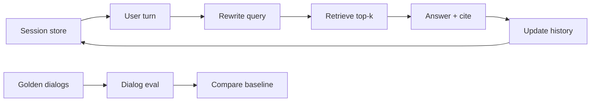

Your manager liked the single-turn FAQ bot from `p7-09-mini-project-rag`, but real customers do not ask neat one-off questions. They follow up with `"What about express?"`, expect the bot to remember what they just asked, and drop in from dozens of concurrent browser tabs at once—while your team needs proof that today's prompt or threshold edit did not quietly break yesterday's working chats.

This capstone upgrades that single-turn script into a stateful multi-turn RAG chatbot with an automated dialog evaluation suite and TTL-bounded session management.

## 1. The brief

The product team needs one shared chatbot core that supports three user stories:

- **Story 1 (Multi-turn customer):** A shopper asks `"How much does delivery cost?"` and follows up with `"What about express?"`. The bot rewrites the follow-up using recent conversation history, retrieves the right FAQ chunk, cites its source, and stays within a strict token budget.
- **Story 2 (Release engineer):** Before merging any change to chunking, thresholds, or prompts, an engineer runs the golden dialog eval suite against a saved baseline and blocks deployment if any previously passing turn becomes `broken`.
- **Story 3 (Production service):** Multiple shoppers chat concurrently through isolated sessions. Idle sessions expire after `session_ttl` seconds, and memory stays bounded by evicting the least recently used session once `max_sessions` is full.

We reuse the exact 8-page shop FAQ corpus (`docs`) from `p7-09-mini-project-rag` §2 so retrieval scores and citations stay consistent across lessons:

```python
docs = [
    {"source": "refunds.md", "text": "Refunds are issued within 30 days of purchase. Keep your original receipt for any return. Opened software is not eligible for a refund."},
    {"source": "shipping.md", "text": "Standard shipping takes 5 business days across the country. Express delivery arrives next day for 12 dollars. Free shipping applies on orders over 50 dollars."},
    {"source": "warranty.md", "text": "Hardware warranty covers factory defects for 12 months. Water damage and dropped screens are not covered. Battery wear after 6 months is excluded."},
    {"source": "payment.md", "text": "Accepted payment methods are Visa, Mastercard, and cash on delivery. Gift cards cannot be redeemed for cash. Invoices are emailed right after checkout."},
    {"source": "accounts.md", "text": "Password resets are sent by email within 5 minutes. Two-factor login can be turned on in security settings. Inactive accounts remain open for 24 months."},
    {"source": "support.md", "text": "Support agents work Monday to Friday from 9 AM to 6 PM. Weekend messages receive replies on Monday morning. Urgent outage tickets get a 2 hour target."},
    {"source": "pickup.md", "text": "Store pickup is ready 2 hours after order confirmation. Unclaimed orders are held at the counter for 7 days. Bring a photo ID at pickup."},
    {"source": "discounts.md", "text": "Student discounts give 15 percent off eligible laptops. Promo codes cannot be combined on one order. Loyalty points expire after 12 months."},
]

print("pages:", len(docs), "first:", docs[0]["source"], "last:", docs[-1]["source"])
# pages: 8 first: refunds.md last: discounts.md
```

Notice that every page holds 3 crisp sentences—so sentence chunking keeps all 24 facts intact just as in `p7-09-mini-project-rag`.

## 2. Architecture

Every incoming chat message flows through session lookup, query rewriting, RAG retrieval, and history trimming, while an offline evaluation branch compares dialog runs against a baseline:



Each component builds directly on earlier phases instead of starting from scratch:

| part | what you build | reuse from |
|---|---|---|
| History & follow-up rewrite | Token-budgeted turn list and deterministic follow-up query rewriter | `p7-01-llm-api`, `p7-05-rag` |
| Retrieve, cite & refuse | Sentence chunk index, `min_score` gate, and verified `[n]` citations | `p7-05-rag`, `p7-09-mini-project-rag` |
| Dialog eval & baseline diff | Turn-by-turn golden dialog scorer and `fixed` / `broken` regression check | `p7-08-evals`, `p7-09-mini-project-rag` |
| Session store | Per-session history dict with `FakeClock` TTL expiry and LRU eviction | `p8-03-caching` |
| FastAPI service (ex03) | `create_app` factory with `/sessions` routes and `TestClient` tests | `p8-05-mini-project` |

## 3. Conversation history with a token budget

Every chat turn adds tokens to the prompt, and an unbounded conversation eventually overflows the model's context window or blows up latency and cost. Store `history` as a list of `{"role", "content"}` message dicts, count tokens with `count_tokens` from `pyai_llm`, and drop the oldest turn from the front until the total fits inside `budget`.

Think of `history` like a sliding whiteboard with a fixed width: when a new note will not fit, you erase the oldest note on the left so the most recent context stays visible.

```python
from pyai_llm import count_tokens


def trim_history(history: list[dict], budget: int) -> list[dict]:
    kept = list(history)
    while kept and sum(count_tokens(m["content"]) for m in kept) > budget:
        kept.pop(0)
    return kept


turns = [
    {"role": "user", "content": "How long does standard shipping take?"},
    {"role": "assistant", "content": "Standard shipping takes 5 business days across the country."},
    {"role": "user", "content": "What about express?"},
    {"role": "assistant", "content": "Express delivery arrives next day for 12 dollars."},
]

history: list[dict] = []
for idx, turn in enumerate(turns, 1):
    history.append(turn)
    history = trim_history(history, budget=25)
    total = sum(count_tokens(m["content"]) for m in history)
    print(f"turn {idx} ({turn['role']}): tokens={total}, kept={len(history)}")
# turn 1 (user): tokens=7, kept=1
# turn 2 (assistant): tokens=17, kept=2
# turn 3 (user): tokens=21, kept=3
# turn 4 (assistant): tokens=23, kept=3
```

Tracing all 4 turns makes the eviction threshold clear:

| turn | role | tokens after trim | kept |
|---|---|---|---|
| 1 | `user` | 7 | 1 |
| 2 | `assistant` | 17 | 2 |
| 3 | `user` | 21 | 3 |
| 4 | `assistant` | 23 | 3 (dropped turn 1) |

Notice that on turn 4, appending the assistant reply pushed the total above `budget=25`, so turn 1 (`7` tokens) was dropped while turns 2–4 (`23` tokens) remained.

> [!NOTE]
> `trim_history` above trims a plain list of `user` and `assistant` turns. In Exercise 1, you will keep a `system` prompt pinned at index `0` so trimming older turns never erases the bot's grounding instructions.

## 4. Follow-up questions

A raw follow-up like `"What about express?"` lacks the topic words from turn 1 (`"delivery"` or `"shipping"`), so embedding retrieval scores it poorly—or pulls an unrelated chunk—and `FakeLLM.chat()` cannot reach the 2-word overlap required to answer. Before embedding the query, use a simple, deterministic rewrite rule that needs **no LLM call**: if `history` has a previous `user` question and the new question is short (`<= 4` words) or starts with `"what about"`, `"and"`, or `"how about"`, prepend the previous user question.

Press **Visualize** on this short block and watch `prev_user` and `rewritten` resolve a follow-up versus a standalone question.

```python
def rewrite_query(question: str, history: list[dict]) -> str:
    prev_user = ""
    for msg in reversed(history):
        if msg["role"] == "user":
            prev_user = msg["content"]
            break
    if not prev_user:
        return question
    low = question.lower().strip()
    is_short = len(question.split()) <= 4
    has_prefix = low.startswith(("what about ", "and ", "how about "))
    if is_short or has_prefix:
        return f"{prev_user} {question}"
    return question


history = [{"role": "user", "content": "How much does delivery cost?"}]
for q in ["What about express?", "How long is hardware warranty for factory defects?"]:
    rewritten = rewrite_query(q, history)
    print(q, "->", rewritten)
# What about express? -> How much does delivery cost? What about express?
# How long is hardware warranty for factory defects? -> How long is hardware warranty for factory defects?
```

Now compare top-1 retrieval cosine similarity (using `client.embed` + `cosine`) and `FakeLLM.chat()` answers before and after rewriting on two real follow-ups:

```python
import re
from pyai_llm import FakeLLM, cosine

docs = [
    {"source": "refunds.md", "text": "Refunds are issued within 30 days of purchase. Keep your original receipt for any return. Opened software is not eligible for a refund."},
    {"source": "shipping.md", "text": "Standard shipping takes 5 business days across the country. Express delivery arrives next day for 12 dollars. Free shipping applies on orders over 50 dollars."},
    {"source": "warranty.md", "text": "Hardware warranty covers factory defects for 12 months. Water damage and dropped screens are not covered. Battery wear after 6 months is excluded."},
    {"source": "payment.md", "text": "Accepted payment methods are Visa, Mastercard, and cash on delivery. Gift cards cannot be redeemed for cash. Invoices are emailed right after checkout."},
    {"source": "accounts.md", "text": "Password resets are sent by email within 5 minutes. Two-factor login can be turned on in security settings. Inactive accounts remain open for 24 months."},
    {"source": "support.md", "text": "Support agents work Monday to Friday from 9 AM to 6 PM. Weekend messages receive replies on Monday morning. Urgent outage tickets get a 2 hour target."},
    {"source": "pickup.md", "text": "Store pickup is ready 2 hours after order confirmation. Unclaimed orders are held at the counter for 7 days. Bring a photo ID at pickup."},
    {"source": "discounts.md", "text": "Student discounts give 15 percent off eligible laptops. Promo codes cannot be combined on one order. Loyalty points expire after 12 months."},
]

client = FakeLLM(embed_dim=256)
chunks = [
    {"id": f"{d['source']}#{i}", "source": d["source"], "text": s.strip()}
    for d in docs
    for i, s in enumerate(re.split(r"(?<=[.!?])\s+", d["text"].strip()))
    if s.strip()
]
chunk_vecs = client.embed([c["text"] for c in chunks])


def retrieve_top1(query: str) -> tuple[float, dict]:
    q_vec = client.embed([query])[0]
    best_score, best_chunk = -1.0, chunks[0]
    for vec, chunk in zip(chunk_vecs, chunks, strict=True):
        score = cosine(q_vec, vec)
        if score > best_score:
            best_score, best_chunk = score, chunk
    return round(best_score, 3), best_chunk


cases = [
    ("How much does delivery cost?", "What about express?"),
    ("When do support messages get replies?", "What about weekend?"),
]
for prev, follow in cases:
    rewritten = f"{prev} {follow}"
    for label, q in [("raw", follow), ("rewritten", rewritten)]:
        score, hit = retrieve_top1(q)
        ans = client.chat([
            {"role": "system", "content": f"Context:\n[1] {hit['text']}"},
            {"role": "user", "content": q},
        ]).content
        print(f"{label:9} | {hit['id']:13} ({score}) | {ans}")
# raw       | shipping.md#1 (0.204) | I don't know based on the provided context.
# rewritten | shipping.md#1 (0.25) | Express delivery arrives next day for 12 dollars. [1]
# raw       | warranty.md#2 (0.218) | I don't know based on the provided context.
# rewritten | support.md#1  (0.378) | Weekend messages receive replies on Monday morning. [1]
```

Side-by-side comparison shows why rewriting before retrieval matters:

| follow-up | mode | top chunk | cosine | answer |
|---|---|---|---|---|
| `"What about express?"` | raw | `shipping.md#1` | `0.204` | `"I don't know based on the provided context."` |
| `"What about express?"` | rewritten | `shipping.md#1` | `0.250` | `"Express delivery arrives next day for 12 dollars. [1]"` |
| `"What about weekend?"` | raw | `warranty.md#2` | `0.218` | `"I don't know based on the provided context."` |
| `"What about weekend?"` | rewritten | `support.md#1` | `0.378` | `"Weekend messages receive replies on Monday morning. [1]"` |

Notice how `"What about weekend?"` without history not only refused, it retrieved `warranty.md#2`—the wrong document entirely—whereas rewriting jumped cosine similarity to `0.378` on `support.md#1`.

## 5. Evaluating conversations

Single-turn evals miss bugs that only appear on turn 2 or 3, such as broken follow-up rewriting or leaked history across conversations. A **golden dialog** is a sequence of turns where each turn defines `question`, `expected_source`, and `expected_facts` (or `expected_source=None` when the bot must refuse).

Score every turn in order, then compare the current run's per-turn pass/fail map against a saved **baseline**: cases that moved from `False` to `True` are **`fixed`**, and cases that moved from `True` to `False` are **`broken`** (regressions):

```python
def compare_to_baseline(current: dict[str, bool], baseline: dict[str, bool]) -> dict:
    fixed = [case_id for case_id, ok in current.items() if ok and not baseline[case_id]]
    broken = [case_id for case_id, ok in current.items() if not ok and baseline[case_id]]
    pass_rate = sum(current.values()) / len(current)
    return {"pass_rate": pass_rate, "fixed": fixed, "broken": broken}


baseline_run = {"d1#t1": True, "d1#t2": False, "d2#t1": True, "d2#t2": True}
current_run = {"d1#t1": True, "d1#t2": True, "d2#t1": True, "d2#t2": False}

diff = compare_to_baseline(current_run, baseline_run)
print("pass_rate:", diff["pass_rate"])
# pass_rate: 0.75
print("fixed:", diff["fixed"], "broken:", diff["broken"])
# fixed: ['d1#t2'] broken: ['d2#t2']
```

Notice that `pass_rate` stayed `0.75` (`3/4`) in both runs, yet `compare_to_baseline` caught that `d1#t2` was fixed at the exact same time `d2#t2` broke.

## 6. Sessions

When two users message your chatbot at the same time, sharing one global `history` list mixes their questions together. Give each `session_id` its own `{"history": [], "last_seen": clock()}` entry inside a dictionary, expire entries whose `now - last_seen >= ttl`, and evict the least recently used session when `len(sessions)` reaches `max_sessions`.

Like `p8-03-caching`, we inject the standard `FakeClock` callable so tests control time deterministically in pure Python without `time.sleep()` or `fastapi`:

```python
class FakeClock:
    def __init__(self, start: float = 0.0) -> None:
        self.t = start

    def __call__(self) -> float:
        return self.t

    def advance(self, seconds: float) -> None:
        self.t += seconds


def purge_expired(sessions: dict[str, dict], now: float, ttl: float) -> list[str]:
    expired = [sid for sid, item in sessions.items() if now - item["last_seen"] >= ttl]
    for sid in expired:
        del sessions[sid]
    return expired


def open_session(
    sessions: dict[str, dict],
    sid: str,
    clock: FakeClock,
    ttl: float,
    max_sessions: int,
) -> None:
    now = clock()
    purge_expired(sessions, now, ttl)
    if sid in sessions:
        sessions[sid]["last_seen"] = now
        return
    if len(sessions) >= max_sessions:
        oldest = min(sessions, key=lambda k: sessions[k]["last_seen"])
        del sessions[oldest]
    sessions[sid] = {"history": [], "last_seen": now}


clock = FakeClock()
sessions: dict[str, dict] = {}
open_session(sessions, "s1", clock, ttl=60.0, max_sessions=2)
clock.advance(10.0)
open_session(sessions, "s2", clock, ttl=60.0, max_sessions=2)
clock.advance(10.0)
open_session(sessions, "s3", clock, ttl=60.0, max_sessions=2)
print("after s3:", sorted(sessions.keys()))
# after s3: ['s2', 's3']

clock.advance(55.0)
removed = purge_expired(sessions, clock(), ttl=60.0)
print("expired at t=75:", removed, "active:", sorted(sessions.keys()))
# expired at t=75: ['s2'] active: ['s3']
```

Notice how `s1` (`last_seen=0`) was evicted when `s3` arrived at `t=20`, and then `s2` (`last_seen=10`) expired at `t=75` (`75 - 10 >= 60`) while `s3` (`last_seen=20`) stayed active.

> [!TIP]
> The code above stays pure Python so it runs in the browser's Pyodide sandbox. In Exercise 3, you will wrap this session store behind FastAPI routes and run it with the local runner (`runner: local`).

## 7. Milestones

The capstone splits into three graded exercises. Every exercise builds on the ideas above and asks for concrete behavior that the lesson snippets intentionally leave out:

| exercise | what you build | done criteria | not implemented in lesson yet |
|---|---|---|---|
| `ex01` `ChatBot` | `ChatBot.ask(question)` returning `{"answer", "sources", "rewritten"}` | Rewrites follow-ups, trims history to token budget, refuses **without calling `chat()`** when no chunk clears `min_score`, returns only valid `[n]` citations | Keeping the `system` prompt pinned while trimming older turns, and bundling all steps into a stateful `ChatBot` class |
| `ex02` Dialog eval | `run_dialog_eval(make_bot, dialogs)` and `compare_to_baseline(current, baseline)` | Runs a fresh bot per dialog, scores every turn (`expected_source`, `expected_facts`, refusals), computes `fixed`, `broken`, `pass_rate`, and fails regression gate if `broken` is non-empty or `pass_rate` is below threshold | Creating an isolated `make_bot()` instance per dialog, reporting the exact `(dialog_id, turn_idx)` of every failure, and enforcing the regression gate |
| `ex03` Session service | `create_app(docs, client, clock, session_ttl, max_sessions)` | Exposes `POST /sessions`, `POST /sessions/{id}/messages`, and `GET /sessions/{id}` via FastAPI; enforces TTL and capacity eviction; returns HTTP `404` for missing or expired sessions | FastAPI routing with Pydantic schemas, counting and enforcing `max_sessions` across HTTP requests, and returning `404` on missing or expired sessions |

## 8. Grading rubric

Use this rubric to verify your finished capstone before marking it complete:

| criterion | how it is measured | passing bar |
|---|---|---|
| Grounded answers & citations | `sources` checked against retrieved chunks and `[n]` bounds on golden dialogs | `100%` grounded (zero invalid citations) |
| Safe refusals | Out-of-FAQ turns checked for `"I don't know"`, `sources == []`, and zero wasted `chat()` calls | `100%` refusal accuracy when no chunk clears `min_score` |
| Regression discipline | `compare_to_baseline(current, baseline)` across all golden dialog turns | `0` `broken` turns and `pass_rate` at or above threshold |
| Session isolation & lifecycle | `TestClient` + `FakeClock` tests for concurrent users, TTL expiry, and capacity eviction | Zero cross-session history leaks; `404` on expired/missing sessions |
| Exercise test suites | Automated `pytest` and browser/local runner checks across `ex01`, `ex02`, and `ex03` | All 3 exercise test suites pass with zero warnings |

## 9. Common mistakes

**1. Retrieving with the raw follow-up instead of the rewritten query**

Passing `"What about express?"` straight to `client.chat()` without prepending the previous user question drops shared topic words and causes a false refusal:

```python
from pyai_llm import FakeLLM

client = FakeLLM(embed_dim=256)
chunk = "Express delivery arrives next day for 12 dollars."

# Wrong: raw follow-up lacks context words and fails FakeLLM's 2-word overlap check
wrong = client.chat([
    {"role": "system", "content": f"Context:\n[1] {chunk}"},
    {"role": "user", "content": "What about express?"},
]).content
print("wrong:", wrong)
# wrong: I don't know based on the provided context.

# Fix: rewrite with the previous user question before retrieving and answering
fixed = client.chat([
    {"role": "system", "content": f"Context:\n[1] {chunk}"},
    {"role": "user", "content": "How much does delivery cost? What about express?"},
]).content
print("fixed:", fixed)
# fixed: Express delivery arrives next day for 12 dollars. [1]
```

Fix: rewrite short or prefix-matching follow-ups before embedding and passing the query to `chat()`.

**2. Dropping the `system` prompt when trimming history**

Putting the `system` prompt inside the same list and popping from index `0` silently erases your grounding instructions as soon as the conversation exceeds the budget:

```python
from pyai_llm import count_tokens

msgs = [
    {"role": "system", "content": "Answer only from shop FAQ context."},
    {"role": "user", "content": "How long do refunds take?"},
    {"role": "assistant", "content": "Refunds are issued within 30 days."},
    {"role": "user", "content": "What about express shipping?"},
]

# Wrong: popping from index 0 drops the system prompt first
bad = list(msgs)
while bad and sum(count_tokens(m["content"]) for m in bad) > 20:
    bad.pop(0)
print("wrong roles:", [m["role"] for m in bad])
# wrong roles: ['user', 'assistant', 'user']

# Fix: keep the system message pinned and only drop oldest conversation turns
sys_msg, rest = msgs[0], list(msgs[1:])
while rest and count_tokens(sys_msg["content"]) + sum(count_tokens(m["content"]) for m in rest) > 20:
    rest.pop(0)
fixed = [sys_msg, *rest]
print("fixed roles:", [m["role"] for m in fixed])
# fixed roles: ['system', 'assistant', 'user']
```

Fix: separate or pin `system` outside the trim loop so only `user`/`assistant` turns are evicted.

**3. Judging a candidate run only by overall `pass_rate`**

If one change fixes `c2` while silently breaking `c1`, the aggregate pass rate stays at `0.5` (`50%`) and hides the regression:

```python
baseline = {"c1": True, "c2": False, "c3": True, "c4": False}
candidate = {"c1": False, "c2": True, "c3": True, "c4": False}

# Wrong: aggregate pass_rate hides that c1 regressed
print("pass_rate:", sum(baseline.values()) / len(baseline), "->", sum(candidate.values()) / len(candidate))
# pass_rate: 0.5 -> 0.5

# Fix: explicitly track broken cases (passed in baseline, failed now)
broken = [k for k in candidate if baseline[k] and not candidate[k]]
print("broken:", broken)
# broken: ['c1']
```

Fix: always compute `broken` and fail the regression gate whenever any baseline pass turns into a failure.

**4. Sharing one mutable `history` list across sessions (aliasing)**

Reusing the same list reference when initializing multiple sessions leaks user A's private messages directly into user B's session:

```python
# Wrong: both sessions point to the exact same list object
shared: list[dict] = []
bad_sessions = {"s1": {"history": shared}, "s2": {"history": shared}}
bad_sessions["s1"]["history"].append({"role": "user", "content": "Secret order #99"})
print("wrong s2 history:", bad_sessions["s2"]["history"])
# wrong s2 history: [{'role': 'user', 'content': 'Secret order #99'}]

# Fix: allocate a fresh list per session
good_sessions = {"s1": {"history": []}, "s2": {"history": []}}
good_sessions["s1"]["history"].append({"role": "user", "content": "Secret order #99"})
print("fixed s2 history:", good_sessions["s2"]["history"])
# fixed s2 history: []
```

Fix: create a brand-new `[]` list inside `open_session` every time a session is created.

## Recap

- Trim conversation `history` with `count_tokens` so prompts stay inside a fixed token budget while keeping the `system` prompt pinned.
- Rewrite short or follow-up turns (`<= 4` words or starting with `"what about"`, `"and"`, `"how about"`) deterministically using the previous user question before retrieval.
- Evaluate multi-turn conversations turn by turn on golden dialogs and diff every run against a baseline to catch `broken` regressions, not just overall `pass_rate`.
- Isolate each user in a `session_id -> {"history", "last_seen"}` store with `FakeClock` TTL expiration and LRU eviction at `max_sessions`.
- Ship in three milestones: `ex01` (`ChatBot`), `ex02` (dialog eval + regression gate), and `ex03` (FastAPI session service on the local runner).

## Take it further

Once all three capstone milestones pass, try extending your chatbot toward production workloads:

- **Swap the deterministic rewriter for an LLM contextualizer**: when follow-ups reference pronouns like `"Does it cover water damage?"`, ask a real model via your `.env` API key to rewrite the turn into a standalone question (never print or commit keys):

```bash
# Load secrets from .env without printing the key
set -a && source .env && set +a
uv run python -c "import os; print('key loaded:', bool(os.getenv('LLM_API_KEY')))"
```

- **Persist sessions in Redis**: replace the in-memory `sessions` dictionary with Redis hashes + native `EXPIRE` TTL so multiple `uvicorn` workers share session state.
- **Stream responses over SSE**: stream tokens as Server-Sent Events from `POST /sessions/{id}/messages` so users see the first words immediately instead of waiting for the full completion.
