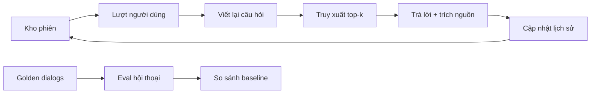

Sếp rất ưng bot hỏi-đáp một lượt từ `p7-09-mini-project-rag`, nhưng khách hàng ngoài đời không chỉ hỏi một câu gọn gàng rồi thôi. Họ sẽ hỏi nối tiếp `"What about express?"`, mong bot nhớ ngữ cảnh vừa trao đổi, và mở hàng chục tab trò chuyện cùng lúc—trong khi đội ngũ của bạn cần bằng chứng rằng một chỉnh sửa prompt hay ngưỡng lọc hôm nay không âm thầm làm hỏng những hội thoại đang chạy tốt hôm qua.

Capstone này nâng cấp script một lượt đó thành một **chatbot** RAG nhiều lượt có trạng thái, đi kèm bộ đánh giá hội thoại tự động và quản lý **phiên** (session) giới hạn theo TTL.

## 1. Yêu cầu dự án

Đội sản phẩm cần một lõi chatbot dùng chung đáp ứng ba kịch bản người dùng (**user story**):

- **Kịch bản 1 (Khách hàng hỏi nhiều lượt):** Khách hỏi `"How much does delivery cost?"` rồi hỏi tiếp `"What about express?"`. Bot viết lại câu nối tiếp dựa trên lịch sử hội thoại gần nhất, truy xuất đúng chunk FAQ, trích dẫn nguồn và giữ prompt trong ngân sách token chặt chẽ.
- **Kịch bản 2 (Kỹ sư phát hành):** Trước khi gộp thay đổi về chia chunk, ngưỡng điểm hay prompt, kỹ sư chạy bộ đánh giá **golden dialog** (hội thoại chuẩn) so với bản **baseline** (mốc đối chiếu) đã lưu và chặn triển khai nếu bất kỳ lượt nào từng đạt nay bị `broken` (hỏng mới).
- **Kịch bản 3 (Dịch vụ production):** Nhiều khách hàng trò chuyện song song qua các phiên tách biệt. Phiên không hoạt động sẽ hết hạn sau `session_ttl` giây, và bộ nhớ luôn được khống chế bằng cách loại phiên ít dùng gần nhất khi chạm ngưỡng `max_sessions`.

Bạn dùng lại nguyên vẹn kho 8 trang FAQ cửa hàng (`docs`) từ `p7-09-mini-project-rag` §2 để điểm truy xuất và trích dẫn khớp hoàn toàn giữa các bài học:

```python
docs = [
    {"source": "refunds.md", "text": "Refunds are issued within 30 days of purchase. Keep your original receipt for any return. Opened software is not eligible for a refund."},
    {"source": "shipping.md", "text": "Standard shipping takes 5 business days across the country. Express delivery arrives next day for 12 dollars. Free shipping applies on orders over 50 dollars."},
    {"source": "warranty.md", "text": "Hardware warranty covers factory defects for 12 months. Water damage and dropped screens are not covered. Battery wear after 6 months is excluded."},
    {"source": "payment.md", "text": "Accepted payment methods are Visa, Mastercard, and cash on delivery. Gift cards cannot be redeemed for cash. Invoices are emailed right after checkout."},
    {"source": "accounts.md", "text": "Password resets are sent by email within 5 minutes. Two-factor login can be turned on in security settings. Inactive accounts remain open for 24 months."},
    {"source": "support.md", "text": "Support agents work Monday to Friday from 9 AM to 6 PM. Weekend messages receive replies on Monday morning. Urgent outage tickets get a 2 hour target."},
    {"source": "pickup.md", "text": "Store pickup is ready 2 hours after order confirmation. Unclaimed orders are held at the counter for 7 days. Bring a photo ID at pickup."},
    {"source": "discounts.md", "text": "Student discounts give 15 percent off eligible laptops. Promo codes cannot be combined on one order. Loyalty points expire after 12 months."},
]

print("pages:", len(docs), "first:", docs[0]["source"], "last:", docs[-1]["source"])
# pages: 8 first: refunds.md last: discounts.md
```

Để ý mỗi trang có đúng 3 câu ngắn gọn—nhờ vậy tách theo câu giữ nguyên vẹn cả 24 sự thật giống hệt `p7-09-mini-project-rag`.

## 2. Kiến trúc hệ thống

Mỗi tin nhắn gửi vào đi qua bước tra cứu phiên, viết lại câu hỏi, truy xuất RAG và cắt gọn lịch sử, trong khi nhánh đánh giá ngoại tuyến so sánh các lượt hội thoại với bản baseline:



Từng thành phần kế thừa trực tiếp từ các phase trước thay vì viết lại từ đầu:

| phần | bạn xây dựng gì | tái sử dụng từ |
|---|---|---|
| Lịch sử & viết lại câu hỏi | Danh sách lượt giới hạn token và hàm viết lại câu nối tiếp tất định | `p7-01-llm-api`, `p7-05-rag` |
| Truy xuất, trích dẫn & từ chối | Chỉ mục chunk theo câu, cổng `min_score` và trích dẫn `[n]` hợp lệ | `p7-05-rag`, `p7-09-mini-project-rag` |
| Eval hội thoại & đối chiếu baseline | Bộ chấm golden dialog từng lượt và kiểm tra hồi quy `fixed` / `broken` | `p7-08-evals`, `p7-09-mini-project-rag` |
| Kho phiên | Dict lưu lịch sử theo từng phiên kèm TTL của `FakeClock` và loại bỏ LRU | `p8-03-caching` |
| Dịch vụ FastAPI (ex03) | Hàm `create_app` với các route `/sessions` và test qua `TestClient` | `p8-05-mini-project` |

## 3. Lịch sử hội thoại có ngân sách token

Mỗi lượt trò chuyện đều cộng thêm token vào prompt, nên lịch sử không giới hạn sớm muộn cũng tràn cửa sổ ngữ cảnh (**context window**) hoặc làm tăng độ trễ và chi phí. Hãy lưu `history` (lịch sử) thành danh sách các dict `{"role", "content"}`, đếm bằng `count_tokens` của `pyai_llm`, và bỏ dần lượt cũ nhất ở đầu danh sách cho tới khi tổng số token vừa khít `budget` (**ngân sách token**).

Hãy hình dung `history` giống một chiếc bảng trắng có bề ngang cố định: khi ghi chú mới không còn chỗ, bạn xóa bớt ghi chú cũ nhất bên trái để phần ngữ cảnh mới nhất luôn nằm trên bảng.

```python
from pyai_llm import count_tokens


def trim_history(history: list[dict], budget: int) -> list[dict]:
    kept = list(history)
    while kept and sum(count_tokens(m["content"]) for m in kept) > budget:
        kept.pop(0)
    return kept


turns = [
    {"role": "user", "content": "How long does standard shipping take?"},
    {"role": "assistant", "content": "Standard shipping takes 5 business days across the country."},
    {"role": "user", "content": "What about express?"},
    {"role": "assistant", "content": "Express delivery arrives next day for 12 dollars."},
]

history: list[dict] = []
for idx, turn in enumerate(turns, 1):
    history.append(turn)
    history = trim_history(history, budget=25)
    total = sum(count_tokens(m["content"]) for m in history)
    print(f"turn {idx} ({turn['role']}): tokens={total}, kept={len(history)}")
# turn 1 (user): tokens=7, kept=1
# turn 2 (assistant): tokens=17, kept=2
# turn 3 (user): tokens=21, kept=3
# turn 4 (assistant): tokens=23, kept=3
```

Bảng trace qua cả 4 lượt cho thấy rõ ngưỡng cắt bỏ:

| lượt | vai trò | token sau khi cắt | số lượt giữ lại |
|---|---|---|---|
| 1 | `user` | 7 | 1 |
| 2 | `assistant` | 17 | 2 |
| 3 | `user` | 21 | 3 |
| 4 | `assistant` | 23 | 3 (đã bỏ lượt 1) |

Để ý ở lượt 4, việc thêm câu trả lời của assistant đẩy tổng số vượt `budget=25`, nên lượt 1 (`7` token) bị bỏ đi và chỉ còn các lượt 2–4 (`23` token).

> [!NOTE]
> Hàm `trim_history` ở trên cắt trên danh sách chỉ gồm các lượt `user` và `assistant`. Ở Exercise 1, bạn sẽ giữ cố định thông điệp `system` ở vị trí `0` để việc cắt lịch sử cũ không bao giờ xóa mất chỉ dẫn bám nguồn của bot.

## 4. Câu hỏi nối tiếp

Một **câu hỏi nối tiếp** (follow-up question) thô như `"What about express?"` thiếu các từ khóa chủ đề của lượt 1 (`"delivery"` hay `"shipping"`), nên bước truy xuất bằng embedding chấm điểm rất thấp—hoặc kéo nhầm chunk không liên quan—và `FakeLLM.chat()` không đủ 2 từ trùng để trả lời. Trước khi embed câu truy vấn, hãy áp dụng quy tắc viết lại đơn giản, tất định và **không cần gọi LLM**: nếu `history` đã có câu hỏi `user` trước đó và câu mới ngắn (`<= 4` từ) hoặc mở đầu bằng `"what about"`, `"and"`, hoặc `"how about"`, hãy ghép thêm câu hỏi người dùng gần nhất vào trước.

Bấm **Visualize** ở khối code ngắn này để theo dõi `prev_user` và `rewritten` xử lý một câu nối tiếp so với một câu hỏi độc lập.

```python
def rewrite_query(question: str, history: list[dict]) -> str:
    prev_user = ""
    for msg in reversed(history):
        if msg["role"] == "user":
            prev_user = msg["content"]
            break
    if not prev_user:
        return question
    low = question.lower().strip()
    is_short = len(question.split()) <= 4
    has_prefix = low.startswith(("what about ", "and ", "how about "))
    if is_short or has_prefix:
        return f"{prev_user} {question}"
    return question


history = [{"role": "user", "content": "How much does delivery cost?"}]
for q in ["What about express?", "How long is hardware warranty for factory defects?"]:
    rewritten = rewrite_query(q, history)
    print(q, "->", rewritten)
# What about express? -> How much does delivery cost? What about express?
# How long is hardware warranty for factory defects? -> How long is hardware warranty for factory defects?
```

Bây giờ hãy so sánh điểm tương đồng `cosine` hạng 1 (dùng `client.embed` + `cosine`) và câu trả lời của `FakeLLM.chat()` trước và sau khi viết lại trên hai câu nối tiếp thực tế:

```python
import re
from pyai_llm import FakeLLM, cosine

docs = [
    {"source": "refunds.md", "text": "Refunds are issued within 30 days of purchase. Keep your original receipt for any return. Opened software is not eligible for a refund."},
    {"source": "shipping.md", "text": "Standard shipping takes 5 business days across the country. Express delivery arrives next day for 12 dollars. Free shipping applies on orders over 50 dollars."},
    {"source": "warranty.md", "text": "Hardware warranty covers factory defects for 12 months. Water damage and dropped screens are not covered. Battery wear after 6 months is excluded."},
    {"source": "payment.md", "text": "Accepted payment methods are Visa, Mastercard, and cash on delivery. Gift cards cannot be redeemed for cash. Invoices are emailed right after checkout."},
    {"source": "accounts.md", "text": "Password resets are sent by email within 5 minutes. Two-factor login can be turned on in security settings. Inactive accounts remain open for 24 months."},
    {"source": "support.md", "text": "Support agents work Monday to Friday from 9 AM to 6 PM. Weekend messages receive replies on Monday morning. Urgent outage tickets get a 2 hour target."},
    {"source": "pickup.md", "text": "Store pickup is ready 2 hours after order confirmation. Unclaimed orders are held at the counter for 7 days. Bring a photo ID at pickup."},
    {"source": "discounts.md", "text": "Student discounts give 15 percent off eligible laptops. Promo codes cannot be combined on one order. Loyalty points expire after 12 months."},
]

client = FakeLLM(embed_dim=256)
chunks = [
    {"id": f"{d['source']}#{i}", "source": d["source"], "text": s.strip()}
    for d in docs
    for i, s in enumerate(re.split(r"(?<=[.!?])\s+", d["text"].strip()))
    if s.strip()
]
chunk_vecs = client.embed([c["text"] for c in chunks])


def retrieve_top1(query: str) -> tuple[float, dict]:
    q_vec = client.embed([query])[0]
    best_score, best_chunk = -1.0, chunks[0]
    for vec, chunk in zip(chunk_vecs, chunks, strict=True):
        score = cosine(q_vec, vec)
        if score > best_score:
            best_score, best_chunk = score, chunk
    return round(best_score, 3), best_chunk


cases = [
    ("How much does delivery cost?", "What about express?"),
    ("When do support messages get replies?", "What about weekend?"),
]
for prev, follow in cases:
    rewritten = f"{prev} {follow}"
    for label, q in [("raw", follow), ("rewritten", rewritten)]:
        score, hit = retrieve_top1(q)
        ans = client.chat([
            {"role": "system", "content": f"Context:\n[1] {hit['text']}"},
            {"role": "user", "content": q},
        ]).content
        print(f"{label:9} | {hit['id']:13} ({score}) | {ans}")
# raw       | shipping.md#1 (0.204) | I don't know based on the provided context.
# rewritten | shipping.md#1 (0.25) | Express delivery arrives next day for 12 dollars. [1]
# raw       | warranty.md#2 (0.218) | I don't know based on the provided context.
# rewritten | support.md#1  (0.378) | Weekend messages receive replies on Monday morning. [1]
```

Đặt kết quả cạnh nhau sẽ thấy rõ hiệu quả của bước viết lại trước khi truy xuất:

| câu nối tiếp | chế độ | chunk đầu bảng | cosine | câu trả lời |
|---|---|---|---|---|
| `"What about express?"` | thô (raw) | `shipping.md#1` | `0.204` | `"I don't know based on the provided context."` |
| `"What about express?"` | viết lại | `shipping.md#1` | `0.250` | `"Express delivery arrives next day for 12 dollars. [1]"` |
| `"What about weekend?"` | thô (raw) | `warranty.md#2` | `0.218` | `"I don't know based on the provided context."` |
| `"What about weekend?"` | viết lại | `support.md#1` | `0.378` | `"Weekend messages receive replies on Monday morning. [1]"` |

Để ý rằng `"What about weekend?"` khi thiếu lịch sử không chỉ bị từ chối mà còn truy xuất nhầm sang `warranty.md#2`—sai hẳn tài liệu—trong khi viết lại giúp điểm cosine tăng vọt lên `0.378` ở đúng `support.md#1`.

## 5. Đánh giá hội thoại

Các bộ eval một lượt sẽ bỏ sót những lỗi chỉ lộ ra ở lượt 2 hay lượt 3, chẳng hạn hàm viết lại câu hỏi bị hỏng hoặc lịch sử rò rỉ giữa các cuộc trò chuyện. Một **golden dialog** là chuỗi các lượt hội thoại trong đó mỗi lượt ghi rõ `question`, `expected_source` và `expected_facts` (hoặc `expected_source=None` khi bot bắt buộc phải từ chối).

Bạn chấm từng lượt theo đúng thứ tự, rồi so sánh bảng kết quả đạt/trượt của lần chạy hiện tại với một bản **baseline** đã lưu: các ca đổi từ `False` sang `True` là **`fixed`** (mới sửa), còn các ca đổi từ `True` sang `False` là **`broken`** (**hồi quy** — regression):

```python
def compare_to_baseline(current: dict[str, bool], baseline: dict[str, bool]) -> dict:
    fixed = [case_id for case_id, ok in current.items() if ok and not baseline[case_id]]
    broken = [case_id for case_id, ok in current.items() if not ok and baseline[case_id]]
    pass_rate = sum(current.values()) / len(current)
    return {"pass_rate": pass_rate, "fixed": fixed, "broken": broken}


baseline_run = {"d1#t1": True, "d1#t2": False, "d2#t1": True, "d2#t2": True}
current_run = {"d1#t1": True, "d1#t2": True, "d2#t1": True, "d2#t2": False}

diff = compare_to_baseline(current_run, baseline_run)
print("pass_rate:", diff["pass_rate"])
# pass_rate: 0.75
print("fixed:", diff["fixed"], "broken:", diff["broken"])
# fixed: ['d1#t2'] broken: ['d2#t2']
```

Để ý rằng `pass_rate` (tỉ lệ đạt chung) ở cả hai lần chạy đều là `0.75` (`3/4`), nhưng `compare_to_baseline` vẫn phát hiện được `d1#t2` vừa được sửa cùng lúc `d2#t2` bị hỏng mới.

## 6. Quản lý phiên

Khi hai người dùng nhắn cho chatbot cùng lúc, dùng chung một list `history` toàn cục sẽ làm câu hỏi của họ trộn lẫn vào nhau. Hãy cấp cho mỗi `session_id` một mục `{"history": [], "last_seen": clock()}` riêng trong dict, cho hết hạn những phiên có `now - last_seen >= ttl`, và loại bỏ phiên ít được dùng gần nhất khi `len(sessions)` chạm mức `max_sessions`.

Giống `p8-03-caching`, bạn truyền hàm `FakeClock` chuẩn để kiểm thử thời gian một cách tất định bằng Python thuần mà không cần `time.sleep()` hay `fastapi`:

```python
class FakeClock:
    def __init__(self, start: float = 0.0) -> None:
        self.t = start

    def __call__(self) -> float:
        return self.t

    def advance(self, seconds: float) -> None:
        self.t += seconds


def purge_expired(sessions: dict[str, dict], now: float, ttl: float) -> list[str]:
    expired = [sid for sid, item in sessions.items() if now - item["last_seen"] >= ttl]
    for sid in expired:
        del sessions[sid]
    return expired


def open_session(
    sessions: dict[str, dict],
    sid: str,
    clock: FakeClock,
    ttl: float,
    max_sessions: int,
) -> None:
    now = clock()
    purge_expired(sessions, now, ttl)
    if sid in sessions:
        sessions[sid]["last_seen"] = now
        return
    if len(sessions) >= max_sessions:
        oldest = min(sessions, key=lambda k: sessions[k]["last_seen"])
        del sessions[oldest]
    sessions[sid] = {"history": [], "last_seen": now}


clock = FakeClock()
sessions: dict[str, dict] = {}
open_session(sessions, "s1", clock, ttl=60.0, max_sessions=2)
clock.advance(10.0)
open_session(sessions, "s2", clock, ttl=60.0, max_sessions=2)
clock.advance(10.0)
open_session(sessions, "s3", clock, ttl=60.0, max_sessions=2)
print("after s3:", sorted(sessions.keys()))
# after s3: ['s2', 's3']

clock.advance(55.0)
removed = purge_expired(sessions, clock(), ttl=60.0)
print("expired at t=75:", removed, "active:", sorted(sessions.keys()))
# expired at t=75: ['s2'] active: ['s3']
```

Để ý cách `s1` (`last_seen=0`) bị loại khi `s3` đến ở `t=20`, rồi `s2` (`last_seen=10`) hết hạn ở `t=75` (`75 - 10 >= 60`) trong khi `s3` (`last_seen=20`) vẫn hoạt động.

> [!TIP]
> Đoạn code trên hoàn toàn bằng Python thuần để chạy mượt trong sandbox Pyodide trên trình duyệt. Sang Exercise 3, bạn sẽ bọc phần lưu trữ phiên này sau các route FastAPI và chạy bằng runner cục bộ (`runner: local`).

## 7. Các mốc hoàn thành

Capstone được chia thành ba bài tập chấm tự động. Mỗi bài tập kế thừa các ý tưởng trên và yêu cầu thêm những hành vi cụ thể mà code minh họa trong bài học cố tình chưa làm:

| bài tập | bạn xây dựng gì | tiêu chí hoàn thành (đo được) | phần bài học chưa làm |
|---|---|---|---|
| `ex01` `ChatBot` | `ChatBot.ask(question)` trả về `{"answer", "sources", "rewritten"}` | Viết lại câu nối tiếp, cắt lịch sử theo ngân sách token, từ chối **mà không gọi `chat()`** khi không có chunk vượt `min_score`, chỉ trả về trích dẫn `[n]` hợp lệ | Giữ nguyên thông điệp `system` khi cắt các lượt cũ hơn, và đóng gói toàn bộ quy trình vào lớp `ChatBot` có trạng thái |
| `ex02` Eval hội thoại | `run_dialog_eval(make_bot, dialogs)` và `compare_to_baseline(current, baseline)` | Tạo bot mới cho từng dialog, chấm mọi lượt (`expected_source`, `expected_facts`, từ chối), trả `fixed`, `broken`, `pass_rate`, và fail cổng hồi quy nếu có `broken` hoặc `pass_rate` dưới ngưỡng | Khởi tạo bot tách biệt qua `make_bot()` cho từng dialog, báo rõ từng cặp `(dialog_id, turn_idx)` bị lỗi, và áp đặt cổng hồi quy |
| `ex03` Dịch vụ phiên | `create_app(make_bot, clock, session_ttl, max_sessions)` | Mở các route FastAPI `POST /sessions`, `POST /sessions/{id}/messages`, `GET /sessions/{id}`; áp dụng TTL và giới hạn số phiên; trả mã HTTP `404` cho phiên thiếu hoặc đã hết hạn | Định tuyến FastAPI kèm schema Pydantic, đếm và giới hạn `max_sessions` qua các request HTTP, và trả `404` khi phiên không tồn tại hoặc hết hạn |

## 8. Tiêu chí chấm điểm

Dùng bảng tiêu chí dưới đây để tự kiểm tra toàn bộ capstone trước khi coi là hoàn thành:

| tiêu chí | cách đo | mức đạt |
|---|---|---|
| Trả lời bám nguồn & trích dẫn | Đối chiếu `sources` với các chunk truy xuất và kiểm tra biên `[n]` trên golden dialogs | `100%` bám nguồn (không trích dẫn sai biên) |
| Từ chối an toàn | Kiểm tra lượt ngoài FAQ có trả `"I don't know"`, `sources == []` và không gọi `chat()` thừa | Tỉ lệ từ chối đúng `100%` khi không chunk nào đạt `min_score` |
| Kỷ luật chống hồi quy | `compare_to_baseline(current, baseline)` trên toàn bộ lượt của golden dialogs | `0` ca `broken` và `pass_rate` đạt ngưỡng quy định |
| Tách biệt & vòng đời phiên | Test bằng `TestClient` + `FakeClock` cho nhiều người dùng, hết hạn TTL và loại phiên cũ | Không rò rỉ lịch sử giữa các phiên; trả `404` khi hết hạn hoặc thiếu phiên |
| Bộ test của bài tập | Chạy `pytest` và runner trình duyệt/cục bộ cho `ex01`, `ex02`, `ex03` | Cả 3 bộ test xanh hoàn toàn và không có cảnh báo |

## 9. Lỗi thường gặp

**1. Truy xuất bằng câu nối tiếp thô thay vì câu đã viết lại**

Đưa thẳng `"What about express?"` vào `client.chat()` mà không ghép câu hỏi người dùng trước đó làm mất từ khóa chủ đề và gây từ chối sai:

```python
from pyai_llm import FakeLLM

client = FakeLLM(embed_dim=256)
chunk = "Express delivery arrives next day for 12 dollars."

# Sai: câu nối tiếp thô thiếu từ khóa ngữ cảnh nên trượt ngưỡng 2 từ trùng của FakeLLM
wrong = client.chat([
    {"role": "system", "content": f"Context:\n[1] {chunk}"},
    {"role": "user", "content": "What about express?"},
]).content
print("wrong:", wrong)
# wrong: I don't know based on the provided context.

# Đúng: viết lại cùng câu hỏi người dùng gần nhất trước khi truy xuất và trả lời
fixed = client.chat([
    {"role": "system", "content": f"Context:\n[1] {chunk}"},
    {"role": "user", "content": "How much does delivery cost? What about express?"},
]).content
print("fixed:", fixed)
# fixed: Express delivery arrives next day for 12 dollars. [1]
```

Cách sửa: luôn chạy bước viết lại câu hỏi ngắn hoặc câu có tiền tố nối tiếp trước khi embed và gọi `chat()`.

**2. Cắt lịch sử làm rơi mất `system` prompt**

Đặt thông điệp `system` chung vào danh sách rồi `pop(0)` từ đầu sẽ âm thầm xóa sạch chỉ dẫn bám nguồn ngay khi hội thoại vượt ngân sách:

```python
from pyai_llm import count_tokens

msgs = [
    {"role": "system", "content": "Answer only from shop FAQ context."},
    {"role": "user", "content": "How long do refunds take?"},
    {"role": "assistant", "content": "Refunds are issued within 30 days."},
    {"role": "user", "content": "What about express shipping?"},
]

# Sai: pop từ vị trí 0 xóa luôn thông điệp system đầu tiên
bad = list(msgs)
while bad and sum(count_tokens(m["content"]) for m in bad) > 20:
    bad.pop(0)
print("wrong roles:", [m["role"] for m in bad])
# wrong roles: ['user', 'assistant', 'user']

# Đúng: giữ cố định thông điệp system và chỉ cắt các lượt hội thoại cũ nhất
sys_msg, rest = msgs[0], list(msgs[1:])
while rest and count_tokens(sys_msg["content"]) + sum(count_tokens(m["content"]) for m in rest) > 20:
    rest.pop(0)
fixed = [sys_msg, *rest]
print("fixed roles:", [m["role"] for m in fixed])
# fixed roles: ['system', 'assistant', 'user']
```

Cách sửa: tách riêng hoặc ghim `system` bên ngoài vòng lặp cắt lịch sử để chỉ các lượt `user`/`assistant` bị loại bỏ.

**3. So sánh với baseline chỉ qua `pass_rate` tổng mà bỏ qua ca `broken`**

Nếu một chỉnh sửa vừa sửa được `c2` vừa làm hỏng `c1`, tỉ lệ đạt tổng vẫn giữ ở `0.5` (`50%`) và che giấu lỗi hồi quy:

```python
baseline = {"c1": True, "c2": False, "c3": True, "c4": False}
candidate = {"c1": False, "c2": True, "c3": True, "c4": False}

# Sai: pass_rate tổng che mất việc c1 bị hỏng mới
print("pass_rate:", sum(baseline.values()) / len(baseline), "->", sum(candidate.values()) / len(candidate))
# pass_rate: 0.5 -> 0.5

# Đúng: liệt kê rõ các ca broken (đạt ở baseline nhưng trượt ở bản mới)
broken = [k for k in candidate if baseline[k] and not candidate[k]]
print("broken:", broken)
# broken: ['c1']
```

Cách sửa: luôn tính danh sách `broken` và đánh trượt cổng hồi quy mỗi khi có bất kỳ ca nào từ đạt chuyển sang trượt.

**4. Các phiên dùng chung một list lịch sử (aliasing)**

Tái sử dụng cùng một tham chiếu list khi khởi tạo nhiều phiên sẽ làm tin nhắn riêng của người dùng A lộ thẳng sang phiên của người dùng B:

```python
# Sai: cả hai phiên trỏ tới cùng một đối tượng list
shared: list[dict] = []
bad_sessions = {"s1": {"history": shared}, "s2": {"history": shared}}
bad_sessions["s1"]["history"].append({"role": "user", "content": "Secret order #99"})
print("wrong s2 history:", bad_sessions["s2"]["history"])
# wrong s2 history: [{'role': 'user', 'content': 'Secret order #99'}]

# Đúng: cấp phát một list mới riêng cho từng phiên
good_sessions = {"s1": {"history": []}, "s2": {"history": []}}
good_sessions["s1"]["history"].append({"role": "user", "content": "Secret order #99"})
print("fixed s2 history:", good_sessions["s2"]["history"])
# fixed s2 history: []
```

Cách sửa: luôn tạo một list `[]` hoàn toàn mới bên trong `open_session` mỗi lần mở phiên.

## Tóm tắt

- Cắt bớt `history` bằng `count_tokens` để prompt luôn nằm trong ngân sách token cố định trong khi giữ nguyên thông điệp `system`.
- Viết lại tất định các lượt ngắn hoặc câu nối tiếp (`<= 4` từ hoặc bắt đầu bằng `"what about"`, `"and"`, `"how about"`) bằng cách ghép câu hỏi người dùng trước đó trước khi truy xuất.
- Đánh giá hội thoại nhiều lượt theo từng lượt trên bộ golden dialog và đối chiếu từng lần chạy với baseline để bắt các ca `broken`, không chỉ nhìn `pass_rate` tổng.
- Tách riêng từng người dùng trong kho `session_id -> {"history", "last_seen"}` với TTL dùng `FakeClock` và loại phiên ít dùng gần nhất khi đạt `max_sessions`.
- Triển khai qua ba mốc: `ex01` (`ChatBot`), `ex02` (eval hội thoại + cổng hồi quy), và `ex03` (dịch vụ phiên FastAPI trên runner cục bộ).

## Mở rộng thêm

Khi cả ba mốc capstone đều đã vượt qua bài kiểm thử, bạn có thể mở rộng chatbot này theo hướng hệ thống thật:

- **Thay bộ viết lại tất định bằng LLM viết lại ngữ cảnh**: khi câu nối tiếp dùng đại từ như `"Does it cover water damage?"`, hãy gọi model thật qua API key đọc từ `.env` để diễn đạt lại thành câu hỏi độc lập (tuyệt đối không in hay commit key):

```bash
# Load secrets from .env without printing the key
set -a && source .env && set +a
uv run python -c "import os; print('key loaded:', bool(os.getenv('LLM_API_KEY')))"
```

- **Lưu phiên vào Redis**: thay dict `sessions` trong RAM bằng Redis hash kèm lệnh `EXPIRE` để nhiều worker `uvicorn` dùng chung trạng thái phiên.
- **Stream phản hồi qua SSE**: truyền từng token dưới dạng Server-Sent Events từ `POST /sessions/{id}/messages` để người dùng thấy những chữ đầu tiên ngay lập tức thay vì chờ cả câu trả lời.
