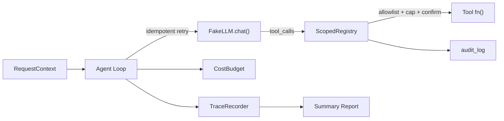

In `p7-10-mini-project-agent`, you built a basic tool-calling loop that dispatches functions and stops after a few steps. In production, an unguarded loop is dangerous: a prompt injection can call `delete_account`, a transient `RateLimitError` can crash a workflow—or worse, blindly retrying a `charge_card` tool can double-bill a customer—and an unbounded loop can drain an entire monthly token budget in minutes.

This capstone hardens that tool-using agent for production across three layers: **scoped permissions**, **idempotent retries with hard cost budgets**, and **structured JSONL trace reporting**.

## 1. The brief

Your platform team operates one shared agent runtime serving three distinct personas:

- **Story 1 (Support agent):** A support rep asks the agent to look up an order and issue a small refund. The request context restricts the agent to `lookup_order` (`read`) and `issue_refund` (`write`, capped at `max_amount=50.0`). Any attempt to refund `$200` or call `delete_account` is blocked and recorded in an audit log.
- **Story 2 (Finance ops):** During peak traffic, the LLM API throws transient `RateLimitError`s. The runtime retries **only** idempotent LLM calls using exponential backoff on a deterministic clock, never retries non-idempotent tool side effects, and halts immediately if `CostBudget` exceeds `max_tokens` or `max_cost_usd`.
- **Story 3 (On-call SRE):** After a batch of agent runs, the SRE reads JSONL trace spans to inspect per-tool call counts, error statuses, total retries, `p95_step_ms` latency, and `budget_utilization` in a compact terminal report.

## 2. Architecture

Every incoming request passes through a permission check before any tool runs, while the outer agent loop tracks retries, token costs, and timing spans:



Each layer extends earlier phases without duplicating `p7-10-mini-project-agent`:

| component | responsibility | builds on |
|---|---|---|
| `ScopedRegistry` (`ex01`) | Per-request allowlist, `read`/`write`/`destructive` policy, `audit_log` | `p7-07-agents`, `p7-10-mini-project-agent` |
| `CostBudget` & `call_with_retry` (`ex02`) | Idempotent backoff with `FakeClock`, token/USD caps, duck-typed agent loop | `p7-01-llm-api`, `p8-04-monitoring` |
| `TraceRecorder` & `summarize_traces` (`ex03`) | Per-step JSONL spans, nearest-rank `p95_step_ms`, compact `< 60`-char report | `p3-05-logging`, `p8-04-monitoring` |

## 3. Scoped permissions, policy caps, and confirmation gates

Giving every agent session access to every registered tool violates the principle of least privilege. Instead, separate **tool registration** (`ToolSpec`) from **request authorization** (`RequestContext`):

| risk tier | typical action | extra guard |
|---|---|---|
| `read` | Fetch order or status | Allowlist check + required args |
| `write` | Issue refund or update record | Allowlist + optional `max_amount` policy cap |
| `destructive` | Delete user or purge data | Allowlist + non-empty `confirmation_token` + `confirm_fn` |

Notice the order of checks matters: an unknown tool fails with `"unknown_tool"` before checking scope, a tool outside `ctx.allowed_tools` fails with `"denied_scope"` before validating arguments, and invalid arguments fail before checking `max_amount` or calling `confirm_fn`.

```python
allowed = {"lookup_order", "issue_refund"}
tool_name = "delete_account"
status = "ok" if tool_name in allowed else "denied_scope"
print("permission check:", tool_name, "->", status)
# permission check: delete_account -> denied_scope
```

Every call—whether allowed, denied, unknown, or raising an exception—appends an entry to `audit_log` so security teams can trace attempted policy violations.

## 4. Idempotent retries and hard cost budgets

Transient `RateLimitError` or `TimeoutError` failures are normal when calling LLM APIs. However, **only idempotent operations** (like `client.chat()`) may be retried safely; retrying a non-idempotent tool call like `issue_refund` could execute the side effect twice.

Press **Visualize** on this short backoff simulation to watch `delay` double on each retry attempt while `clock_t` advances deterministically:

```python
base_delay = 0.5
clock_t = 0.0
for attempt in range(3):
    delay = base_delay * (2 ** attempt)
    clock_t += delay
    print(f"attempt={attempt} delay={delay}s clock={clock_t}s")
# attempt=0 delay=0.5s clock=0.5s
# attempt=1 delay=1.0s clock=1.5s
# attempt=2 delay=2.0s clock=3.5s
```

Alongside retries, every LLM response reports `Usage(prompt_tokens, completion_tokens, total_tokens)`. Multiplying `prompt_tokens` and `completion_tokens` by per-1k rates in `Pricing` lets `CostBudget` enforce both `max_tokens` and `max_cost_usd` **before** and **after** each step:

```python
from pyai_llm import Usage

usage = Usage(prompt_tokens=400, completion_tokens=100, total_tokens=500)
cost = (usage.prompt_tokens * 0.001 + usage.completion_tokens * 0.002) / 1000.0
print("tokens:", usage.total_tokens, "cost_usd:", round(cost, 6))
# tokens: 500 cost_usd: 0.0006
```

> [!NOTE]
> In `ex02`, `run_budgeted_agent` uses **duck typing** for `registry`: it only calls `registry.execute(name, args, ctx)`, so `ex02` stays 100% self-contained without importing `ex01`.

## 5. Trace spans and summary reports

When an agent runs across many requests, raw print statements are hard to parse. Structured JSONL spans capture `request_id`, `step`, `kind` (`"llm"` or `"tool"`), `name`, `status`, `started_at`, `duration_ms`, `tokens`, `cost_usd`, `retries`, and `error`.

To compute `p95_step_ms` deterministically without external libraries, sort the durations ascending and pick the **nearest-rank** index `max(0, math.ceil(0.95 * len(durs)) - 1)`:

```python
import math

durs = [12.0, 18.5, 25.0, 40.0, 110.0]
idx = max(0, math.ceil(0.95 * len(durs)) - 1)
print("p95_idx:", idx, "p95_ms:", durs[idx])
# p95_idx: 4 p95_ms: 110.0
```

## 6. Milestones and grading rubric

Build the capstone across three exercises in `curriculum/capstones/cap-02-tool-agent/exercises/`:

1. **`ex01-scoped-permissions`:** Implement `ToolSpec`, `RequestContext`, and `ScopedRegistry` with strict status priority, argument filtering, policy caps, confirmation gates, `"tool_error"` handling, and `audit_log`.
2. **`ex02-retry-budget`:** Implement `Pricing`, `CostBudget`, `call_with_retry`, and `run_budgeted_agent` using `FakeClock` and `pyai_llm.FakeLLM`.
3. **`ex03-trace-report`:** Implement `TraceRecorder` (`record_step`, `to_jsonl`), `summarize_traces` (empty-span safe, `kind == "tool"` counts, `p95_step_ms`, `budget_utilization`), and `format_report` (`< 60` chars per line).

| criterion | how it is measured | passing bar |
|---|---|---|
| Scope & policy enforcement | `ex01` unit tests for allowlist, arg filtering, `max_amount`, confirmation, and `audit_log` | `100%` denials block `fn()` and log exact status |
| Retry & budget safety | `ex02` tests with `FakeClock`, `RateLimitError`, `TimeoutError`, and hard token/USD caps | Zero retries on `idempotent=False`; stops on budget breach |
| Traceability & reporting | `ex03` tests for JSONL spans, nearest-rank `p95_step_ms`, and `< 60`-char lines | All edge cases (empty spans, errors, `None` budget) pass |
| Exercise test suites | Automated `pytest` and Pyodide browser runner checks across `ex01`, `ex02`, `ex03` | `100%` pass with zero warnings |

## 7. Common mistakes

**1. Retrying a non-idempotent tool call**

Wrapping a payment or refund tool in a retry loop after a `TimeoutError` can execute the side effect twice:

```python
calls = 0
def flaky_refund() -> str:
    global calls
    calls += 1
    if calls == 1:
        raise TimeoutError("gateway timeout")
    return "refunded"

# Wrong: retrying a side-effect tool runs it twice if the first actually succeeded
for _ in range(2):
    try:
        flaky_refund()
        break
    except TimeoutError:
        pass
print("wrong calls:", calls)
# wrong calls: 2
```

Fix: pass `idempotent=False` for tool executions so `call_with_retry` runs them at most once.

**2. Checking `max_amount` with truthiness instead of `is not None`**

If `max_amount = 0.0` (meaning zero-dollar cap), `if spec.max_amount:` evaluates to `False` and skips the policy check!

```python
max_amount = 0.0
amount = 10.0
print("wrong check:", bool(max_amount))
print("right check:", max_amount is not None and amount > max_amount)
# wrong check: False
# right check: True
```

Fix: always check `spec.max_amount is not None` and validate that `amount` is numeric (and not a `bool`, since `isinstance(True, int)` is `True` in Python!).

**3. Counting `"llm"` spans inside `tool_counts`**

Mixing `"llm"` and `"tool"` spans in `tool_counts` inflates tool metrics with model names.

Fix: filter `span["kind"] == "tool"` before incrementing `tool_counts[span["name"]]`.

**4. Mutating `messages` without an explicit string `"content"`**

`pyai_llm.FakeLLM.chat()` validates that every message dict has a string `"content"` key. Appending `{"role": "assistant", "content": None}` raises `ValueError`.

Fix: always append `{"role": "assistant", "content": resp.content or ""}`.

## Recap

- Separate tool definitions (`ToolSpec`) from per-request authorization (`RequestContext`) and log every outcome—including `"unknown_tool"` and `"tool_error"`—to `audit_log`.
- Retry only idempotent calls (`RateLimitError`, `TimeoutError`) with exponential backoff on `FakeClock`, and enforce `CostBudget` both before and after each LLM step.
- Record structured JSONL spans with `TraceRecorder`, compute nearest-rank `p95_step_ms`, and render compact `< 60`-char reports with `format_report`.

## Take it further

Once all three exercises pass, try extending your hardened agent:

- **Add circuit breakers per tool:** trip a tool into `"denied_policy"` for 60 seconds after 3 consecutive `"tool_error"` failures.
- **Export OpenTelemetry spans:** map each `TraceRecorder` dict to an OTel `Span` and ship batches to Jaeger or Grafana Tempo.
- **Persist audit logs:** write `audit_log` entries to an append-only SQLite table or structured log sink for compliance reviews.
