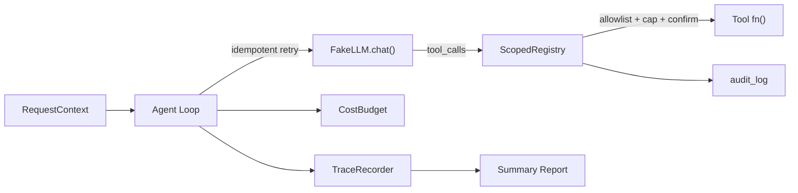

Ở bài `p7-10-mini-project-agent`, bạn đã xây dựng một vòng lặp gọi tool cơ bản biết điều phối hàm và dừng sau vài bước. Trong môi trường production, một vòng lặp thiếu bảo vệ rất nguy hiểm: prompt injection có thể gọi `delete_account`, lỗi `RateLimitError` thoáng qua có thể làm sập quy trình—hoặc tệ hơn, retry mù quáng tool `charge_card` có thể trừ tiền khách hai lần—và vòng lặp không giới hạn có thể đốt sạch ngân sách token cả tháng chỉ trong vài phút.

Bài capstone này gia cố agent dùng tool cho production qua ba lớp: **phân quyền theo phạm vi**, **retry idempotent kèm ngân sách chi phí cứng**, và **báo cáo trace JSONL có cấu trúc**.

## 1. Đề bài

Đội ngũ platform của bạn vận hành một runtime agent dùng chung phục vụ ba nhóm người dùng:

- **Kịch bản 1 (Support agent):** Nhân viên hỗ trợ nhờ agent tra cứu đơn hàng và hoàn tiền nhỏ. Ngữ cảnh request giới hạn agent chỉ được gọi `lookup_order` (`read`) và `issue_refund` (`write`, trần `max_amount=50.0`). Mọi nỗ lực hoàn `$200` hay gọi `delete_account` đều bị chặn và ghi vào audit log (nhật ký kiểm toán).
- **Kịch bản 2 (Finance ops):** Vào giờ cao điểm, LLM API ném lỗi `RateLimitError` thoáng qua. Runtime **chỉ** retry các lệnh gọi LLM có tính idempotent (lũy đẳng — gọi lại không gây tác dụng phụ kép) bằng exponential backoff (lùi thời gian lũy tiến) trên đồng hồ tất định, không bao giờ retry tác dụng phụ của tool, và dừng ngay nếu `CostBudget` vượt `max_tokens` hoặc `max_cost_usd`.
- **Kịch bản 3 (On-call SRE):** Sau một loạt lượt chạy agent, kỹ sư SRE đọc các span trace JSONL để kiểm tra số lần gọi từng tool, trạng thái lỗi, tổng số lần retry, độ trễ `p95_step_ms`, và `budget_utilization` trong một báo cáo terminal gọn gàng.

## 2. Kiến trúc

Mỗi request đi vào đều qua bước kiểm tra quyền trước khi bất kỳ tool nào chạy, trong khi vòng lặp agent bên ngoài theo dõi số lần retry, chi phí token và span thời gian:



Mỗi lớp mở rộng từ các giai đoạn trước mà không lặp lại `p7-10-mini-project-agent`:

| thành phần | trách nhiệm | kế thừa từ |
|---|---|---|
| `ScopedRegistry` (`ex01`) | Allowlist theo request, chính sách `read`/`write`/`destructive`, `audit_log` | `p7-07-agents`, `p7-10-mini-project-agent` |
| `CostBudget` & `call_with_retry` (`ex02`) | Backoff idempotent với `FakeClock`, trần token/USD, vòng lặp duck-typed | `p7-01-llm-api`, `p8-04-monitoring` |
| `TraceRecorder` & `summarize_traces` (`ex03`) | Span JSONL từng bước, `p95_step_ms` nearest-rank, báo cáo `< 60` ký tự | `p3-05-logging`, `p8-04-monitoring` |

## 3. Phân quyền theo phạm vi, hạn mức và cổng xác nhận

Cấp cho mọi phiên agent quyền gọi tất cả tool đã đăng ký là vi phạm nguyên tắc đặc quyền tối thiểu (least privilege). Thay vào đó, hãy tách **đăng ký tool** (`ToolSpec`) khỏi **ủy quyền request** (`RequestContext`):

| mức rủi ro | hành động điển hình | lớp bảo vệ thêm |
|---|---|---|
| `read` | Tra cứu đơn hàng hoặc trạng thái | Kiểm tra allowlist + tham số bắt buộc |
| `write` | Hoàn tiền hoặc cập nhật bản ghi | Allowlist + trần chính sách `max_amount` tùy chọn |
| `destructive` | Xóa người dùng hoặc xóa dữ liệu | Allowlist + `confirmation_token` khác rỗng + `confirm_fn` |

Lưu ý thứ tự kiểm tra rất quan trọng: tool chưa đăng ký thất bại với `"unknown_tool"` trước khi kiểm tra phạm vi, tool nằm ngoài `ctx.allowed_tools` thất bại với `"denied_scope"` trước khi kiểm tra tham số, và tham số sai thất bại trước khi kiểm tra `max_amount` hay gọi `confirm_fn`.

```python
allowed = {"lookup_order", "issue_refund"}
tool_name = "delete_account"
status = "ok" if tool_name in allowed else "denied_scope"
print("permission check:", tool_name, "->", status)
# permission check: delete_account -> denied_scope
```

Mọi lần gọi—dù thành công, bị từ chối, không tồn tại hay ném ngoại lệ—đều ghi thêm một bản ghi vào `audit_log` để đội bảo mật có thể truy vết các vi phạm chính sách.

## 4. Retry idempotent và ngân sách chi phí cứng

Lỗi `RateLimitError` hay `TimeoutError` thoáng qua là bình thường khi gọi LLM API. Tuy nhiên, **chỉ các thao tác idempotent** (như `client.chat()`) mới được phép retry an toàn; retry một tool có tác dụng phụ như `issue_refund` có thể thực thi giao dịch hai lần.

Nhấn **Visualize** trên đoạn mô phỏng backoff ngắn này để xem `delay` tăng gấp đôi sau mỗi lần thử trong khi `clock_t` tiến lên một cách tất định:

```python
base_delay = 0.5
clock_t = 0.0
for attempt in range(3):
    delay = base_delay * (2 ** attempt)
    clock_t += delay
    print(f"attempt={attempt} delay={delay}s clock={clock_t}s")
# attempt=0 delay=0.5s clock=0.5s
# attempt=1 delay=1.0s clock=1.5s
# attempt=2 delay=2.0s clock=3.5s
```

Song song với retry, mỗi phản hồi LLM trả về `Usage(prompt_tokens, completion_tokens, total_tokens)`. Nhân `prompt_tokens` và `completion_tokens` với đơn giá mỗi 1k token trong `Pricing` giúp `CostBudget` kiểm soát cả `max_tokens` lẫn `max_cost_usd` **trước** và **sau** mỗi bước:

```python
from pyai_llm import Usage

usage = Usage(prompt_tokens=400, completion_tokens=100, total_tokens=500)
cost = (usage.prompt_tokens * 0.001 + usage.completion_tokens * 0.002) / 1000.0
print("tokens:", usage.total_tokens, "cost_usd:", round(cost, 6))
# tokens: 500 cost_usd: 0.0006
```

> [!NOTE]
> Trong `ex02`, `run_budgeted_agent` dùng **duck typing** (định kiểu vịt — chỉ cần có phương thức phù hợp) cho `registry`: nó chỉ gọi `registry.execute(name, args, ctx)`, nhờ vậy `ex02` hoàn toàn độc lập mà không cần import `ex01`.

## 5. Span trace và báo cáo tổng hợp

Khi agent chạy qua nhiều request, các dòng `print` thô rất khó phân tích. Các span JSONL có cấu trúc lưu `request_id`, `step`, `kind` (`"llm"` hoặc `"tool"`), `name`, `status`, `started_at`, `duration_ms`, `tokens`, `cost_usd`, `retries`, và `error`.

Để tính `p95_step_ms` tất định mà không cần thư viện ngoài, bạn sắp xếp độ trễ tăng dần rồi lấy chỉ số **nearest-rank** (thứ hạng gần nhất) `max(0, math.ceil(0.95 * len(durs)) - 1)`:

```python
import math

durs = [12.0, 18.5, 25.0, 40.0, 110.0]
idx = max(0, math.ceil(0.95 * len(durs)) - 1)
print("p95_idx:", idx, "p95_ms:", durs[idx])
# p95_idx: 4 p95_ms: 110.0
```

## 6. Các cột mốc và tiêu chí chấm điểm

Hoàn thành capstone qua ba bài tập trong `curriculum/capstones/cap-02-tool-agent/exercises/`:

1. **`ex01-scoped-permissions`:** Cài đặt `ToolSpec`, `RequestContext`, và `ScopedRegistry` với thứ tự trạng thái nghiêm ngặt, lọc tham số, trần chính sách, cổng xác nhận, bắt `"tool_error"`, và `audit_log`.
2. **`ex02-retry-budget`:** Cài đặt `Pricing`, `CostBudget`, `call_with_retry`, và `run_budgeted_agent` dùng `FakeClock` và `pyai_llm.FakeLLM`.
3. **`ex03-trace-report`:** Cài đặt `TraceRecorder` (`record_step`, `to_jsonl`), `summarize_traces` (an toàn với span rỗng, đếm `kind == "tool"`, `p95_step_ms`, `budget_utilization`), và `format_report` (`< 60` ký tự mỗi dòng).

| tiêu chí | cách đo lường | mức đạt |
|---|---|---|
| Thực thi phạm vi & chính sách | Unit test `ex01` cho allowlist, lọc tham số, `max_amount`, xác nhận, và `audit_log` | `100%` từ chối chặn `fn()` và ghi đúng trạng thái |
| An toàn retry & ngân sách | Test `ex02` với `FakeClock`, `RateLimitError`, `TimeoutError`, và trần token/USD | Không retry khi `idempotent=False`; dừng khi vượt ngân sách |
| Truy vết & báo cáo | Test `ex03` cho span JSONL, `p95_step_ms` nearest-rank, và dòng `< 60` ký tự | Mọi biên (span rỗng, lỗi, ngân sách `None`) đều đạt |
| Bộ test bài tập | Kiểm tra tự động `pytest` và Pyodide browser runner trên `ex01`, `ex02`, `ex03` | Đạt `100%` với 0 cảnh báo |

## 7. Các lỗi thường gặp

**1. Retry một lệnh gọi tool không idempotent**

Bọc tool thanh toán hoặc hoàn tiền trong vòng lặp retry sau `TimeoutError` có thể thực thi tác dụng phụ hai lần:

```python
calls = 0
def flaky_refund() -> str:
    global calls
    calls += 1
    if calls == 1:
        raise TimeoutError("gateway timeout")
    return "refunded"

# Sai: retry tool có tác dụng phụ sẽ chạy nó 2 lần nếu lần đầu thực ra đã thành công
for _ in range(2):
    try:
        flaky_refund()
        break
    except TimeoutError:
        pass
print("wrong calls:", calls)
# wrong calls: 2
```

Cách sửa: truyền `idempotent=False` cho các lệnh gọi tool để `call_with_retry` chỉ chạy tối đa một lần.

**2. Kiểm tra `max_amount` bằng truthiness thay vì `is not None`**

Nếu `max_amount = 0.0` (tức trần bằng 0 đô), `if spec.max_amount:` trả về `False` và bỏ qua kiểm tra chính sách!

```python
max_amount = 0.0
amount = 10.0
print("wrong check:", bool(max_amount))
print("right check:", max_amount is not None and amount > max_amount)
# wrong check: False
# right check: True
```

Cách sửa: luôn kiểm tra `spec.max_amount is not None` và xác thực `amount` là kiểu số (và không phải `bool`, vì `isinstance(True, int)` là `True` trong Python!).

**3. Đếm cả span `"llm"` vào `tool_counts`**

Trộn span `"llm"` và `"tool"` vào `tool_counts` làm số liệu tool bị phình to bởi tên mô hình.

Cách sửa: lọc `span["kind"] == "tool"` trước khi tăng `tool_counts[span["name"]]`.

**4. Thêm vào `messages` mà thiếu `"content"` kiểu chuỗi**

`pyai_llm.FakeLLM.chat()` kiểm tra mọi dict trong `messages` đều có khóa `"content"` kiểu `str`. Thêm `{"role": "assistant", "content": None}` sẽ ném `ValueError`.

Cách sửa: luôn thêm `{"role": "assistant", "content": resp.content or ""}`.

## Tóm tắt

- Tách định nghĩa tool (`ToolSpec`) khỏi ủy quyền từng request (`RequestContext`) và ghi mọi kết quả—kể cả `"unknown_tool"` và `"tool_error"`—vào `audit_log`.
- Chỉ retry các lệnh idempotent (`RateLimitError`, `TimeoutError`) bằng exponential backoff trên `FakeClock`, và kiểm tra `CostBudget` cả trước lẫn sau mỗi bước LLM.
- Ghi span JSONL có cấu trúc với `TraceRecorder`, tính `p95_step_ms` nearest-rank, và xuất báo cáo gọn `< 60` ký tự mỗi dòng bằng `format_report`.

## Mở rộng thêm

Khi cả ba bài tập đã đạt, bạn có thể mở rộng agent thêm các tính năng sau:

- **Thêm circuit breaker theo từng tool:** ngắt mạch một tool sang `"denied_policy"` trong 60 giây sau 3 lần lỗi `"tool_error"` liên tiếp.
- **Xuất span OpenTelemetry:** ánh xạ mỗi dict của `TraceRecorder` thành `Span` của OTel và gửi theo lô sang Jaeger hoặc Grafana Tempo.
- **Lưu audit log bền vững:** ghi các bản ghi `audit_log` vào bảng SQLite append-only hoặc hệ thống log có cấu trúc để phục vụ kiểm toán.
