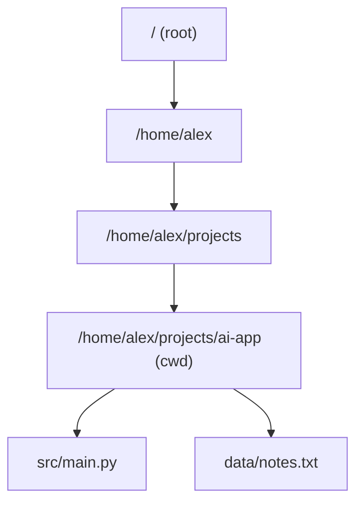

Every Python project lives in a folder on your computer, and the **terminal** is how you talk to that folder directly with text commands. Before you install packages, use Git, or launch an AI server, you need to know where you are, how to move around, and how to run a `.py` file.

## 1. The terminal and your current working directory

When you open a terminal, you are always standing inside one specific folder called the **current working directory** (`cwd`). Every relative command you type starts from there.



There are two ways to name a location:

- **Absolute path:** starts from the top of the drive or filesystem (`/` on macOS/Linux, `C:\Users\...` on Windows). It means the same place no matter where you are standing.
- **Relative path:** starts from your `cwd` (`src/main.py`). Two special shortcuts exist in every folder:
  - `.` means **this current folder**.
  - `..` means **one folder up** (the parent folder).

> [!TIP]
> On Windows PowerShell, paths use `\` (`src\main.py`), while macOS and Linux use `/` (`src/main.py`). Inside Python code, `/` works everywhere — even on Windows.

## 2. Navigating folders: Windows PowerShell vs macOS/Linux

The core ideas are identical across operating systems; only a few command names differ:

| Action | Windows PowerShell | macOS / Linux (`bash` / `zsh`) | Example |
|---|---|---|---|
| Show current folder | `pwd` (or `Get-Location`) | `pwd` | `pwd` |
| List files in folder | `ls` (or `Get-ChildItem`) | `ls` (or `ls -la`) | `ls` |
| Change folder | `cd <folder>` | `cd <folder>` | `cd src` |
| Go up one folder | `cd ..` | `cd ..` | `cd ..` |
| Create a new folder | `mkdir <name>` | `mkdir <name>` | `mkdir data` |
| Clear the screen | `clear` (or `cls`) | `clear` | `clear` |

For example, to move from `ai-app` up to `projects` and check what is inside:

```powershell
pwd
cd ..
ls
```

```bash
pwd
cd ..
ls
```

## 3. Tracing how paths resolve

Suppose your `cwd` is `/home/alex/projects/ai-app` and you want to reach `../shared/config.py`. You can think of resolving a path as keeping a stack of folder names:

```python
cwd_parts = ["home", "alex", "projects", "ai-app"]
steps = ["..", "shared", "config.py"]

stack = list(cwd_parts)
for step in steps:
    if step == "..":
        if stack:
            stack.pop()
    elif step != ".":
        stack.append(step)

resolved = "/" + "/".join(stack)
print(resolved)  # /home/alex/projects/shared/config.py
```

Press **Visualize** on the code block above and watch `stack` shrink when it hits `".."` and grow as `"shared"` and `"config.py"` are added.

| Step | Action on `stack` | `stack` after step |
|---|---|---|
| `".."` | pop `"ai-app"` | `["home", "alex", "projects"]` |
| `"shared"` | append `"shared"` | `["home", "alex", "projects", "shared"]` |
| `"config.py"` | append `"config.py"` | `["home", "alex", "projects", "shared", "config.py"]` |

## 4. Running a Python file and passing arguments

Once your terminal is inside the project folder, you run a script with `python` (or `uv run python` when using `uv`):

```bash
python hello.py
python summarize.py --model mini --limit 5
```

Everything after `python` is passed to your script as a list of strings called **command-line arguments** (`sys.argv`). The first item (`argv[0]`) is always the script name, and the rest are your arguments:

```python
command = "python summarize.py --model mini"
tokens = command.split()

program = tokens[0]
script = tokens[1]
flags = tokens[2:]

print(f"Program: {program}, Script: {script}, Flags: {flags}")
```

## 5. Exit codes: did it succeed?

When any terminal command or Python script finishes, it hands back an integer **exit code** to the shell:

- **`0`** means **success** — no errors occurred.
- **Non-zero** (such as `1` or `2`) means **something failed** (file not found, syntax error, bad argument).

> [!NOTE]
> Tools like `uv`, `git`, and CI pipelines read exit codes to decide whether to continue or stop.

## 6. Common mistakes

**Running `cd` on a file instead of a folder.** `cd main.py` fails because `cd` only enters directories. Use `cd src` to enter the folder, then `python main.py`.

**Spaces in folder names without quotes.** `cd my project` passes two separate words to `cd`. Wrap names with spaces in quotes: `cd "my project"`.

**Running Python from the wrong `cwd`.** If `main.py` lives in `src/`, running `python main.py` from the parent folder raises `can't open file ... No such file or directory`. Either `cd src` first or pass the relative path `python src/main.py`.

**Too many `..` segments.** Going up past `/` cannot go higher than root — the path clamps at `/`.

## Recap

- Your terminal always has a **current working directory** (`cwd`); check it with `pwd` and list its contents with `ls`.
- **Absolute paths** start from root (`/` or `C:\`); **relative paths** start from `cwd` using `.` (here) and `..` (parent).
- Run scripts with `python script.py [args...]` (or `uv run python script.py`); arguments arrive as strings.
- Exit code `0` means success; any non-zero exit code means an error.

## Take it further

In the next lesson you will use `uv` to create isolated Python environments so every project keeps its own packages cleanly separated.
