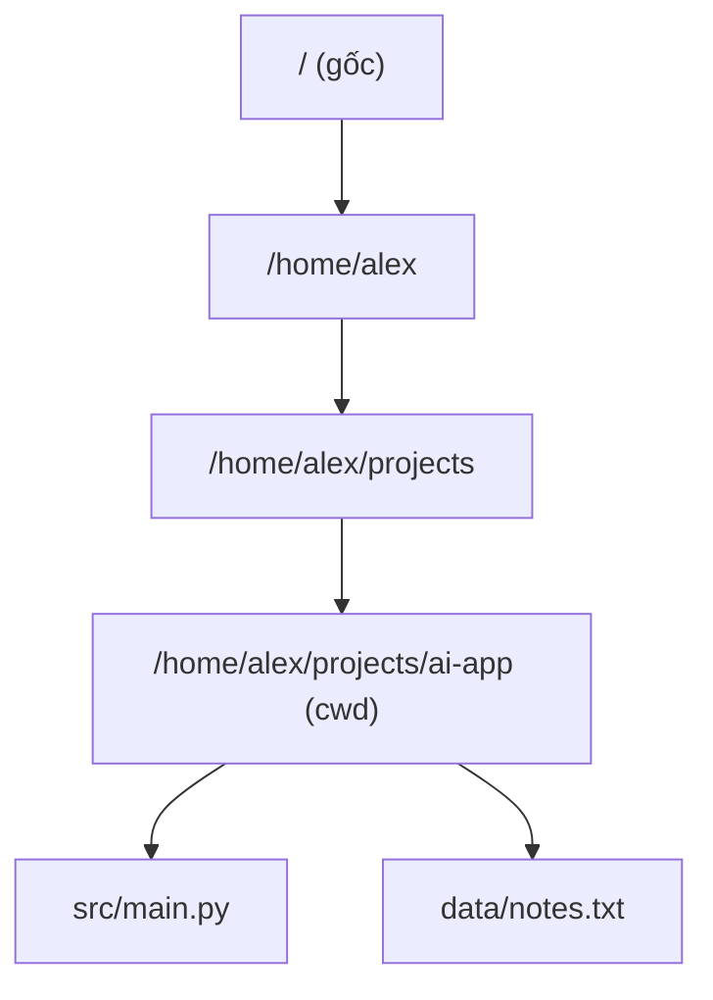

Mỗi dự án Python đều nằm trong một thư mục trên máy tính của bạn, và **terminal** (cửa sổ dòng lệnh) là cách bạn giao tiếp trực tiếp với thư mục đó bằng các lệnh văn bản. Trước khi cài thư viện, dùng Git hay chạy một AI server, bạn cần biết mình đang đứng ở đâu, cách di chuyển giữa các thư mục và cách chạy một file `.py`.

## 1. Terminal và thư mục làm việc hiện tại

Khi mở terminal, bạn luôn đứng bên trong một thư mục cụ thể gọi là **thư mục làm việc hiện tại** (`cwd` — current working directory). Mọi lệnh dùng đường dẫn tương đối đều tính từ đây.



Có hai cách gọi tên một vị trí:

- **Đường dẫn tuyệt đối (absolute path):** bắt đầu từ đỉnh ổ đĩa hoặc hệ thống file (`/` trên macOS/Linux, `C:\Users\...` trên Windows). Nó luôn chỉ cùng một chỗ bất kể bạn đang đứng ở đâu.
- **Đường dẫn tương đối (relative path):** bắt đầu từ `cwd` của bạn (`src/main.py`). Có hai ký hiệu đặc biệt trong mọi thư mục:
  - `.` nghĩa là **thư mục hiện tại này**.
  - `..` nghĩa là **lùi lên một thư mục** (thư mục cha).

> [!TIP]
> Trên Windows PowerShell, đường dẫn dùng `\` (`src\main.py`), còn macOS và Linux dùng `/` (`src/main.py`). Bên trong code Python, `/` hoạt động ở mọi hệ điều hành — kể cả Windows.

## 2. Di chuyển thư mục: Windows PowerShell và macOS/Linux

Ý tưởng cốt lõi giống hệt nhau trên mọi hệ điều hành; chỉ một vài tên lệnh khác nhau:

| Thao tác | Windows PowerShell | macOS / Linux (`bash` / `zsh`) | Ví dụ |
|---|---|---|---|
| Xem thư mục hiện tại | `pwd` (hoặc `Get-Location`) | `pwd` | `pwd` |
| Liệt kê file trong thư mục | `ls` (hoặc `Get-ChildItem`) | `ls` (hoặc `ls -la`) | `ls` |
| Chuyển thư mục | `cd <thư mục>` | `cd <thư mục>` | `cd src` |
| Lùi lên một thư mục | `cd ..` | `cd ..` | `cd ..` |
| Tạo thư mục mới | `mkdir <tên>` | `mkdir <tên>` | `mkdir data` |
| Xóa màn hình | `clear` (hoặc `cls`) | `clear` | `clear` |

Ví dụ, để đi từ `ai-app` lên `projects` và xem bên trong có gì:

```powershell
pwd
cd ..
ls
```

```bash
pwd
cd ..
ls
```

## 3. Theo dõi cách phân giải đường dẫn

Giả sử `cwd` của bạn là `/home/alex/projects/ai-app` và bạn muốn đi tới `../shared/config.py`. Bạn có thể hình dung việc phân giải đường dẫn giống như giữ một ngăn xếp (stack) các tên thư mục:

```python
cwd_parts = ["home", "alex", "projects", "ai-app"]
steps = ["..", "shared", "config.py"]

stack = list(cwd_parts)
for step in steps:
    if step == "..":
        if stack:
            stack.pop()
    elif step != ".":
        stack.append(step)

resolved = "/" + "/".join(stack)
print(resolved)  # /home/alex/projects/shared/config.py
```

Bấm **Visualize** ở khối code phía trên để xem `stack` thu gọn khi gặp `".."` và dài ra khi thêm `"shared"` và `"config.py"`.

| Bước | Thao tác trên `stack` | `stack` sau bước |
|---|---|---|
| `".."` | lấy `"ai-app"` ra | `["home", "alex", "projects"]` |
| `"shared"` | thêm `"shared"` | `["home", "alex", "projects", "shared"]` |
| `"config.py"` | thêm `"config.py"` | `["home", "alex", "projects", "shared", "config.py"]` |

## 4. Chạy file Python và truyền tham số dòng lệnh

Khi terminal đã ở trong thư mục dự án, bạn chạy script bằng `python` (hoặc `uv run python` khi dùng `uv`):

```bash
python hello.py
python summarize.py --model mini --limit 5
```

Mọi thứ đứng sau `python` được truyền vào script dưới dạng một danh sách chuỗi gọi là **tham số dòng lệnh** (command-line arguments — `sys.argv`). Phần tử đầu tiên (`argv[0]`) luôn là tên script, phần còn lại là các tham số của bạn:

```python
command = "python summarize.py --model mini"
tokens = command.split()

program = tokens[0]
script = tokens[1]
flags = tokens[2:]

print(f"Program: {program}, Script: {script}, Flags: {flags}")
```

## 5. Mã thoát (exit code): lệnh chạy thành công hay lỗi?

Khi một lệnh terminal hay script Python chạy xong, nó trả về một số nguyên gọi là **exit code** (mã thoát) cho shell:

- **`0`** nghĩa là **thành công** — không có lỗi xảy ra.
- **Khác 0** (như `1` hoặc `2`) nghĩa là **đã có lỗi** (không tìm thấy file, lỗi cú pháp, tham số sai).

> [!NOTE]
> Các công cụ như `uv`, `git` và hệ thống CI đọc exit code để quyết định chạy tiếp hay dừng lại.

## 6. Lỗi thường gặp

**Dùng `cd` với tên file thay vì thư mục.** `cd main.py` sẽ báo lỗi vì `cd` chỉ đi vào thư mục. Hãy dùng `cd src` để vào thư mục, rồi chạy `python main.py`.

**Tên thư mục có dấu cách nhưng thiếu dấu ngoặc kép.** `cd my project` truyền hai từ rời nhau cho `cd`. Hãy bọc tên có dấu cách trong dấu ngoặc kép: `cd "my project"`.

**Chạy Python từ sai `cwd`.** Nếu `main.py` nằm trong `src/`, chạy `python main.py` từ thư mục cha sẽ báo `can't open file ... No such file or directory`. Bạn cần `cd src` trước hoặc truyền đường dẫn tương đối `python src/main.py`.

**Quá nhiều dấu `..`.** Lùi lên quá `/` không thể cao hơn thư mục gốc — đường dẫn dừng lại ở `/`.

## Tóm tắt

- Terminal luôn có một **thư mục làm việc hiện tại** (`cwd`); kiểm tra bằng `pwd` và liệt kê nội dung bằng `ls`.
- **Đường dẫn tuyệt đối** bắt đầu từ gốc (`/` hoặc `C:\`); **đường dẫn tương đối** tính từ `cwd` với `.` (tại đây) và `..` (thư mục cha).
- Chạy script bằng `python script.py [args...]` (hoặc `uv run python script.py`); các tham số đi vào dưới dạng chuỗi.
- Exit code `0` là thành công; mọi số khác `0` đều báo lỗi.

## Mở rộng

Ở bài học tiếp theo, bạn sẽ dùng `uv` để tạo các môi trường Python cô lập giúp mỗi dự án giữ riêng bộ thư viện của mình một cách gọn gàng.
