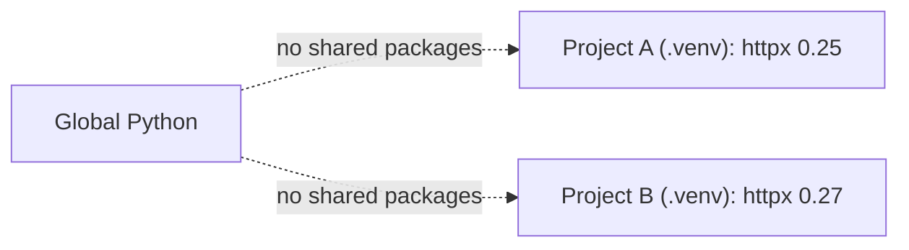

Imagine building two AI projects on the same laptop: a chatbot that needs `httpx==0.25.0`, and an evaluation script that requires `httpx==0.27.0`. If you install packages into one global Python folder, upgrading for the second project breaks the first. **Virtual environments** and **uv** solve this cleanly.

## 1. Why virtual environments exist

A **virtual environment** (often shortened to **venv**) is a self-contained folder—usually `.venv/` inside your project—that holds its own Python interpreter and installed packages. Project A and Project B never interfere with each other.



Let us model that isolation in Python using dictionaries—each project maps package names to installed versions:

```python
envs = {
    "chatbot": {"httpx": "0.25.0", "pydantic": "2.6.0"},
    "evals": {"httpx": "0.27.0", "pytest": "8.2.0"},
}
print("chatbot httpx:", envs["chatbot"]["httpx"])  # 0.25.0
print("evals httpx:", envs["evals"]["httpx"])      # 0.27.0
```

Press **Visualize** on the block above to see how the two environment dictionaries stay completely separate in memory.

> [!NOTE]
> Never commit `.venv/` to Git. It is large, OS-specific, and can be recreated in seconds from `pyproject.toml` and `uv.lock`. Add `.venv/` to `.gitignore`.

## 2. Creating and managing a project with `uv`

`uv` is a fast, all-in-one Python package and project manager. Instead of juggling `python -m venv`, `pip install`, and `pip freeze`, you use four core commands in your terminal:

```bash
uv init my-ai-app
cd my-ai-app
uv add httpx pydantic
uv run python main.py
```

On Windows PowerShell, the exact same `uv` commands work without changes:

```powershell
uv init my-ai-app
cd my-ai-app
uv add httpx pydantic
uv run python main.py
```

| Command | What it does | Files touched |
|---|---|---|
| `uv init <name>` | Creates a new project skeleton | `pyproject.toml`, `.python-version`, `main.py` |
| `uv add <pkg>` | Installs a package into `.venv/` and records it | `pyproject.toml`, `uv.lock`, `.venv/` |
| `uv sync` | Installs exact locked versions into `.venv/` | `.venv/` |
| `uv run python <file>` | Runs Python inside `.venv/` automatically | None |

> [!TIP]
> With `uv run python script.py`, you do not even need to manually run `activate` in your terminal—`uv` automatically uses the project's `.venv/`.

## 3. `pyproject.toml` vs `uv.lock`

When you run `uv add`, `uv` updates two files:

1. **`pyproject.toml`** — Your *human-edited* project manifest. It lists flexible version constraints you care about (for example `"httpx>=0.27.0"`).
2. **`uv.lock`** — Your *machine-generated* lockfile. It pins the exact resolved version of every direct and indirect package so teammates get identical environments via `uv sync`.

```toml
[project]
name = "my-ai-app"
version = "0.1.0"
requires-python = ">=3.11"
dependencies = [
    "httpx>=0.27.0",
    "pydantic>=2.6.0",
]
```

| Aspect | `pyproject.toml` | `uv.lock` |
|---|---|---|
| Written by | You (or `uv init` / `uv add`) | `uv` automatically |
| Version format | Ranges (`>=0.27.0`) | Exact pins (`0.27.2`) |
| Commit to Git? | Yes | Yes |
| Edit by hand? | Yes | Never |

## 4. Reading `pyproject.toml` with Python's `tomllib`

Since Python 3.11, the standard library includes `tomllib` to parse TOML files without installing any third-party package:

```python
import tomllib

toml_text = """
[project]
name = "my-ai-app"
dependencies = ["httpx>=0.27.0", "pydantic>=2.6.0"]
"""

data = tomllib.loads(toml_text)
deps = data["project"]["dependencies"]
print(data["project"]["name"])  # my-ai-app
print(len(deps), deps[0])       # 2 httpx>=0.27.0
```

Each entry in `dependencies` is a string combining a package name and an optional version specifier (`>=`, `==`, `<=`, `~=`, `!=`, `>`, `<`). Note that package names on PyPI are **case-insensitive** (`PyYAML` and `pyyaml` refer to the same package).

## 5. Common mistakes

- **Running `python` instead of `uv run python`.** Bare `python` may point to the global interpreter, which raises `ModuleNotFoundError` for packages installed in `.venv/`.
- **Editing `uv.lock` by hand.** Always use `uv add`, `uv remove`, or `uv lock --upgrade` so hashes and transitive dependencies stay valid.
- **Committing `.venv/` to Git.** Always keep `.venv/` in `.gitignore` and share `pyproject.toml` + `uv.lock` instead.
- **Assuming package names are case-sensitive.** Comparing `"PyYAML"` against `"pyyaml"` without `.lower()` can falsely report a missing dependency.

> [!WARNING]
> If you clone a repo that already has `pyproject.toml` and `uv.lock`, run `uv sync` before running any scripts so `.venv/` matches the lockfile.

## Recap

- **Virtual environments** (`.venv/`) isolate each project's Python interpreter and packages so projects never conflict.
- **`uv init`**, **`uv add`**, **`uv sync`**, and **`uv run`** handle project creation, dependency installation, locking, and execution.
- **`pyproject.toml`** stores human-readable dependency ranges; **`uv.lock`** pins exact versions for reproducible builds. Both belong in Git; `.venv/` does not.
- Python 3.11+ includes **`tomllib`** in the standard library to parse `pyproject.toml` into dictionaries and lists.

## Take it further

- Practice reading `[project].dependencies` with `tomllib` and checking virtual environment dictionaries in the two exercises below.
- Next lesson: **Git essentials** (`p0-03-git`), where you will learn how to track `pyproject.toml` and `uv.lock` while ignoring `.venv/`.
