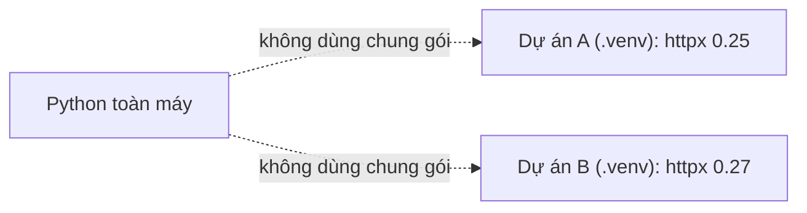

Hãy tưởng tượng bạn làm hai dự án AI trên cùng một máy tính: một chatbot cần `httpx==0.25.0`, và một script đánh giá (evaluation) đòi hỏi `httpx==0.27.0`. Nếu bạn cài mọi thư viện vào một thư mục Python dùng chung toàn máy, nâng cấp cho dự án thứ hai sẽ làm hỏng dự án đầu tiên. **Virtual environment (môi trường ảo)** và **uv** giải quyết triệt để vấn đề này.

## 1. Vì sao cần môi trường ảo

**Virtual environment** (thường gọi tắt là **venv**) là một thư mục độc lập—thường là `.venv/` nằm ngay trong thư mục dự án—chứa bộ thông dịch (interpreter) Python và các gói cài đặt riêng. Dự án A và Dự án B không bao giờ xung đột với nhau.



Hãy mô phỏng sự cô lập đó bằng dictionary trong Python—mỗi dự án ánh xạ tên gói tới phiên bản đã cài:

```python
envs = {
    "chatbot": {"httpx": "0.25.0", "pydantic": "2.6.0"},
    "evals": {"httpx": "0.27.0", "pytest": "8.2.0"},
}
print("chatbot httpx:", envs["chatbot"]["httpx"])  # 0.25.0
print("evals httpx:", envs["evals"]["httpx"])      # 0.27.0
```

Hãy bấm **Visualize** ở khối code trên để xem hai dictionary môi trường nằm tách biệt hoàn toàn trong bộ nhớ.

> [!NOTE]
> Không bao giờ commit thư mục `.venv/` lên Git. Nó rất nặng, phụ thuộc hệ điều hành, và có thể tạo lại trong vài giây từ `pyproject.toml` và `uv.lock`. Hãy thêm `.venv/` vào `.gitignore`.

## 2. Tạo và quản lý dự án bằng `uv`

`uv` là công cụ quản lý gói (package) và dự án (project) Python tốc độ cao, tích hợp mọi bước vào một nơi. Thay vì phải nhớ rời rạc `python -m venv`, `pip install`, và `pip freeze`, bạn chỉ cần bốn lệnh cốt lõi trong terminal:

```bash
uv init my-ai-app
cd my-ai-app
uv add httpx pydantic
uv run python main.py
```

Trên Windows PowerShell, các lệnh `uv` hoạt động giống hệt nhau:

```powershell
uv init my-ai-app
cd my-ai-app
uv add httpx pydantic
uv run python main.py
```

| Lệnh | Tác dụng | File bị thay đổi |
|---|---|---|
| `uv init <tên>` | Tạo khung dự án mới | `pyproject.toml`, `.python-version`, `main.py` |
| `uv add <gói>` | Cài gói vào `.venv/` và ghi nhận dependency | `pyproject.toml`, `uv.lock`, `.venv/` |
| `uv sync` | Cài đúng các phiên bản đã khóa vào `.venv/` | `.venv/` |
| `uv run python <file>` | Tự động chạy Python bên trong `.venv/` | Không |

> [!TIP]
> Với `uv run python script.py`, bạn thậm chí không cần gõ lệnh `activate` thủ công trong terminal—`uv` tự động dùng đúng `.venv/` của dự án.

## 3. `pyproject.toml` và `uv.lock`

Khi bạn chạy `uv add`, `uv` cập nhật hai tệp quan trọng:

1. **`pyproject.toml`** — Tệp kê khai dự án (project manifest) *do người viết*. Nó liệt kê các ràng buộc phiên bản linh hoạt mà bạn cần (ví dụ `"httpx>=0.27.0"`).
2. **`uv.lock`** — **Lockfile (tệp khóa phiên bản)** *do máy sinh ra*. Nó ghim chính xác phiên bản của từng gói trực tiếp lẫn gián tiếp để đồng đội tái tạo môi trường y hệt bằng `uv sync`.

```toml
[project]
name = "my-ai-app"
version = "0.1.0"
requires-python = ">=3.11"
dependencies = [
    "httpx>=0.27.0",
    "pydantic>=2.6.0",
]
```

| Tiêu chí | `pyproject.toml` | `uv.lock` |
|---|---|---|
| Ai tạo/cập nhật | Bạn (hoặc `uv init` / `uv add`) | `uv` tự động |
| Định dạng phiên bản | Khoảng phiên bản (`>=0.27.0`) | Phiên bản cố định (`0.27.2`) |
| Commit lên Git? | Có | Có |
| Sửa bằng tay? | Có | Không bao giờ |

## 4. Đọc `pyproject.toml` bằng `tomllib` của Python

Từ Python 3.11, thư viện chuẩn (standard library) có sẵn module `tomllib` giúp đọc tệp TOML mà không cần cài thêm thư viện ngoài:

```python
import tomllib

toml_text = """
[project]
name = "my-ai-app"
dependencies = ["httpx>=0.27.0", "pydantic>=2.6.0"]
"""

data = tomllib.loads(toml_text)
deps = data["project"]["dependencies"]
print(data["project"]["name"])  # my-ai-app
print(len(deps), deps[0])       # 2 httpx>=0.27.0
```

Mỗi phần tử trong `dependencies` là một chuỗi gồm tên gói và bộ chỉ định phiên bản tùy chọn (`>=`, `==`, `<=`, `~=`, `!=`, `>`, `<`). Lưu ý rằng tên gói trên PyPI **không phân biệt hoa thường** (`PyYAML` và `pyyaml` là cùng một gói).

## 5. Lỗi thường gặp

- **Gõ `python` thay vì `uv run python`.** Lệnh `python` trần có thể trỏ vào Python toàn máy, gây lỗi `ModuleNotFoundError` dù bạn đã cài gói trong `.venv/`.
- **Sửa `uv.lock` bằng tay.** Luôn dùng `uv add`, `uv remove`, hoặc `uv lock --upgrade` để mã băm (hash) và các gói phụ thuộc bắc cầu luôn khớp.
- **Commit `.venv/` lên Git.** Luôn giữ `.venv/` trong `.gitignore` và chỉ chia sẻ `pyproject.toml` cùng `uv.lock`.
- **Quên chuẩn hóa chữ hoa/thường khi so sánh tên gói.** So sánh `"PyYAML"` với `"pyyaml"` mà không dùng `.lower()` có thể báo nhầm là thiếu gói.

> [!WARNING]
> Khi bạn clone một repo đã có sẵn `pyproject.toml` và `uv.lock`, hãy chạy `uv sync` trước khi chạy bất kỳ script nào để `.venv/` khớp với lockfile.

## Tóm tắt

- **Môi trường ảo** (`.venv/`) cô lập Python và các gói của từng dự án để chúng không xung đột nhau.
- **`uv init`**, **`uv add`**, **`uv sync`**, và **`uv run`** đảm nhận tạo dự án, cài đặt, khóa phiên bản và chạy code.
- **`pyproject.toml`** lưu khoảng phiên bản dễ đọc; **`uv.lock`** ghim phiên bản chính xác để tái tạo môi trường. Cả hai đều đưa lên Git; `.venv/` thì không.
- Python 3.11+ tích hợp sẵn **`tomllib`** trong thư viện chuẩn để phân tích `pyproject.toml` thành dictionary và list.

## Đi xa hơn

- Thực hành đọc `[project].dependencies` bằng `tomllib` và kiểm tra dictionary môi trường ảo trong hai bài tập bên dưới.
- Bài tiếp theo: **Git căn bản** (`p0-03-git`), nơi bạn sẽ học cách theo dõi `pyproject.toml` và `uv.lock` trong khi bỏ qua `.venv/`.
