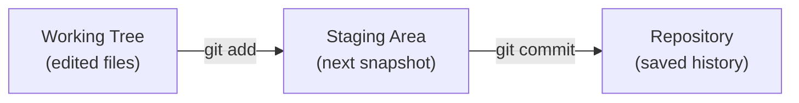
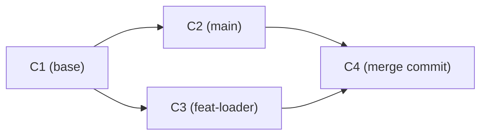

When you build a Python or AI project, you constantly edit files, test experiments, and tweak prompts or hyperparameters. Without version control, one broken edit can wipe out hours of working code. **Git** solves this by taking snapshots of your project so you can experiment safely, compare changes, and collaborate on **GitHub**.

## 1. Git's three areas

Git does not save changes automatically like a cloud drive. Instead, your files move through three distinct areas:



- **Working Tree:** the actual folder on your disk where you create and edit files.
- **Staging Area (Index):** a checklist of exact changes you want to include in your next snapshot.
- **Repository (`.git/`):** the permanent history of committed snapshots.

Why have a Staging Area in the middle? Because you often edit three files while fixing a bug, yet only two belong in the current commit. Staging lets you craft clean, focused snapshots.

We can model these three areas in Python using dictionaries (`dict[str, str]`) that map each file path to its content:

```python
committed = {"app.py": "print('v1')"}
staged = {"app.py": "print('v1')"}
working = {"app.py": "print('v2')", "notes.txt": "todo"}

staged["app.py"] = working["app.py"]  # git add app.py
committed = dict(staged)              # git commit
print("Committed:", committed)
print("Untracked:", [p for p in working if p not in staged])
```

Press **Visualize** on the code block above and watch how `staged` copies the change from `working` before `committed` records the new snapshot.

## 2. Core daily commands

Once you have a project folder, you initialize Git once and repeat the `status → add → commit` loop:

```bash
git init
git status
git add app.py
git commit -m "Add initial app entry point"
git log --oneline
```

On Windows PowerShell and macOS/Linux Terminal, these `git` commands are identical.

| Command | Area transition | What it does |
|---|---|---|
| `git init` | — | Creates `.git/` in the current folder |
| `git status` | Working ↔ Staging ↔ Repo | Shows untracked, modified, and staged files |
| `git add <file>` | Working → Staging | Copies file changes into the Staging Area |
| `git commit -m "..."` | Staging → Repository | Saves a permanent snapshot with a message |
| `git log --oneline` | Repository | Lists commit history compactly |

> [!TIP]
> Write commit messages in the imperative mood (e.g., `"Add user loader"`, not `"Added user loader"`), keep the subject line at most 72 characters, and skip the trailing period.

## 3. `.gitignore` hygiene

Not every file in your folder belongs in Git history. Virtual environments (`.venv/`), caches (`__pycache__/`), and secret keys (`.env`) should **never** be committed. Create a `.gitignore` file in your project root:

```text
.venv/
__pycache__/
*.pyc
.env
```

If `.env` (containing an API key) is committed even once, it stays in `.git/` history even after you delete the file later. Always create `.gitignore` before your first `git add .`.

## 4. Branching and merging

A **branch** is a lightweight movable label pointing to a commit. Creating a branch lets you build a new feature without breaking `main`:

```bash
git switch -c feat-loader
# edit files, then git add & git commit
git switch main
git merge feat-loader
```



There are two common merge outcomes:
1. **Fast-forward merge:** `main` had no new commits since you branched, so Git simply moves the `main` label forward.
2. **Three-way merge:** Both `main` and `feat-loader` have new commits, so Git compares both against their common ancestor (`base`). If both branches changed the same lines differently, Git pauses with a **merge conflict**:

```text
<<<<<<< HEAD
timeout = 30
=======
timeout = 60
>>>>>>> feat-loader
```

To resolve a conflict, edit the file to keep the correct code (removing the `<<<<<<<`, `=======`, and `>>>>>>>` markers), then run `git add <file>` and `git commit`.

## 5. Syncing with GitHub

Your local repository lives on your machine; **GitHub** hosts a remote copy (usually named `origin`):

```bash
git remote add origin https://github.com/yourname/your-repo.git
git push -u origin main
git pull origin main
```

- `git push -u origin main` uploads your local `main` commits and links `main` to `origin/main`.
- `git pull` fetches remote commits and merges them into your current branch. Always `git pull` before starting work if you collaborate or switch machines.

## 6. Common mistakes

**Running `git add .` without `.gitignore`.** This stages `.venv/` (thousands of files) and `.env` secrets. Check `git status` before `git add`.

**Forgetting to stage edits before `git commit`.** Editing a file in the Working Tree does not update the Staging Area. If `git commit` says `"nothing to commit"`, run `git add <file>` first.

**Leaving conflict markers in code.** Python will raise a `SyntaxError` on `<<<<<<< HEAD`. Always search for `<<<<<<<` after resolving a merge conflict.

> [!WARNING]
> Never commit `.env` or API keys to a public GitHub repository. Once pushed, bots scan public commits within seconds.

## Recap

- Git tracks changes across three areas: **Working Tree** → (`git add`) → **Staging Area** → (`git commit`) → **Repository**.
- Use `.gitignore` to exclude `.venv/`, `__pycache__/`, and `.env` from version control.
- Use `git switch -c <branch>` for isolated work and `git merge <branch>` to combine changes.
- Three-way merges compare `base`, `main`, and `feature`; conflicting edits require manual resolution.
- Sync with GitHub using `git push` and `git pull`.

## Take it further

- Practice reading `git diff` (Working vs Staging) and `git diff --staged` (Staging vs Repository) before every commit.
- Explore Pull Requests on GitHub to review branch diffs before merging into `main`.
