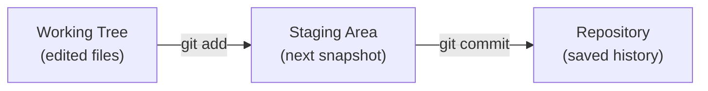
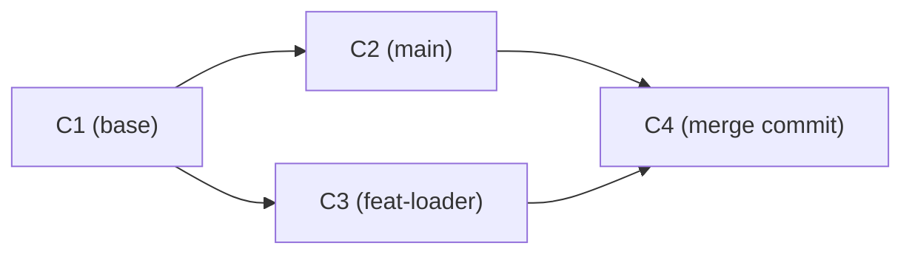

Khi xây dựng một dự án Python hay AI, bạn liên tục chỉnh sửa file, thử nghiệm và tinh chỉnh prompt hoặc siêu tham số. Nếu không có quản lý phiên bản (version control), chỉ một lần sửa lỗi có thể làm mất nhiều giờ code đang chạy tốt. **Git** giải quyết vấn đề này bằng cách chụp lại các bản lưu (snapshot) của dự án để bạn thử nghiệm an toàn, so sánh thay đổi và cộng tác trên **GitHub**.

## 1. Ba vùng của Git

Git không tự động lưu thay đổi như ổ đĩa đám mây. Thay vào đó, các file của bạn đi qua ba vùng tách biệt:



- **Working Tree (cây thư mục làm việc):** thư mục thật trên ổ đĩa nơi bạn tạo và chỉnh sửa file.
- **Staging Area / Index (vùng chờ):** danh sách kiểm tra các thay đổi chính xác mà bạn muốn đưa vào bản lưu tiếp theo.
- **Repository (kho lưu trữ, `.git/`):** lịch sử vĩnh viễn của các bản lưu đã commit.

Vì sao cần có Staging Area ở giữa? Bởi vì bạn thường sửa ba file khi vá lỗi, nhưng chỉ hai file thuộc về commit hiện tại. Staging giúp bạn tạo ra các bản lưu gọn gàng, đúng trọng tâm.

Bạn có thể mô hình hóa ba vùng này trong Python bằng dictionary (`dict[str, str]`) ánh xạ đường dẫn file tới nội dung của nó:

```python
committed = {"app.py": "print('v1')"}
staged = {"app.py": "print('v1')"}
working = {"app.py": "print('v2')", "notes.txt": "todo"}

staged["app.py"] = working["app.py"]  # git add app.py
committed = dict(staged)              # git commit
print("Committed:", committed)
print("Untracked:", [p for p in working if p not in staged])
```

Bấm **Visualize** trên khối code phía trên để quan sát cách `staged` chép thay đổi từ `working` trước khi `committed` ghi nhận bản lưu mới.

## 2. Các lệnh cốt lõi hằng ngày

Khi đã có thư mục dự án, bạn khởi tạo Git một lần và lặp lại vòng lặp `status → add → commit`:

```bash
git init
git status
git add app.py
git commit -m "Add initial app entry point"
git log --oneline
```

Trên Windows PowerShell cũng như macOS/Linux Terminal, các lệnh `git` này giống hệt nhau.

| Lệnh | Chuyển vùng | Tác dụng |
|---|---|---|
| `git init` | — | Tạo `.git/` trong thư mục hiện tại |
| `git status` | Working ↔ Staging ↔ Repo | Hiện file chưa theo dõi, đã sửa và đã stage |
| `git add <file>` | Working → Staging | Chép thay đổi của file vào Staging Area |
| `git commit -m "..."` | Staging → Repository | Lưu bản chụp vĩnh viễn kèm thông điệp |
| `git log --oneline` | Repository | Liệt kê lịch sử commit gọn nhẹ |

> [!TIP]
> Viết commit message ở dạng mệnh lệnh (ví dụ `"Add user loader"`, không phải `"Added user loader"`), giữ dòng tiêu đề tối đa 72 ký tự và không đặt dấu chấm ở cuối.

## 3. Vệ sinh `.gitignore`

Không phải file nào trong thư mục cũng thuộc về lịch sử Git. Môi trường ảo (`.venv/`), bộ nhớ đệm (`__pycache__/`) và khóa bí mật (`.env`) **không bao giờ** được phép commit. Hãy tạo file `.gitignore` ở thư mục gốc dự án:

```text
.venv/
__pycache__/
*.pyc
.env
```

Nếu `.env` (chứa API key) bị commit dù chỉ một lần, nó vẫn nằm trong lịch sử `.git/` ngay cả khi bạn xóa file đó về sau. Luôn tạo `.gitignore` trước lần `git add .` đầu tiên.

## 4. Tạo nhánh (branch) và gộp nhánh (merge)

Một **branch (nhánh)** là một nhãn di chuyển nhẹ trỏ tới một commit. Tạo nhánh giúp bạn phát triển tính năng mới mà không làm hỏng `main`:

```bash
git switch -c feat-loader
# edit files, then git add & git commit
git switch main
git merge feat-loader
```



Có hai kết quả gộp nhánh thường gặp:
1. **Fast-forward merge (gộp chuyển tiếp nhanh):** `main` chưa có commit mới kể từ lúc bạn tách nhánh, nên Git chỉ cần dời nhãn `main` tiến lên.
2. **Three-way merge (gộp ba chiều):** Cả `main` và `feat-loader` đều có commit mới, nên Git so sánh cả hai với tổ tiên chung (`base`). Nếu cả hai nhánh sửa cùng một dòng theo cách khác nhau, Git sẽ tạm dừng với **merge conflict (xung đột gộp nhánh)**:

```text
<<<<<<< HEAD
timeout = 30
=======
timeout = 60
>>>>>>> feat-loader
```

Để giải quyết xung đột, bạn sửa file để giữ lại đoạn code đúng (xóa các dấu `<<<<<<<`, `=======` và `>>>>>>>`), rồi chạy `git add <file>` và `git commit`.

## 5. Đồng bộ với GitHub

Kho lưu trữ cục bộ nằm trên máy của bạn; **GitHub** lưu bản sao từ xa (remote, thường đặt tên là `origin`):

```bash
git remote add origin https://github.com/yourname/your-repo.git
git push -u origin main
git pull origin main
```

- `git push -u origin main` tải các commit ở `main` cục bộ lên và liên kết `main` với `origin/main`.
- `git pull` lấy các commit từ xa về và gộp vào nhánh hiện tại. Luôn chạy `git pull` trước khi bắt đầu làm việc nếu bạn cộng tác nhóm hoặc đổi máy.

## 6. Lỗi thường gặp

**Chạy `git add .` khi chưa có `.gitignore`.** Thao tác này đưa cả `.venv/` (hàng nghìn file) và bí mật trong `.env` vào vùng chờ. Hãy kiểm tra `git status` trước khi `git add`.

**Quên stage chỉnh sửa trước khi `git commit`.** Sửa file trong Working Tree không tự cập nhật Staging Area. Nếu `git commit` báo `"nothing to commit"`, hãy chạy `git add <file>` trước.

**Để sót dấu xung đột trong code.** Python sẽ báo `SyntaxError` ở dòng `<<<<<<< HEAD`. Luôn tìm chuỗi `<<<<<<<` sau khi xử lý xung đột gộp nhánh.

> [!WARNING]
> Không bao giờ commit `.env` hay API key lên repository GitHub công khai. Khi đã đẩy lên, bot tự động sẽ quét các commit công khai chỉ trong vài giây.

## Tóm tắt

- Git theo dõi thay đổi qua ba vùng: **Working Tree** → (`git add`) → **Staging Area** → (`git commit`) → **Repository**.
- Dùng `.gitignore` để loại trừ `.venv/`, `__pycache__/` và `.env` khỏi quản lý phiên bản.
- Dùng `git switch -c <branch>` để làm việc cô lập và `git merge <branch>` để gộp thay đổi.
- Gộp ba chiều so sánh `base`, `main` và `feature`; các chỉnh sửa xung đột cần được xử lý thủ công.
- Đồng bộ với GitHub bằng `git push` và `git pull`.

## Mở rộng

- Tập đọc `git diff` (Working so với Staging) và `git diff --staged` (Staging so với Repository) trước mỗi lần commit.
- Tìm hiểu Pull Request trên GitHub để rà soát khác biệt của nhánh trước khi gộp vào `main`.
