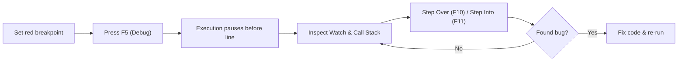

Writing Python in a plain text editor works until you hit an import error from the wrong environment or a silent logic bug inside a loop. **VS Code** turns those guesses into direct visual checks: it points at your `.venv` interpreter, formats code on save with Ruff, runs `pytest` from the sidebar, and pauses execution mid-loop so you can inspect every variable.

## 1. Selecting the `.venv` interpreter

When you open a project created with `uv`, VS Code needs to know **which** Python executable should run your files and power autocomplete. That executable is called the **interpreter**.

If VS Code picks your global system Python instead of `.venv`, third-party packages installed with `uv add` will show `ModuleNotFoundError` even though `uv run python` works in the terminal.

| OS | Interpreter path inside your project |
|---|---|
| Windows | `.venv\Scripts\python.exe` |
| macOS / Linux | `.venv/bin/python` |

To select it in VS Code:
1. Open the Command Palette (`Ctrl+Shift+P` on Windows/Linux, `Cmd+Shift+P` on macOS).
2. Type `Python: Select Interpreter` and press `Enter`.
3. Choose the entry labelled `.venv` (matching your project folder).

Check the bottom-right status bar: it should display the Python version followed by `('.venv': venv)`.

## 2. Configuring `.vscode/settings.json`

Team projects store shared editor rules in `.vscode/settings.json` so everyone formats code the same way. For Python, **Ruff** handles both linting (catching mistakes) and formatting (consistent spacing and quotes) when you save a file.

```json
{
  "python.defaultInterpreterPath": ".venv/bin/python",
  "editor.formatOnSave": true,
  "ruff.lineLength": 100,
  "[python]": {
    "editor.defaultFormatter": "charliermarsh.ruff"
  }
}
```

Because `.vscode/settings.json` is plain JSON, you can also inspect or generate it with Python's built-in `json` module:

```python
import json

raw = '{"editor.formatOnSave": true, "ruff.lineLength": 100}'
config = json.loads(raw)
print(config["ruff.lineLength"])  # 100
print(json.dumps(config, indent=2))
```

> [!TIP]
> On Windows, `.venv\\Scripts\\python.exe` also works in `python.defaultInterpreterPath`. Avoid committing machine-specific absolute paths like `C:\\Users\\...` so teammates on other operating systems can share the file.

## 3. Running tests from the Testing sidebar

Instead of re-typing `uv run python -m pytest` after every small edit, you can use VS Code's **Testing** sidebar (the flask icon on the left Activity Bar):

1. Click **Configure Python Tests** and select **pytest**.
2. Choose the folder containing your tests (for example, `.` or `tests`).
3. Click the green play icon next to a file or a single `test_*` function to run it, or click the debug icon next to a failing test to step straight into it.

## 4. Using the VS Code debugger

`print()` debugging works for quick checks, but a **debugger** lets you pause a program at any line and look around without editing your code.



Key panels and shortcuts when paused at a **breakpoint** (a red dot you click in the left gutter next to a line number):

| Action / Panel | Shortcut | What it does |
|---|---|---|
| Toggle breakpoint | `F9` | Adds or removes a red pause marker on the current line |
| Start / Continue | `F5` | Runs until the next breakpoint or the end of the program |
| Step Over | `F10` | Runs the current line and moves to the next line in the same function |
| Step Into | `F11` | Enters a function call on the current line to inspect it line by line |
| Variables & Watch | Sidebar | Shows local variables now and lets you track custom expressions |
| Call Stack | Sidebar | Shows the chain of function calls that led to the current line |

Try tracing this short loop by hand, then press **Visualize** on the code block to watch `total` and `n` update at every step—just like stepping with `F10` in VS Code:

```python
scores = [4, 7, 12, 9]
total = 0

for index, value in enumerate(scores):
    total += value
    if value >= 10:
        print(f"hit at index {index}: total={total}")
        break
```

Notice how `total` becomes `4`, then `11`, then `23` at `index = 2` (`value = 12`), and `break` stops the loop before `9` is ever added.

## 5. Common mistakes

- **Wrong interpreter selected.** Running a file works in the terminal with `uv run`, but VS Code underlines imports in yellow. Open `Python: Select Interpreter` and pick `.venv`.
- **Broken JSON syntax in `.vscode/settings.json`.** A trailing comma after the last key or single quotes instead of double quotes makes `json.loads` (and VS Code) reject the settings file.
- **Placing a breakpoint on a blank line or comment.** VS Code skips non-executable lines; place breakpoints on lines that actually run (assignments, `if`, `return`, loops).
- **Using `Step Into` (`F11`) on `print()` or built-ins.** Use `Step Over` (`F10`) to move past standard calls, and save `Step Into` for your own helper functions.

## Recap

- Point VS Code at your project's `.venv` interpreter via `Python: Select Interpreter`.
- Store shared formatting and linting rules in `.vscode/settings.json` with Ruff (`charliermarsh.ruff`) and `editor.formatOnSave`.
- Use the Testing sidebar to run or debug individual `pytest` functions in one click.
- Use breakpoints (`F9`), `F5` (Continue), `F10` (Step Over), `F11` (Step Into), Watch, and Call Stack to inspect bugs without littering code with `print()`.

## Take it further

- Add `"editor.rulers": [100]` to `.vscode/settings.json` so VS Code draws a faint vertical guide at your `ruff.lineLength` limit.
- Try a **conditional breakpoint** in VS Code: right-click a red breakpoint dot and choose **Edit Breakpoint** to pause only when an expression like `index == 5` is `True`.
