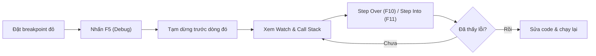

Viết Python trong trình soạn thảo thuần sẽ ổn cho đến khi bạn gặp lỗi import từ sai môi trường hoặc một lỗi logic âm thầm trong vòng lặp. **VS Code** biến những lần phỏng đoán đó thành kiểm tra trực quan: nó trỏ đúng vào interpreter của `.venv`, tự động format code khi lưu bằng Ruff, chạy `pytest` từ thanh bên và tạm dừng chương trình giữa vòng lặp để bạn soi từng biến.

## 1. Chọn interpreter `.venv`

Khi mở một project tạo bằng `uv`, VS Code cần biết **chương trình Python nào** sẽ chạy file và hỗ trợ gợi ý code. Chương trình thực thi đó gọi là **interpreter** (trình thông dịch).

Nếu VS Code chọn Python toàn cục của hệ thống thay vì `.venv`, các thư viện cài qua `uv add` sẽ báo `ModuleNotFoundError` dù `uv run python` vẫn chạy bình thường trong terminal.

| Hệ điều hành | Đường dẫn interpreter trong project |
|---|---|
| Windows | `.venv\Scripts\python.exe` |
| macOS / Linux | `.venv/bin/python` |

Để chọn interpreter trong VS Code:
1. Mở Command Palette (`Ctrl+Shift+P` trên Windows/Linux, `Cmd+Shift+P` trên macOS).
2. Gõ `Python: Select Interpreter` rồi nhấn `Enter`.
3. Chọn mục có nhãn `.venv` (khớp với thư mục project của bạn).

Kiểm tra thanh trạng thái ở góc dưới bên phải: nó phải hiển thị phiên bản Python kèm `('.venv': venv)`.

## 2. Cấu hình `.vscode/settings.json`

Các project nhóm lưu quy tắc soạn thảo chung trong `.vscode/settings.json` để mọi người format code giống nhau. Với Python, **Ruff** đảm nhiệm cả linting (bắt lỗi) lẫn formatting (căn lề và dấu nháy đồng nhất) mỗi khi bạn lưu file.

```json
{
  "python.defaultInterpreterPath": ".venv/bin/python",
  "editor.formatOnSave": true,
  "ruff.lineLength": 100,
  "[python]": {
    "editor.defaultFormatter": "charliermarsh.ruff"
  }
}
```

Vì `.vscode/settings.json` là JSON thuần, bạn cũng có thể đọc hoặc tạo nó bằng module `json` có sẵn của Python:

```python
import json

raw = '{"editor.formatOnSave": true, "ruff.lineLength": 100}'
config = json.loads(raw)
print(config["ruff.lineLength"])  # 100
print(json.dumps(config, indent=2))
```

> [!TIP]
> Trên Windows, `.venv\\Scripts\\python.exe` cũng dùng được trong `python.defaultInterpreterPath`. Tránh đưa đường dẫn tuyệt đối gắn với máy cá nhân như `C:\\Users\\...` để đồng đội dùng hệ điều hành khác vẫn dùng chung file được.

## 3. Chạy test từ thanh Testing

Thay vì gõ lại `uv run python -m pytest` sau mỗi lần sửa nhỏ, bạn có thể dùng thanh **Testing** (biểu tượng bình thí nghiệm ở thanh Activity Bar bên trái):

1. Nhấn **Configure Python Tests** và chọn **pytest**.
2. Chọn thư mục chứa test (ví dụ `.` hoặc `tests`).
3. Nhấn nút play màu xanh cạnh một file hoặc một hàm `test_*` để chạy, hoặc nhấn nút debug cạnh test bị fail để nhảy thẳng vào gỡ lỗi.

## 4. Dùng debugger của VS Code

Debug bằng `print()` tiện cho việc kiểm tra nhanh, nhưng **debugger** (trình gỡ lỗi) cho phép bạn tạm dừng chương trình tại bất kỳ dòng nào và quan sát trạng thái mà không cần sửa code.



Các bảng và phím tắt quan trọng khi đang dừng tại **breakpoint** (chấm đỏ bạn bấm ở lề trái cạnh số dòng):

| Thao tác / Bảng | Phím tắt | Tác dụng |
|---|---|---|
| Bật/tắt breakpoint | `F9` | Thêm hoặc xóa điểm dừng đỏ tại dòng hiện tại |
| Start / Continue | `F5` | Chạy tiếp đến breakpoint kế tiếp hoặc hết chương trình |
| Step Over | `F10` | Chạy xong dòng hiện tại và sang dòng kế tiếp trong cùng hàm |
| Step Into | `F11` | Đi vào bên trong hàm được gọi ở dòng hiện tại để soi từng dòng |
| Variables & Watch | Thanh bên | Hiển thị biến cục bộ và cho phép theo dõi biểu thức tùy chọn |
| Call Stack | Thanh bên | Hiển thị chuỗi lời gọi hàm đã dẫn tới dòng hiện tại |

Hãy thử tự lần theo vòng lặp ngắn dưới đây, rồi nhấn **Visualize** trên khối code để xem `total` và `value` đổi sau từng bước—giống hệt khi bạn bấm `F10` trong VS Code:

```python
scores = [4, 7, 12, 9]
total = 0

for index, value in enumerate(scores):
    total += value
    if value >= 10:
        print(f"hit at index {index}: total={total}")
        break
```

Hãy để ý `total` tăng từ `4`, lên `11`, rồi `23` tại `index = 2` (`value = 12`), và `break` dừng vòng lặp trước khi `9` kịp được cộng vào.

## 5. Lỗi thường gặp

- **Chọn nhầm interpreter.** Chạy file trong terminal bằng `uv run` thì được, nhưng VS Code gạch chân vàng các dòng `import`. Hãy mở `Python: Select Interpreter` và chọn `.venv`.
- **Sai cú pháp JSON trong `.vscode/settings.json`.** Dấu phẩy thừa sau phần tử cuối hoặc dùng nháy đơn thay vì nháy kép sẽ khiến `json.loads` (và VS Code) từ chối file cấu hình.
- **Đặt breakpoint trên dòng trống hoặc dòng comment.** VS Code bỏ qua các dòng không thực thi; hãy đặt breakpoint trên dòng có lệnh chạy thật (gán biến, `if`, `return`, vòng lặp).
- **Dùng `Step Into` (`F11`) vào `print()` hay hàm dựng sẵn.** Hãy dùng `Step Over` (`F10`) để đi qua các hàm chuẩn, và chỉ dùng `Step Into` cho hàm bạn tự viết.

## Tóm tắt

- Trỏ VS Code vào interpreter `.venv` của project qua `Python: Select Interpreter`.
- Lưu quy tắc format và lint chung trong `.vscode/settings.json` với Ruff (`charliermarsh.ruff`) và `editor.formatOnSave`.
- Dùng thanh Testing để chạy hoặc debug từng hàm `pytest` chỉ với một cú nhấp chuột.
- Dùng breakpoint (`F9`), `F5` (Continue), `F10` (Step Over), `F11` (Step Into), Watch và Call Stack để tìm lỗi mà không cần rải `print()` khắp nơi.

## Mở rộng thêm

- Thêm `"editor.rulers": [100]` vào `.vscode/settings.json` để VS Code vẽ một đường kẻ dọc mờ tại giới hạn `ruff.lineLength` của bạn.
- Thử **conditional breakpoint** (breakpoint có điều kiện) trong VS Code: nhấp chuột phải vào chấm đỏ và chọn **Edit Breakpoint** để chỉ dừng khi biểu thức như `index == 5` trả về `True`.
