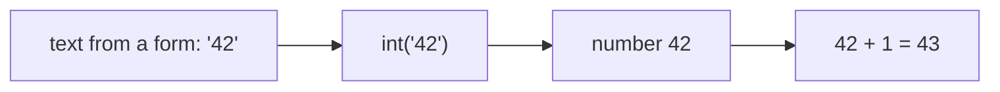

Every AI program juggles values: a user's message, a price, a model's confidence score, a yes/no flag. Before you can do anything clever with them, you need somewhere to keep them. That is what variables are for, and it is the first building block of everything else in this course.

## 1. A variable is a name for a value

Think of a **variable** as a sticky label. You write a name on it and stick it on a value, so you can find that value later. You create one with `=`:

```python
city = "Hanoi"
population = 8_500_000
print(city, population)  # Hanoi 8500000
```

Read `=` as *"store the value on the right under the name on the left"*. It is **not** "equals" from maths.

```text
  city        ──►  "Hanoi"
  population  ──►  8500000
```

> [!TIP]
> Underscores in numbers like `8_500_000` are just for readability. Python ignores them.

## 2. Changing a variable

A label can be moved to a new value at any time. Python always works out the right-hand side **first**, then stores the result:

```python
score = 10
score = score + 5   # right side first: 10 + 5 = 15, then store 15
score = score * 2   # 15 * 2 = 30
print(score)        # 30
```

Here is what `score` holds after each line:

| line | code | `score` |
|---|---|---|
| 1 | `score = 10` | 10 |
| 2 | `score = score + 5` | 15 |
| 3 | `score = score * 2` | 30 |

Press **Visualize** on the code block above and watch `score` change line by line.

**Naming rules:** letters, digits and `_`; cannot start with a digit; case-sensitive (`Score` and `score` are different); cannot be a Python keyword such as `class`, `if` or `for`. Use `snake_case` like `total_price`.

## 3. The four basic types

Every value has a **type**, and the type decides what you can do with it. `type()` tells you which one:

```python
print(type(42))        # <class 'int'>   whole number
print(type(3.14))      # <class 'float'> decimal number
print(type("hello"))   # <class 'str'>   text
print(type(True))      # <class 'bool'>  True or False
```

| Type | Example | Used for | In an AI app |
|---|---|---|---|
| `int` | `42`, `-7` | counting things | number of tokens |
| `float` | `3.14`, `0.5` | measurements, prices | a model's confidence `0.93` |
| `str` | `"hi"`, `'AI'` | text | the user's prompt |
| `bool` | `True`, `False` | yes/no answers | `is_spam = True` |

> [!NOTE]
> Quotes make the difference: `42` is a number, `"42"` is text that happens to contain digits.

## 4. Arithmetic and comparisons

```python
a = 7
b = 2
print(a + b, a - b, a * b)  # 9 5 14
print(a / b)                # 3.5  (/ always gives a float)
print(a // b, a % b)        # 3 1  (floor division, remainder)
print(a ** b)               # 49   (power)
```

`%` (remainder) is handy: `n % 2 == 0` checks whether `n` is even.

Comparisons answer a question, so they produce a `bool`:

```python
print(5 > 3)         # True
print(5 == 3)        # False (== compares, = assigns)
print("ai" == "ai")  # True
```

## 5. Text and f-strings

Joining text with `+` works, but **f-strings** are clearer. Put `f` before the quotes and any variable or expression inside `{}`:

```python
name = "Lan"
age = 21
print(f"{name} is {age} years old")  # Lan is 21 years old
print(f"Next year: {age + 1}")       # Next year: 22
```

## 6. Converting between types

Data from files, forms and APIs almost always arrives as **text**. Convert it before doing maths:



```python
text = "42"
number = int(text)
print(number + 1)        # 43
print(float("1.75"))     # 1.75
print(str(3) + " cats")  # 3 cats
```

| You have | You want | Use |
|---|---|---|
| `"42"` | `42` | `int("42")` |
| `"1.75"` | `1.75` | `float("1.75")` |
| `3` | `"3"` | `str(3)` |

## 7. Common mistakes

**Adding text instead of numbers.** `"5" + "7"` joins the text and gives `"57"`, not `12`:

```python
print("5" + "7")            # 57
print(int("5") + int("7"))  # 12
```

**Joining text and a number with `+`.** `"Age " + 21` crashes with `TypeError: can only concatenate str (not "int") to str`. Use an f-string instead: `f"Age {21}"`.

**Converting a decimal with `int()`.** `int("1.75")` crashes with `ValueError`. Use `float("1.75")`.

> [!WARNING]
> `=` stores a value, `==` compares two values. Writing `if age = 18` is a `SyntaxError`.

## Recap

- `name = value` stores a value; the right side is computed first, and you can overwrite it later.
- Four basic types: `int`, `float`, `str`, `bool`. Check with `type()`.
- `/` gives a float, `//` floor division, `%` remainder, `**` power. Comparisons give a `bool`.
- Use f-strings to build readable text.
- Data from outside is text: convert with `int()`, `float()`, `str()` before doing maths.
