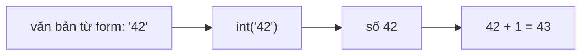

Chương trình AI nào cũng phải xử lý rất nhiều giá trị: tin nhắn của người dùng, giá tiền, độ tự tin của mô hình, một cờ có/không. Trước khi làm điều gì thông minh với chúng, bạn cần một chỗ để cất chúng. Đó chính là việc của biến, viên gạch đầu tiên cho mọi thứ trong khóa học này.

## 1. Biến là tên gọi cho một giá trị

Hãy hình dung **biến** (variable) như một tờ nhãn dán. Bạn viết tên lên nhãn rồi dán vào một giá trị để lát nữa tìm lại. Tạo biến bằng dấu `=`:

```python
city = "Hanoi"
population = 8_500_000
print(city, population)  # Hanoi 8500000
```

Hãy đọc `=` là *"lưu giá trị bên phải vào cái tên bên trái"*. Nó **không** phải dấu "bằng" trong toán.

```text
  city        ──►  "Hanoi"
  population  ──►  8500000
```

> [!TIP]
> Dấu gạch dưới trong số như `8_500_000` chỉ giúp dễ đọc. Python bỏ qua chúng.

## 2. Thay đổi giá trị của biến

Nhãn có thể chuyển sang giá trị mới bất cứ lúc nào. Python luôn tính vế phải **trước**, rồi mới lưu kết quả:

```python
score = 10
score = score + 5   # tính vế phải trước: 10 + 5 = 15, rồi lưu 15
score = score * 2   # 15 * 2 = 30
print(score)        # 30
```

Đây là giá trị của `score` sau từng dòng:

| dòng | code | `score` |
|---|---|---|
| 1 | `score = 10` | 10 |
| 2 | `score = score + 5` | 15 |
| 3 | `score = score * 2` | 30 |

Bấm **Visualize** ở khối code phía trên để xem `score` thay đổi qua từng dòng.

**Quy tắc đặt tên:** gồm chữ, số và `_`; không bắt đầu bằng số; phân biệt hoa thường (`Score` và `score` là hai biến khác nhau); không được trùng từ khóa của Python như `class`, `if`, `for`. Nên dùng `snake_case` như `total_price`.

## 3. Bốn kiểu dữ liệu cơ bản

Mỗi giá trị đều có một **kiểu** (type), và kiểu quyết định bạn làm được gì với nó. Hàm `type()` cho biết đó là kiểu nào:

```python
print(type(42))        # <class 'int'>   số nguyên
print(type(3.14))      # <class 'float'> số thực
print(type("hello"))   # <class 'str'>   văn bản
print(type(True))      # <class 'bool'>  True hoặc False
```

| Kiểu | Ví dụ | Dùng để | Trong ứng dụng AI |
|---|---|---|---|
| `int` | `42`, `-7` | đếm số lượng | số token |
| `float` | `3.14`, `0.5` | số đo, giá tiền | độ tự tin của mô hình `0.93` |
| `str` | `"hi"`, `'AI'` | văn bản | câu hỏi của người dùng |
| `bool` | `True`, `False` | câu trả lời có/không | `is_spam = True` |

> [!NOTE]
> Dấu nháy tạo nên khác biệt: `42` là số, còn `"42"` là văn bản tình cờ chứa chữ số.

## 4. Phép tính và phép so sánh

```python
a = 7
b = 2
print(a + b, a - b, a * b)  # 9 5 14
print(a / b)                # 3.5  (/ luôn trả về float)
print(a // b, a % b)        # 3 1  (chia lấy phần nguyên, chia lấy dư)
print(a ** b)               # 49   (lũy thừa)
```

`%` (chia lấy dư) rất tiện: `n % 2 == 0` kiểm tra `n` có phải số chẵn không.

Phép so sánh là một câu hỏi, nên kết quả là một giá trị `bool`:

```python
print(5 > 3)         # True
print(5 == 3)        # False (== để so sánh, = để gán)
print("ai" == "ai")  # True
```

## 5. Văn bản và f-string

Nối chuỗi bằng `+` vẫn được, nhưng **f-string** rõ ràng hơn. Đặt `f` trước dấu nháy và để biến hoặc biểu thức trong `{}`:

```python
name = "Lan"
age = 21
print(f"{name} is {age} years old")  # Lan is 21 years old
print(f"Next year: {age + 1}")       # Next year: 22
```

## 6. Chuyển đổi kiểu

Dữ liệu từ file, form hay API gần như luôn đến dưới dạng **văn bản**. Hãy chuyển kiểu trước khi tính toán:



```python
text = "42"
number = int(text)
print(number + 1)        # 43
print(float("1.75"))     # 1.75
print(str(3) + " cats")  # 3 cats
```

| Bạn đang có | Bạn cần | Dùng |
|---|---|---|
| `"42"` | `42` | `int("42")` |
| `"1.75"` | `1.75` | `float("1.75")` |
| `3` | `"3"` | `str(3)` |

## 7. Lỗi thường gặp

**Cộng văn bản thay vì cộng số.** `"5" + "7"` nối hai chuỗi thành `"57"`, không phải `12`:

```python
print("5" + "7")            # 57
print(int("5") + int("7"))  # 12
```

**Nối văn bản với số bằng `+`.** `"Age " + 21` sẽ lỗi `TypeError: can only concatenate str (not "int") to str`. Hãy dùng f-string: `f"Age {21}"`.

**Dùng `int()` cho số thập phân.** `int("1.75")` sẽ lỗi `ValueError`. Hãy dùng `float("1.75")`.

> [!WARNING]
> `=` để lưu giá trị, `==` để so sánh hai giá trị. Viết `if age = 18` sẽ bị `SyntaxError`.

## Tóm tắt

- `name = value` lưu một giá trị; vế phải được tính trước, và bạn có thể ghi đè sau đó.
- Bốn kiểu cơ bản: `int`, `float`, `str`, `bool`. Kiểm tra bằng `type()`.
- `/` trả về float, `//` chia lấy nguyên, `%` chia lấy dư, `**` lũy thừa. Phép so sánh trả về `bool`.
- Dùng f-string để tạo văn bản dễ đọc.
- Dữ liệu từ bên ngoài là văn bản: chuyển bằng `int()`, `float()`, `str()` trước khi tính toán.
