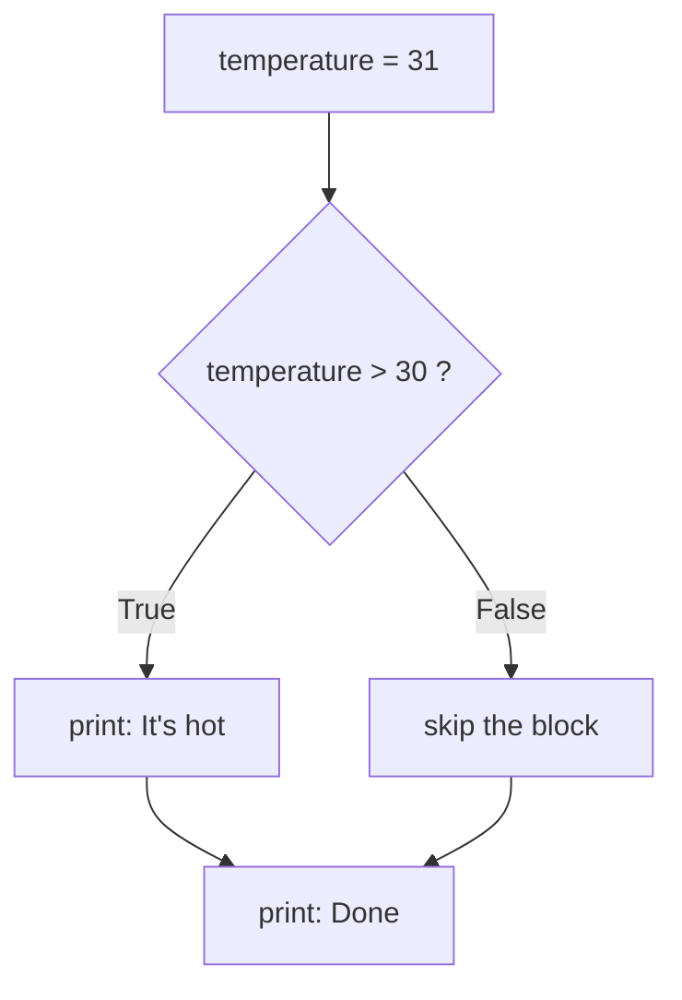
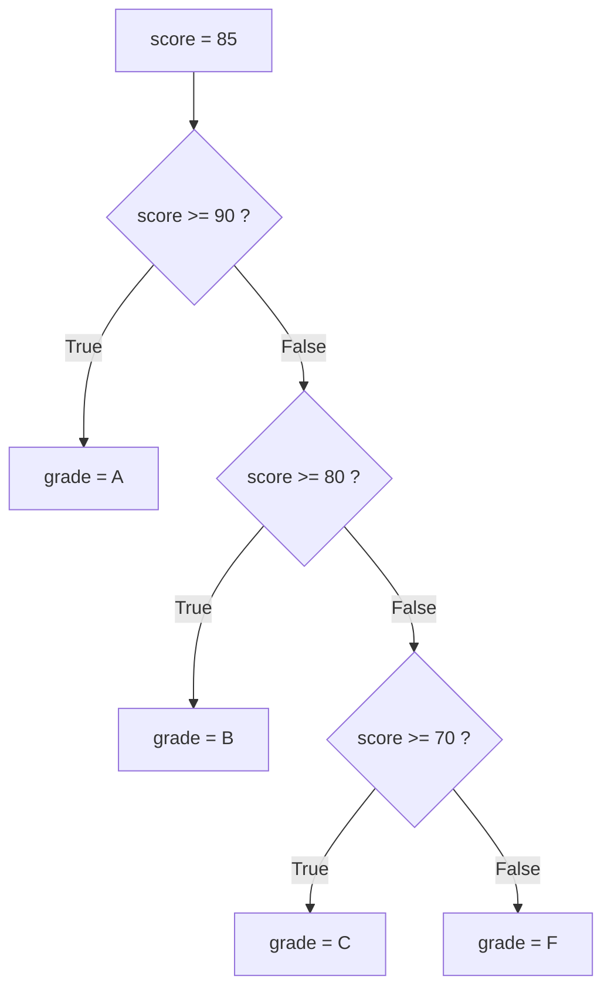

Every useful AI program has to make decisions. Is the model's confidence high enough to show the answer, or should it ask the user to rephrase? Is the prompt empty? Is the user over their daily limit? A program that cannot choose can only do the same thing every time. In this lesson you learn how Python makes choices: `if`, `elif` and `else`.

## 1. A condition is a yes/no question

A **condition** is any expression that answers *yes* or *no*, which in Python means `True` or `False`. You already met these in lesson 1: comparisons produce a `bool`.

```python
print(5 > 3)    # True
print(5 == 3)   # False
print(5 != 3)   # True
print(4 <= 4)   # True
```

| Operator | Asks | Example | Result |
|---|---|---|---|
| `==` | equal? | `3 == 3` | `True` |
| `!=` | different? | `3 != 3` | `False` |
| `<` | smaller? | `2 < 5` | `True` |
| `>` | bigger? | `2 > 5` | `False` |
| `<=` | smaller or equal? | `5 <= 5` | `True` |
| `>=` | bigger or equal? | `4 >= 5` | `False` |

## 2. `if`: do this only when the answer is yes

Think of a traffic light: *if* the light is green, you go; otherwise you skip that step. In code, put a condition after `if`, and the indented lines under it run **only when it is `True`**:



```python
temperature = 31

if temperature > 30:
    print("It's hot")  # runs only when the condition is True
print("Done")          # runs every time
# It's hot
# Done
```

Press **Visualize** on this block first. Then change `temperature` to `20` and press **Visualize** again: watch Python skip the indented line, so "It's hot" disappears and "Done" stays.

## 3. Indentation and the colon

Two details matter a lot:

- The line with `if` ends with a colon `:`.
- The lines that belong to the `if` are **indented** (4 spaces). Python uses indentation to know where the block starts and ends.

```python
age = 15

if age >= 18:
    print("Adult")
    print("You may vote")
print("This line always runs")  # not indented: outside the if
# This line always runs
```

Here `age >= 18` is `False`, so both indented lines are skipped. Only the last line prints.

> [!WARNING]
> Forgetting the `:` gives `SyntaxError`. Wrong or missing indentation gives `IndentationError`.

## 4. `else`: the other path

`else` runs when the condition is `False`. Exactly one of the two blocks runs, never both, never neither:

```python
score = 45

if score >= 50:
    print("Pass")
else:
    print("Fail")
# Fail
```

## 5. `elif`: more than two choices

Use `elif` ("else if") for extra checks. Picture a sorting machine: the item goes past each gate in order, and the **first gate that fits catches it**. All the gates below it are ignored.



```python
score = 85

if score >= 90:
    grade = "A"
elif score >= 80:
    grade = "B"
elif score >= 70:
    grade = "C"
else:
    grade = "F"

print(grade)  # B
```

`85 >= 90` is `False`, so Python moves on. `85 >= 80` is `True`, so `grade` becomes `"B"` and the rest of the chain is skipped, even though `85 >= 70` is also true.

> [!TIP]
> Order matters. Always check the most demanding condition first. See the second mistake in section 9.

## 6. Combining conditions: `and`, `or`, `not`

Sometimes one question is not enough: "is the user an adult **and** do they have a ticket?" Combine conditions with `and`, `or` and `not`.

| Operator | Meaning | Example |
|---|---|---|
| `and` | both must be True | `age >= 18 and has_ticket` |
| `or` | at least one is True | `is_weekend or is_holiday` |
| `not` | flips True/False | `not is_raining` |

The **truth table** shows every possible case (`T` = True, `F` = False):

| `a` | `b` | `a and b` | `a or b` | `not a` |
|---|---|---|---|---|
| T | T | T | T | F |
| T | F | F | T | F |
| F | T | F | T | T |
| F | F | F | F | T |

Remember it like this: `and` is strict (only the first row is True), `or` is generous (only the last row is False).

```python
age = 20
has_ticket = True
is_vip = False

print(age >= 18 and has_ticket)  # True
print(is_vip or age >= 65)       # False
print(not is_vip)                # True

if age >= 18 and has_ticket:
    print("Welcome in")          # Welcome in
```

You can also write a range check naturally: `0 <= score <= 100`.

> [!NOTE]
> When mixing, `not` is applied first, then `and`, then `or`. Add parentheses when unsure: `(a or b) and c`.

## 7. Truthiness: empty and zero count as False

In an `if`, Python does not need a real `bool`. It treats some values as **False** ("falsy") and everything else as **True** ("truthy"):

| Falsy (counts as False) | Truthy (counts as True) |
|---|---|
| `0` and `0.0` | any other number, like `7` or `-1` |
| `""` (empty text) | any text with something in it, like `"hi"` or `"0"` |

Later you will meet more falsy values, such as an empty list `[]` and `None` (which means "no value").

```python
name = ""

if name:
    print(f"Hello, {name}")
else:
    print("Please enter a name")  # Please enter a name

print(bool(0), bool(""), bool("0"), bool(7))  # False False True True
```

This is a handy shortcut: `if name:` means "if `name` has something in it". Notice `bool("0")` is `True`: it is a non-empty string, not the number zero.

## 8. Nested `if` vs `elif`

You can put an `if` inside another `if` (a **nested if**). It works, but gets hard to read quickly:

```python
age = 16
has_id = True

if age >= 18:
    if has_id:
        print("Enter")
# (nothing printed: age is 16)
```

When the checks are about the same question, prefer `and`, or a flat `elif` chain:

```python
age = 16
has_id = True

if age >= 18 and has_id:
    print("Enter")
elif age >= 18:
    print("Bring your ID")
else:
    print("Too young")  # Too young
```

## 9. Common mistakes

**Using `=` instead of `==`.** `=` stores a value, `==` compares. Writing `if age = 18:` is a `SyntaxError`. Write `if age == 18:`.

**Putting the easy condition first.** Python stops at the first branch that is True, so a loose condition on top hides the stricter ones below it:

```python
score = 95

if score >= 70:
    grade = "C"
elif score >= 90:
    grade = "A"   # never reached for 95!
else:
    grade = "F"

print(grade)  # C  (wrong: 95 should be an A)
```

**Writing `x == 1 or 2`.** This does not mean "x is 1 or 2". Python reads it as `(x == 1) or 2`, and `2` is always truthy, so the whole thing is always true:

```python
x = 5

if x == 1 or 2:
    print("always true")  # always true (even though x is 5)

if x == 1 or x == 2:
    print("x is 1 or 2")  # not printed: correct
```

> [!WARNING]
> After `and` / `or`, write a full comparison on **both sides**: `x == 1 or x == 2`.

## Recap

- A condition is an expression that gives `True` or `False`; compare with `== != < > <= >=`.
- `if`, `elif` and `else` end with `:`; the block under them is indented by 4 spaces.
- Python runs only the first matching branch, so put the strictest `elif` first.
- `and`, `or`, `not` combine conditions (see the truth table); use parentheses when unsure.
- `0`, `0.0` and `""` count as False; any other number and non-empty text count as True.
- Prefer a flat `elif` chain or `and` over deeply nested `if`s, and avoid the classic slips: `=` vs `==`, wrong `elif` order, and `x == 1 or 2`.
