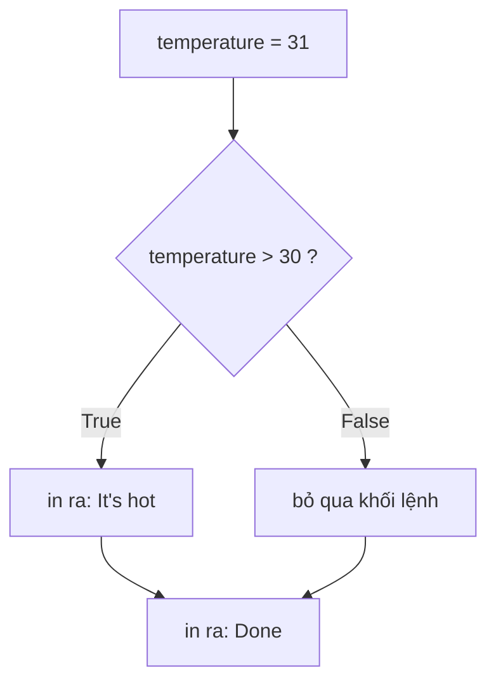
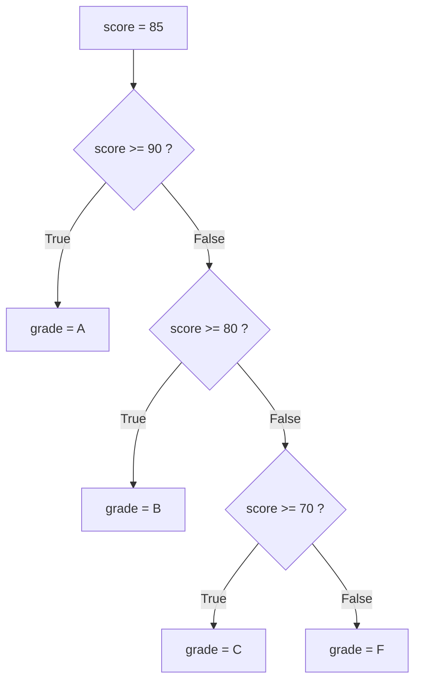

Chương trình AI nào có ích cũng phải biết ra quyết định. Độ tự tin của mô hình đã đủ cao để hiện câu trả lời chưa, hay nên nhờ người dùng hỏi lại? Prompt có bị rỗng không? Người dùng đã vượt giới hạn hôm nay chưa? Một chương trình không biết lựa chọn thì lần nào cũng làm y hệt nhau. Trong bài này bạn sẽ học cách Python lựa chọn: `if`, `elif` và `else`.

## 1. Điều kiện là một câu hỏi có/không

**Điều kiện** (condition) là một biểu thức trả lời *có* hoặc *không*, trong Python là `True` hoặc `False`. Bạn đã gặp chúng ở bài 1: phép so sánh cho ra một giá trị `bool`.

```python
print(5 > 3)    # True
print(5 == 3)   # False
print(5 != 3)   # True
print(4 <= 4)   # True
```

| Toán tử | Hỏi | Ví dụ | Kết quả |
|---|---|---|---|
| `==` | bằng nhau? | `3 == 3` | `True` |
| `!=` | khác nhau? | `3 != 3` | `False` |
| `<` | nhỏ hơn? | `2 < 5` | `True` |
| `>` | lớn hơn? | `2 > 5` | `False` |
| `<=` | nhỏ hơn hoặc bằng? | `5 <= 5` | `True` |
| `>=` | lớn hơn hoặc bằng? | `4 >= 5` | `False` |

## 2. `if`: chỉ làm khi câu trả lời là "có"

Hãy nghĩ đến đèn giao thông: *nếu* đèn xanh thì bạn đi, còn không thì bỏ qua bước đó. Trong code, đặt điều kiện sau `if`, và các dòng thụt lề bên dưới chỉ chạy **khi điều kiện là `True`**:



```python
temperature = 31

if temperature > 30:
    print("It's hot")  # chỉ chạy khi điều kiện là True
print("Done")          # lần nào cũng chạy
# It's hot
# Done
```

Hãy thử đổi `temperature` thành `20` rồi chạy lại: "It's hot" biến mất, còn "Done" vẫn ở đó. Bấm **Visualize** ở khối code này để xem Python nhảy qua dòng thụt lề như thế nào.

## 3. Thụt lề và dấu hai chấm

Có hai chi tiết rất quan trọng:

- Dòng `if` kết thúc bằng dấu hai chấm `:`.
- Các dòng thuộc về `if` phải được **thụt lề** (indentation), dùng 4 dấu cách. Python dựa vào thụt lề để biết khối code bắt đầu và kết thúc ở đâu.

```python
age = 15

if age >= 18:
    print("Adult")
    print("You may vote")
print("This line always runs")  # không thụt lề: nằm ngoài if
# This line always runs
```

Ở đây `age >= 18` là `False`, nên cả hai dòng thụt lề bị bỏ qua. Chỉ dòng cuối cùng được in.

> [!WARNING]
> Quên `:` sẽ gây `SyntaxError`. Thụt lề sai hoặc thiếu gây `IndentationError`.

## 4. `else`: con đường còn lại

`else` chạy khi điều kiện là `False`. Đúng một trong hai khối sẽ chạy: không bao giờ chạy cả hai, cũng không bao giờ không chạy khối nào:

```python
score = 45

if score >= 50:
    print("Pass")
else:
    print("Fail")
# Fail
```

## 5. `elif`: nhiều hơn hai lựa chọn

Dùng `elif` (viết tắt của "else if") để thêm các phép kiểm tra. Hãy hình dung một máy phân loại: món đồ đi qua từng cổng theo thứ tự, và **cổng nào vừa đầu tiên sẽ giữ nó lại**. Các cổng phía sau đều bị bỏ qua.



```python
score = 85

if score >= 90:
    grade = "A"
elif score >= 80:
    grade = "B"
elif score >= 70:
    grade = "C"
else:
    grade = "F"

print(grade)  # B
```

`85 >= 90` là `False`, nên Python đi tiếp. `85 >= 80` là `True`, nên `grade` thành `"B"` và phần còn lại của chuỗi bị bỏ qua, dù `85 >= 70` cũng đúng.

> [!TIP]
> Thứ tự rất quan trọng. Hãy luôn kiểm tra điều kiện khắt khe nhất trước. Xem lỗi thứ hai ở mục 9.

## 6. Kết hợp điều kiện: `and`, `or`, `not`

Đôi khi một câu hỏi là chưa đủ: "người dùng đã đủ tuổi **và** có vé chưa?". Hãy kết hợp các điều kiện bằng `and`, `or` và `not`.

| Toán tử | Ý nghĩa | Ví dụ |
|---|---|---|
| `and` | cả hai đều True | `age >= 18 and has_ticket` |
| `or` | ít nhất một cái True | `is_weekend or is_holiday` |
| `not` | đảo True/False | `not is_raining` |

**Bảng chân trị** (truth table) cho thấy mọi trường hợp có thể xảy ra (`T` = True, `F` = False):

| `a` | `b` | `a and b` | `a or b` | `not a` |
|---|---|---|---|---|
| T | T | T | T | F |
| T | F | F | T | F |
| F | T | F | T | T |
| F | F | F | F | T |

Cách nhớ: `and` rất khắt khe (chỉ dòng đầu là True), còn `or` rất dễ tính (chỉ dòng cuối là False).

```python
age = 20
has_ticket = True
is_vip = False

print(age >= 18 and has_ticket)  # True
print(is_vip or age >= 65)       # False
print(not is_vip)                # True

if age >= 18 and has_ticket:
    print("Welcome in")          # Welcome in
```

Bạn cũng có thể viết kiểm tra khoảng giá trị rất tự nhiên: `0 <= score <= 100`.

> [!NOTE]
> Khi trộn lẫn, `not` được tính trước, rồi đến `and`, rồi đến `or`. Nếu không chắc, hãy thêm ngoặc: `(a or b) and c`.

## 7. Truthiness: rỗng và số 0 được coi là False

Trong `if`, Python không cần một giá trị `bool` thật sự. Nó coi một số giá trị là **False** ("falsy") và mọi thứ còn lại là **True** ("truthy"):

| Falsy (coi là False) | Truthy (coi là True) |
|---|---|
| `0` và `0.0` | mọi số khác, như `7` hay `-1` |
| `""` (văn bản rỗng) | mọi văn bản có nội dung, như `"hi"` hay `"0"` |

Sau này bạn sẽ gặp thêm các giá trị falsy khác, như list rỗng `[]` và `None` (nghĩa là "không có giá trị").

```python
name = ""

if name:
    print(f"Hello, {name}")
else:
    print("Please enter a name")  # Please enter a name

print(bool(0), bool(""), bool("0"), bool(7))  # False False True True
```

Đây là một cách viết tắt rất tiện: `if name:` nghĩa là "nếu `name` có nội dung gì đó". Lưu ý `bool("0")` là `True`: đó là một chuỗi không rỗng, không phải số không.

## 8. `if` lồng nhau và `elif`

Bạn có thể đặt một `if` bên trong `if` khác (**nested if**, if lồng nhau). Nó chạy được nhưng nhanh chóng khó đọc:

```python
age = 16
has_id = True

if age >= 18:
    if has_id:
        print("Enter")
```

Khi các kiểm tra cùng xoay quanh một câu hỏi, hãy ưu tiên `and`, hoặc một chuỗi `elif` phẳng:

```python
age = 16
has_id = True

if age >= 18 and has_id:
    print("Enter")
elif age >= 18:
    print("Bring your ID")
else:
    print("Too young")  # Too young
```

## 9. Những lỗi thường gặp

**Dùng `=` thay cho `==`.** `=` để lưu giá trị, `==` để so sánh. Viết `if age = 18:` sẽ gây `SyntaxError`. Hãy viết `if age == 18:`.

**Đặt điều kiện dễ lên đầu.** Python dừng ở nhánh đúng đầu tiên, nên một điều kiện rộng ở trên sẽ che mất các điều kiện chặt hơn ở dưới:

```python
score = 95

if score >= 70:
    grade = "C"
elif score >= 90:
    grade = "A"   # không bao giờ tới được với 95!
else:
    grade = "F"

print(grade)  # C  (sai: 95 phải là A)
```

**Viết `x == 1 or 2`.** Câu này không có nghĩa là "x bằng 1 hoặc 2". Python đọc nó là `(x == 1) or 2`, mà `2` luôn là truthy, nên cả biểu thức luôn đúng:

```python
x = 5

if x == 1 or 2:
    print("always true")  # always true (dù x là 5)

if x == 1 or x == 2:
    print("x is 1 or 2")  # không in ra: đúng như mong muốn
```

> [!WARNING]
> Sau `and` / `or`, hãy viết một phép so sánh đầy đủ ở **cả hai vế**: `x == 1 or x == 2`.

## Tóm tắt

- Điều kiện là biểu thức cho ra `True` hoặc `False`; so sánh bằng `== != < > <= >=`.
- `if`, `elif`, `else` kết thúc bằng `:`; khối code bên dưới được thụt lề 4 dấu cách.
- Python chỉ chạy nhánh đúng đầu tiên, nên hãy đặt `elif` khắt khe nhất lên trước.
- `and`, `or`, `not` kết hợp các điều kiện (xem bảng chân trị); không chắc thì thêm ngoặc.
- `0`, `0.0` và `""` được coi là False; mọi số khác và văn bản không rỗng được coi là True.
- Ưu tiên chuỗi `elif` phẳng hoặc `and` thay vì nhiều tầng `if` lồng nhau.
- Tránh các lỗi kinh điển: `=` với `==`, sai thứ tự `elif`, và `x == 1 or 2`.
