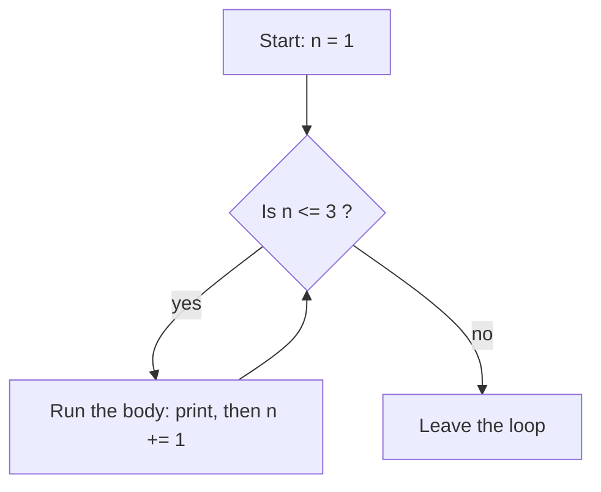

Imagine you have 10,000 customer messages and you want to know how many are positive. Nobody reads them one by one: a program takes the first message, checks it, takes the next, checks it, and keeps going until the list is finished. Cleaning a dataset, counting tokens, feeding every row to a model: all of these are **loops**. This lesson shows the tools Python gives you to repeat work.

## 1. What is a loop?

A **loop** repeats a piece of code. Think of a teacher stamping a pile of homework: pick up one sheet, stamp it, put it down, repeat until the pile is empty. You write the instruction once, Python repeats it.

```python
for i in range(3):
    print("Hello!")
# Hello!
# Hello!
# Hello!
```

The indented line is the **body** of the loop. It runs once per round. Indentation (4 spaces) is how Python knows which lines belong to the loop.

## 2. `for` and `range()`

`range()` produces a sequence of whole numbers, and `for` walks through them one at a time, putting each one in a variable:

```python
for i in range(5):
    print(i)  # 0 1 2 3 4 (one per line)
```

`range` is **one** function with optional arguments. You give it up to three numbers, and Python fills in the ones you skip:

| Call | Meaning | Numbers produced |
|---|---|---|
| `range(stop)` | start at 0, step 1 | `range(5)` gives 0, 1, 2, 3, 4 |
| `range(start, stop)` | step 1 | `range(2, 6)` gives 2, 3, 4, 5 |
| `range(start, stop, step)` | you choose all three | `range(0, 10, 3)` gives 0, 3, 6, 9 |

A negative `step` counts down: `range(5, 0, -1)` gives 5, 4, 3, 2, 1.

Here is `range(2, 10, 3)` as a picture. Start at 2, jump 3 each time, and stop before reaching 10:

```text
range(2, 10, 3)

  0  1  2  3  4  5  6  7  8  9  10
        ^        ^        ^     |
        2   +3   5   +3   8   +3  11 > 10 ✗
```

So the loop sees 2, 5, 8.

```python
for n in range(2, 11, 2):
    print(n)  # 2 4 6 8 10 (one per line)
```

After a `for` loop ends, its variable is not deleted. It keeps the last value it had:

```python
for i in range(3):
    print(i)  # 0 1 2 (one per line)
print(i)      # 2
```

> [!WARNING]
> The **stop** value is never included. `range(1, 5)` gives 1, 2, 3, 4. To count from 1 to `n`, write `range(1, n + 1)`. This "off by one" mistake is the most common loop bug.

## 3. Looping over a string

A string is a sequence of characters, so `for` can walk through it one character at a time:

```python
for letter in "Hanoi":
    print(letter)  # H a n o i (one per line)
```

`letter in "aeiou"` asks: *is this character one of those letters?* The answer is `True` or `False`, so it works inside `if`:

```python
for letter in "banana":
    if letter in "aeiou":
        print(letter, "is a vowel")  # a is a vowel (three times)
```

## 4. The accumulator pattern

Most loops build up **one answer**. Think of a piggy bank: it starts empty, and every round you drop a coin in. The variable that collects the answer is called an **accumulator**. Create it before the loop, update it inside:

```python
total = 0
for n in range(1, 6):
    total += n
print(total)  # 15
```

`total += n` is shorthand for `total = total + n`: "take what is in `total`, add `n`, store it back". The same trick works for `-=`, `*=` and so on.

Press **Visualize** on the code above and watch `total` grow round by round. Here is the same run as a table:

| step | `n` | `total` after `total += n` |
|---|---|---|
| before the loop | - | 0 |
| 1 | 1 | 1 |
| 2 | 2 | 3 |
| 3 | 3 | 6 |
| 4 | 4 | 10 |
| 5 | 5 | 15 |

After step 5 the loop is over, and `print(total)` shows 15.

**Counting** is the same pattern, but you add 1 instead of a value:

```python
count = 0
for n in range(1, 21):
    if n % 3 == 0:
        count += 1
print(count)  # 6 (the multiples of 3: 3, 6, 9, 12, 15, 18)
```

> [!TIP]
> Always set the accumulator **before** the loop. If you put `total = 0` inside the loop, it resets every round.

## 5. `while` loops

Use `for` when you know how many rounds you need. Use `while` when you want to repeat **as long as a condition is true**:

```python
n = 1
while n <= 3:
    print("round", n)
    n += 1
# round 1
# round 2
# round 3
```

Before every round, Python asks the question again:



When `n` becomes 4 the answer is "no", and the loop ends.

> [!WARNING]
> Something inside a `while` must eventually make the condition false. Forget `n += 1` and the loop never ends (an **infinite loop**). If that happens in your editor, stop the run.

## 6. `break` and `continue`

- `break` leaves the loop immediately.
- `continue` skips the rest of this round and jumps to the next one.

```python
for n in range(1, 10):
    if n % 2 == 0:
        continue  # skip even numbers
    if n > 7:
        break     # stop completely
    print(n)      # 1 3 5 7
```

`while True:` is a loop whose condition is always true, so it only ends when it reaches a `break`. You will see it in the second example.

## 7. Common mistakes

**Off by one.** `range` stops *before* its end value, so the last number is missing:

```python
for i in range(1, 5):
    print(i)  # 1 2 3 4 (no 5!)
```

Fix: `range(1, 6)`, or `range(1, n + 1)` when the end is a variable.

**An infinite `while` loop.** The variable in the condition never changes, or you change a different variable:

```text
n = 0
i = 1
while i <= 3:
    print(i)
    n += 1
```

The condition looks at `i`, but the loop changes `n`. So `i` stays 1 and the loop never stops. Always check that the variable in the condition is the one you update.

**Resetting the accumulator inside the loop.** The total starts from 0 again every round:

```python
for n in range(1, 4):
    total = 0
    total += n
print(total)  # 3 (expected 6)
```

**Using `=` instead of `+=`.** `total = n` throws away the old value instead of adding to it:

```python
total = 0
for n in range(1, 4):
    total = n
print(total)  # 3 (expected 6)
```

## Recap

- `for x in range(start, stop, step)` repeats with numbers. `start` and `step` are optional, and `stop` is never included. Strings work too: `for letter in text`.
- Accumulator: set `total = 0` before the loop, then `total += value` inside. Counting adds 1. A trace table (step, value, total) shows exactly what happens.
- `while condition:` repeats as long as the condition is true, so make sure the loop changes something the condition looks at.
- `break` stops the loop; `continue` skips to the next round.
- Watch out for off-by-one in `range`, a forgotten update in `while`, and `total = 0` in the wrong place.
