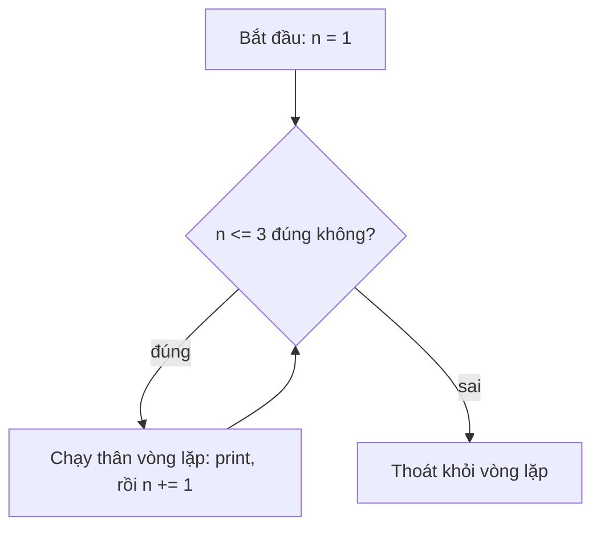

Hãy tưởng tượng bạn có 10.000 tin nhắn của khách hàng và muốn biết có bao nhiêu tin tích cực. Không ai ngồi đọc từng tin: chương trình lấy tin đầu tiên, kiểm tra, lấy tin kế tiếp, kiểm tra, và cứ thế cho đến hết danh sách. Làm sạch dataset, đếm token, đưa từng dòng dữ liệu vào model: tất cả đều là **vòng lặp** (loop). Bài này giới thiệu các công cụ Python cho bạn để lặp lại công việc.

## 1. Vòng lặp là gì?

**Vòng lặp** (loop) lặp lại một đoạn code. Hãy nghĩ đến cô giáo đóng dấu một chồng bài tập: lấy một tờ, đóng dấu, đặt xuống, rồi lặp lại cho đến khi hết chồng. Bạn chỉ viết lệnh một lần, Python tự lặp lại.

```python
for i in range(3):
    print("Hello!")
# Hello!
# Hello!
# Hello!
```

Dòng thụt lề là **thân vòng lặp** (body). Nó chạy một lần mỗi vòng. Thụt lề (4 dấu cách) là cách Python biết dòng nào thuộc về vòng lặp.

## 2. `for` và `range()`

`range()` tạo ra một dãy số nguyên, còn `for` đi qua từng số một và gán vào một biến:

```python
for i in range(5):
    print(i)  # 0 1 2 3 4
```

`range` là **một** hàm (function) có các tham số tùy chọn. Bạn đưa vào tối đa ba số, số nào bỏ qua thì Python tự điền giá trị mặc định:

| Cách gọi | Ý nghĩa | Các số tạo ra |
|---|---|---|
| `range(stop)` | bắt đầu từ 0, bước 1 | `range(5)` cho 0, 1, 2, 3, 4 |
| `range(start, stop)` | bước 1 | `range(2, 6)` cho 2, 3, 4, 5 |
| `range(start, stop, step)` | bạn chọn cả ba | `range(0, 10, 3)` cho 0, 3, 6, 9 |

`step` âm thì đếm ngược: `range(5, 0, -1)` cho 5, 4, 3, 2, 1.

Đây là hình minh họa của `range(2, 10, 3)`. Bắt đầu ở 2, mỗi lần nhảy 3, và dừng trước khi chạm tới 10:

```text
range(2, 10, 3)

  0  1  2  3  4  5  6  7  8  9  10
        ^        ^        ^     |
        2   +3   5   +3   8   +3  11 is past 10: stop
```

Vậy vòng lặp sẽ thấy 2, 5, 8.

```python
for n in range(2, 11, 2):
    print(n)  # 2 4 6 8 10
```

> [!WARNING]
> Giá trị **stop** (điểm dừng) không bao giờ được tính. `range(1, 5)` cho 1, 2, 3, 4. Muốn đếm từ 1 đến `n`, hãy viết `range(1, n + 1)`. Lỗi "lệch một đơn vị" (off by one) này là lỗi vòng lặp phổ biến nhất.

## 3. Lặp qua một chuỗi

Chuỗi (string) là một dãy ký tự, nên `for` có thể đi qua từng ký tự một:

```python
for letter in "Hanoi":
    print(letter)  # H a n o i (mỗi chữ một dòng)
```

`letter in "aeiou"` hỏi: *ký tự này có nằm trong các chữ cái kia không?* Câu trả lời là `True` hoặc `False`, nên dùng được ngay trong `if`:

```python
for letter in "banana":
    if letter in "aeiou":
        print(letter, "is a vowel")  # a is a vowel (ba lần)
```

## 4. Mẫu tích lũy (accumulator)

Phần lớn vòng lặp tạo ra **một kết quả cuối cùng**. Hãy nghĩ đến con heo đất: ban đầu trống, mỗi vòng bạn bỏ thêm một đồng vào. Biến gom kết quả đó gọi là biến **tích lũy** (accumulator). Tạo nó trước vòng lặp, cập nhật nó bên trong:

```python
total = 0
for n in range(1, 6):
    total += n
print(total)  # 15
```

`total += n` là cách viết gọn của `total = total + n`: "lấy giá trị đang có trong `total`, cộng thêm `n`, rồi cất lại vào `total`". Mẹo này dùng được với `-=`, `*=` và các toán tử khác.

Hãy bấm **Visualize** ở đoạn code trên và xem `total` tăng dần qua từng vòng. Đây là cùng lần chạy đó dưới dạng bảng:

| bước | `n` | `total` sau `total += n` |
|---|---|---|
| trước vòng lặp | - | 0 |
| 1 | 1 | 1 |
| 2 | 2 | 3 |
| 3 | 3 | 6 |
| 4 | 4 | 10 |
| 5 | 5 | 15 |

Sau bước 5 vòng lặp kết thúc, và `print(total)` in ra 15.

**Đếm** (counting) là cùng một mẫu, chỉ khác là bạn cộng 1 thay vì cộng một giá trị:

```python
count = 0
for n in range(1, 21):
    if n % 3 == 0:
        count += 1
print(count)  # 6 (các bội số của 3: 3, 6, 9, 12, 15, 18)
```

> [!TIP]
> Luôn đặt biến tích lũy **trước** vòng lặp. Nếu viết `total = 0` bên trong vòng lặp, nó sẽ bị reset về 0 ở mỗi vòng.

## 5. Vòng lặp `while`

Dùng `for` khi bạn biết cần bao nhiêu vòng. Dùng `while` khi muốn lặp **chừng nào điều kiện còn đúng**:

```python
n = 1
while n <= 3:
    print("round", n)
    n += 1
# round 1
# round 2
# round 3
```

Trước mỗi vòng, Python hỏi lại câu hỏi đó:



Khi `n` thành 4, câu trả lời là "sai", và vòng lặp kết thúc.

> [!WARNING]
> Bên trong `while` phải có thứ gì đó cuối cùng làm điều kiện thành sai. Quên `n += 1` thì vòng lặp không bao giờ dừng (**vòng lặp vô hạn**, infinite loop). Nếu gặp tình huống này trong editor, hãy dừng chương trình.

## 6. `break` và `continue`

- `break` thoát khỏi vòng lặp ngay lập tức.
- `continue` bỏ qua phần còn lại của vòng hiện tại và nhảy sang vòng kế tiếp.

```python
for n in range(1, 10):
    if n % 2 == 0:
        continue  # bỏ qua số chẵn
    if n > 7:
        break     # dừng hẳn
    print(n)      # 1 3 5 7
```

`while True:` là vòng lặp có điều kiện luôn đúng, nên nó chỉ kết thúc khi gặp `break`. Bạn sẽ thấy cách dùng này trong ví dụ thứ hai.

## 7. Lỗi thường gặp

**Lệch một đơn vị (off by one).** `range` dừng *trước* giá trị cuối, nên số cuối bị thiếu:

```python
for i in range(1, 5):
    print(i)  # 1 2 3 4 (không có 5!)
```

Cách sửa: `range(1, 6)`, hoặc `range(1, n + 1)` khi giá trị cuối là một biến.

**Vòng lặp `while` vô hạn.** Biến trong điều kiện không bao giờ thay đổi, hoặc bạn đổi nhầm sang biến khác:

```text
i = 1
while i <= 3:
    print(i)
    n += 1
```

Điều kiện nhìn vào `i`, nhưng vòng lặp lại thay đổi `n`. Vì vậy `i` mãi bằng 1 và vòng lặp không bao giờ dừng. Hãy luôn kiểm tra: biến nằm trong điều kiện có đúng là biến bạn cập nhật không.

**Reset biến tích lũy bên trong vòng lặp.** Tổng bị bắt đầu lại từ 0 ở mỗi vòng:

```python
for n in range(1, 4):
    total = 0
    total += n
print(total)  # 3 (đáng lẽ phải là 6)
```

**Dùng `=` thay vì `+=`.** `total = n` vứt giá trị cũ đi thay vì cộng thêm vào:

```python
total = 0
for n in range(1, 4):
    total = n
print(total)  # 3 (đáng lẽ phải là 6)
```

## Tóm tắt

- `for x in range(start, stop, step)` lặp theo dãy số. `start` và `step` là tùy chọn, còn `stop` không bao giờ được tính. Chuỗi cũng lặp được: `for letter in text`.
- Tích lũy: đặt `total = 0` trước vòng lặp, rồi `total += value` bên trong. Đếm thì cộng 1. Bảng theo dõi (bước, giá trị, total) cho thấy chính xác chuyện gì xảy ra.
- `while condition:` lặp chừng nào điều kiện còn đúng, nên hãy chắc chắn vòng lặp có thay đổi thứ mà điều kiện đang nhìn vào.
- `break` dừng vòng lặp; `continue` nhảy sang vòng kế tiếp.
- Cẩn thận với off-by-one trong `range`, quên cập nhật trong `while`, và đặt `total = 0` sai chỗ.
