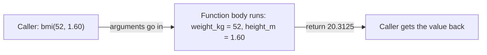

Every tool an LLM agent can use, such as "search the web", "get the weather" or "send an email", is a **function**: it takes some inputs (parameters) and gives back a result (a return value). When you build AI programs you will write, call and combine functions all day long. This lesson shows you how.

## 1. A function is a small machine

So far your code ran from top to bottom, and when you needed the same steps twice you copied and pasted them. That gets messy fast. A **function** is a named block of code that you write once and run whenever you want.

Think of a function as a **machine** or a **recipe**: you put ingredients in, the machine does its work, and a finished dish comes out.



Functions give you two things: **reuse** (write once, call many times) and **names** (`bmi(...)` tells the reader what happens without showing how). You already use functions that Python gives you for free, called **built-in functions**: `print()`, `type()`, `int()`.

## 2. Defining and calling

Use `def`, a name, parentheses, a colon, and an indented body:

```python
def say_hello():
    print("Hello!")


say_hello()   # Hello!
say_hello()   # Hello!
```

`def` only *defines* the function (like writing a recipe on a card). Nothing runs until you **call** it with `name()`. Note the parentheses: `say_hello` is the function itself, `say_hello()` is "run it now".

## 3. Parameters and arguments

A **parameter** is a variable name in the `def` line: an empty slot. An **argument** is the real value you put in that slot when you call the function.

```python
def add(a, b):
    total = a + b
    return total


result = add(2, 3)
print(result)   # 5
```

Press **Visualize** on this block. When `add(2, 3)` is called, a new box (a *frame*) appears with `a = 2` and `b = 3`. Then `total = 5` is created inside it. When `return` runs, the frame disappears and the value `5` travels back to the line that called the function.

| | Where | Example |
|---|---|---|
| **parameter** | in the `def` line | `a`, `b` |
| **argument** | in the call | `2`, `3` |

Arguments are matched to parameters **by position**: the first argument goes to the first parameter, and so on.

## 4. return vs print

This is the most common beginner confusion.

| | `print(x)` | `return x` |
|---|---|---|
| What it does | **shows** `x` on the screen | **hands** `x` back to the caller |
| Can the program use it afterwards? | no | yes: store it, compute with it |
| What the call gives back | `None` | `x` |

```python
def double_print(n):
    print(n * 2)


def double_return(n):
    return n * 2


a = double_print(4)    # prints 8
b = double_return(4)   # prints nothing
print("a is", a)       # a is None
print("b is", b)       # b is 8
print("b + 1 =", b + 1)  # b + 1 = 9
```

A function with no `return` gives back `None` ("nothing"). That is why `a` is `None`, and `a + 1` would crash.

> [!WARNING]
> If you see `None` where you expected a number, or `TypeError: unsupported operand type(s) ... 'NoneType'`, you probably used `print` (or forgot `return`) inside the function.

`return` also **ends** the function immediately; code after it never runs:

```python
def sign(n):
    if n < 0:
        return "negative"
    if n == 0:
        return "zero"
    return "positive"


print(sign(-3), sign(0), sign(8))   # negative zero positive
```

> [!TIP]
> Rule of thumb: functions that *compute* something should `return` it. Let the caller decide whether to print.

## 5. Default and keyword arguments

Give a parameter a **default value** with `=`. If the caller skips that parameter, Python uses the default:

```python
def greet(name, greeting="Hello"):
    return f"{greeting}, {name}!"


print(greet("Lan"))                        # Hello, Lan!
print(greet("Lan", "Hi"))                  # Hi, Lan!
print(greet("Lan", greeting="Xin chao"))   # Xin chao, Lan!
```

Look at the three calls:

1. `greet("Lan")` gives only `name`, so `greeting` stays `"Hello"`.
2. `greet("Lan", "Hi")` gives two arguments by position, so `greeting` becomes `"Hi"`.
3. `greet("Lan", greeting="Xin chao")` names the parameter. This is a **keyword argument**. It is easier to read, and the order of keyword arguments does not matter.

> [!NOTE]
> Parameters with defaults must come after the ones without: `def f(a, b=1)` is fine, `def f(a=1, b)` is a syntax error.

## 6. Docstrings

A string on the first line of the body describes what the function does. It is called a **docstring**:

```python
def average(numbers):
    """Return the mean of a non-empty list of numbers."""
    return sum(numbers) / len(numbers)


print(average([2, 4, 9]))   # 5.0
```

Here `sum(...)` is a built-in that adds up all the numbers in a list, and `len(...)` counts the items. Good names plus a one-line docstring make code readable months later.

## 7. Scope: local, global and shadowing

Where a variable is created decides where you can use it. This is called **scope**.

```text
 global
 ┌────────────────────────────────────┐
 │ rate = 0.1                         │
 │                                    │
 │ def add_tax(price):                │
 │ ┌────────────────────────────────┐ │
 │ │ local                          │ │
 │ │ price, tax                     │ │
 │ │ (exist only while it runs)     │ │
 │ └────────────────────────────────┘ │
 └────────────────────────────────────┘
```

Variables created inside a function are **local**: they vanish when the function ends. Variables created outside are **global**: a function can read them.

```python
rate = 0.1                  # global


def add_tax(price):
    tax = price * rate      # tax is local, rate is read from outside
    return price + tax


print(add_tax(100))   # 110.0
# print(tax)          # NameError: tax does not exist out here
```

**Shadowing.** What if a function assigns to a name that already exists outside? Python does **not** change the outside variable. It creates a brand new local one with the same name, which *hides* the global one inside the function:

```python
count = 10            # global


def reset():
    count = 0         # a NEW local variable, not the global one
    print("inside:", count)


reset()                  # inside: 0
print("outside:", count)  # outside: 10
```

The global `count` is still `10`. To send information out of a function, use `return`, not a hidden change to a global.

## 8. Functions calling functions

Functions can call other functions. Small pieces combine into bigger ones:

```python
def bmi(weight_kg, height_m):
    return weight_kg / height_m ** 2


def describe(weight_kg, height_m):
    value = bmi(weight_kg, height_m)
    return f"BMI is {value:.1f}"


print(describe(52, 1.60))   # BMI is 20.3
```

In the f-string, `:.1f` means "show 1 decimal place". Each call gets its own frame, so `describe` and `bmi` each have one.

## 9. Common mistakes

**Printing instead of returning.** The function shows the answer, but the caller gets `None`:

```python
def area(width, height):
    print(width * height)


size = area(3, 4)   # prints 12
print(size)         # None
```

Fix: write `return width * height`.

**Forgetting the parentheses.** `say_hello` is the function itself; only `say_hello()` runs it:

```python
def say_hello():
    return "Hello!"


print(say_hello)     # <function say_hello at 0x...>
print(say_hello())   # Hello!
```

**A list as a default argument.** A default value is created only once, so a list default is shared by every call. Preview of a trap you will meet later:

```python
def add_item(item, basket=[]):
    basket.append(item)
    return basket


print(add_item("apple"))   # ['apple']
print(add_item("pear"))    # ['apple', 'pear']  surprise!
```

For now: use only numbers, text, `True`/`False` or `None` as defaults, never `[]` or `{}`.

**Using a variable that exists only inside the function.** `tax` is created inside `add_tax`, so outside it does not exist:

```python
def add_tax(price):
    tax = price * 0.1
    return price + tax


add_tax(100)
print(tax)   # NameError: name 'tax' is not defined
```

Return the value you need instead.

> [!WARNING]
> Having the same name inside and outside a function is legal but confusing. Prefer different names, or pass values in as parameters.

## Recap

- `def name(parameters):` defines a function; `name(arguments)` runs it. Without `()` you only name it.
- A function is a machine: arguments go in, the body runs, `return` sends the value back and ends the function.
- `print` shows a value; `return` gives it back. No `return` means `None`.
- Default values (`greeting="Hello"`) make parameters optional; keyword arguments pass by name.
- Variables inside a function are local; assigning to a global's name inside a function shadows it instead of changing it.
- Functions can call other functions: build big things from small, named pieces.
