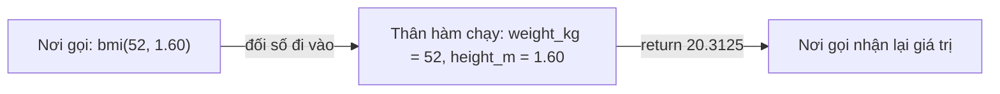

Mọi công cụ mà một LLM agent có thể dùng, như "tìm trên web", "xem thời tiết" hay "gửi email", đều là một **hàm** (function): nhận vào một vài đầu vào (tham số) và trả ra một kết quả (giá trị trả về). Khi xây dựng chương trình AI, bạn sẽ viết, gọi và ghép hàm suốt ngày. Bài này cho bạn thấy cách làm.

## 1. Hàm là một cái máy nhỏ

Từ đầu đến giờ code của bạn chạy từ trên xuống dưới, và khi cần lặp lại các bước thì bạn copy-paste. Cách đó nhanh chóng trở nên lộn xộn. **Hàm** (function) là một khối code có tên: bạn viết một lần và chạy bất cứ khi nào cần.

Hãy hình dung hàm như một **cái máy** hay một **công thức nấu ăn**: bạn cho nguyên liệu vào, máy làm việc, và một món hoàn chỉnh được đưa ra.



Hàm mang lại hai thứ: **tái sử dụng** (viết một lần, gọi nhiều lần) và **đặt tên** (`bmi(...)` cho người đọc biết chuyện gì xảy ra mà không cần xem chi tiết). Bạn đã dùng các hàm Python cho sẵn, gọi là **hàm có sẵn** (built-in function): `print()`, `type()`, `int()`.

## 2. Định nghĩa và gọi hàm

Dùng `def`, tên hàm, dấu ngoặc, dấu hai chấm, rồi phần thân thụt lề:

```python
def say_hello():
    print("Hello!")


say_hello()   # Hello!
say_hello()   # Hello!
```

`def` chỉ *định nghĩa* hàm (giống như viết công thức ra tấm thẻ). Không có gì chạy cho đến khi bạn **gọi** (call) hàm bằng `name()`. Chú ý dấu ngoặc: `say_hello` là bản thân cái hàm, còn `say_hello()` nghĩa là "chạy nó ngay".

## 3. Tham số và đối số

**Tham số** (parameter) là tên biến nằm ở dòng `def`: một chỗ trống. **Đối số** (argument) là giá trị thật bạn đặt vào chỗ trống đó khi gọi hàm.

```python
def add(a, b):
    total = a + b
    return total


result = add(2, 3)
print(result)   # 5
```

Hãy bấm **Visualize** cho đoạn này. Khi `add(2, 3)` được gọi, một khung (frame) mới xuất hiện với `a = 2` và `b = 3`. Sau đó `total = 5` được tạo bên trong khung. Khi `return` chạy, khung biến mất và giá trị `5` quay về dòng đã gọi hàm.

| | Nằm ở đâu | Ví dụ |
|---|---|---|
| **tham số** | ở dòng `def` | `a`, `b` |
| **đối số** | ở lời gọi | `2`, `3` |

Đối số được ghép với tham số **theo vị trí**: đối số đầu vào tham số đầu, và cứ thế.

## 4. return và print

Đây là chỗ người mới hay nhầm nhất.

| | `print(x)` | `return x` |
|---|---|---|
| Làm gì | **hiển thị** `x` lên màn hình | **trả** `x` về cho nơi gọi |
| Chương trình dùng được sau đó không? | không | có: lưu vào biến, tính tiếp |
| Nếu thiếu, lời gọi cho ra | không có gì hữu ích (`None`) | không áp dụng |

```python
def double_print(n):
    print(n * 2)


def double_return(n):
    return n * 2


a = double_print(4)    # in ra 8
b = double_return(4)   # không in gì
print("a is", a)       # a is None
print("b is", b)       # b is 8
print("b + 1 =", b + 1)  # b + 1 = 9
```

Hàm không có `return` sẽ trả về `None` ("không có gì"). Vì vậy `a` là `None`, và `a + 1` sẽ gây lỗi.

> [!WARNING]
> Nếu bạn thấy `None` ở chỗ đáng lẽ là một con số, hoặc lỗi `TypeError: unsupported operand type(s) ... 'NoneType'`, rất có thể bạn đã dùng `print` (hoặc quên `return`) trong hàm.

`return` cũng **kết thúc** hàm ngay lập tức; code phía sau nó không chạy:

```python
def sign(n):
    if n < 0:
        return "negative"
    if n == 0:
        return "zero"
    return "positive"


print(sign(-3), sign(0), sign(8))   # negative zero positive
```

> [!TIP]
> Quy tắc nhớ nhanh: hàm *tính toán* nên `return` kết quả. Để nơi gọi hàm quyết định có in ra hay không.

## 5. Tham số mặc định và keyword argument

Cho tham số một **giá trị mặc định** (default value) bằng dấu `=`. Nếu người gọi bỏ qua tham số đó, Python dùng giá trị mặc định:

```python
def greet(name, greeting="Hello"):
    return f"{greeting}, {name}!"


print(greet("Lan"))                        # Hello, Lan!
print(greet("Lan", "Hi"))                  # Hi, Lan!
print(greet("Lan", greeting="Xin chao"))   # Xin chao, Lan!
```

Xem ba lời gọi:

1. `greet("Lan")` chỉ đưa `name`, nên `greeting` giữ nguyên là `"Hello"`.
2. `greet("Lan", "Hi")` đưa hai đối số theo vị trí, nên `greeting` thành `"Hi"`.
3. `greet("Lan", greeting="Xin chao")` gọi tên tham số. Đây là **keyword argument** (đối số theo tên). Cách này dễ đọc hơn, và thứ tự các keyword argument không quan trọng.

> [!NOTE]
> Tham số có giá trị mặc định phải đứng sau tham số không có: `def f(a, b=1)` hợp lệ, còn `def f(a=1, b)` là lỗi cú pháp.

## 6. Docstring

Một chuỗi ở dòng đầu tiên của thân hàm dùng để mô tả hàm làm gì. Nó gọi là **docstring**:

```python
def average(numbers):
    """Return the mean of a non-empty list of numbers."""
    return sum(numbers) / len(numbers)


print(average([2, 4, 9]))   # 5.0
```

Ở đây `sum(...)` là hàm có sẵn cộng tất cả số trong một list, còn `len(...)` đếm số phần tử. Tên hàm tốt cộng một dòng docstring giúp code vẫn dễ đọc sau nhiều tháng.

## 7. Phạm vi: local, global và shadowing

Biến được tạo ở đâu thì quyết định bạn dùng được nó ở đâu. Khái niệm này gọi là **phạm vi** (scope).

```text
 global
 ┌────────────────────────────────────┐
 │ rate = 0.1                         │
 │                                    │
 │ def add_tax(price):                │
 │ ┌────────────────────────────────┐ │
 │ │ local                          │ │
 │ │ price, tax                     │ │
 │ │ (exist only while it runs)     │ │
 │ └────────────────────────────────┘ │
 └────────────────────────────────────┘
```

Biến tạo bên trong hàm là biến **cục bộ** (local): chúng biến mất khi hàm kết thúc. Biến tạo bên ngoài là biến **toàn cục** (global): hàm có thể đọc chúng.

```python
rate = 0.1                  # biến toàn cục


def add_tax(price):
    tax = price * rate      # tax là cục bộ, rate được đọc từ bên ngoài
    return price + tax


print(add_tax(100))   # 110.0
# print(tax)          # NameError: tax không tồn tại ở bên ngoài
```

**Shadowing (che khuất).** Nếu hàm gán giá trị cho một tên đã tồn tại ở bên ngoài thì sao? Python **không** đổi biến bên ngoài. Nó tạo ra một biến cục bộ hoàn toàn mới cùng tên, và biến này *che* biến toàn cục bên trong hàm:

```python
count = 10            # biến toàn cục


def reset():
    count = 0         # một biến cục bộ MỚI, không phải biến toàn cục
    print("inside:", count)


reset()                  # inside: 0
print("outside:", count)  # outside: 10
```

`count` toàn cục vẫn là `10`. Muốn đưa thông tin ra khỏi hàm, hãy dùng `return`, đừng ngầm sửa biến toàn cục.

## 8. Hàm gọi hàm

Hàm có thể gọi hàm khác. Những mảnh nhỏ ghép lại thành mảnh lớn:

```python
def bmi(weight_kg, height_m):
    return weight_kg / height_m ** 2


def describe(weight_kg, height_m):
    value = bmi(weight_kg, height_m)
    return f"BMI is {value:.1f}"


print(describe(52, 1.60))   # BMI is 20.3
```

Trong f-string, `:.1f` nghĩa là "hiện 1 chữ số thập phân". Bấm **Visualize** để thấy một khung cho `describe` và, bên trong nó, một khung nữa cho `bmi`.

## 9. Lỗi thường gặp

**In ra thay vì trả về.** Hàm hiển thị đáp án, nhưng nơi gọi chỉ nhận được `None`:

```python
def area(width, height):
    print(width * height)


size = area(3, 4)   # in ra 12
print(size)         # None
```

Cách sửa: viết `return width * height`.

**Quên dấu ngoặc.** `say_hello` là bản thân cái hàm; chỉ `say_hello()` mới chạy nó:

```python
def say_hello():
    return "Hello!"


print(say_hello)     # <function say_hello at 0x...>
print(say_hello())   # Hello!
```

**Code sau `return` không bao giờ chạy.** Lệnh `print` bên dưới là code chết:

```python
def double(n):
    return n * 2
    print("done")   # không bao giờ chạy


print(double(5))   # 10
```

**Dùng list làm giá trị mặc định.** Giá trị mặc định chỉ được tạo một lần, nên list mặc định bị chia sẻ giữa mọi lời gọi. Đây là bản xem trước của một cái bẫy bạn sẽ gặp lại sau:

```python
def add_item(item, basket=[]):
    basket.append(item)
    return basket


print(add_item("apple"))   # ['apple']
print(add_item("pear"))    # ['apple', 'pear']  bất ngờ chưa!
```

Tạm thời: chỉ dùng số, chuỗi, `True`/`False` hoặc `None` làm giá trị mặc định, đừng bao giờ dùng `[]` hay `{}`.

**Dùng biến chỉ tồn tại bên trong hàm.** `tax` ở trên được tạo bên trong `add_tax`, nên ở bên ngoài bạn sẽ gặp `NameError: name 'tax' is not defined`. Hãy trả giá trị cần dùng ra bằng `return`.

> [!WARNING]
> Đặt cùng một tên ở trong và ngoài hàm là hợp lệ nhưng dễ gây rối. Hãy ưu tiên đặt tên khác nhau, hoặc truyền giá trị vào bằng tham số.

## Tóm tắt

- `def name(parameters):` định nghĩa hàm; `name(arguments)` chạy hàm. Thiếu `()` thì bạn mới chỉ gọi tên.
- Hàm là một cái máy: đối số đi vào, thân hàm chạy, `return` gửi giá trị về và kết thúc hàm.
- `print` hiển thị giá trị; `return` trả giá trị về. Không có `return` nghĩa là `None`.
- Giá trị mặc định (`greeting="Hello"`) làm tham số thành tùy chọn; keyword argument truyền theo tên.
- Biến bên trong hàm là biến cục bộ; gán cho tên của biến toàn cục bên trong hàm sẽ che nó chứ không đổi nó.
- Hàm có thể gọi hàm khác: xây thứ lớn từ những mảnh nhỏ có tên.
