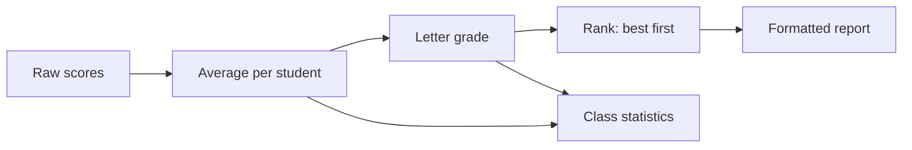
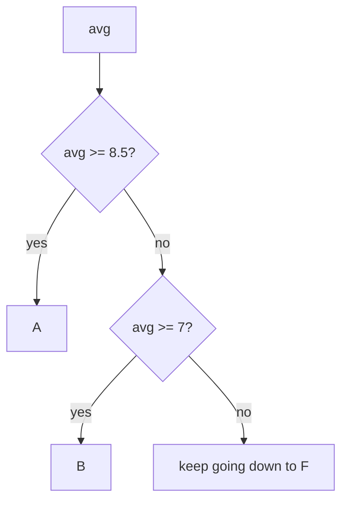

Every data and AI job has small reporting scripts: read some raw numbers, clean them up, and print a summary that a person can read in ten seconds. In this lesson you build one. It is a **grade report** for a class: each student's average, a letter grade, a ranking and some class statistics. It is a small, real tool, and it has the same shape as the scripts you will write at work later.

You will not learn much new Python here. The point is to practise the most important skill of all: **breaking a problem into small functions** and then putting them together.

## 1. The data

Ms. Lan is a teacher. She keeps each student as a dict, and the whole class as a list of dicts:

```python
students = [
    {"name": "An", "scores": [8, 7.5, 9]},
    {"name": "Binh", "scores": [9, 9.5, 8.5]},
    {"name": "Chi", "scores": [5, 6, 4.5]},
]
print(len(students), "students")      # 3 students
print(students[0]["name"])            # An
print(students[0]["scores"])          # [8, 7.5, 9]
```

```text
students ──► [ {name, scores}, {name, scores}, {name, scores} ]
                  An              Binh            Chi
```

She wants the program to turn this raw data into a report she can print.

## 2. The pipeline

A good way to think about a program is as a pipeline: data goes in on the left, and each step changes it a little until the result comes out on the right.



Each box is a job for a small function. If one box breaks, you know exactly where to look.

## 3. Plan before you code

Before you type anything, write down the functions and what goes in and out of each one. This plan is the most valuable part of a project:

| Function | Input | Output |
|---|---|---|
| `average(scores)` | list of numbers | the mean, or `0.0` for an empty list |
| `letter_grade(avg)` | a number | `"A"`, `"B"`, `"C"`, `"D"` or `"F"` |
| `sort_key(row)` | a dict `{"name", "avg"}` | a tuple used for sorting |
| `build_report(students)` | list of dicts | list of text lines, best student first |
| `class_stats(students)` | list of dicts | a dict with count, mean, best, worst, grade counts |

Grades use a 10-point scale:

| Average | Grade |
|---|---|
| 8.5 and above | A |
| 7 and above | B |
| 5.5 and above | C |
| 4 and above | D |
| below 4 | F |

> [!TIP]
> Build from the bottom up. Once `average` works, you never have to think about it again while writing `build_report`. Small functions are easy to test, one at a time.

## 4. Two small tricks

You need a few new things, and all of them are tiny.

**Trick 1: two decimals.** `round(x, 2)` gives a number rounded to 2 decimals. An f-string with `:.2f` shows a number with exactly 2 decimals, even when they are zeros:

```python
x = 8.16666
print(round(x, 2))    # 8.17
print(f"{x:.2f}")     # 8.17
print(f"{9:.2f}")     # 9.00
```

Use `round` when you need a rounded number, and `:.2f` when you only want to display it. In a report, you almost always want `:.2f`.

> [!NOTE]
> `round(2.5)` is `2`, not `3`. An exact half goes to the nearest even number (`round(3.5)` is `4`). For money, prefer `:.2f` when you only need to display.

**Trick 2: `sorted` with a `key`.** You already know `sorted(items)`. With `key=some_function`, Python calls your function on each item and sorts by what it returns. Write the helper with a normal `def`, and pass its name **without parentheses**:

```python
def by_length(word):
    return len(word)

words = ["pear", "fig", "banana"]
print(sorted(words, key=by_length))   # ['fig', 'pear', 'banana']
```

| word | `by_length(word)` |
|---|---|
| `"pear"` | 4 |
| `"fig"` | 3 |
| `"banana"` | 6 |

Python sorts by the right-hand column (3, 4, 6), so the order is `fig`, `pear`, `banana`.

## 5. Sorting by two things

What if the key should be two things, such as "highest average first, then name"? A key can return a **tuple**: two values in parentheses, like `(7.0, "An")`. Python compares tuples one value at a time. It looks at the first values, and only if they are equal does it look at the second ones:

```python
print((1, "b") < (2, "a"))   # True: 1 is smaller than 2, the names do not matter
print((2, "b") < (2, "a"))   # False: first values tie, so "b" < "a" decides
```

To put the highest average first, flip its sign: `-9.0` is smaller than `-7.0`, so 9.0 comes first. The name is the second value, so equal averages are ordered A to Z. Here is the key for each row:

| row | `sort_key(row)` |
|---|---|
| `{"name": "Zoe", "avg": 7.0}` | `(-7.0, "Zoe")` |
| `{"name": "An", "avg": 9.0}` | `(-9.0, "An")` |
| `{"name": "Bao", "avg": 7.0}` | `(-7.0, "Bao")` |

```python
rows = [
    {"name": "Zoe", "avg": 7.0},
    {"name": "An", "avg": 9.0},
    {"name": "Bao", "avg": 7.0},
]

def sort_key(row):
    return (-row["avg"], row["name"])

for row in sorted(rows, key=sort_key):
    print(row["name"], row["avg"])    # An 9.0, then Bao 7.0, then Zoe 7.0
```

> [!NOTE]
> `sorted` returns a new list and leaves the original alone.

## 6. Step 1: the average

Add the scores up and divide by how many there are. An empty list would mean dividing by zero, so handle it first:

```python
def average(scores):
    if not scores:        # an empty list counts as "false"
        return 0.0
    return sum(scores) / len(scores)

print(average([8, 7.5, 9]))   # 8.1666...
print(average([]))            # 0.0
```

## 7. Step 2: the letter grade

Check from the highest threshold down. The first condition that is true wins, so each `if` needs only one comparison:



```python
def letter_grade(avg):
    if avg >= 8.5:
        return "A"
    if avg >= 7:
        return "B"
    if avg >= 5.5:
        return "C"
    if avg >= 4:
        return "D"
    return "F"

print(letter_grade(8.5), letter_grade(7.2), letter_grade(3.9))   # A B F
```

> [!WARNING]
> Boundaries matter: exactly `8.5` is an `A`, exactly `7` is a `B`. Use `>=`, not `>`.

## 8. Step 3: the class report

Loop over the students, compute each average, then sort with the `sort_key` idea. The key `(-avg, name)` puts the highest average first and breaks ties alphabetically:

```python
def average(scores):
    if not scores:
        return 0.0
    return sum(scores) / len(scores)

def letter_grade(avg):
    if avg >= 8.5:
        return "A"
    if avg >= 7:
        return "B"
    if avg >= 5.5:
        return "C"
    if avg >= 4:
        return "D"
    return "F"

students = [
    {"name": "An", "scores": [8, 7.5, 9]},
    {"name": "Binh", "scores": [9, 9.5, 8.5]},
]

def sort_key(row):
    return (-row["avg"], row["name"])

rows = []
for student in students:
    avg = average(student["scores"])
    rows.append({"name": student["name"], "avg": avg})

for row in sorted(rows, key=sort_key):
    print(f"{row['name']}: {row['avg']:.2f} ({letter_grade(row['avg'])})")
```

Each row is a small dict, so `sort_key` can read `row["avg"]` and `row["name"]`. In the exercise, your function returns the lines in a list instead of printing them.

## 9. Step 4: class statistics

Once every student has an average, statistics are a few more loops: count the students, take the mean of the averages, find the best and worst with a loop, and count how many students got each letter.

For the best student, keep "the best so far" and replace it whenever you see a higher average. On a tie, keep the name that comes first alphabetically:

```python
averages = {"An": 8.2, "Binh": 9.0, "Chi": 5.2}

best_name = "An"
best_avg = averages["An"]
for name in averages:
    avg = averages[name]
    if avg > best_avg or (avg == best_avg and name < best_name):
        best_name = name
        best_avg = avg
print(best_name, best_avg)   # Binh 9.0
```

A dict is perfect for counting letters. Press **Visualize** on this block and watch `counts` change after every letter:

```python
grades = ["B", "A", "B", "F"]
counts = {"A": 0, "B": 0, "C": 0, "D": 0, "F": 0}
for grade in grades:
    counts[grade] += 1
print(counts)   # {'A': 1, 'B': 2, 'C': 0, 'D': 0, 'F': 1}
```

## 10. Sample output

For the three students in section 1, the final report looks like this:

```text
Binh: 9.00 (A)
An: 8.17 (B)
Chi: 5.17 (D)
```

And `class_stats` gives `{"count": 3, "mean": 7.44, "best": "Binh", "worst": "Chi", "grade_counts": {"A": 1, "B": 1, "C": 0, "D": 1, "F": 0}}` (the mean is rounded here for display only).

## 11. Your turn

Open the two exercises. Exercise 1 covers Steps 1 to 3, exercise 2 covers Step 4. The editor already contains function skeletons with `# TODO` steps. Write your code inside the functions and `return` the answer. Press **Check** often: getting one test green at a time is a great way to build a program.

## 12. Common mistakes

**Using `>` instead of `>=`.** With `avg > 8.5`, a student with exactly `8.5` gets a `B`. The tests check the boundaries, so use `>=`.

**Forgetting the empty list.** `sum([]) / len([])` crashes with `ZeroDivisionError: division by zero`. Add `if not scores: return 0.0` first.

**Printing instead of returning.** If `build_report` prints the lines, the caller gets `None` back and the test fails. Collect the lines in a list and `return` it:

```python
def wrong():
    print("An: 8.17 (B)")      # the caller receives None

def right():
    return ["An: 8.17 (B)"]    # the caller receives the list
```

**Putting parentheses after the key.** `sorted(rows, key=sort_key())` calls `sort_key` right away with no argument and crashes with `TypeError`. Write `key=sort_key`.

## Recap

- A real program is small functions that each do one job and call each other. Write the plan (function, input, output) before the code.
- `average` guards against the empty list; `letter_grade` checks thresholds from high to low.
- `sorted(items, key=helper)` sorts by what a `def` helper returns; a tuple key like `(-avg, name)` gives "highest first, ties by name".
- `round(x, 2)` rounds a number; `f"{x:.2f}"` shows exactly 2 decimals.
- A loop that remembers "the best so far" finds the best item; a dict is great for counting.

## Take it further

Done early? Try these on your own in the editor. They are also good ideas to mention on your CV once the project works:

- Read the scores from a CSV file instead of a hard-coded list (you will learn files in a later lesson).
- Export the report as Markdown: one table row per student.
- Draw a histogram of the grades with text bars, like `"#" * count` (see example 3).
- Make the last score (the exam) count double, or drop each student's lowest score.
