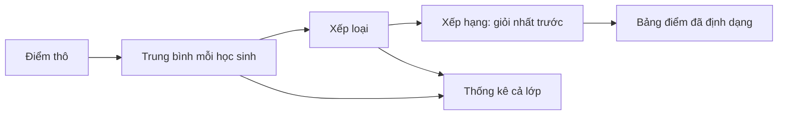
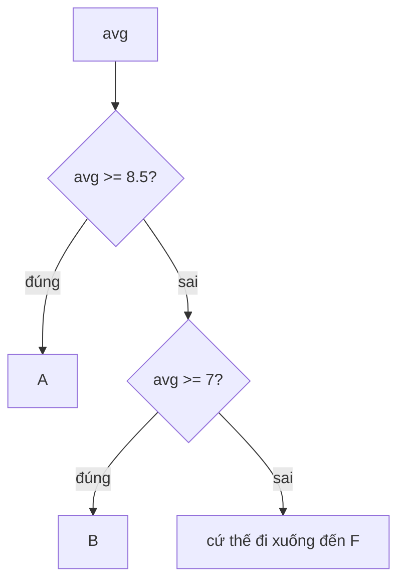

Công việc nào về dữ liệu hay AI cũng có những script báo cáo nhỏ: đọc vài con số thô, làm sạch, rồi in ra bản tóm tắt mà một người đọc trong mười giây là hiểu. Trong bài này bạn sẽ tự xây một script như vậy. Đó là **bảng điểm** của một lớp: điểm trung bình của từng học sinh, xếp loại, xếp hạng và vài thống kê cả lớp. Đây là một công cụ nhỏ nhưng có thật, và nó có cùng cấu trúc với các script bạn sẽ viết khi đi làm sau này.

Bài này không dạy nhiều Python mới. Mục tiêu là luyện kỹ năng quan trọng nhất: **chia một bài toán thành các hàm nhỏ** (function) rồi ghép chúng lại với nhau.

## 1. Dữ liệu

Cô Lan là giáo viên. Cô lưu mỗi học sinh là một dict, và cả lớp là một list các dict:

```python
students = [
    {"name": "An", "scores": [8, 7.5, 9]},
    {"name": "Binh", "scores": [9, 9.5, 8.5]},
    {"name": "Chi", "scores": [5, 6, 4.5]},
]
print(len(students), "students")      # 3 students
print(students[0]["name"])            # An
print(students[0]["scores"])          # [8, 7.5, 9]
```

```text
students ──► [ {name, scores}, {name, scores}, {name, scores} ]
                  An              Binh            Chi
```

Cô muốn chương trình biến dữ liệu thô này thành một bảng điểm có thể in ra.

## 2. Dây chuyền xử lý (pipeline)

Một cách nghĩ hay về chương trình là xem nó như một dây chuyền: dữ liệu đi vào bên trái, mỗi bước biến đổi nó một chút cho đến khi kết quả ra ở bên phải.



Mỗi ô là việc của một hàm nhỏ. Nếu một ô bị lỗi, bạn biết chính xác phải tìm ở đâu.

## 3. Lên kế hoạch trước khi viết code

Trước khi gõ gì, hãy viết ra các hàm và cái gì đi vào, cái gì đi ra của từng hàm. Bản kế hoạch này là phần giá trị nhất của một project:

| Hàm | Đầu vào | Đầu ra |
|---|---|---|
| `average(scores)` | list các số | điểm trung bình, hoặc `0.0` nếu list rỗng |
| `letter_grade(avg)` | một số | `"A"`, `"B"`, `"C"`, `"D"` hoặc `"F"` |
| `sort_key(row)` | dict `{"name", "avg"}` | một tuple dùng để sắp xếp |
| `build_report(students)` | list các dict | list các dòng chữ, học sinh giỏi nhất đứng đầu |
| `class_stats(students)` | list các dict | dict gồm số lượng, trung bình, tốt nhất, kém nhất, đếm xếp loại |

Xếp loại theo thang điểm 10:

| Điểm trung bình | Xếp loại |
|---|---|
| từ 8.5 trở lên | A |
| từ 7 trở lên | B |
| từ 5.5 trở lên | C |
| từ 4 trở lên | D |
| dưới 4 | F |

> [!TIP]
> Hãy xây từ dưới lên. Khi `average` đã chạy đúng, bạn không cần nghĩ lại về nó lúc viết `build_report`. Hàm nhỏ thì dễ kiểm thử, từng cái một.

## 4. Hai mẹo nhỏ

Bạn cần vài thứ mới, và thứ nào cũng rất nhỏ.

**Mẹo 1: hai chữ số thập phân.** `round(x, 2)` cho ra số đã làm tròn đến 2 chữ số thập phân. F-string với `:.2f` hiển thị số với đúng 2 chữ số thập phân, kể cả khi đó là số 0:

```python
x = 8.16666
print(round(x, 2))    # 8.17
print(f"{x:.2f}")     # 8.17
print(f"{9:.2f}")     # 9.00
```

Dùng `round` khi bạn cần một số đã làm tròn, và `:.2f` khi bạn chỉ muốn hiển thị. Trong báo cáo, gần như lúc nào bạn cũng muốn dùng `:.2f`.

> [!NOTE]
> `round(2.5)` ra `2`, không phải `3`. Số nằm đúng giữa sẽ được làm tròn về số chẵn gần nhất (`round(3.5)` ra `4`). Với tiền, hãy dùng `:.2f` khi bạn chỉ cần hiển thị.

**Mẹo 2: `sorted` với `key`.** Bạn đã biết `sorted(items)`. Với `key=some_function`, Python gọi hàm của bạn trên từng phần tử và sắp xếp theo giá trị hàm trả về. Hãy viết hàm phụ (helper) bằng `def` bình thường, và truyền tên hàm **không có dấu ngoặc**:

```python
def by_length(word):
    return len(word)

words = ["pear", "fig", "banana"]
print(sorted(words, key=by_length))   # ['fig', 'pear', 'banana']
```

| từ | `by_length(word)` |
|---|---|
| `"pear"` | 4 |
| `"fig"` | 3 |
| `"banana"` | 6 |

Python sắp xếp theo cột bên phải (3, 4, 6), nên thứ tự là `fig`, `pear`, `banana`.

## 5. Sắp xếp theo hai tiêu chí

Nếu key cần gồm hai thứ, ví dụ "điểm trung bình cao nhất trước, rồi đến tên" thì sao? Key có thể trả về một **tuple** (bộ giá trị): hai giá trị trong ngoặc tròn, như `(7.0, "An")`. Python so sánh tuple từng giá trị một. Nó xem giá trị đầu tiên trước, và chỉ khi chúng bằng nhau mới xem giá trị thứ hai:

```python
print((1, "b") < (2, "a"))   # True: 1 is smaller than 2, the names do not matter
print((2, "b") < (2, "a"))   # False: first values tie, so "b" < "a" decides
```

Để điểm cao nhất đứng đầu, hãy đổi dấu của nó: `-9.0` nhỏ hơn `-7.0`, nên 9.0 đứng trước. Tên là giá trị thứ hai, nên các điểm bằng nhau được xếp theo A đến Z. Đây là key của từng row:

| row | `sort_key(row)` |
|---|---|
| `{"name": "Zoe", "avg": 7.0}` | `(-7.0, "Zoe")` |
| `{"name": "An", "avg": 9.0}` | `(-9.0, "An")` |
| `{"name": "Bao", "avg": 7.0}` | `(-7.0, "Bao")` |

```python
rows = [
    {"name": "Zoe", "avg": 7.0},
    {"name": "An", "avg": 9.0},
    {"name": "Bao", "avg": 7.0},
]

def sort_key(row):
    return (-row["avg"], row["name"])

for row in sorted(rows, key=sort_key):
    print(row["name"], row["avg"])    # An 9.0, then Bao 7.0, then Zoe 7.0
```

> [!NOTE]
> `sorted` trả về một list mới và không thay đổi list gốc.

## 6. Bước 1: điểm trung bình

Cộng các điểm rồi chia cho số lượng. List rỗng sẽ gây chia cho 0, nên hãy xử lý trường hợp đó trước:

```python
def average(scores):
    if not scores:        # an empty list counts as "false"
        return 0.0
    return sum(scores) / len(scores)

print(average([8, 7.5, 9]))   # 8.1666...
print(average([]))            # 0.0
```

## 7. Bước 2: xếp loại

Kiểm tra từ ngưỡng cao nhất xuống thấp. Điều kiện nào đúng trước thì thắng, nên mỗi `if` chỉ cần một phép so sánh:



```python
def letter_grade(avg):
    if avg >= 8.5:
        return "A"
    if avg >= 7:
        return "B"
    if avg >= 5.5:
        return "C"
    if avg >= 4:
        return "D"
    return "F"

print(letter_grade(8.5), letter_grade(7.2), letter_grade(3.9))   # A B F
```

> [!WARNING]
> Chú ý các điểm biên: đúng `8.5` là `A`, đúng `7` là `B`. Dùng `>=`, không dùng `>`.

## 8. Bước 3: bảng điểm cả lớp

Duyệt qua các học sinh, tính điểm trung bình của từng người, rồi sắp xếp theo ý tưởng `sort_key`. Key `(-avg, name)` đưa điểm cao nhất lên đầu, và nếu bằng điểm thì xếp theo tên:

```python
def average(scores):
    if not scores:
        return 0.0
    return sum(scores) / len(scores)

def letter_grade(avg):
    if avg >= 8.5:
        return "A"
    if avg >= 7:
        return "B"
    if avg >= 5.5:
        return "C"
    if avg >= 4:
        return "D"
    return "F"

students = [
    {"name": "An", "scores": [8, 7.5, 9]},
    {"name": "Binh", "scores": [9, 9.5, 8.5]},
]

def sort_key(row):
    return (-row["avg"], row["name"])

rows = []
for student in students:
    avg = average(student["scores"])
    rows.append({"name": student["name"], "avg": avg})

for row in sorted(rows, key=sort_key):
    print(f"{row['name']}: {row['avg']:.2f} ({letter_grade(row['avg'])})")
```

Mỗi row là một dict nhỏ, nên `sort_key` đọc được `row["avg"]` và `row["name"]`. Trong bài tập, hàm của bạn trả về các dòng trong một list thay vì in ra.

## 9. Bước 4: thống kê cả lớp

Khi mỗi học sinh đã có điểm trung bình, thống kê chỉ là vài vòng lặp nữa: đếm số học sinh, lấy trung bình của các điểm trung bình, tìm người cao nhất và thấp nhất bằng vòng lặp, và đếm số học sinh theo từng loại.

Để tìm học sinh giỏi nhất, hãy giữ "người tốt nhất cho đến lúc này" và thay thế mỗi khi gặp điểm trung bình cao hơn. Nếu bằng điểm thì giữ tên đứng trước theo bảng chữ cái:

```python
averages = {"An": 8.2, "Binh": 9.0, "Chi": 5.2}

best_name = "An"
best_avg = averages["An"]
for name in averages:
    avg = averages[name]
    if avg > best_avg or (avg == best_avg and name < best_name):
        best_name = name
        best_avg = avg
print(best_name, best_avg)   # Binh 9.0
```

Dict rất hợp để đếm các loại. Bấm **Visualize** ở khối code này để xem `counts` thay đổi sau mỗi chữ cái:

```python
grades = ["B", "A", "B", "F"]
counts = {"A": 0, "B": 0, "C": 0, "D": 0, "F": 0}
for grade in grades:
    counts[grade] += 1
print(counts)   # {'A': 1, 'B': 2, 'C': 0, 'D': 0, 'F': 1}
```

## 10. Kết quả mẫu

Với ba học sinh ở phần 1, bảng điểm cuối cùng trông như sau:

```text
Binh: 9.00 (A)
An: 8.17 (B)
Chi: 5.17 (D)
```

Còn `class_stats` trả về `{"count": 3, "mean": 7.44, "best": "Binh", "worst": "Chi", "grade_counts": {"A": 1, "B": 1, "C": 0, "D": 1, "F": 0}}` (mean ở đây chỉ làm tròn để hiển thị).

## 11. Đến lượt bạn

Mở hai bài tập. Bài 1 gồm Bước 1 đến 3, bài 2 là Bước 4. Trong editor đã có sẵn khung hàm với các bước `# TODO`. Viết code bên trong hàm và `return` kết quả. Hãy bấm **Kiểm tra** thường xuyên: làm cho từng test chuyển xanh một là cách tốt để xây dựng chương trình.

## 12. Lỗi thường gặp

**Dùng `>` thay vì `>=`.** Với `avg > 8.5`, học sinh có đúng `8.5` bị xếp `B`. Test kiểm tra các điểm biên, nên hãy dùng `>=`.

**Quên list rỗng.** `sum([]) / len([])` báo lỗi `ZeroDivisionError: division by zero`. Hãy thêm `if not scores: return 0.0` ở đầu hàm.

**In ra thay vì trả về.** Nếu `build_report` chỉ in các dòng, nơi gọi hàm nhận lại `None` và test thất bại. Hãy gom các dòng vào một list rồi `return` nó:

```python
def wrong():
    print("An: 8.17 (B)")      # the caller receives None

def right():
    return ["An: 8.17 (B)"]    # the caller receives the list
```

**Thêm dấu ngoặc sau key.** `sorted(rows, key=sort_key())` gọi `sort_key` ngay lập tức mà không có đối số và báo lỗi `TypeError`. Hãy viết `key=sort_key`.

## Tóm tắt

- Một chương trình thật là các hàm nhỏ, mỗi hàm làm một việc và gọi lẫn nhau. Hãy viết kế hoạch (hàm, đầu vào, đầu ra) trước khi viết code.
- `average` phải xử lý list rỗng; `letter_grade` kiểm tra ngưỡng từ cao xuống thấp.
- `sorted(items, key=helper)` sắp xếp theo giá trị mà hàm phụ `def` trả về; key tuple như `(-avg, name)` cho kết quả "cao nhất trước, bằng điểm thì theo tên".
- `round(x, 2)` làm tròn số; `f"{x:.2f}"` hiển thị đúng 2 chữ số thập phân.
- Vòng lặp nhớ "người tốt nhất cho đến lúc này" sẽ tìm ra phần tử tốt nhất; dict rất hợp để đếm.

## Làm tiếp nếu muốn

Xong sớm? Tự thử trong editor nhé. Đây cũng là những ý tưởng hay để ghi vào CV khi project đã chạy tốt:

- Đọc điểm từ file CSV thay vì dùng list viết sẵn (bạn sẽ học về file ở bài sau).
- Xuất báo cáo ra Markdown: mỗi học sinh một dòng của bảng.
- Vẽ biểu đồ phân bố xếp loại bằng thanh ký tự, như `"#" * count` (xem ví dụ 3).
- Cho điểm cuối cùng (bài thi) tính gấp đôi, hoặc bỏ điểm thấp nhất của mỗi học sinh.
