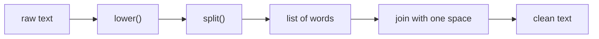

Almost everything an AI engineer touches is text: the user's prompt, the model's answer, a document to summarise, a label like `"Positive"`. Text is messy. It arrives with extra spaces, odd capital letters and stray punctuation, and a program that cannot clean it will give strange results. In this lesson you learn the everyday tools for **strings** (`str`): cutting text, cleaning it, splitting it into words, and formatting it neatly.

## 1. A string is a row of characters

You already know that a list is a row of numbered lockers. A **string** is the same idea, but every locker holds one **character** (a letter, digit, space or symbol). Indexing and slicing work exactly as they do for lists:

```text
index:     0    1    2    3    4    5
         [ "P", "y", "t", "h", "o", "n" ]
index:    -6   -5   -4   -3   -2   -1
```

```python
word = "Python"
print(len(word))    # 6
print(word[0])      # P
print(word[-1])     # n
print(word[1:4])    # yth
print(word[:2])     # Py
print(word[2:])     # thon
```

`word[1:4]` starts at index 1 and stops **before** index 4, just like a list slice. Spaces count as characters too: `len("a b")` is `3`.

## 2. Looping over characters

A `for` loop gives you one character at a time:

```python
count = 0
for ch in "banana":
    if ch == "a":
        count = count + 1
print(count)  # 3
```

Press **Visualize** on this block and watch `ch` take the values `b`, `a`, `n`, `a`, `n`, `a` while `count` grows.

## 3. Strings never change: methods return a new string

This is the most important idea in the lesson. A string is **immutable**: once it exists, nobody can change it. A string method such as `strip()` does not edit the text. It builds a **new** string and hands it back. If you do not catch it in a variable, it is lost.

```python
name = "  Lan  "
name.strip()              # the new string is thrown away
print(f"[{name}]")        # [  Lan  ]  (unchanged!)
name = name.strip()       # catch it by assigning
print(f"[{name}]")        # [Lan]
```

Here is what `name` holds as the code runs:

| line | code | `name` |
|---|---|---|
| 1 | `name = "  Lan  "` | `"  Lan  "` |
| 2 | `name.strip()` | `"  Lan  "` (a new string was made, then dropped) |
| 4 | `name = name.strip()` | `"Lan"` |

> [!WARNING]
> Writing `name.strip()` on its own line does nothing useful. Always write `name = name.strip()` (or use the result straight away).

## 4. The most useful methods

A **method** is a function that belongs to a value. You call it with a dot: `text.upper()`. Here are the ones you will use every day:

| Method | What it does | Example → result |
|---|---|---|
| `lower()` / `upper()` | change letter case | `"Hi".lower()` → `"hi"` |
| `strip()` | remove spaces at both ends | `"  hi ".strip()` → `"hi"` |
| `replace(old, new)` | swap every `old` for `new` | `"a-b".replace("-", " ")` → `"a b"` |
| `startswith(x)` / `endswith(x)` | does the text begin / end with `x`? | `"cat.txt".endswith(".txt")` → `True` |
| `find(x)` | index of the first `x`, or `-1` | `"hello".find("l")` → `2` |
| `x in text` | is `x` somewhere inside? | `"ell" in "hello"` → `True` |

```python
raw = "  Hello, World!  "
clean = raw.strip()
print(clean.lower())                  # hello, world!
print(clean.upper())                  # HELLO, WORLD!
print(clean.replace("World", "AI"))   # Hello, AI!
print(clean.startswith("Hello"))      # True
print(clean.endswith("?"))            # False
print(clean.find("World"))            # 7
print(clean.find("cat"))              # -1
print("World" in clean)               # True
```

Methods can be **chained**: each one works on the result of the one before it.

```python
print("  Hello There  ".strip().lower())  # hello there
```

> [!TIP]
> To check whether a word is present, use `in`. Use `find()` only when you need the position.

## 5. split and join

`split()` cuts a string into a **list** of pieces. `join()` glues a list of strings back into one string. They are opposites:

```text
"a,b,c"  ──split(",")──►  ["a", "b", "c"]  ──" | ".join(...)──►  "a | b | c"
```

```python
line = "red,green,blue"
colors = line.split(",")
print(colors)               # ['red', 'green', 'blue']
print(" | ".join(colors))   # red | green | blue
```

Notice the order in `join`: the **separator** comes first, and the list goes inside the brackets. Calling `split()` with nothing inside the brackets splits on any run of spaces and ignores extra spaces at the ends, which is perfect for words:

```python
sentence = "  the   cat sat  "
words = sentence.split()
print(words)            # ['the', 'cat', 'sat']
print(len(words))       # 3
print(" ".join(words))  # the cat sat
```

`join` only accepts strings. To join numbers, turn them into text first:

```python
numbers = [3, 1, 2]
parts = []
for n in numbers:
    parts.append(str(n))
print(",".join(parts))  # 3,1,2
```

## 6. Formatting numbers in f-strings

You know `f"{value}"`. After the value you can add a colon and a **format spec** that says how to show it:

| Spec | Meaning | Example (`value`) → result |
|---|---|---|
| `:.2f` | 2 digits after the decimal point | `3.14159` → `3.14` |
| `:,` | commas between thousands | `1234567` → `1,234,567` |
| `:>8` | right-align in 8 characters | `"ai"` → `"      ai"` |
| `:<10` | left-align in 10 characters | `"ai"` → `"ai        "` |
| `:>8.2f` | right-align, 2 decimals | `3.5` → `"    3.50"` |
| `:>8,` | combine: right-align, with commas | `1234` → `"   1,234"` |
| `:,.2f` | commas and 2 decimals | `1234.5` → `1,234.50` |

```python
price = 1234.5
word = "ai"
print(f"{price:.2f}")    # 1234.50
print(f"{price:,.2f}")   # 1,234.50
print(f"[{word:>8}]")    # [      ai]
print(f"[{word:<8}]")    # [ai      ]
```

Alignment is how you make neat columns. The number after `<` or `>` is the **width** of the column:

```python
print(f"{'model':<10}{'tokens':>8}")
print(f"{'small':<10}{12345:>8,}")
print(f"{'big':<10}{987:>8,}")
```

The output lines up like a table:

```text
model       tokens
small       12,345
big            987
```

## 7. Cleaning a prompt

Users type in all sorts of ways: `"   Summarize THIS   text  "`. Before a program compares or sends text, it **normalises** it: one style for everyone. The usual recipe is `lower()`, then `split()`, then `join()`:



```python
raw_prompt = "   Summarize THIS   text, please!  "
words = raw_prompt.lower().split()
clean_prompt = " ".join(words)
print(clean_prompt)  # summarize this text, please!
print(len(words))    # 4
```

Then an f-string builds a **prompt template** by dropping values into fixed text:

```python
role = "helpful tutor"
topic = "python strings"
limit = 50
prompt = f"You are a {role}. Answer in {limit} words about {topic}."
print(prompt)  # You are a helpful tutor. Answer in 50 words about python strings.
```

## 8. Common mistakes

**Forgetting to keep the result.** `text.upper()` alone changes nothing. Write `text = text.upper()`.

**Trying to change a character.** Strings are immutable, so this crashes with `TypeError: 'str' object does not support item assignment`:

```text
word = "Python"
word[0] = "J"
```

Build a new string instead: `"J" + word[1:]` gives `"Jython"`.

**Going past the end.** `"abc"[3]` raises `IndexError`, because the valid indexes are 0, 1 and 2.

**Using `find()` as a yes/no answer.** `find()` returns the *position*, not `True`/`False`. A match at index 0 gives `0`, which counts as `False`, and "not found" gives `-1`, which counts as `True`. Both are the wrong way round:

```python
text = "hello"
if text.find("h"):        # find returns 0, and 0 counts as False
    print("found")
else:
    print("missing")      # missing  (wrong!)

if "h" in text:           # use `in` for yes/no questions
    print("found")        # found
```

**Joining numbers.** `",".join([1, 2])` raises `TypeError` because `join` needs strings. Convert with `str()` first.

## Recap

- A string is a row of characters: index and slice it like a list, and loop over it with `for ch in text`.
- Strings are immutable. Methods like `strip()`, `lower()` and `replace()` return a **new** string, so assign the result: `text = text.strip()`.
- Handy tools: `lower`, `upper`, `strip`, `replace`, `startswith`, `endswith`, `find`, and `in`.
- `split()` turns text into a list; `separator.join(list)` turns a list of strings back into text.
- Format specs in f-strings: `:.2f`, `:,`, `:>8`, `:<10` make numbers and columns look right.
- To normalise a prompt: `lower()`, `split()`, `" ".join(...)`.
