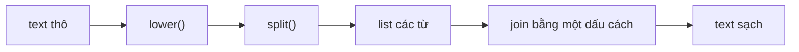

Gần như mọi thứ một AI engineer đụng tới đều là text: prompt của người dùng, câu trả lời của model, một tài liệu cần tóm tắt, một nhãn như `"Positive"`. Text thường rất "bẩn": thừa dấu cách, chữ hoa chữ thường lung tung, dấu câu lạc chỗ, và chương trình không làm sạch được sẽ cho kết quả kỳ lạ. Trong bài này bạn học bộ công cụ hằng ngày cho **chuỗi** (string, kiểu `str`): cắt text, làm sạch, tách thành từ và định dạng cho gọn đẹp.

## 1. Chuỗi là một hàng ký tự

Bạn đã biết list giống một dãy ngăn tủ được đánh số. **Chuỗi** (string) cũng vậy, nhưng mỗi ngăn chứa một **ký tự** (chữ, số, dấu cách hoặc ký hiệu). Lấy phần tử theo index và cắt (slice) hoạt động y hệt list:

```text
index:     0    1    2    3    4    5
         [ "P", "y", "t", "h", "o", "n" ]
index:    -6   -5   -4   -3   -2   -1
```

```python
word = "Python"
print(len(word))    # 6
print(word[0])      # P
print(word[-1])     # n
print(word[1:4])    # yth
print(word[:2])     # Py
print(word[2:])     # thon
```

`word[1:4]` bắt đầu ở index 1 và dừng **trước** index 4, giống slice của list. Dấu cách cũng là ký tự: `len("a b")` bằng `3`.

## 2. Duyệt qua từng ký tự

Vòng lặp `for` đưa cho bạn từng ký tự một:

```python
count = 0
for ch in "banana":
    if ch == "a":
        count = count + 1
print(count)  # 3
```

Bấm **Visualize** trên khối code này và xem `ch` lần lượt nhận các giá trị `b`, `a`, `n`, `a`, `n`, `a` trong khi `count` tăng dần.

## 3. Chuỗi không bao giờ đổi: phương thức trả về chuỗi mới

Đây là ý quan trọng nhất của bài. Chuỗi là **bất biến** (immutable): đã tạo ra rồi thì không ai sửa được. Một phương thức (method) như `strip()` không sửa text gốc. Nó tạo ra một chuỗi **mới** rồi đưa lại cho bạn. Nếu bạn không hứng nó vào một biến, nó sẽ mất.

```python
name = "  Lan  "
name.strip()              # chuỗi mới bị vứt đi
print(f"[{name}]")        # [  Lan  ]  (không đổi!)
name = name.strip()       # hứng lại bằng phép gán
print(f"[{name}]")        # [Lan]
```

Đây là giá trị của `name` khi code chạy:

| dòng | code | `name` |
|---|---|---|
| 1 | `name = "  Lan  "` | `"  Lan  "` |
| 2 | `name.strip()` | `"  Lan  "` (chuỗi mới được tạo ra rồi bị bỏ) |
| 4 | `name = name.strip()` | `"Lan"` |

> [!WARNING]
> Viết `name.strip()` riêng một dòng thì không có tác dụng gì. Hãy luôn viết `name = name.strip()` (hoặc dùng kết quả ngay lập tức).

## 4. Các phương thức hữu ích nhất

**Phương thức** (method) là một hàm gắn với một giá trị. Bạn gọi nó bằng dấu chấm: `text.upper()`. Đây là những phương thức bạn sẽ dùng mỗi ngày:

| Phương thức | Làm gì | Ví dụ → kết quả |
|---|---|---|
| `lower()` / `upper()` | đổi chữ thường / chữ hoa | `"Hi".lower()` → `"hi"` |
| `strip()` | bỏ dấu cách ở hai đầu | `"  hi ".strip()` → `"hi"` |
| `replace(old, new)` | thay mọi `old` bằng `new` | `"a-b".replace("-", " ")` → `"a b"` |
| `startswith(x)` / `endswith(x)` | text có bắt đầu / kết thúc bằng `x` không? | `"cat.txt".endswith(".txt")` → `True` |
| `find(x)` | index của `x` đầu tiên, hoặc `-1` | `"hello".find("l")` → `2` |
| `x in text` | `x` có nằm đâu đó trong text không? | `"ell" in "hello"` → `True` |

```python
raw = "  Hello, World!  "
clean = raw.strip()
print(clean.lower())                  # hello, world!
print(clean.upper())                  # HELLO, WORLD!
print(clean.replace("World", "AI"))   # Hello, AI!
print(clean.startswith("Hello"))      # True
print(clean.endswith("?"))            # False
print(clean.find("World"))            # 7
print(clean.find("cat"))              # -1
print("World" in clean)               # True
```

Các phương thức có thể **gọi nối tiếp** (chaining): cái sau làm việc trên kết quả của cái trước.

```python
print("  Hello There  ".strip().lower())  # hello there
```

> [!TIP]
> Muốn kiểm tra một từ có xuất hiện hay không, hãy dùng `in`. Chỉ dùng `find()` khi bạn cần vị trí.

## 5. split và join

`split()` cắt một chuỗi thành **list** các mảnh. `join()` ghép một list các chuỗi lại thành một chuỗi. Hai hàm này ngược nhau:

```text
"a,b,c"  ──split(",")──►  ["a", "b", "c"]  ──" | ".join(...)──►  "a | b | c"
```

```python
line = "red,green,blue"
colors = line.split(",")
print(colors)               # ['red', 'green', 'blue']
print(" | ".join(colors))   # red | green | blue
```

Chú ý thứ tự trong `join`: **dấu ngăn cách** đứng trước, còn list nằm trong ngoặc. Gọi `split()` mà không truyền gì vào ngoặc sẽ tách theo mọi cụm dấu cách và bỏ qua dấu cách thừa ở hai đầu, rất hợp để tách từ:

```python
sentence = "  the   cat sat  "
words = sentence.split()
print(words)            # ['the', 'cat', 'sat']
print(len(words))       # 3
print(" ".join(words))  # the cat sat
```

`join` chỉ nhận chuỗi. Muốn ghép các số, hãy đổi chúng thành text trước:

```python
numbers = [3, 1, 2]
parts = []
for n in numbers:
    parts.append(str(n))
print(",".join(parts))  # 3,1,2
```

## 6. Định dạng số trong f-string

Bạn đã biết `f"{value}"`. Sau giá trị, bạn có thể thêm dấu hai chấm và một **format spec** (đặc tả định dạng) để chỉ cách hiển thị:

| Spec | Ý nghĩa | Ví dụ (`value`) → kết quả |
|---|---|---|
| `:.2f` | 2 chữ số sau dấu thập phân | `3.14159` → `3.14` |
| `:,` | dấu phẩy ngăn cách hàng nghìn | `1234567` → `1,234,567` |
| `:>8` | căn phải trong 8 ký tự | `"ai"` → `"      ai"` |
| `:<10` | căn trái trong 10 ký tự | `"ai"` → `"ai        "` |
| `:>8.2f` | căn phải, 2 chữ số thập phân | `3.5` → `"    3.50"` |
| `:>8,` | kết hợp: căn phải, có dấu phẩy | `1234` → `"   1,234"` |
| `:,.2f` | dấu phẩy và 2 chữ số thập phân | `1234.5` → `1,234.50` |

```python
price = 1234.5
word = "ai"
print(f"{price:.2f}")    # 1234.50
print(f"{price:,.2f}")   # 1,234.50
print(f"[{word:>8}]")    # [      ai]
print(f"[{word:<8}]")    # [ai      ]
```

Căn lề là cách tạo ra các cột ngay ngắn. Con số sau `<` hoặc `>` là **độ rộng** (width) của cột:

```python
print(f"{'model':<10}{'tokens':>8}")
print(f"{'small':<10}{12345:>8,}")
print(f"{'big':<10}{987:>8,}")
```

Kết quả thẳng hàng như một cái bảng:

```text
model       tokens
small       12,345
big            987
```

## 7. Làm sạch một prompt

Người dùng gõ đủ kiểu: `"   Summarize THIS   text  "`. Trước khi so sánh hoặc gửi text đi, chương trình **chuẩn hóa** (normalise) nó: đưa mọi cách gõ về cùng một dạng. Công thức quen thuộc là `lower()`, rồi `split()`, rồi `join()`:



```python
raw_prompt = "   Summarize THIS   text, please!  "
words = raw_prompt.lower().split()
clean_prompt = " ".join(words)
print(clean_prompt)  # summarize this text, please!
print(len(words))    # 4
```

Sau đó, f-string giúp dựng **prompt template** (khuôn prompt) bằng cách điền giá trị vào đoạn text cố định:

```python
role = "helpful tutor"
topic = "python strings"
limit = 50
prompt = f"You are a {role}. Answer in {limit} words about {topic}."
print(prompt)  # You are a helpful tutor. Answer in 50 words about python strings.
```

## 8. Lỗi thường gặp

**Quên giữ lại kết quả.** Chỉ viết `text.upper()` thì không có gì thay đổi. Hãy viết `text = text.upper()`.

**Cố đổi một ký tự.** Chuỗi là bất biến nên đoạn này lỗi `TypeError: 'str' object does not support item assignment`:

```text
word = "Python"
word[0] = "J"
```

Thay vào đó hãy dựng chuỗi mới: `"J" + word[1:]` cho ra `"Jython"`.

**Vượt quá cuối chuỗi.** `"abc"[3]` gây `IndexError`, vì index hợp lệ chỉ là 0, 1 và 2.

**Dùng `find()` như câu trả lời có/không.** `find()` trả về *vị trí*, không phải `True`/`False`. Khớp ở index 0 cho ra `0`, mà `0` được coi là `False`; còn "không thấy" cho ra `-1`, mà `-1` được coi là `True`. Cả hai đều ngược:

```python
text = "hello"
if text.find("h"):        # find trả về 0, và 0 được coi là False
    print("found")
else:
    print("missing")      # missing  (sai!)

if "h" in text:           # dùng `in` cho câu hỏi có/không
    print("found")        # found
```

**Ghép các số.** `",".join([1, 2])` gây `TypeError` vì `join` cần chuỗi. Hãy đổi bằng `str()` trước.

## Tóm tắt

- Chuỗi là một hàng ký tự: lấy index và slice như list, và duyệt bằng `for ch in text`.
- Chuỗi là bất biến. Các phương thức như `strip()`, `lower()`, `replace()` trả về chuỗi **mới**, nên hãy gán lại kết quả: `text = text.strip()`.
- Công cụ hay dùng: `lower`, `upper`, `strip`, `replace`, `startswith`, `endswith`, `find` và `in`.
- `split()` biến text thành list; `separator.join(list)` biến list các chuỗi trở lại thành text.
- Format spec trong f-string: `:.2f`, `:,`, `:>8`, `:<10` giúp số và cột trông đúng ý.
- Để chuẩn hóa một prompt: `lower()`, `split()`, `" ".join(...)`.
