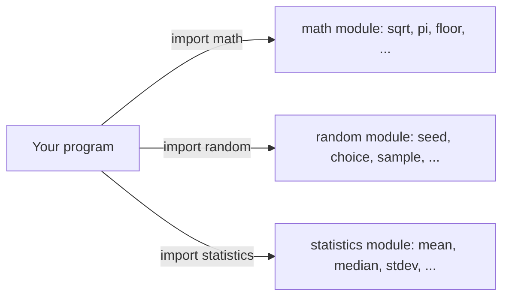
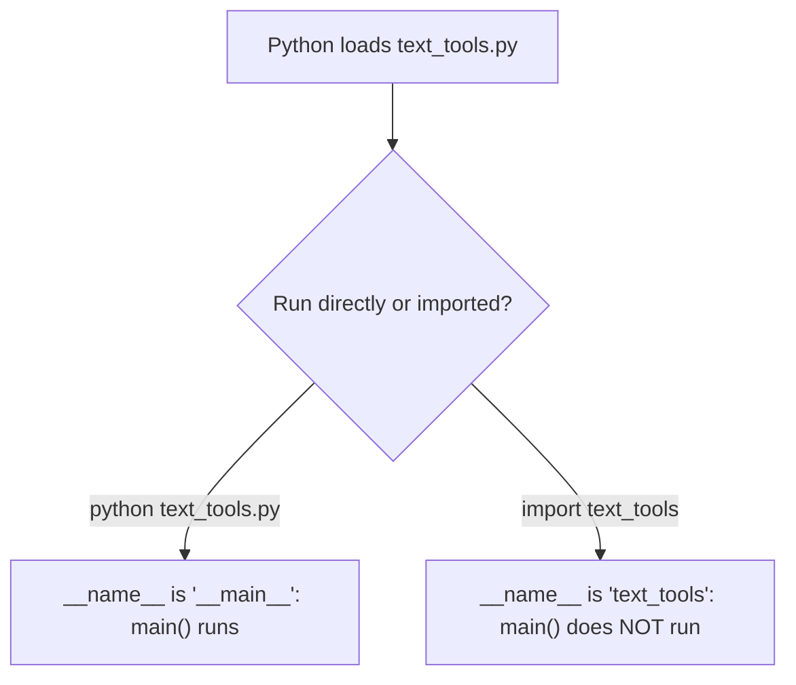

Every AI project starts the same way: someone needs to shuffle a dataset, count words, compute an average, or work out how many days are left before a deadline. You could write all of that yourself, but Python already ships with thousands of tested, ready-made tools. Knowing how to **import** them (and where to look for them) is what separates "I wrote 40 lines" from "I wrote 3 lines that work". It is also how every big library you will meet later, such as NumPy, pandas and PyTorch, is used.

## 1. A module is a file of reusable code

A **module** is simply a `.py` file that contains functions and values you can borrow. Think of a toolbox in a workshop: you do not forge a new hammer for every nail, you open the box and take one.



Python's **standard library** is the set of modules that come with Python itself. No installation, no internet. You only need to say which one you want with `import`:

```python
import math

print(math.sqrt(16))  # 4.0
print(math.pi)        # 3.141592653589793
```

After `import math`, the name `math` points to the module. You reach inside it with a dot: `math.sqrt` means "the `sqrt` function that lives in `math`".

## 2. Three ways to import

```python
import math                  # 1. bring the whole module, use math.xxx
from math import sqrt        # 2. bring one name, use sqrt directly
import statistics as st      # 3. bring the module under a short nickname

print(math.floor(2.7))       # 2
print(sqrt(25))              # 5.0
print(st.mean([1, 2, 3]))    # 2
```

| You write | Names you can use afterwards | When to use it |
|---|---|---|
| `import math` | `math.sqrt`, `math.pi` | default choice; the reader sees where each function comes from |
| `from math import sqrt` | `sqrt` | when you use one or two names many times |
| `import statistics as st` | `st.mean`, `st.median` | long module names; the community uses fixed nicknames such as `np` for NumPy and `pd` for pandas |

> [!TIP]
> Always put the `import` lines at the **top** of the file. Anyone opening your code sees at once which tools it depends on.

## 3. A tour of useful standard-library modules

You do not need to memorise these. Remember that they exist, then look up the details when you need them.

**`math`**: maths helpers.

```python
import math

print(math.ceil(2.1), math.floor(2.9))        # 3 2
print(math.sqrt(2))                           # 1.4142135623730951
print(0.1 + 0.2 == 0.3)                       # False (tiny rounding error)
print(math.isclose(0.1 + 0.2, 0.3))           # True
```

Comparing floats with `==` is risky because of those tiny rounding errors. `math.isclose` asks "are they close enough?" instead.

**`statistics`**: the numbers you report after every experiment.

```python
import statistics

scores = [70, 80, 90, 100]
print(statistics.mean(scores))              # 85
print(statistics.median(scores))            # 85.0
print(round(statistics.stdev(scores), 2))   # 12.91
```

`mean` is the average, `median` is the middle value, and `stdev` (standard deviation) tells you how spread out the numbers are.

**`random`**: shuffling and sampling, with a **seed** for repeatable results.

```python
import random

random.seed(42)
print(random.randint(1, 100))                # 82
print(random.choice(["cat", "dog", "bird"])) # cat

items = [1, 2, 3, 4, 5]
random.shuffle(items)                        # shuffles the list itself
print(items)                                 # [2, 4, 5, 3, 1]
```

**`datetime`**: dates and date arithmetic.

```python
from datetime import date, timedelta

start = date(2025, 3, 1)
deadline = start + timedelta(days=45)
print(deadline)                              # 2025-04-15
print((deadline - date(2025, 4, 1)).days)    # 14
```

**`collections.Counter`**: counting without writing the loop yourself.

```python
from collections import Counter

counts = Counter(["ai", "is", "fun", "ai", "is", "ai"])
print(counts.most_common(2))   # [('ai', 3), ('is', 2)]
print(counts["ai"])            # 3
print(counts["python"])        # 0 (a missing word is 0, not an error)
```

This is the word-counting loop from the collections lesson, built in. Real NLP code uses it constantly.

**`pathlib`**: file paths as objects (we only peek at it here; reading files comes in the next lessons).

```python
from pathlib import Path

path = Path("data") / "raw" / "reviews.csv"
print(path.name)     # reviews.csv
print(path.stem)     # reviews
print(path.suffix)   # .csv
```

## 4. Reproducibility: why we seed random

Many AI steps use randomness: shuffling data, picking a validation set, initialising a model. If each run gives different numbers, you cannot tell whether your change helped or you just got lucky. The fix is `random.seed(...)`: the same seed produces the same "random" sequence every time.

Seeding the global generator works, and a function that takes the seed as a parameter is even better:

```python
import random

def roll_three(seed):
    rng = random.Random(seed)   # a private generator with its own seed
    rolls = []
    for _ in range(3):
        rolls.append(rng.randint(1, 6))
    return rolls

print(roll_three(42))   # [6, 1, 1]
print(roll_three(42))   # [6, 1, 1]  same seed, same result
print(roll_three(7))    # [3, 2, 4]  another seed, another result
```

Press **Visualize** on this block and watch `rolls` grow one number at a time. In `for _ in range(3)` the name `_` is a throwaway: we only want to repeat three times and do not need the counter.

`random.Random(seed)` makes a separate generator, so one function never disturbs the random numbers used somewhere else. Many professional code bases prefer this style.

## 5. Real projects are many modules

In this course the editor holds one file. A real project has many, each with one clear job. Here is a typical small AI project:

```text
rag_demo/
├── main.py
├── text_tools.py
├── stats_tools.py
└── retrieval/
    ├── __init__.py
    └── search.py
```

Here `main.py` is the entry point (the file you run), `text_tools.py` and `stats_tools.py` are modules with helper functions, and `retrieval/` is a folder of modules, which makes it a **package**. The empty `__init__.py` marks a folder as a package.

Inside `main.py` you would import your own modules exactly like standard ones:

```text
import text_tools
from stats_tools import summarize
from retrieval.search import find_best_chunk
```

A folder of modules is a **package**, and the dot walks down into it: `retrieval.search` means "the `search` module inside the `retrieval` package".

Why split code into files? Each file stays short, you find things faster, teammates edit different files without clashing, and you can test each module on its own.

## 6. `if __name__ == "__main__":`

When you **run** a file, Python sets a hidden variable `__name__` to `"__main__"`. When another file **imports** it, `__name__` is the module's name instead. This lets one file work both as a program and as a toolbox:

```python
def double(x):
    return x * 2


def main():
    print(double(21))


if __name__ == "__main__":
    main()     # runs only when this file is run directly
```



Without the guard, importing the file would also run all its printing code, which is rarely what you want. Put the "do things" code inside `main()` and keep the guard as the last two lines.

## 7. Where to look things up

Nobody remembers every function. Good engineers know how to look:

```python
import math

help(math.sqrt)
# Help on built-in function sqrt in module math:
#
# sqrt(x, /)
#     Return the square root of x.

print("sqrt" in dir(math))   # True
```

- `help(thing)` prints the documentation of a function or module.
- `dir(module)` lists every name inside a module.
- The official docs at `docs.python.org` have a page for each module, with examples. Search "python <module name>" first.

> [!TIP]
> Before you write a helper for something common (average, counting, dates, paths), spend two minutes checking whether the standard library already has it. It is faster, tested by millions of people, and everyone can read it.

## 8. Common mistakes

**Forgetting the import.** Using a module without importing it crashes with `NameError: name 'math' is not defined`. Add `import math` at the top.

**Mixing the two styles.** After `from math import sqrt`, the name `math` does **not** exist, so `math.sqrt(4)` fails. After `import math`, plain `sqrt(4)` fails. Use whichever form you imported.

```python
from math import sqrt

print(sqrt(9))   # 3.0
# print(math.sqrt(9))  # NameError: name 'math' is not defined
```

**Naming your own file like a module.** If you create `random.py` or `statistics.py` in your project, `import random` loads **your** file instead of the standard one, and strange errors follow. Pick names like `text_tools.py`.

**`import datetime` versus `from datetime import date`.** The module `datetime` also contains a tool named `datetime`, so the same word means two things. After `import datetime` you must write `datetime.date(2025, 1, 1)`. After `from datetime import date` you write `date(2025, 1, 1)`.

> [!WARNING]
> Avoid `from module import *`. It dumps every name into your program, you no longer know where a name came from, and it can silently overwrite your own variables.

## Recap

- A **module** is a `.py` file of reusable code; the **standard library** is the set of modules that ship with Python.
- `import math`, `from math import sqrt`, `import statistics as st`: pick the form that keeps your code clear, and put imports at the top.
- Handy modules: `math`, `statistics`, `random`, `datetime`, `collections.Counter`, `pathlib`.
- `random.seed(42)` (or `random.Random(42)`) makes experiments **reproducible**.
- Real projects split code into modules and **packages** (folders of modules); `if __name__ == "__main__":` keeps a file usable both as a program and as an import.
- Look things up with `help()`, `dir()` and docs.python.org before you write your own.
