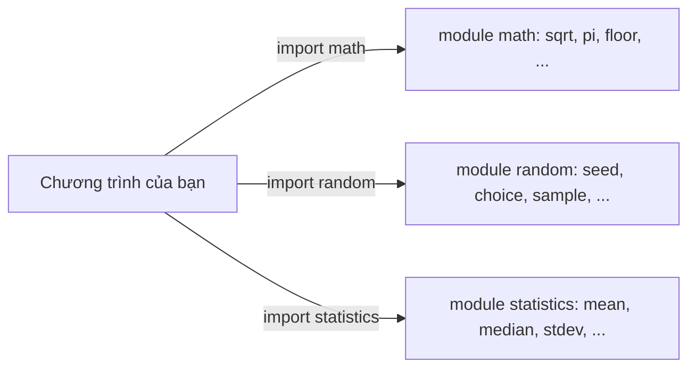
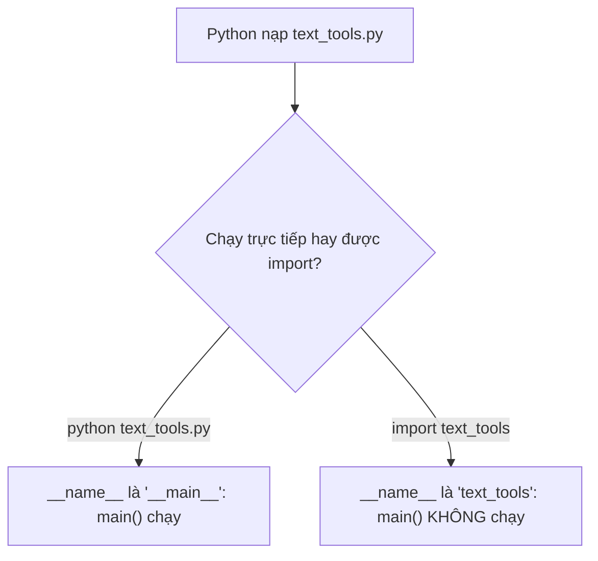

Dự án AI nào cũng bắt đầu giống nhau: ai đó cần xáo trộn một dataset, đếm từ, tính trung bình, hoặc tính xem còn bao nhiêu ngày đến deadline. Bạn hoàn toàn có thể tự viết hết, nhưng Python đã có sẵn hàng nghìn công cụ đã được kiểm thử kỹ. Biết cách **import** chúng (và biết tìm chúng ở đâu) là khác biệt giữa "tôi viết 40 dòng" và "tôi viết 3 dòng mà chạy đúng". Đó cũng là cách bạn sẽ dùng mọi thư viện lớn sau này như NumPy, pandas hay PyTorch.

## 1. Module là một file chứa code dùng lại được

**Module** (mô-đun) đơn giản là một file `.py` chứa các hàm và giá trị mà bạn có thể mượn. Hãy hình dung hộp đồ nghề trong xưởng: bạn không rèn một cái búa mới cho mỗi cây đinh, bạn mở hộp và lấy một cái ra.



**Thư viện chuẩn** (standard library) của Python là tập các module đi kèm ngay khi cài Python. Không cần cài thêm, không cần internet. Bạn chỉ cần nói mình muốn module nào bằng `import`:

```python
import math

print(math.sqrt(16))  # 4.0
print(math.pi)        # 3.141592653589793
```

Sau `import math`, cái tên `math` trỏ tới module. Bạn truy cập vào bên trong bằng dấu chấm: `math.sqrt` nghĩa là "hàm `sqrt` nằm trong `math`".

## 2. Ba cách import

```python
import math                  # 1. lấy cả module, dùng math.xxx
from math import sqrt        # 2. lấy riêng một tên, dùng sqrt trực tiếp
import statistics as st      # 3. lấy module với một biệt danh ngắn

print(math.floor(2.7))       # 2
print(sqrt(25))              # 5.0
print(st.mean([1, 2, 3]))    # 2
```

| Bạn viết | Tên dùng được sau đó | Khi nào dùng |
|---|---|---|
| `import math` | `math.sqrt`, `math.pi` | lựa chọn mặc định; người đọc thấy ngay mỗi hàm đến từ đâu |
| `from math import sqrt` | `sqrt` | khi bạn dùng một hai tên rất nhiều lần |
| `import statistics as st` | `st.mean`, `st.median` | tên module dài; cộng đồng dùng sẵn các biệt danh cố định như `np` cho NumPy và `pd` cho pandas |

> [!TIP]
> Luôn đặt các dòng `import` ở **đầu** file. Ai mở code của bạn cũng thấy ngay nó phụ thuộc vào những công cụ nào.

## 3. Điểm qua vài module hữu ích của thư viện chuẩn

Bạn không cần học thuộc. Chỉ cần nhớ là chúng tồn tại, rồi tra chi tiết khi cần.

**`math`**: các hàm toán học.

```python
import math

print(math.ceil(2.1), math.floor(2.9))        # 3 2
print(math.sqrt(2))                           # 1.4142135623730951
print(0.1 + 0.2 == 0.3)                       # False (sai số làm tròn rất nhỏ)
print(math.isclose(0.1 + 0.2, 0.3))           # True
```

So sánh float bằng `==` có rủi ro vì những sai số làm tròn nhỏ xíu đó. `math.isclose` hỏi câu khác: "hai số có đủ gần nhau không?".

**`statistics`**: những con số bạn báo cáo sau mỗi thí nghiệm.

```python
import statistics

scores = [70, 80, 90, 100]
print(statistics.mean(scores))              # 85
print(statistics.median(scores))            # 85.0
print(round(statistics.stdev(scores), 2))   # 12.91
```

`mean` là trung bình, `median` là giá trị ở giữa (trung vị), còn `stdev` (độ lệch chuẩn) cho biết các số phân tán nhiều hay ít.

**`random`**: xáo trộn và lấy mẫu, với **seed** để kết quả lặp lại được.

```python
import random

random.seed(42)
print(random.randint(1, 100))                # 82
print(random.choice(["cat", "dog", "bird"])) # cat

items = [1, 2, 3, 4, 5]
random.shuffle(items)                        # xáo trộn chính list này
print(items)                                 # [2, 4, 5, 3, 1]
```

**`datetime`**: ngày tháng và phép tính trên ngày.

```python
from datetime import date, timedelta

start = date(2025, 3, 1)
deadline = start + timedelta(days=45)
print(deadline)                              # 2025-04-15
print((deadline - date(2025, 4, 1)).days)    # 14
```

**`collections.Counter`**: đếm mà không cần tự viết vòng lặp.

```python
from collections import Counter

counts = Counter(["ai", "is", "fun", "ai", "is", "ai"])
print(counts.most_common(2))   # [('ai', 3), ('is', 2)]
print(counts["ai"])            # 3
print(counts["python"])        # 0 (từ không có thì là 0, không báo lỗi)
```

Đây chính là vòng lặp đếm từ ở bài về collection, được làm sẵn. Code NLP thật dùng nó liên tục.

**`pathlib`**: đường dẫn file dưới dạng đối tượng (ở đây ta chỉ xem lướt; đọc file sẽ học ở các bài sau).

```python
from pathlib import Path

path = Path("data") / "raw" / "reviews.csv"
print(path.name)     # reviews.csv
print(path.stem)     # reviews
print(path.suffix)   # .csv
```

## 4. Tái lập kết quả: vì sao phải đặt seed cho random

Nhiều bước trong AI dùng ngẫu nhiên: xáo trộn dữ liệu, chọn tập validation, khởi tạo mô hình. Nếu mỗi lần chạy ra một số khác nhau, bạn không biết thay đổi của mình có tác dụng hay chỉ là may mắn. Cách khắc phục là `random.seed(...)`: cùng một seed thì luôn cho cùng một chuỗi "ngẫu nhiên".

Đặt seed cho bộ sinh toàn cục thì được, và một hàm nhận seed làm tham số còn tốt hơn:

```python
import random

def roll_three(seed):
    rng = random.Random(seed)   # bộ sinh riêng với seed của nó
    rolls = []
    for _ in range(3):
        rolls.append(rng.randint(1, 6))
    return rolls

print(roll_three(42))   # [6, 1, 1]
print(roll_three(42))   # [6, 1, 1]  cùng seed, cùng kết quả
print(roll_three(7))    # [3, 2, 4]  seed khác, kết quả khác
```

Bấm **Visualize** ở khối code này để xem `rolls` dài ra từng số một. Trong `for _ in range(3)`, tên `_` là tên bỏ đi: ta chỉ muốn lặp ba lần và không cần biến đếm.

`random.Random(seed)` tạo ra một bộ sinh riêng, nên một hàm không làm xáo trộn các số ngẫu nhiên đang dùng ở chỗ khác. Nhiều codebase chuyên nghiệp ưa dùng kiểu viết này.

## 5. Dự án thật gồm nhiều module

Trong khóa học này, editor chỉ có một file. Dự án thật có nhiều file, mỗi file một việc rõ ràng. Đây là một dự án AI nhỏ điển hình:

```text
rag_demo/
├── main.py
├── text_tools.py
├── stats_tools.py
└── retrieval/
    ├── __init__.py
    └── search.py
```

Ở đây `main.py` là điểm vào (file bạn chạy), `text_tools.py` và `stats_tools.py` là các module chứa hàm hỗ trợ, còn `retrieval/` là thư mục chứa module nên gọi là **package**. File `__init__.py` (thường để trống) đánh dấu một thư mục là package.

Trong `main.py` bạn sẽ import module của chính mình giống hệt module chuẩn:

```text
import text_tools
from stats_tools import summarize
from retrieval.search import find_best_chunk
```

Một thư mục chứa module gọi là **package** (gói), và dấu chấm đi sâu vào trong nó: `retrieval.search` nghĩa là "module `search` bên trong package `retrieval`".

Vì sao nên tách code ra nhiều file? Mỗi file ngắn gọn, bạn tìm đồ nhanh hơn, đồng đội sửa các file khác nhau mà không đụng nhau, và bạn có thể kiểm thử từng module riêng.

## 6. `if __name__ == "__main__":`

Khi bạn **chạy** một file, Python gán biến ẩn `__name__` bằng `"__main__"`. Khi file khác **import** nó, `__name__` lại là tên của module. Nhờ vậy một file vừa làm chương trình vừa làm hộp đồ nghề được:

```python
def double(x):
    return x * 2


def main():
    print(double(21))


if __name__ == "__main__":
    main()     # chỉ chạy khi file này được chạy trực tiếp
```



Nếu thiếu đoạn bảo vệ này, việc import file cũng sẽ chạy luôn mọi dòng code in ra, điều mà bạn hiếm khi muốn. Hãy đặt phần code "làm việc" trong `main()` và để hai dòng guard ở cuối file.

## 7. Tra cứu ở đâu

Không ai nhớ hết mọi hàm. Kỹ sư giỏi là người biết cách tra:

```python
import math

help(math.sqrt)
# Help on built-in function sqrt in module math:
#
# sqrt(x, /)
#     Return the square root of x.

print("sqrt" in dir(math))   # True
```

- `help(thing)` in ra tài liệu của một hàm hoặc module.
- `dir(module)` liệt kê mọi tên bên trong một module.
- Tài liệu chính thức ở `docs.python.org` có một trang cho mỗi module, kèm ví dụ. Hãy tìm "python <tên module>" trước tiên.

> [!TIP]
> Trước khi tự viết hàm cho một việc phổ biến (trung bình, đếm, ngày tháng, đường dẫn), hãy dành hai phút xem thư viện chuẩn đã có chưa. Dùng đồ có sẵn thì nhanh hơn, đã được hàng triệu người kiểm thử, và ai cũng đọc hiểu được.

## 8. Lỗi thường gặp

**Quên import.** Dùng module mà chưa import sẽ lỗi `NameError: name 'math' is not defined`. Hãy thêm `import math` ở đầu file.

**Trộn lẫn hai kiểu import.** Sau `from math import sqrt`, cái tên `math` **không** tồn tại, nên `math.sqrt(4)` bị lỗi. Sau `import math`, gọi `sqrt(4)` trơn cũng lỗi. Hãy dùng đúng dạng bạn đã import.

```python
from math import sqrt

print(sqrt(9))   # 3.0
# print(math.sqrt(9))  # NameError: name 'math' is not defined
```

**Đặt tên file của mình trùng tên module.** Nếu bạn tạo `random.py` hoặc `statistics.py` trong dự án, `import random` sẽ nạp file **của bạn** thay vì module chuẩn, và các lỗi kỳ lạ xuất hiện. Hãy đặt tên như `text_tools.py`.

**`import datetime` khác với `from datetime import date`.** Module `datetime` còn chứa một công cụ cũng tên `datetime`, nên cùng một từ mang hai nghĩa. Sau `import datetime` bạn phải viết `datetime.date(2025, 1, 1)`. Sau `from datetime import date` bạn viết `date(2025, 1, 1)`.

> [!WARNING]
> Tránh `from module import *`. Nó đổ mọi tên vào chương trình, bạn không còn biết một tên đến từ đâu, và nó có thể âm thầm ghi đè biến của bạn.

## Tóm tắt

- **Module** là một file `.py` chứa code dùng lại được; **thư viện chuẩn** là tập các module đi kèm Python.
- `import math`, `from math import sqrt`, `import statistics as st`: chọn dạng giúp code rõ ràng nhất, và đặt import ở đầu file.
- Các module hữu ích: `math`, `statistics`, `random`, `datetime`, `collections.Counter`, `pathlib`.
- `random.seed(42)` (hoặc `random.Random(42)`) giúp thí nghiệm **tái lập được** (reproducible).
- Dự án thật tách code thành module và **package** (thư mục chứa module); `if __name__ == "__main__":` giúp một file vừa chạy được như chương trình vừa import được.
- Hãy tra bằng `help()`, `dir()` và docs.python.org trước khi tự viết lại thứ đã có.
