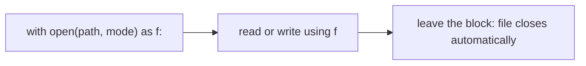

Almost every AI project starts and ends with files. Your training data is a CSV or a JSON Lines file, your settings live in a JSON file, and your program writes its results and logs to files. A program forgets everything when it stops running; files are how it remembers. In this lesson you will learn to read and write them safely.

## 1. Why files?

Variables live in memory, and memory is wiped when the program ends. A **file** lives on disk, so it survives. Here are the file types you will meet most often:

| Format | Looks like | Typical use in AI work |
|---|---|---|
| `.txt` | plain lines of text | logs, raw documents, prompt lists |
| `.csv` | rows and columns, separated by commas | tabular datasets, evaluation results |
| `.json` | nested dictionaries and lists | configs, API responses |
| `.jsonl` | one JSON object per line | LLM training and evaluation data |

> [!NOTE]
> In this lesson every code block creates its own file inside a **temporary folder** (`tempfile.TemporaryDirectory()`), writes to it, reads it back, and the folder disappears at the end. That way you can press Run as many times as you like and nothing is left on your computer. In your real projects you will use a normal path such as `data/prompts.txt`.

## 2. Open, use, close

To use a file you **open** it, **read or write**, then **close** it. Closing matters: it saves unsaved data and frees the file for other programs. Python has a block made for this, called `with`:



Think of borrowing a book from a library. `with` is the librarian who takes the book back for you, even if something goes wrong while you read it. Here is the smallest complete example:

```python
import tempfile

with tempfile.TemporaryDirectory() as tmp:
    path = f"{tmp}/notes.txt"

    with open(path, "w", encoding="utf-8") as f:
        f.write("first prompt\n")
        f.write("second prompt\n")

    with open(path, "r", encoding="utf-8") as f:
        text = f.read()

    print(repr(text))  # 'first prompt\nsecond prompt\n'
```

Read `open(path, "w", encoding="utf-8") as f` as *"open this file for writing and call it `f`"*. The `\n` is the **newline** character: it ends a line. `repr()` shows it instead of jumping to a new line.

The second argument of `open` is the **mode**:

| Mode | Meaning | If the file exists | If it does not exist |
|---|---|---|---|
| `"r"` (default) | read | reads it | error |
| `"w"` | write | **erases it first** | creates it |
| `"a"` | append | adds to the end | creates it |

> [!WARNING]
> Always write `encoding="utf-8"`. Without it, Python on some computers (especially Windows) uses another encoding and Vietnamese letters such as `ê` or `ơ` come out garbled.

## 3. Three ways to read

Once a file is open, you can read it in three ways:

| Way | Gives you | Good for |
|---|---|---|
| `f.read()` | one big string | small files |
| `f.readlines()` | a list of lines | small files, when you need a list |
| `for line in f:` | one line at a time | **big files** (only one line is in memory) |

```python
import tempfile

with tempfile.TemporaryDirectory() as tmp:
    path = f"{tmp}/prompts.txt"
    with open(path, "w", encoding="utf-8") as f:
        f.write("Hello\nWhat is AI?\nBye\n")

    with open(path, encoding="utf-8") as f:
        lines = f.readlines()
    print(lines)  # ['Hello\n', 'What is AI?\n', 'Bye\n']

    with open(path, encoding="utf-8") as f:
        for line in f:
            print(line.strip())  # Hello, then What is AI?, then Bye
```

Every line still carries its `\n` at the end. `line.strip()` removes it (and spaces at both ends). Without `strip()`, `print` would add its own newline and you would see blank lines between the lines.

```text
raw line:      "What is AI?\n"
after strip:   "What is AI?"
```

Press **Visualize** on the code block above and watch `line` change while the loop walks through the file. A loop over `f` is the way to handle a file with millions of lines, because Python never holds more than one line.

## 4. Writing lines

`f.write(text)` writes exactly the text you give it. It does **not** add a newline, so you add `"\n"` yourself. The mode decides what happens to old content:

```python
import tempfile

with tempfile.TemporaryDirectory() as tmp:
    path = f"{tmp}/log.txt"

    with open(path, "w", encoding="utf-8") as f:
        f.write("run 1\n")
    with open(path, "a", encoding="utf-8") as f:
        f.write("run 2\n")
    with open(path, encoding="utf-8") as f:
        print(f.read().splitlines())  # ['run 1', 'run 2']

    with open(path, "w", encoding="utf-8") as f:
        f.write("run 3\n")
    with open(path, encoding="utf-8") as f:
        print(f.read().splitlines())  # ['run 3']
```

`"a"` kept `run 1` and added `run 2`. Opening with `"w"` again threw everything away. `splitlines()` is the string method that cuts text into a list of lines without the `\n`.

## 5. Paths with pathlib

A **path** is the address of a file. The `pathlib` module gives you `Path` objects that are nicer than plain strings: use `/` to join pieces, and ask questions with attributes.

```python
import tempfile
from pathlib import Path

with tempfile.TemporaryDirectory() as tmp:
    path = Path(tmp) / "report.csv"
    print(path.exists())    # False
    path.write_text("a,b\n1,2\n", encoding="utf-8")
    print(path.exists())    # True
    print(path.name)        # report.csv
    print(path.suffix)      # .csv
    print(path.stem)        # report
    print(repr(path.read_text(encoding="utf-8")))  # 'a,b\n1,2\n'
```

| Piece | What it does |
|---|---|
| `Path("folder") / "file.txt"` | joins parts into one path |
| `path.exists()` | `True` if the file or folder exists |
| `path.name`, `path.stem`, `path.suffix` | `report.csv`, `report`, `.csv` |
| `path.read_text(encoding="utf-8")` | open, read everything, close |
| `path.write_text(text, encoding="utf-8")` | open, write (like mode `"w"`), close |

`open(path)` accepts a `Path` as well as a string. Use `read_text` / `write_text` for quick whole-file jobs, and `with open(...)` when you want to go line by line.

## 6. CSV: rows that become dictionaries

A **CSV** file holds a table, one row per line, with values separated by commas. The first line is the **header**: the column names. `csv.DictReader` turns every row into a dictionary, using the header as the keys:

```text
header line:   name,score
row line:      Lan,9.5
                 │
                 ▼
Python gets:   {"name": "Lan", "score": "9.5"}
```

```python
import csv
import tempfile
from pathlib import Path

with tempfile.TemporaryDirectory() as tmp:
    path = Path(tmp) / "scores.csv"
    rows = [{"name": "Lan", "score": 9.5}, {"name": "Minh", "score": 7}]

    with open(path, "w", newline="", encoding="utf-8") as f:
        writer = csv.DictWriter(f, fieldnames=["name", "score"])
        writer.writeheader()
        writer.writerows(rows)

    total = 0
    with open(path, newline="", encoding="utf-8") as f:
        for row in csv.DictReader(f):
            print(row)  # {'name': 'Lan', 'score': '9.5'} then {'name': 'Minh', 'score': '7'}
            total += float(row["score"])
    print(total)        # 16.5
```

Notice two things. First, `newline=""` is the setting the `csv` module wants when you open a CSV file. Second, the scores came back as the **strings** `'9.5'` and `'7'`: a CSV file only stores text, so you convert with `float()` or `int()` yourself, just like in lesson 1.

## 7. JSON: nested data

**JSON** is a text format for data that Python already knows: dictionaries, lists, strings, numbers, booleans and `None`. Most web APIs and config files use it. Python's `json` module has four functions, and the trailing `s` means *string*:

| Function | From | To |
|---|---|---|
| `json.dump(data, f)` | Python data | a file |
| `json.load(f)` | a file | Python data |
| `json.dumps(data)` | Python data | a string |
| `json.loads(text)` | a string | Python data |

```python
import json
import tempfile
from pathlib import Path

config = {"model": "demo-model", "temperature": 0.7, "stop": ["END"], "note": "Xin chào"}

with tempfile.TemporaryDirectory() as tmp:
    path = Path(tmp) / "config.json"
    with open(path, "w", encoding="utf-8") as f:
        json.dump(config, f, indent=2, ensure_ascii=False)

    with open(path, encoding="utf-8") as f:
        loaded = json.load(f)
    print(loaded == config)  # True

    print(path.read_text(encoding="utf-8"))
```

The file looks like this:

```text
{
  "model": "demo-model",
  "temperature": 0.7,
  "stop": [
    "END"
  ],
  "note": "Xin chào"
}
```

`indent=2` makes the file easy for humans to read. `ensure_ascii=False` keeps Vietnamese letters as they are; without it you would get `"Xin chào"`. And the string versions:

```python
import json

text = json.dumps({"ok": True, "answer": None})
print(text)                        # {"ok": true, "answer": null}
data = json.loads(text)
print(data["ok"], data["answer"])  # True None
```

JSON writes `True` as `true` and `None` as `null`, and `loads` converts them back.

## 8. JSON Lines: one record per line

A big dataset as one giant JSON list would have to be loaded all at once. **JSON Lines** (`.jsonl`) solves that: **one JSON object per line**. It is the format of most LLM datasets, because you can read it with the same line-by-line loop from §3 and append a new record without touching the rest.

```text
{"prompt": "Hi", "response": "Hello!"}
{"prompt": "2+2?", "response": ""}
```

Here is a mini data-cleaning job: load a dataset, count the rows, and write a cleaned copy without the empty responses.

```python
import json
import tempfile
from pathlib import Path

examples = [
    {"prompt": "Hi", "response": "Hello!"},
    {"prompt": "2+2?", "response": ""},
    {"prompt": "Bonjour", "response": "Salut!"},
]

with tempfile.TemporaryDirectory() as tmp:
    raw = Path(tmp) / "raw.jsonl"
    clean = Path(tmp) / "clean.jsonl"

    with open(raw, "w", encoding="utf-8") as f:
        for item in examples:
            f.write(json.dumps(item, ensure_ascii=False) + "\n")

    kept = 0
    with open(raw, encoding="utf-8") as src, open(clean, "w", encoding="utf-8") as dst:
        for line in src:
            item = json.loads(line)
            if item["response"].strip():
                dst.write(json.dumps(item, ensure_ascii=False) + "\n")
                kept += 1
    print("kept", kept, "of", len(examples))  # kept 2 of 3
```

One `with` can open two files at once (separated by a comma). Each line is a complete JSON text, so you use `json.loads(line)` to read one record and `json.dumps(item) + "\n"` to write one.

## 9. Common mistakes

**Forgetting that `"w"` erases the file.** Opening an existing file with `"w"` deletes its content immediately. Use `"a"` to add to the end.

**Forgetting the newline.** `f.write("a")` followed by `f.write("b")` gives `ab` on one line. Add `"\n"`. When reading, a line is `"Hello\n"`, not `"Hello"`:

```python
line = "Hello\n"
print(line == "Hello")          # False
print(line.strip() == "Hello")  # True
```

**Treating CSV values as numbers.** Every CSV value is text, so `row["score"] + 1` raises a `TypeError`. Convert first with `float(row["score"])`.

**Mixing up `load` and `loads`.** `load` / `dump` work with files; `loads` / `dumps` work with strings. `json.loads(f)` fails because `f` is a file, not a string.

**Using the file after the `with` block.** When the block ends the file is closed, and `f.read()` outside it raises `ValueError: I/O operation on closed file`. Do all the reading inside the block.

> [!TIP]
> If Python says `FileNotFoundError`, the path is wrong. Print it and check `Path(path).exists()` before anything else.

## Recap

- Files keep data after the program ends. Use `with open(path, mode, encoding="utf-8") as f:` so the file closes by itself.
- Modes: `"r"` read, `"w"` write (erases), `"a"` append. `write` does not add `"\n"`.
- Read with `f.read()`, `f.readlines()` or `for line in f:` (best for big files). `line.strip()` removes the newline.
- `pathlib.Path` joins with `/` and offers `.exists()`, `.name`, `.suffix`, `.read_text()`, `.write_text()`.
- CSV: `csv.DictReader` / `DictWriter`, values are always strings. JSON: `load`/`dump` for files, `loads`/`dumps` for strings, `indent=2` and `ensure_ascii=False`.
- JSON Lines is one JSON object per line: loop over the file and call `json.loads(line)`.
