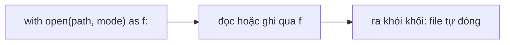

Gần như dự án AI nào cũng bắt đầu và kết thúc bằng file. Dữ liệu huấn luyện là file CSV hoặc JSON Lines, cấu hình nằm trong file JSON, còn chương trình thì ghi kết quả và log ra file. Chương trình chạy xong là quên sạch mọi thứ; file chính là cách nó ghi nhớ. Trong bài này bạn sẽ học đọc và ghi file một cách an toàn.

## 1. Vì sao cần file?

Biến nằm trong bộ nhớ (memory), và bộ nhớ bị xóa khi chương trình kết thúc. **File** nằm trên ổ đĩa nên vẫn còn đó. Đây là các loại file bạn sẽ gặp nhiều nhất:

| Định dạng | Trông như thế nào | Dùng trong AI để làm gì |
|---|---|---|
| `.txt` | các dòng chữ thường | log, tài liệu thô, danh sách prompt |
| `.csv` | hàng và cột, ngăn cách bằng dấu phẩy | bộ dữ liệu dạng bảng, kết quả đánh giá |
| `.json` | dictionary và list lồng nhau | cấu hình, phản hồi của API |
| `.jsonl` | mỗi dòng một object JSON | dữ liệu huấn luyện và đánh giá LLM |

> [!NOTE]
> Trong bài này, mỗi khối code tự tạo file của nó bên trong một **thư mục tạm** (`tempfile.TemporaryDirectory()`), ghi vào, đọc lại, rồi thư mục tự biến mất khi kết thúc. Nhờ vậy bạn bấm Run bao nhiêu lần cũng được mà máy không bị để lại file nào. Trong dự án thật, bạn sẽ dùng đường dẫn bình thường như `data/prompts.txt`.

## 2. Mở, dùng, đóng

Để dùng một file, bạn **mở** (open) nó, **đọc hoặc ghi**, rồi **đóng** (close) nó. Việc đóng rất quan trọng: nó lưu dữ liệu chưa ghi hết và trả file lại cho các chương trình khác. Python có sẵn một khối dành cho việc này, gọi là `with`:



Hãy hình dung bạn mượn một cuốn sách ở thư viện. `with` là cô thủ thư trả sách giúp bạn, kể cả khi đang đọc thì có chuyện gì xảy ra. Đây là ví dụ đầy đủ nhỏ nhất:

```python
import tempfile

with tempfile.TemporaryDirectory() as tmp:
    path = f"{tmp}/notes.txt"

    with open(path, "w", encoding="utf-8") as f:
        f.write("first prompt\n")
        f.write("second prompt\n")

    with open(path, "r", encoding="utf-8") as f:
        text = f.read()

    print(repr(text))  # 'first prompt\nsecond prompt\n'
```

Hãy đọc `open(path, "w", encoding="utf-8") as f` là *"mở file này để ghi và đặt tên nó là `f`"*. `\n` là ký tự **xuống dòng** (newline): nó kết thúc một dòng. `repr()` hiển thị ký tự đó thay vì xuống dòng thật.

Tham số thứ hai của `open` là **chế độ** (mode):

| Mode | Ý nghĩa | Nếu file đã có | Nếu file chưa có |
|---|---|---|---|
| `"r"` (mặc định) | đọc | đọc nó | báo lỗi |
| `"w"` | ghi | **xóa sạch nội dung trước** | tạo mới |
| `"a"` | ghi nối thêm (append) | thêm vào cuối | tạo mới |

> [!WARNING]
> Luôn viết `encoding="utf-8"`. Nếu không, Python trên một số máy (nhất là Windows) dùng bảng mã khác và các chữ tiếng Việt như `ê` hay `ơ` sẽ bị lỗi font.

## 3. Ba cách đọc

Khi file đã mở, bạn có ba cách đọc:

| Cách | Cho bạn | Phù hợp với |
|---|---|---|
| `f.read()` | một chuỗi lớn | file nhỏ |
| `f.readlines()` | một list các dòng | file nhỏ, khi cần một list |
| `for line in f:` | từng dòng một | **file lớn** (trong bộ nhớ chỉ có một dòng) |

```python
import tempfile

with tempfile.TemporaryDirectory() as tmp:
    path = f"{tmp}/prompts.txt"
    with open(path, "w", encoding="utf-8") as f:
        f.write("Hello\nWhat is AI?\nBye\n")

    with open(path, encoding="utf-8") as f:
        lines = f.readlines()
    print(lines)  # ['Hello\n', 'What is AI?\n', 'Bye\n']

    with open(path, encoding="utf-8") as f:
        for line in f:
            print(line.strip())  # Hello, rồi What is AI?, rồi Bye
```

Mỗi dòng vẫn còn `\n` ở cuối. `line.strip()` bỏ nó đi (cùng khoảng trắng hai đầu). Nếu không `strip()`, `print` sẽ tự thêm một lần xuống dòng nữa và bạn thấy các dòng trống xen giữa.

```text
raw line:      "What is AI?\n"
after strip:   "What is AI?"
```

Bấm **Visualize** ở khối code phía trên và xem `line` thay đổi khi vòng lặp đi qua file. Vòng lặp qua `f` là cách xử lý file có hàng triệu dòng, vì Python không bao giờ giữ nhiều hơn một dòng.

## 4. Ghi từng dòng

`f.write(text)` ghi đúng chuỗi bạn đưa vào. Nó **không** tự thêm xuống dòng, nên bạn tự thêm `"\n"`. Mode quyết định nội dung cũ sẽ ra sao:

```python
import tempfile

with tempfile.TemporaryDirectory() as tmp:
    path = f"{tmp}/log.txt"

    with open(path, "w", encoding="utf-8") as f:
        f.write("run 1\n")
    with open(path, "a", encoding="utf-8") as f:
        f.write("run 2\n")
    with open(path, encoding="utf-8") as f:
        print(f.read().splitlines())  # ['run 1', 'run 2']

    with open(path, "w", encoding="utf-8") as f:
        f.write("run 3\n")
    with open(path, encoding="utf-8") as f:
        print(f.read().splitlines())  # ['run 3']
```

`"a"` giữ `run 1` và thêm `run 2`. Mở lại bằng `"w"` thì mọi thứ bị xóa sạch. `splitlines()` là phương thức của chuỗi, cắt văn bản thành list các dòng và bỏ luôn `\n`.

## 5. Đường dẫn với pathlib

**Đường dẫn** (path) là địa chỉ của một file. Module `pathlib` cho bạn các object `Path` tiện hơn chuỗi thường: dùng `/` để nối các phần, và hỏi thông tin qua thuộc tính.

```python
import tempfile
from pathlib import Path

with tempfile.TemporaryDirectory() as tmp:
    path = Path(tmp) / "report.csv"
    print(path.exists())    # False
    path.write_text("a,b\n1,2\n", encoding="utf-8")
    print(path.exists())    # True
    print(path.name)        # report.csv
    print(path.suffix)      # .csv
    print(path.stem)        # report
    print(repr(path.read_text(encoding="utf-8")))  # 'a,b\n1,2\n'
```

| Thành phần | Làm gì |
|---|---|
| `Path("folder") / "file.txt"` | nối các phần thành một đường dẫn |
| `path.exists()` | `True` nếu file hoặc thư mục tồn tại |
| `path.name`, `path.stem`, `path.suffix` | `report.csv`, `report`, `.csv` |
| `path.read_text(encoding="utf-8")` | mở, đọc hết, đóng |
| `path.write_text(text, encoding="utf-8")` | mở, ghi (như mode `"w"`), đóng |

`open(path)` nhận cả `Path` lẫn chuỗi. Dùng `read_text` / `write_text` cho việc nhanh với cả file, và `with open(...)` khi bạn muốn đi từng dòng.

## 6. CSV: mỗi hàng thành một dictionary

File **CSV** chứa một bảng, mỗi dòng là một hàng, các giá trị ngăn cách bằng dấu phẩy. Dòng đầu là **header**: tên các cột. `csv.DictReader` biến mỗi hàng thành một dictionary, dùng header làm key:

```text
header line:   name,score
row line:      Lan,9.5
                 │
                 ▼
Python gets:   {"name": "Lan", "score": "9.5"}
```

```python
import csv
import tempfile
from pathlib import Path

with tempfile.TemporaryDirectory() as tmp:
    path = Path(tmp) / "scores.csv"
    rows = [{"name": "Lan", "score": 9.5}, {"name": "Minh", "score": 7}]

    with open(path, "w", newline="", encoding="utf-8") as f:
        writer = csv.DictWriter(f, fieldnames=["name", "score"])
        writer.writeheader()
        writer.writerows(rows)

    total = 0
    with open(path, newline="", encoding="utf-8") as f:
        for row in csv.DictReader(f):
            print(row)  # {'name': 'Lan', 'score': '9.5'} rồi {'name': 'Minh', 'score': '7'}
            total += float(row["score"])
    print(total)        # 16.5
```

Chú ý hai điều. Một, `newline=""` là thiết lập mà module `csv` cần khi bạn mở file CSV. Hai, điểm số trở về dưới dạng **chuỗi** `'9.5'` và `'7'`: file CSV chỉ chứa văn bản, nên bạn tự chuyển bằng `float()` hoặc `int()`, giống bài 1.

## 7. JSON: dữ liệu lồng nhau

**JSON** là định dạng văn bản cho những loại dữ liệu mà Python đã biết: dictionary, list, chuỗi, số, boolean và `None`. Hầu hết web API và file cấu hình dùng nó. Module `json` của Python có bốn hàm, và chữ `s` ở cuối nghĩa là *string* (chuỗi):

| Hàm | Từ | Thành |
|---|---|---|
| `json.dump(data, f)` | dữ liệu Python | một file |
| `json.load(f)` | một file | dữ liệu Python |
| `json.dumps(data)` | dữ liệu Python | một chuỗi |
| `json.loads(text)` | một chuỗi | dữ liệu Python |

```python
import json
import tempfile
from pathlib import Path

config = {"model": "demo-model", "temperature": 0.7, "stop": ["END"], "note": "Xin chào"}

with tempfile.TemporaryDirectory() as tmp:
    path = Path(tmp) / "config.json"
    with open(path, "w", encoding="utf-8") as f:
        json.dump(config, f, indent=2, ensure_ascii=False)

    with open(path, encoding="utf-8") as f:
        loaded = json.load(f)
    print(loaded == config)  # True

    print(path.read_text(encoding="utf-8"))
```

File trông như thế này:

```text
{
  "model": "demo-model",
  "temperature": 0.7,
  "stop": [
    "END"
  ],
  "note": "Xin chào"
}
```

`indent=2` giúp người đọc file dễ nhìn. `ensure_ascii=False` giữ nguyên chữ tiếng Việt; nếu thiếu nó bạn sẽ thấy `"Xin chào"`. Còn đây là bản dùng chuỗi:

```python
import json

text = json.dumps({"ok": True, "answer": None})
print(text)                        # {"ok": true, "answer": null}
data = json.loads(text)
print(data["ok"], data["answer"])  # True None
```

JSON viết `True` thành `true` và `None` thành `null`, còn `loads` đổi chúng về lại.

## 8. JSON Lines: mỗi dòng một bản ghi

Một bộ dữ liệu lớn viết thành một list JSON khổng lồ thì phải nạp hết một lần. **JSON Lines** (`.jsonl`) giải quyết chuyện đó: **mỗi dòng một object JSON**. Đây là định dạng của hầu hết bộ dữ liệu LLM, vì bạn đọc nó bằng đúng vòng lặp từng dòng ở §3, và thêm bản ghi mới mà không đụng tới phần còn lại.

```text
{"prompt": "Hi", "response": "Hello!"}
{"prompt": "2+2?", "response": ""}
```

Đây là một việc làm sạch dữ liệu nhỏ: nạp bộ dữ liệu, đếm số hàng, rồi ghi một bản sạch đã bỏ các response rỗng.

```python
import json
import tempfile
from pathlib import Path

examples = [
    {"prompt": "Hi", "response": "Hello!"},
    {"prompt": "2+2?", "response": ""},
    {"prompt": "Bonjour", "response": "Salut!"},
]

with tempfile.TemporaryDirectory() as tmp:
    raw = Path(tmp) / "raw.jsonl"
    clean = Path(tmp) / "clean.jsonl"

    with open(raw, "w", encoding="utf-8") as f:
        for item in examples:
            f.write(json.dumps(item, ensure_ascii=False) + "\n")

    kept = 0
    with open(raw, encoding="utf-8") as src, open(clean, "w", encoding="utf-8") as dst:
        for line in src:
            item = json.loads(line)
            if item["response"].strip():
                dst.write(json.dumps(item, ensure_ascii=False) + "\n")
                kept += 1
    print("kept", kept, "of", len(examples))  # kept 2 of 3
```

Một `with` có thể mở cùng lúc hai file (cách nhau bằng dấu phẩy). Mỗi dòng là một chuỗi JSON hoàn chỉnh, nên bạn dùng `json.loads(line)` để đọc một bản ghi và `json.dumps(item) + "\n"` để ghi một bản ghi.

## 9. Lỗi thường gặp

**Quên rằng `"w"` xóa sạch file.** Mở file đã có bằng `"w"` là nội dung bị xóa ngay lập tức. Dùng `"a"` để thêm vào cuối.

**Quên xuống dòng.** `f.write("a")` rồi `f.write("b")` cho ra `ab` trên cùng một dòng. Hãy thêm `"\n"`. Khi đọc, một dòng là `"Hello\n"` chứ không phải `"Hello"`:

```python
line = "Hello\n"
print(line == "Hello")          # False
print(line.strip() == "Hello")  # True
```

**Coi giá trị CSV là số.** Mọi giá trị CSV đều là văn bản, nên `row["score"] + 1` gây `TypeError`. Hãy chuyển trước bằng `float(row["score"])`.

**Nhầm `load` với `loads`.** `load` / `dump` làm việc với file; `loads` / `dumps` làm việc với chuỗi. `json.loads(f)` lỗi vì `f` là file, không phải chuỗi.

**Dùng file sau khối `with`.** Hết khối thì file đã đóng, và `f.read()` ở ngoài sẽ báo `ValueError: I/O operation on closed file`. Hãy đọc xong mọi thứ bên trong khối.

> [!TIP]
> Nếu Python báo `FileNotFoundError`, đường dẫn đang sai. Hãy in nó ra và kiểm tra `Path(path).exists()` trước tiên.

## Tóm tắt

- File giữ dữ liệu sau khi chương trình kết thúc. Dùng `with open(path, mode, encoding="utf-8") as f:` để file tự đóng.
- Mode: `"r"` đọc, `"w"` ghi (xóa nội dung cũ), `"a"` ghi nối thêm. `write` không tự thêm `"\n"`.
- Đọc bằng `f.read()`, `f.readlines()` hoặc `for line in f:` (tốt nhất cho file lớn). `line.strip()` bỏ ký tự xuống dòng.
- `pathlib.Path` nối bằng `/` và có `.exists()`, `.name`, `.suffix`, `.read_text()`, `.write_text()`.
- CSV: `csv.DictReader` / `DictWriter`, giá trị luôn là chuỗi. JSON: `load`/`dump` cho file, `loads`/`dumps` cho chuỗi, kèm `indent=2` và `ensure_ascii=False`.
- JSON Lines là mỗi dòng một object JSON: lặp qua file và gọi `json.loads(line)`.
