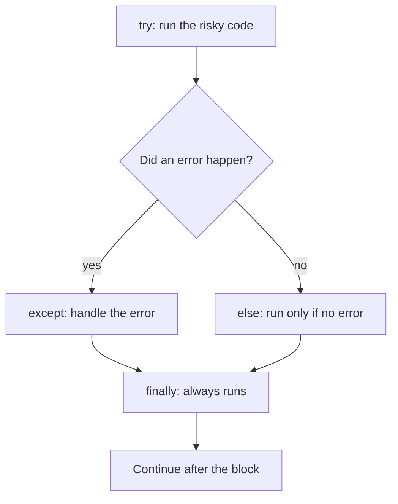

Real programs meet messy input all the time: a user types `"twelve"` where a number should be, a file is missing, or a language model answers with chatty text instead of JSON. AI pipelines talk to the messy outside world constantly. **Exceptions** let your program notice a problem, react to it, and keep going instead of crashing.

## 1. What is an exception?

When Python cannot do what a line asks, it stops and **raises an exception**: an error object with a type and a message. If nothing handles it, the program dies and prints a **traceback**.

```text
numbers = [10, 20, 30]
print(numbers[5])

Traceback (most recent call last):
  File "demo.py", line 2, in <module>
    print(numbers[5])
IndexError: list index out of range
```

Read a traceback **from the bottom up**:

| where | what it tells you |
|---|---|
| last line | the exception **type** (`IndexError`) and its **message** |
| line above | the exact line of code that failed |
| `File ..., line 2` | where to look in your file |

> [!TIP]
> Always read the last line of a traceback first. It usually tells you what went wrong in plain words.

## 2. try and except

Think of `try` as a **safety net under a trapeze artist**: you do the risky move inside the net, and if you fall, the net catches you and the show goes on.

```python
text = "twelve"
try:
    number = int(text)
    print("got", number)
except ValueError:
    print("that is not a number")
print("program goes on")
# that is not a number
# program goes on
```

Python runs the `try` block line by line. As soon as `int(text)` raises a `ValueError`, the **rest of the `try` block is skipped** (so `got` is never printed) and Python jumps to the matching `except` block. After that the program continues normally.

| step | what happens |
|---|---|
| 1 | `int("twelve")` fails and raises `ValueError` |
| 2 | `print("got", number)` is skipped |
| 3 | `except ValueError:` matches, so its block runs |
| 4 | the line after the whole block runs |

## 3. Catching the right error

Different mistakes raise different exception types. These are the ones you will meet most:

| exception | typical cause | example |
|---|---|---|
| `ValueError` | right type, wrong value | `int("abc")` |
| `TypeError` | wrong type | `"a" + 1`, `int(None)` |
| `KeyError` | dict key does not exist | `{"a": 1}["b"]` |
| `IndexError` | list position too big | `[1, 2][5]` |
| `ZeroDivisionError` | dividing by zero | `1 / 0` |
| `FileNotFoundError` | file does not exist | `open("nope.txt")` |

Name the exact type you expect, so other problems are not hidden:

```python
def divide(a, b):
    try:
        return a / b
    except ZeroDivisionError:
        return None


print(divide(10, 2))   # 5.0
print(divide(1, 0))    # None
```

Add `as err` to get the error object. Printing it shows the message:

```python
settings = {"model": "small"}
try:
    print(settings["temperature"])
except KeyError as err:
    print("missing key:", err)
# missing key: 'temperature'
```

To handle several types the same way, put them in a tuple. To handle them differently, write several `except` blocks. Python checks them **from top to bottom** and uses the first one that matches:

```python
def to_number(text):
    try:
        return float(text)
    except (ValueError, TypeError):
        return None


def describe(items, position):
    try:
        return items[position]
    except IndexError:
        return "no such position"
    except TypeError:
        return "position must be a number"


print(to_number("3.5"))            # 3.5
print(to_number(None))             # None
print(describe(["a", "b"], 1))     # b
print(describe(["a", "b"], 9))     # no such position
print(describe(["a", "b"], "x"))   # position must be a number
```

Some error types are a **kind of** another type. `json.JSONDecodeError` is a kind of `ValueError`, and every error in this lesson is a kind of `Exception`. So `except ValueError` also catches all the kinds of `ValueError`:

```text
Exception
├── ValueError
│   └── json.JSONDecodeError
├── TypeError
└── LookupError
    ├── KeyError
    └── IndexError
```

## 4. else and finally

A `try` statement can have two more optional blocks:

- `else` runs **only if no exception happened**.
- `finally` runs **every time**, error or not. It is for clean-up work.



```python
def read_ratio(a, b):
    try:
        ratio = a / b
    except ZeroDivisionError:
        print("cannot divide by zero")
        ratio = None
    else:
        print("division worked")
    finally:
        print("done with", a, b)
    return ratio


print(read_ratio(6, 3))
print(read_ratio(6, 0))
# division worked
# done with 6 3
# 2.0
# cannot divide by zero
# done with 6 0
# None
```

Press **Visualize** on this block and watch which lines run for each call.

| call | `try` | `except` | `else` | `finally` |
|---|---|---|---|---|
| `read_ratio(6, 3)` | runs fully | skipped | runs | runs |
| `read_ratio(6, 0)` | stops at the error | runs | skipped | runs |

> [!NOTE]
> Why use `else` instead of putting the code at the end of `try`? It keeps the `try` block small, so you only catch errors from the one risky line. You already know a built-in clean-up tool: `with open(...)` closes the file for you, so you rarely need `finally` for files.

## 5. Raise your own errors

You can raise an exception yourself with `raise`. Do this when a function receives something that makes no sense, so the problem is reported at once with a clear message instead of causing a strange bug later:

```python
def set_temperature(value):
    if value < 0 or value > 2:
        raise ValueError(f"temperature must be between 0 and 2, got {value}")
    return value


try:
    set_temperature(5)
except ValueError as err:
    print("rejected:", err)
# rejected: temperature must be between 0 and 2, got 5
```

A good message says what was expected and what was received. If nobody catches a raised error, the program stops with a traceback, which is exactly what you want for a real bug.

## 6. Catch it or let it crash?

| situation | what to do |
|---|---|
| Input from outside you cannot trust (user text, a model reply, a file) | catch the specific error and use a fallback |
| Your function got an argument that makes no sense | `raise ValueError` with a clear message |
| A bug in your own code (a typo in a name) | do not catch it; read the traceback and fix the code |

## 7. Common mistakes

**A bare `except` hides bugs.** Below, the real problem is a typo (`prise`), but you only see a useless message:

```python
try:
    total = prise * 3
except:
    print("something went wrong")
# something went wrong
```

Python raised `NameError: name 'prise' is not defined`, and the bare `except` swallowed it. Catch only the type you expect, such as `except ValueError:`. Then real bugs still show up.

> [!WARNING]
> Avoid `except:` and `except Exception:` for everyday code. They catch mistakes you wanted to see.

**Wrong order of `except` blocks.** The first match wins, so a general type placed first hides the specific one:

```python
try:
    int("abc")
except Exception:
    print("general")
except ValueError:
    print("specific")
# general
```

Put the specific type first (`ValueError`), then the general one.

**Silently ignoring the error with `pass`.** (`pass` is a line that does nothing.) The error disappears, and the variable never gets created:

```text
try:
    value = int("12a")
except ValueError:
    pass
print(value)

NameError: name 'value' is not defined
```

Give `value` a fallback in the `except` block (`value = 0`), or at least print a message, so you know it happened.

## Recap

- An exception is an error object. Read the traceback from the last line up.
- `try` runs risky code; the matching `except` runs if it fails, and the rest of `try` is skipped.
- Name the specific type (`ValueError`, `KeyError`, ...). Avoid bare `except`.
- `else` runs only when nothing failed; `finally` runs every time.
- `raise ValueError("clear message")` reports bad input early. Catch what you expect, and let real bugs crash so you can fix them.
