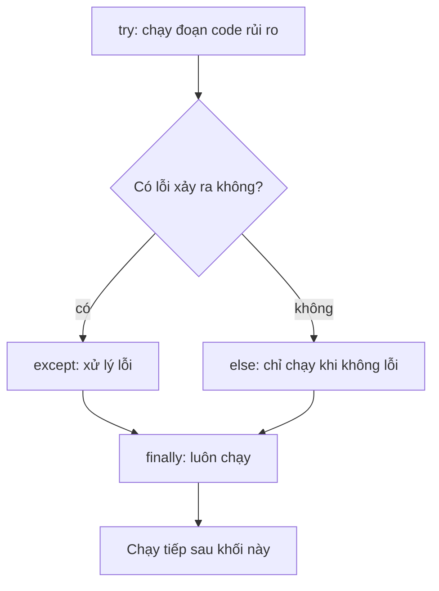

Chương trình thật luôn gặp dữ liệu lộn xộn: người dùng gõ `"twelve"` ở chỗ cần một con số, file bị thiếu, hoặc language model trả lời bằng văn bản lan man thay vì JSON. Các pipeline AI liên tục làm việc với thế giới bên ngoài đầy bất ngờ. **Exception** (ngoại lệ) giúp chương trình nhận ra vấn đề, phản ứng lại, và chạy tiếp thay vì sập.

## 1. Exception là gì?

Khi Python không làm được việc mà một dòng yêu cầu, nó dừng lại và **raise một exception**: một đối tượng lỗi có loại và thông báo. Nếu không ai xử lý, chương trình chết và in ra **traceback**.

```text
numbers = [10, 20, 30]
print(numbers[5])

Traceback (most recent call last):
  File "demo.py", line 2, in <module>
    print(numbers[5])
IndexError: list index out of range
```

Hãy đọc traceback **từ dưới lên**:

| ở đâu | nó cho bạn biết gì |
|---|---|
| dòng cuối | **loại** exception (`IndexError`) và **thông báo** của nó |
| dòng ngay trên | đúng dòng code bị lỗi |
| `File ..., line 2` | chỗ cần xem trong file của bạn |

> [!TIP]
> Luôn đọc dòng cuối của traceback trước. Thường nó nói bằng lời đơn giản điều gì đã sai.

## 2. try và except

Hãy hình dung `try` là **tấm lưới an toàn dưới người làm xiếc**: bạn thực hiện động tác nguy hiểm trong lưới, nếu bị ngã thì lưới đỡ lấy và buổi diễn vẫn tiếp tục.

```python
text = "twelve"
try:
    number = int(text)
    print("got", number)
except ValueError:
    print("that is not a number")
print("program goes on")
# that is not a number
# program goes on
```

Python chạy khối `try` từng dòng một. Ngay khi `int(text)` gây `ValueError`, **phần còn lại của khối `try` bị bỏ qua** (nên `got` không bao giờ được in) và Python nhảy tới khối `except` khớp. Sau đó chương trình chạy tiếp bình thường.

| bước | chuyện gì xảy ra |
|---|---|
| 1 | `int("twelve")` thất bại và gây `ValueError` |
| 2 | `print("got", number)` bị bỏ qua |
| 3 | `except ValueError:` khớp, nên khối của nó chạy |
| 4 | dòng nằm sau cả khối được chạy |

## 3. Bắt đúng loại lỗi

Các lỗi khác nhau gây ra các loại exception khác nhau. Đây là những loại bạn sẽ gặp nhiều nhất:

| exception | nguyên nhân thường gặp | ví dụ |
|---|---|---|
| `ValueError` | đúng kiểu, sai giá trị | `int("abc")` |
| `TypeError` | sai kiểu | `"a" + 1`, `int(None)` |
| `KeyError` | key của dict không tồn tại | `{"a": 1}["b"]` |
| `IndexError` | vị trí trong list quá lớn | `[1, 2][5]` |
| `ZeroDivisionError` | chia cho 0 | `1 / 0` |
| `FileNotFoundError` | file không tồn tại | `open("nope.txt")` |

Hãy nêu đúng loại lỗi bạn chờ đợi, để các vấn đề khác không bị che đi:

```python
def divide(a, b):
    try:
        return a / b
    except ZeroDivisionError:
        return None


print(divide(10, 2))   # 5.0
print(divide(1, 0))    # None
```

Thêm `as err` để lấy đối tượng lỗi. In nó ra sẽ thấy thông báo:

```python
settings = {"model": "small"}
try:
    print(settings["temperature"])
except KeyError as err:
    print("missing key:", err)
# missing key: 'temperature'
```

Muốn xử lý nhiều loại theo cùng một cách, đặt chúng trong một tuple. Muốn xử lý khác nhau, viết nhiều khối `except`. Python kiểm tra chúng **từ trên xuống** và dùng khối đầu tiên khớp:

```python
def to_number(text):
    try:
        return float(text)
    except (ValueError, TypeError):
        return None


def describe(items, position):
    try:
        return items[position]
    except IndexError:
        return "no such position"
    except TypeError:
        return "position must be a number"


print(to_number("3.5"))            # 3.5
print(to_number(None))             # None
print(describe(["a", "b"], 1))     # b
print(describe(["a", "b"], 9))     # no such position
print(describe(["a", "b"], "x"))   # position must be a number
```

## 4. else và finally

Câu lệnh `try` có thể có thêm hai khối tùy chọn:

- `else` chạy **chỉ khi không có exception nào xảy ra**.
- `finally` chạy **mọi lần**, dù có lỗi hay không. Nó dùng để dọn dẹp.



```python
def read_ratio(a, b):
    try:
        ratio = a / b
    except ZeroDivisionError:
        print("cannot divide by zero")
        ratio = None
    else:
        print("division worked")
    finally:
        print("done with", a, b)
    return ratio


print(read_ratio(6, 3))
print(read_ratio(6, 0))
# division worked
# done with 6 3
# 2.0
# cannot divide by zero
# done with 6 0
# None
```

Bấm **Visualize** ở khối code này để xem dòng nào chạy trong mỗi lần gọi.

| lần gọi | `try` | `except` | `else` | `finally` |
|---|---|---|---|---|
| `read_ratio(6, 3)` | chạy hết | bỏ qua | chạy | chạy |
| `read_ratio(6, 0)` | dừng ở chỗ lỗi | chạy | bỏ qua | chạy |

> [!NOTE]
> Tại sao dùng `else` thay vì đặt code ở cuối `try`? Vì nó giữ khối `try` nhỏ, nên bạn chỉ bắt lỗi của đúng một dòng rủi ro. Bạn đã biết một công cụ dọn dẹp có sẵn: `with open(...)` tự đóng file cho bạn, nên hiếm khi cần `finally` cho file.

## 5. Tự raise lỗi

Bạn có thể tự gây exception bằng `raise`. Hãy làm vậy khi một hàm nhận được thứ vô nghĩa, để vấn đề được báo ngay kèm thông báo rõ ràng, thay vì gây ra một bug kỳ lạ về sau:

```python
def set_temperature(value):
    if value < 0 or value > 2:
        raise ValueError(f"temperature must be between 0 and 2, got {value}")
    return value


try:
    set_temperature(5)
except ValueError as err:
    print("rejected:", err)
# rejected: temperature must be between 0 and 2, got 5
```

Một thông báo tốt nói rõ điều gì được chờ đợi và điều gì đã nhận được. Nếu không ai bắt lỗi đã raise, chương trình dừng với traceback, đúng như bạn muốn với một bug thật.

## 6. Bắt lỗi hay để nó sập?

| tình huống | nên làm gì |
|---|---|
| Dữ liệu từ bên ngoài bạn không tin được (text người dùng, reply của model, một file) | bắt đúng loại lỗi và dùng giá trị dự phòng |
| Hàm của bạn nhận một đối số vô nghĩa | `raise ValueError` kèm thông báo rõ ràng |
| Bug trong code của chính bạn (gõ sai tên) | đừng bắt; hãy đọc traceback và sửa code |

## 7. Lỗi thường gặp

**`except` trần (bare `except`) che giấu bug.** Dưới đây vấn đề thật là một lỗi gõ nhầm (`prise`), nhưng bạn chỉ thấy một thông báo vô dụng:

```python
try:
    total = prise * 3
except:
    print("something went wrong")
# something went wrong
```

Python đã raise `NameError: name 'prise' is not defined`, và `except` trần nuốt mất nó. Chỉ bắt loại lỗi bạn chờ đợi, như `except ValueError:`. Khi đó bug thật vẫn lộ ra.

> [!WARNING]
> Tránh `except:` và `except Exception:` trong code hằng ngày. Chúng bắt cả những lỗi mà bạn muốn nhìn thấy.

**Sai thứ tự các khối `except`.** Khối khớp đầu tiên thắng, nên loại chung đặt trước sẽ che mất loại cụ thể:

```python
try:
    int("abc")
except Exception:
    print("general")
except ValueError:
    print("specific")
# general
```

Hãy đặt loại cụ thể (`ValueError`) trước, rồi mới đến loại chung.

**Lờ lỗi đi bằng `pass`.** Lỗi biến mất, và biến không bao giờ được tạo ra:

```text
try:
    value = int("12a")
except ValueError:
    pass
print(value)

NameError: name 'value' is not defined
```

Hãy gán cho `value` một giá trị dự phòng trong khối `except` (`value = 0`), hoặc ít nhất in một thông báo, để bạn biết chuyện đó đã xảy ra.

## Tóm tắt

- Exception là một đối tượng lỗi. Hãy đọc traceback từ dòng cuối lên.
- `try` chạy code rủi ro; `except` khớp chạy nếu nó thất bại, và phần còn lại của `try` bị bỏ qua.
- Nêu đúng loại cụ thể (`ValueError`, `KeyError`, ...). Tránh `except` trần.
- `else` chỉ chạy khi không có gì thất bại; `finally` chạy mọi lần.
- `raise ValueError("thông báo rõ ràng")` báo dữ liệu xấu từ sớm. Hãy bắt cái bạn chờ đợi, và để bug thật sập để còn sửa.
