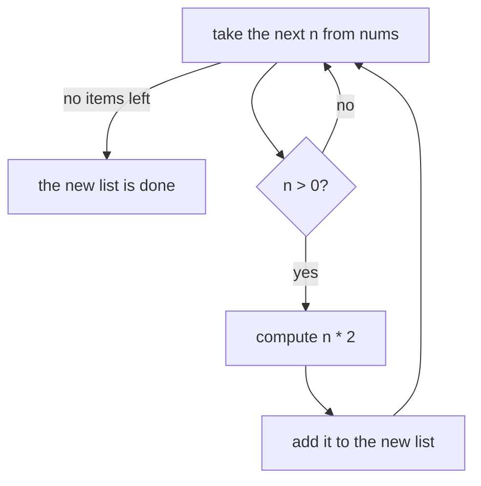

Before text reaches a model, it is almost always cleaned: spaces trimmed, letters lowercased, empty rows thrown away, duplicate labels removed. Each of these jobs is "take a collection, change or filter it, and get a new collection". Python has a short, readable way to write exactly this pattern: the **comprehension**. You will see it in almost every data and AI script.

## 1. From a loop to a comprehension

You already know how to build a new list with a loop: start with an empty list, loop, and `append`.

```python
nums = [3, -1, 4]

doubled = []
for n in nums:
    doubled.append(n * 2)

print(doubled)   # [6, -2, 8]
```

A **list comprehension** does the same job in one line:

```python
nums = [3, -1, 4]

doubled = [n * 2 for n in nums]

print(doubled)   # [6, -2, 8]
```

Read it out loud: "make a list of `n * 2` **for** each `n` **in** `nums`". The square brackets mean "the result is a list". The original `nums` is not changed.

Here is how the two versions line up:

| Loop version | Comprehension piece |
|---|---|
| `doubled = []` and the final list | the square brackets `[ ... ]` |
| `doubled.append(n * 2)` | `n * 2` (the value to keep, written first) |
| `for n in nums:` | `for n in nums` |
| `if n > 0:` (optional filter) | `if n > 0` (optional, at the end) |

## 2. The reading order

The value you keep is written **first**, but Python still runs the loop first. Think of it as an assembly line: take an item, check it, shape it, put it in the new list.



This diagram is the comprehension `[n * 2 for n in nums if n > 0]`. When you meet a long comprehension, read it in this order: the `for` part first, then the `if`, and the expression at the front last.

## 3. Filtering with `if`

Put `if condition` at the end to keep only the items that pass. Items that fail are skipped, and nothing is added for them.

```python
nums = [3, -1, 4, -5]

positives = [n for n in nums if n > 0]
print(positives)   # [3, 4]

doubled_positives = [n * 2 for n in nums if n > 0]
print(doubled_positives)   # [6, 8]
```

Press **Visualize** on this block and watch `n` change. The finished list appears when the line ends.

Here is a trace of the second comprehension:

| step | `n` | `n > 0`? | new list |
|---|---|---|---|
| 1 | `3` | yes | `[6]` |
| 2 | `-1` | no | `[6]` |
| 3 | `4` | yes | `[6, 8]` |
| 4 | `-5` | no | `[6, 8]` |

Any condition from the conditions lesson works here, including `and`, `or`, and truthiness. An empty string counts as `False`, which is handy for dropping empty text:

```python
rows = ["hello", "", "world", ""]

non_empty = [r for r in rows if r]
print(non_empty)   # ['hello', 'world']
```

## 4. Choosing between two values

Sometimes you do not want to drop an item, you want to change it in one of two ways. For that Python has a one-line choice: `value_if_true if condition else value_if_false`. It is a tiny `if`/`else` that gives back a value.

```python
score = 0.8
label = "pass" if score >= 0.5 else "fail"
print(label)   # pass
```

Put it at the **front** of a comprehension to decide each item's value:

```python
scores = [0.9, 0.4, 0.7]

labels = ["pass" if s >= 0.5 else "fail" for s in scores]
print(labels)   # ['pass', 'fail', 'pass']
```

Compare the two places an `if` can go:

| Where | Example | What it does |
|---|---|---|
| at the **end**, alone | `[s for s in scores if s >= 0.5]` | **filters**: some items are dropped |
| at the **front**, with `else` | `["pass" if s >= 0.5 else "fail" for s in scores]` | **chooses**: every item stays |

> [!TIP]
> Quick test: if the result must have the same number of items as the input, the `if ... else` goes at the front. If some items may disappear, the `if` goes at the end.

## 5. Dict comprehensions

Use curly braces and `key: value` to build a dict. This is perfect for "item to its measurement", like a word and its length:

```python
words = ["token", "prompt", "ai"]

lengths = {w: len(w) for w in words}
print(lengths)   # {'token': 5, 'prompt': 6, 'ai': 2}
```

To loop over an existing dict, use `.items()` to get each key and value, exactly as in the collections lesson. A filter works here too:

```python
grades = {"Lan": 9, "Minh": 4, "An": 7}

passed = {name: g for name, g in grades.items() if g >= 5}
print(passed)   # {'Lan': 9, 'An': 7}
```

> [!NOTE]
> A dict has one value per key. If two items produce the same key, the **later one wins**: `{w[0]: w for w in ["apple", "avocado"]}` gives `{'a': 'avocado'}`.

## 6. Set comprehensions

A **set** is a collection that keeps every value only once and does not care about order. Think of a bag of labelled stickers: putting in a second `"cat"` sticker changes nothing. Sets are written with curly braces and no colon.

```python
labels = ["cat", "dog", "cat", "bird", "dog"]

unique = {label for label in labels}
print(len(unique))   # 3
print(sorted(unique))   # ['bird', 'cat', 'dog']
```

Because a set has no fixed order, we wrap it in `sorted(...)` when we want to print it in a stable way. A set comprehension is the quickest way to **remove duplicates**, and you can clean the items on the way in:

```python
raw = ["Cat", "cat ", "DOG", "dog", " cat"]

unique = {label.strip().lower() for label in raw}
print(sorted(unique))   # ['cat', 'dog']
```

Here are all three shapes side by side:

| Brackets | Builds | Example |
|---|---|---|
| `[expr for x in items]` | a list | `[len(w) for w in words]` |
| `{key: value for x in items}` | a dict | `{w: len(w) for w in words}` |
| `{expr for x in items}` | a set | `{len(w) for w in words}` |

> [!NOTE]
> An empty `{}` is an empty **dict**, not an empty set. To make an empty set, write `set()`.

## 7. Two loops in one comprehension

You can write more than one `for`. They run like nested loops, with the **outer one first**:

```python
chats = [["hi", "hello"], ["bye"]]

messages = [msg for chat in chats for msg in chat]
print(messages)   # ['hi', 'hello', 'bye']
```

That is the same as:

```python
chats = [["hi", "hello"], ["bye"]]

messages = []
for chat in chats:
    for msg in chat:
        messages.append(msg)
print(messages)   # ['hi', 'hello', 'bye']
```

This "flatten a list of lists" is the one case where two `for` parts are worth it. If you need three levels, or a filter on each level, use a normal loop.

## 8. When not to use a comprehension

A comprehension is for **building a new collection from an old one**. Do not use it when:

- **You only want a side effect**, such as printing. Use a `for` loop.
- **The body needs several steps.** A line that needs a scroll bar is harder to read than a loop.
- **You need `break`, `continue`, or to change variables outside.** Comprehensions cannot do that.

If a comprehension does not fit on one comfortable line, or you need to re-read it twice, switch to a loop or move the work into a small function:

```python
def normalize(text):
    return " ".join(text.lower().split())


prompts = ["  Hello   WORLD ", "What IS  AI?"]
clean = [normalize(p) for p in prompts]
print(clean)   # ['hello world', 'what is ai?']
```

`split()` cuts the text into words and `" ".join(...)` glues them back with single spaces, so extra spaces disappear (see the strings lesson). A good name like `normalize` often reads better than a long expression inside the brackets.

| Use a comprehension when | Use a loop when |
|---|---|
| you build a list, dict or set from another collection | you print, save, or call something for its effect |
| the expression and filter are short | the body has several steps |
| one `for` (or a simple flatten) is enough | you need `break` or `continue` |

## 9. Common mistakes

**Using a comprehension just to print.** It works, but it also builds a useless list of `None` values:

```python
names = ["Lan", "Minh"]
result = [print(n) for n in names]   # prints Lan, then Minh
print(result)                        # [None, None]
```

Fix: use a normal loop, `for n in names: print(n)`.

**Putting `else` at the end.** The filter `if` has no `else`:

```python
nums = [3, -1, 4]
fixed = [n for n in nums if n > 0 else 0]
# SyntaxError: invalid syntax
```

Fix: the `if ... else` that chooses a value goes at the front: `[n if n > 0 else 0 for n in nums]` gives `[3, 0, 4]`.

**Looping over a dict without `.items()`.** A plain loop over a dict gives only the keys:

```python
grades = {"Lan": 9}
copy = {name: g for name, g in grades}
# ValueError: too many values to unpack (expected 2)
```

Fix: `{name: g for name, g in grades.items()}`.

**Forgetting that a dict key can appear only once.** Two items with the same key silently overwrite each other:

```python
words = ["apple", "avocado", "banana"]
first_letter = {w[0]: w for w in words}
print(first_letter)   # {'a': 'avocado', 'b': 'banana'}  "apple" is lost
```

Fix: pick a key that is unique for each item, or use a loop that collects a list per key.

> [!WARNING]
> If you are tempted to add a second `if` or a third `for`, stop. Readability beats being short.

## Recap

- A comprehension builds a new list, dict or set from another collection in one readable line.
- Shape: `[expression for item in items]`. The brackets pick the type: `[...]` list, `{k: v ...}` dict, `{x ...}` set.
- `if` at the **end** filters items out. `a if cond else b` at the **front** chooses a value for every item.
- Two `for` parts run like nested loops, outer first. Use that only to flatten a list of lists.
- A set comprehension removes duplicates; wrap it in `sorted(...)` to print it in a stable order.
- Use a plain `for` loop for side effects like printing, or when the body needs several steps.
