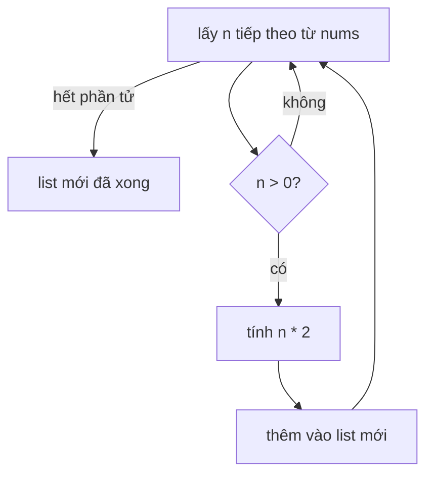

Trước khi văn bản được đưa vào model, nó gần như luôn phải được làm sạch: cắt bớt dấu cách, đổi sang chữ thường, bỏ các dòng rỗng, loại các label bị trùng. Việc nào cũng là "lấy một collection, biến đổi hoặc lọc nó, rồi nhận về một collection mới". Python có một cách viết ngắn gọn, dễ đọc cho đúng mẫu này: **comprehension**. Bạn sẽ gặp nó trong hầu hết các script dữ liệu và AI.

## 1. Từ vòng lặp sang comprehension

Bạn đã biết cách tạo list mới bằng vòng lặp: bắt đầu với list rỗng, lặp, rồi `append`.

```python
nums = [3, -1, 4]

doubled = []
for n in nums:
    doubled.append(n * 2)

print(doubled)   # [6, -2, 8]
```

**List comprehension** làm cùng việc đó chỉ trong một dòng:

```python
nums = [3, -1, 4]

doubled = [n * 2 for n in nums]

print(doubled)   # [6, -2, 8]
```

Hãy đọc thành lời: "tạo một list gồm `n * 2` **với mỗi** `n` **trong** `nums`". Cặp ngoặc vuông nghĩa là "kết quả là một list". `nums` ban đầu không bị thay đổi.

Hai cách viết tương ứng với nhau như sau:

| Bản dùng vòng lặp | Phần tương ứng trong comprehension |
|---|---|
| `doubled = []` và list kết quả cuối cùng | cặp ngoặc vuông `[ ... ]` |
| `doubled.append(n * 2)` | `n * 2` (giá trị cần giữ, viết đầu tiên) |
| `for n in nums:` | `for n in nums` |
| `if n > 0:` (bộ lọc, không bắt buộc) | `if n > 0` (không bắt buộc, đặt ở cuối) |

## 2. Thứ tự đọc

Giá trị cần giữ được viết **đầu tiên**, nhưng Python vẫn chạy vòng lặp trước. Hãy hình dung một dây chuyền: lấy một phần tử, kiểm tra, biến đổi, bỏ vào list mới.



Sơ đồ này là comprehension `[n * 2 for n in nums if n > 0]`. Khi gặp một comprehension dài, hãy đọc theo thứ tự này: phần `for` trước, rồi đến `if`, và biểu thức ở đầu đọc sau cùng.

## 3. Lọc bằng `if`

Đặt `if condition` ở cuối để chỉ giữ những phần tử thỏa điều kiện. Phần tử không thỏa sẽ bị bỏ qua, và không có gì được thêm vào cho chúng.

```python
nums = [3, -1, 4, -5]

positives = [n for n in nums if n > 0]
print(positives)   # [3, 4]

doubled_positives = [n * 2 for n in nums if n > 0]
print(doubled_positives)   # [6, 8]
```

Bấm **Visualize** ở khối code này để xem `n` thay đổi. List hoàn chỉnh xuất hiện khi dòng code kết thúc.

Đây là bảng theo dõi (trace) của comprehension thứ hai:

| bước | `n` | `n > 0`? | list mới |
|---|---|---|---|
| 1 | `3` | có | `[6]` |
| 2 | `-1` | không | `[6]` |
| 3 | `4` | có | `[6, 8]` |
| 4 | `-5` | không | `[6, 8]` |

Mọi điều kiện bạn đã học ở bài Câu lệnh điều kiện đều dùng được ở đây, kể cả `and`, `or` và truthiness. Chuỗi rỗng được coi là `False`, rất tiện để bỏ các đoạn text rỗng:

```python
rows = ["hello", "", "world", ""]

non_empty = [r for r in rows if r]
print(non_empty)   # ['hello', 'world']
```

## 4. Chọn giữa hai giá trị

Đôi khi bạn không muốn bỏ phần tử, mà muốn biến đổi nó theo một trong hai cách. Python có cú pháp chọn trong một dòng: `value_if_true if condition else value_if_false`. Đó là một `if`/`else` thu nhỏ trả về một giá trị.

```python
score = 0.8
label = "pass" if score >= 0.5 else "fail"
print(label)   # pass
```

Đặt nó ở **đầu** comprehension để quyết định giá trị của từng phần tử:

```python
scores = [0.9, 0.4, 0.7]

labels = ["pass" if s >= 0.5 else "fail" for s in scores]
print(labels)   # ['pass', 'fail', 'pass']
```

So sánh hai chỗ `if` có thể xuất hiện:

| Vị trí | Ví dụ | Tác dụng |
|---|---|---|
| ở **cuối**, đứng một mình | `[s for s in scores if s >= 0.5]` | **lọc**: một số phần tử bị bỏ |
| ở **đầu**, đi kèm `else` | `["pass" if s >= 0.5 else "fail" for s in scores]` | **chọn**: mọi phần tử đều được giữ |

> [!TIP]
> Cách kiểm tra nhanh: nếu kết quả phải có số phần tử bằng đầu vào thì `if ... else` đặt ở đầu. Nếu một số phần tử có thể biến mất thì `if` đặt ở cuối.

## 5. Dict comprehension

Dùng ngoặc nhọn và `key: value` để tạo dict. Cách này rất hợp với kiểu "phần tử và số đo của nó", như một từ và độ dài của từ:

```python
words = ["token", "prompt", "ai"]

lengths = {w: len(w) for w in words}
print(lengths)   # {'token': 5, 'prompt': 6, 'ai': 2}
```

Để lặp qua một dict có sẵn, dùng `.items()` để lấy từng key và value, giống hệt bài collections. Bộ lọc cũng dùng được ở đây:

```python
grades = {"Lan": 9, "Minh": 4, "An": 7}

passed = {name: g for name, g in grades.items() if g >= 5}
print(passed)   # {'Lan': 9, 'An': 7}
```

> [!NOTE]
> Mỗi key trong dict chỉ có một value. Nếu hai phần tử cho ra cùng một key thì **phần tử sau thắng**: `{w[0]: w for w in ["apple", "avocado"]}` cho kết quả `{'a': 'avocado'}`.

## 6. Set comprehension

**Set** là một collection chỉ giữ mỗi giá trị một lần và không quan tâm đến thứ tự. Hãy hình dung một túi sticker có nhãn: bỏ thêm sticker `"cat"` thứ hai vào cũng không thay đổi gì. Set được viết bằng ngoặc nhọn và không có dấu hai chấm.

```python
labels = ["cat", "dog", "cat", "bird", "dog"]

unique = {label for label in labels}
print(len(unique))   # 3
print(sorted(unique))   # ['bird', 'cat', 'dog']
```

Vì set không có thứ tự cố định, ta bọc nó trong `sorted(...)` khi muốn in ra theo thứ tự ổn định. Set comprehension là cách nhanh nhất để **loại phần tử trùng**, và bạn có thể làm sạch các phần tử ngay lúc đưa vào:

```python
raw = ["Cat", "cat ", "DOG", "dog", " cat"]

unique = {label.strip().lower() for label in raw}
print(sorted(unique))   # ['cat', 'dog']
```

Đây là cả ba dạng đặt cạnh nhau:

| Ngoặc | Tạo ra | Ví dụ |
|---|---|---|
| `[expr for x in items]` | một list | `[len(w) for w in words]` |
| `{key: value for x in items}` | một dict | `{w: len(w) for w in words}` |
| `{expr for x in items}` | một set | `{len(w) for w in words}` |

> [!NOTE]
> `{}` rỗng là một **dict** rỗng, không phải set rỗng. Muốn tạo set rỗng, hãy viết `set()`.

## 7. Hai vòng lặp trong một comprehension

Bạn có thể viết nhiều hơn một `for`. Chúng chạy như các vòng lặp lồng nhau, với **vòng ngoài đứng trước**:

```python
chats = [["hi", "hello"], ["bye"]]

messages = [msg for chat in chats for msg in chat]
print(messages)   # ['hi', 'hello', 'bye']
```

Đoạn trên tương đương với:

```python
chats = [["hi", "hello"], ["bye"]]

messages = []
for chat in chats:
    for msg in chat:
        messages.append(msg)
print(messages)   # ['hi', 'hello', 'bye']
```

"Làm phẳng một list của các list" là trường hợp duy nhất đáng để dùng hai phần `for`. Nếu cần ba tầng, hoặc cần lọc ở mỗi tầng, hãy dùng vòng lặp thường.

## 8. Khi nào không nên dùng comprehension

Comprehension dùng để **tạo một collection mới từ một collection cũ**. Đừng dùng khi:

- **Bạn chỉ cần tác dụng phụ** (side effect), ví dụ như in ra. Hãy dùng vòng `for`.
- **Phần thân cần nhiều bước.** Một dòng dài đến mức phải cuộn ngang thì khó đọc hơn một vòng lặp.
- **Bạn cần `break`, `continue`, hoặc thay đổi biến bên ngoài.** Comprehension không làm được những việc đó.

Nếu comprehension không nằm gọn trong một dòng dễ đọc, hoặc bạn phải đọc lại hai lần mới hiểu, hãy chuyển sang vòng lặp hoặc đưa phần việc vào một hàm nhỏ:

```python
def normalize(text):
    return " ".join(text.lower().split())


prompts = ["  Hello   WORLD ", "What IS  AI?"]
clean = [normalize(p) for p in prompts]
print(clean)   # ['hello world', 'what is ai?']
```

`split()` cắt văn bản thành các từ và `" ".join(...)` ghép chúng lại bằng đúng một dấu cách, nên dấu cách thừa biến mất (xem bài về string). Một cái tên tốt như `normalize` thường dễ đọc hơn một biểu thức dài nằm trong ngoặc.

| Dùng comprehension khi | Dùng vòng lặp khi |
|---|---|
| bạn tạo list, dict hoặc set từ một collection khác | bạn in, lưu, hoặc gọi hàm chỉ vì tác dụng của nó |
| biểu thức và bộ lọc ngắn | phần thân có nhiều bước |
| một `for` (hoặc làm phẳng đơn giản) là đủ | bạn cần `break` hoặc `continue` |

## 9. Lỗi thường gặp

**Dùng comprehension chỉ để in.** Nó chạy được, nhưng còn tạo ra một list vô ích toàn `None`:

```python
names = ["Lan", "Minh"]
result = [print(n) for n in names]   # in Lan, rồi Minh
print(result)                        # [None, None]
```

Cách sửa: dùng vòng lặp thường, `for n in names: print(n)`.

**Đặt `else` ở cuối.** `if` dùng để lọc không có `else`:

```python
nums = [3, -1, 4]
fixed = [n for n in nums if n > 0 else 0]
# SyntaxError: invalid syntax
```

Cách sửa: `if ... else` dùng để chọn giá trị phải đặt ở đầu: `[n if n > 0 else 0 for n in nums]` cho kết quả `[3, 0, 4]`.

**Lặp qua dict mà quên `.items()`.** Vòng lặp thường trên dict chỉ cho bạn các key:

```python
grades = {"Lan": 9}
copy = {name: g for name, g in grades}
# ValueError: too many values to unpack (expected 2)
```

Cách sửa: `{name: g for name, g in grades.items()}`.

**Quên rằng một key của dict chỉ xuất hiện một lần.** Hai phần tử cùng key sẽ lặng lẽ ghi đè lên nhau:

```python
words = ["apple", "avocado", "banana"]
first_letter = {w[0]: w for w in words}
print(first_letter)   # {'a': 'avocado', 'b': 'banana'}  "apple" bị mất
```

Cách sửa: chọn một key khác nhau cho mỗi phần tử, hoặc dùng vòng lặp gom thành một list cho mỗi key.

> [!WARNING]
> Nếu bạn muốn thêm `if` thứ hai hoặc `for` thứ ba, hãy dừng lại. Dễ đọc quan trọng hơn ngắn gọn.

## Tóm tắt

- Comprehension tạo list, dict hoặc set mới từ một collection khác chỉ trong một dòng dễ đọc.
- Dạng chung: `[expression for item in items]`. Loại ngoặc quyết định kiểu kết quả: `[...]` list, `{k: v ...}` dict, `{x ...}` set.
- `if` ở **cuối** lọc bỏ phần tử. `a if cond else b` ở **đầu** chọn giá trị cho mọi phần tử.
- Hai phần `for` chạy như vòng lặp lồng nhau, vòng ngoài trước. Chỉ dùng cách này để làm phẳng list của các list.
- Set comprehension loại phần tử trùng; bọc trong `sorted(...)` để in theo thứ tự ổn định.
- Dùng vòng `for` thường cho tác dụng phụ như in ra, hoặc khi phần thân cần nhiều bước.
