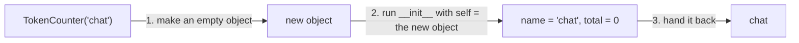

Every chat message, every token counter and every prompt template in an AI app is a small bundle of **data** and **actions** that belong together. A message has a role and a text, and it can tell you how many words it has. Python has a tool for exactly this kind of bundle: the **class**. Almost every AI library you will use (the OpenAI client, PyTorch, scikit-learn) is built from classes, so this lesson is your key to reading their code.

## 1. Why classes?

Imagine you track how many tokens a chat feature has used. With what you know, you would use a dict and a function:

```python
counter = {"name": "chat", "total": 0}


def add_tokens(counter, n):
    counter["total"] += n


add_tokens(counter, 12)
print(counter)   # {'name': 'chat', 'total': 12}
```

It works, but the data (the dict) and the actions (the function) live in two different places. Nothing stops you from writing `counter["totl"]` by mistake, and nothing says which functions belong to which dict.

A **class** fixes this by putting data and actions into one package. Think of a class as a **blueprint** (or a cookie cutter). The blueprint is not something you can use yet; it describes how to build one. Each thing you build from it is an **object**, also called an **instance** (the cookie).

## 2. Defining a class and building objects

Use `class`, a name, and a colon. By convention class names start with a capital letter. Inside, you write a special function called `__init__` (two underscores on each side) that sets up every new object:

```python
class TokenCounter:
    def __init__(self, name):
        self.name = name
        self.total = 0


chat = TokenCounter("chat")
print(chat.name)    # chat
print(chat.total)   # 0
```

Here is what happens on the line `chat = TokenCounter("chat")`:



- Python makes a new, empty object and runs `__init__` for you. You don't call `__init__` yourself to build an object.
- **`self`** is the object being built. Python passes it in automatically as the first parameter, so `"chat"` goes to `name`.
- `self.name = name` stores a value inside the object. A variable that belongs to an object is called an **attribute**. You read it with a dot: `chat.total`.

> [!NOTE]
> `self` is just a parameter name, but everybody uses `self`. Always write it as the first parameter of every function inside a class.

## 3. Methods: actions that belong to the object

A function defined inside a class is called a **method**. Its first parameter is always `self`, which lets it read and change the object's attributes:

```python
class TokenCounter:
    def __init__(self, name):
        self.name = name
        self.total = 0

    def add(self, n):
        self.total += n

    def is_over(self, limit):
        return self.total > limit


chat = TokenCounter("chat")
chat.add(12)
chat.add(30)
print(chat.total)           # 42
print(chat.is_over(40))     # True
```

Press **Visualize** on this block and watch `total` grow inside the `chat` object. Visualize shows the attributes of every object (for example `TokenCounter(name='chat', total=12)`), so you will see `total` change from 0 to 12 to 42.

When you write `chat.add(12)`, Python passes `chat` as `self` and `12` as `n`. That is why you give one argument but the method has two parameters.

| step | code | `chat.total` |
|---|---|---|
| 1 | `chat = TokenCounter("chat")` | `0` |
| 2 | `chat.add(12)` | `12` |
| 3 | `chat.add(30)` | `42` |

Notice the two kinds of methods. `add` **changes** the object and returns nothing (so its result is `None`). `is_over` only **asks a question** and gives the answer back with `return`.

> [!TIP]
> Read `chat.add(12)` as "chat, add 12 to yourself". The object on the left of the dot is the one that changes.

## 4. Every object keeps its own state

You can build as many objects as you like from one class. Each one has its own copy of the attributes:

```python
class ChatMessage:
    def __init__(self, role, text):
        self.role = role
        self.text = text

    def word_count(self):
        return len(self.text.split())   # split() cuts the text into a list of words


question = ChatMessage("user", "What is a class?")
answer = ChatMessage("assistant", "A blueprint for making objects.")
print(question.role, question.word_count())   # user 4
print(answer.role, answer.word_count())       # assistant 5

question.text = "Hi"
print(question.text)   # Hi
print(answer.text)     # A blueprint for making objects.
```

Changing `question.text` did not touch `answer`. Here is the picture:

```text
class ChatMessage            (role, text, word_count())
        |
        +--> question   role: "user"        text: "What is a class?"
        |
        +--> answer     role: "assistant"   text: "A blueprint for making objects."
```

One thing to be careful with: `b = a` does **not** build a new object. It gives the same object a second name, just like two names for one list:

```python
class Box:
    def __init__(self):
        self.items = []

    def put(self, x):
        self.items.append(x)


a = Box()
b = a            # same object, two names
b.put(1)
print(a.items)   # [1]
```

## 5. `__repr__`: a readable printout

If you print an object right now, Python only shows where it lives in memory, which is not useful:

```python
class Tag:
    def __init__(self, name):
        self.name = name


print(Tag("ai"))   # <__main__.Tag object at 0x...>
```

Add a method called `__repr__`. It must **return** a string that describes the object:

```python
class Tag:
    def __init__(self, name):
        self.name = name

    def __repr__(self):
        return f"Tag({self.name})"


print(Tag("ai"))                 # Tag(ai)
print([Tag("ai"), Tag("ml")])    # [Tag(ai), Tag(ml)]
```

`print` uses `__repr__` when the class has no `__str__` (a nicer-looking version you may meet later), and so does a list when it shows its items. When you debug, a good `__repr__` saves a lot of time.

## 6. Class or dict?

A class is not always better than a dict. Use this table to choose:

| use a dict | use a class |
|---|---|
| You just carry a few values, for example one user's settings that you only read once | Data **and** actions belong together |
| The keys can differ from item to item | Every object has the same attributes |
| You need it once | You build many objects, each with its own state |

A small example where a class is a good fit is a prompt template. It remembers its text and fills in a topic whenever you ask. (`text.replace(old, new)` swaps every `old` for `new`, as in the strings lesson.)

```python
class PromptTemplate:
    def __init__(self, template):
        self.template = template

    def fill(self, topic):
        return self.template.replace("{topic}", topic)


short = PromptTemplate("Explain {topic} in one sentence.")
print(short.fill("a class"))   # Explain a class in one sentence.
print(short.fill("a dict"))    # Explain a dict in one sentence.
```

## 7. Common mistakes

**Forgetting `self` in a method.** Python passes the object in as the first argument, so the method needs a slot for it:

```python
class Counter:
    def __init__(self):
        self.n = 0

    def add(n):          # forgot self
        pass


Counter().add(5)   # TypeError: Counter.add() takes 1 positional argument but 2 were given
```

Fix: `def add(self, n):`. Python counts the object too, so it saw 2 arguments.

**Forgetting `self.` before an attribute.** Without `self.` you only create a local variable that vanishes when the method ends:

```python
class Counter:
    def __init__(self):
        total = 0              # a local variable, not an attribute

    def add(self, n):
        self.total += n


Counter().add(5)   # AttributeError: 'Counter' object has no attribute 'total'
```

Fix: write `self.total = 0`.

**Printing inside `__repr__` instead of returning.** The method must give back a string:

```python
class Tag:
    def __init__(self, name):
        self.name = name

    def __repr__(self):
        print(self.name)    # shows the name, but returns None


print(Tag("ai"))   # prints ai, then TypeError: __str__ returned non-string (type NoneType)
```

`print` asks for `__str__` first, which falls back to `__repr__`, so the error names `__str__`. Fix: `return f"Tag({self.name})"`.

**Forgetting the parentheses when calling a method.** Without `()` you only name the method, you do not run it:

```python
class TokenCounter:
    def __init__(self):
        self.total = 0

    def add(self, n):
        self.total += n


chat = TokenCounter()
chat.add            # does nothing: the method is not called
print(chat.total)   # 0
chat.add(12)        # this one runs
print(chat.total)   # 12
```

> [!WARNING]
> Attributes are read without parentheses (`chat.total`), methods are called with them (`chat.add(12)`). If you mix them up you get a `TypeError` or a strange `<bound method ...>` printout.

## Recap

- A **class** is a blueprint. Calling it, `TokenCounter("chat")`, builds an **object** (an instance).
- `__init__(self, ...)` runs automatically for every new object. Use it to create the attributes with `self.name = ...`.
- A **method** is a function inside a class. Its first parameter is `self`: the object you called it on (`chat.add(12)`).
- Each object has its own attributes. Changing one does not change another, but `b = a` is the same object with two names.
- `__repr__` must **return** a string. `print` and lists use it to show your object.
- Use a class when data and actions belong together and you need many objects. Use a dict for a quick bag of values.
