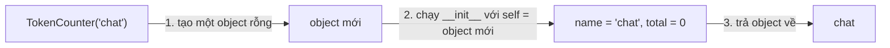

Mỗi tin nhắn chat, mỗi bộ đếm token và mỗi prompt template trong một ứng dụng AI đều là một gói nhỏ gồm **dữ liệu** và **hành động** đi cùng nhau. Một tin nhắn có vai trò (role) và nội dung, và nó có thể tự cho bạn biết mình có bao nhiêu từ. Python có một công cụ dành riêng cho kiểu gói này: **class** (lớp). Hầu hết thư viện AI bạn sẽ dùng (OpenAI client, PyTorch, scikit-learn) đều được xây từ class, nên bài này là chìa khóa để đọc hiểu code của chúng.

## 1. Tại sao cần class?

Giả sử bạn theo dõi số token mà một tính năng chat đã dùng. Với những gì đã học, bạn sẽ dùng một dict và một hàm:

```python
counter = {"name": "chat", "total": 0}


def add_tokens(counter, n):
    counter["total"] += n


add_tokens(counter, 12)
print(counter)   # {'name': 'chat', 'total': 12}
```

Cách này chạy được, nhưng dữ liệu (dict) và hành động (hàm) nằm ở hai nơi khác nhau. Không gì ngăn bạn gõ nhầm `counter["totl"]`, và cũng không gì cho biết hàm nào thuộc về dict nào.

**Class** giải quyết việc này bằng cách gói dữ liệu và hành động vào một chỗ. Hãy hình dung class là một **bản thiết kế** (hay khuôn làm bánh). Bản thiết kế chưa dùng được ngay; nó mô tả cách tạo ra một thứ. Mỗi thứ bạn tạo ra từ nó là một **object** (đối tượng), còn gọi là **instance** (thể hiện), tức là chiếc bánh.

## 2. Định nghĩa class và tạo object

Dùng `class`, một cái tên, và dấu hai chấm. Theo quy ước, tên class bắt đầu bằng chữ hoa. Bên trong, bạn viết một hàm đặc biệt tên `__init__` (hai dấu gạch dưới ở mỗi đầu) để thiết lập mọi object mới:

```python
class TokenCounter:
    def __init__(self, name):
        self.name = name
        self.total = 0


chat = TokenCounter("chat")
print(chat.name)    # chat
print(chat.total)   # 0
```

Đây là những gì xảy ra ở dòng `chat = TokenCounter("chat")`:



- Python tạo một object rỗng và tự chạy `__init__` cho bạn. Bạn không tự gọi `__init__` để tạo object.
- **`self`** là chính object đang được tạo. Python tự truyền nó vào làm tham số đầu tiên, nên `"chat"` đi vào `name`.
- `self.name = name` lưu một giá trị vào bên trong object. Một biến thuộc về object gọi là **attribute** (thuộc tính). Bạn đọc nó bằng dấu chấm: `chat.total`.

> [!NOTE]
> `self` chỉ là một cái tên tham số, nhưng mọi người đều dùng `self`. Luôn viết nó làm tham số đầu tiên của mọi hàm bên trong class.

## 3. Method: hành động thuộc về object

Hàm được định nghĩa bên trong class gọi là **method** (phương thức). Tham số đầu tiên của nó luôn là `self`, nhờ đó method đọc và thay đổi được các attribute của object:

```python
class TokenCounter:
    def __init__(self, name):
        self.name = name
        self.total = 0

    def add(self, n):
        self.total += n

    def is_over(self, limit):
        return self.total > limit


chat = TokenCounter("chat")
chat.add(12)
chat.add(30)
print(chat.total)           # 42
print(chat.is_over(40))     # True
```

Bấm **Visualize** ở khối code này để xem `total` tăng dần bên trong object `chat`. Visualize hiển thị attribute của từng object (ví dụ `TokenCounter(name='chat', total=12)`), nên bạn sẽ thấy `total` đổi từ 0 sang 12 rồi 42.

Khi bạn viết `chat.add(12)`, Python truyền `chat` vào `self` và `12` vào `n`. Vì thế bạn đưa một đối số nhưng method có hai tham số.

| bước | code | `chat.total` |
|---|---|---|
| 1 | `chat = TokenCounter("chat")` | `0` |
| 2 | `chat.add(12)` | `12` |
| 3 | `chat.add(30)` | `42` |

Hãy để ý hai loại method. `add` **thay đổi** object và không trả gì (nên kết quả là `None`). `is_over` chỉ **đặt một câu hỏi** và trả câu trả lời về bằng `return`.

> [!TIP]
> Hãy đọc `chat.add(12)` là "chat ơi, tự cộng thêm 12". Object bên trái dấu chấm là object bị thay đổi.

## 4. Mỗi object giữ trạng thái riêng

Bạn có thể tạo bao nhiêu object tùy ý từ một class. Mỗi object có bản sao attribute của riêng nó:

```python
class ChatMessage:
    def __init__(self, role, text):
        self.role = role
        self.text = text

    def word_count(self):
        return len(self.text.split())   # split() cắt chuỗi thành list các từ


question = ChatMessage("user", "What is a class?")
answer = ChatMessage("assistant", "A blueprint for making objects.")
print(question.role, question.word_count())   # user 4
print(answer.role, answer.word_count())       # assistant 5

question.text = "Hi"
print(question.text)   # Hi
print(answer.text)     # A blueprint for making objects.
```

Việc đổi `question.text` không động đến `answer`. Đây là hình minh họa:

```text
class ChatMessage            (role, text, word_count())
        |
        +--> question   role: "user"        text: "What is a class?"
        |
        +--> answer     role: "assistant"   text: "A blueprint for making objects."
```

Có một điều cần cẩn thận: `b = a` **không** tạo object mới. Nó chỉ đặt thêm một cái tên thứ hai cho cùng một object, giống như hai tên cho cùng một list:

```python
class Box:
    def __init__(self):
        self.items = []

    def put(self, x):
        self.items.append(x)


a = Box()
b = a            # cùng một object, hai cái tên
b.put(1)
print(a.items)   # [1]
```

## 5. `__repr__`: bản in dễ đọc

Nếu bạn in một object ngay bây giờ, Python chỉ cho biết nó nằm ở đâu trong bộ nhớ, chẳng có ích gì:

```python
class Tag:
    def __init__(self, name):
        self.name = name


print(Tag("ai"))   # <__main__.Tag object at 0x...>
```

Hãy thêm một method tên `__repr__`. Nó phải **return** một chuỗi mô tả object:

```python
class Tag:
    def __init__(self, name):
        self.name = name

    def __repr__(self):
        return f"Tag({self.name})"


print(Tag("ai"))                 # Tag(ai)
print([Tag("ai"), Tag("ml")])    # [Tag(ai), Tag(ml)]
```

`print` dùng `__repr__` khi class không có `__str__` (một bản in đẹp hơn mà bạn có thể gặp sau này), và list cũng vậy khi hiển thị các phần tử. Khi debug, một `__repr__` tốt giúp bạn tiết kiệm rất nhiều thời gian.

## 6. Class hay dict?

Class không phải lúc nào cũng tốt hơn dict. Hãy dùng bảng này để chọn:

| dùng dict | dùng class |
|---|---|
| Bạn chỉ mang theo vài giá trị, ví dụ cài đặt của một người dùng mà bạn chỉ đọc một lần | Dữ liệu **và** hành động đi cùng nhau |
| Các key có thể khác nhau giữa các phần tử | Mọi object có cùng các attribute |
| Bạn chỉ cần dùng một lần | Bạn tạo nhiều object, mỗi object có trạng thái riêng |

Một ví dụ nhỏ phù hợp với class là prompt template. Nó nhớ đoạn text của mình và điền chủ đề vào mỗi khi bạn yêu cầu. (`text.replace(old, new)` thay mọi `old` bằng `new`, như trong bài về chuỗi.)

```python
class PromptTemplate:
    def __init__(self, template):
        self.template = template

    def fill(self, topic):
        return self.template.replace("{topic}", topic)


short = PromptTemplate("Explain {topic} in one sentence.")
print(short.fill("a class"))   # Explain a class in one sentence.
print(short.fill("a dict"))    # Explain a dict in one sentence.
```

## 7. Lỗi thường gặp

**Quên `self` trong method.** Python truyền object vào làm đối số đầu tiên, nên method cần một chỗ trống để nhận nó:

```python
class Counter:
    def __init__(self):
        self.n = 0

    def add(n):          # quên self
        pass


Counter().add(5)   # TypeError: Counter.add() takes 1 positional argument but 2 were given
```

Cách sửa: `def add(self, n):`. Python tính cả object nên nó thấy 2 đối số.

**Quên `self.` trước attribute.** Không có `self.` thì bạn chỉ tạo một biến cục bộ và nó biến mất khi method kết thúc:

```python
class Counter:
    def __init__(self):
        total = 0              # biến cục bộ, không phải attribute

    def add(self, n):
        self.total += n


Counter().add(5)   # AttributeError: 'Counter' object has no attribute 'total'
```

Cách sửa: viết `self.total = 0`.

**Dùng print trong `__repr__` thay vì return.** Method này phải trả về một chuỗi:

```python
class Tag:
    def __init__(self, name):
        self.name = name

    def __repr__(self):
        print(self.name)    # in ra tên, nhưng trả về None


print(Tag("ai"))   # in ra ai, rồi TypeError: __str__ returned non-string (type NoneType)
```

`print` hỏi `__str__` trước, và nó dùng `__repr__` thay thế, nên lỗi nhắc đến `__str__`. Cách sửa: `return f"Tag({self.name})"`.

**Quên dấu ngoặc khi gọi method.** Không có `()` thì bạn chỉ nhắc tên method, chứ chưa chạy nó:

```python
class TokenCounter:
    def __init__(self):
        self.total = 0

    def add(self, n):
        self.total += n


chat = TokenCounter()
chat.add            # không làm gì: method chưa được gọi
print(chat.total)   # 0
chat.add(12)        # dòng này mới chạy
print(chat.total)   # 12
```

> [!WARNING]
> Attribute được đọc không cần ngoặc (`chat.total`), còn method được gọi bằng ngoặc (`chat.add(12)`). Nếu nhầm lẫn, bạn sẽ gặp `TypeError` hoặc một dòng lạ kiểu `<bound method ...>`.

## Tóm tắt

- **Class** là bản thiết kế. Gọi nó, `TokenCounter("chat")`, sẽ tạo ra một **object** (instance).
- `__init__(self, ...)` tự chạy cho mỗi object mới. Dùng nó để tạo các attribute bằng `self.name = ...`.
- **Method** là hàm nằm trong class. Tham số đầu tiên là `self`: chính object mà bạn gọi method trên đó (`chat.add(12)`).
- Mỗi object có attribute riêng. Đổi object này không đổi object khác, nhưng `b = a` là cùng một object với hai cái tên.
- `__repr__` phải **return** một chuỗi. `print` và list dùng nó để hiển thị object của bạn.
- Dùng class khi dữ liệu và hành động đi cùng nhau và bạn cần nhiều object. Dùng dict cho một túi giá trị nhanh gọn.
