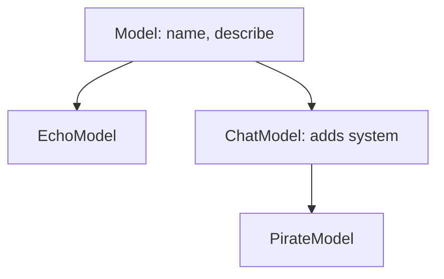
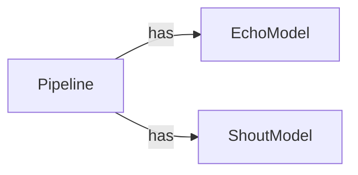

In AI code you rarely have just one kind of model. You have an echo model for tests, a canned model for demos, a chat model for real answers. They all do the same job ("take a prompt, give a reply") but in different ways. **Inheritance** lets you write the shared part once and add only the differences. **Composition** lets you build bigger things, like a pipeline, out of smaller parts. This lesson shows both, and when to pick which.

## 1. A subclass reuses a class

You already know how to write a class with `__init__`, attributes and methods. Now imagine you want a second class that is the same as the first, plus one extra thing. Copy and paste works, but then every fix has to be made twice.

**Inheritance** solves this: a new class can **inherit** everything from an existing one. The existing class is the **parent** (or **base class**). The new class is the **child** (or **subclass**). You write the parent's name in parentheses after the child's name.

```python
class Model:
    def __init__(self, name):
        self.name = name

    def describe(self):
        return f"I am {self.name}"


class LoudModel(Model):
    def shout(self, text):
        return text.upper() + "!"


m = LoudModel("loud-1")
print(m.name)            # loud-1
print(m.describe())      # I am loud-1
print(m.shout("hello"))  # HELLO!
```

`LoudModel` never wrote `__init__` or `describe`, yet `m.name` and `m.describe()` work: they come from `Model`. Only `shout` is new. (`.upper()` is a string method that gives the text in capital letters.)

A child can have its own children, so classes form a **tree**:



Read each arrow as "is a kind of": a `ChatModel` is a kind of `Model`, and a `PirateModel` is a kind of `ChatModel`.

## 2. super().__init__ sets up the parent part

What if the child needs an extra attribute? Then it needs its own `__init__`. But a child's `__init__` **replaces** the parent's one, so the parent's setup would not run. Call it yourself with `super()`, which means "the parent class":

```python
class Model:
    def __init__(self, name):
        self.name = name


class ChatModel(Model):
    def __init__(self, name, system):
        super().__init__(name)   # let Model set self.name
        self.system = system     # then add our own attribute


bot = ChatModel("chat-1", "be polite")
print(bot.name)     # chat-1
print(bot.system)   # be polite
```

Press **Visualize** on this block and watch `self` in the two `__init__` frames (it is the new object that becomes `bot`) get `name` first, from the parent's `__init__`, and `system` second.

Notice there is no `self` inside the parentheses of `super().__init__(name)`: `super()` already knows which object you are working on.

> [!TIP]
> Rule of thumb: if a child writes its own `__init__`, its first line is almost always `super().__init__(...)`.

## 3. Override: same name, new behavior

A child can also write a method with the **same name** as the parent's. Python uses the child's version for child objects. This is called **overriding**.

A base class often has a method that only says "children must write me". It does this with `raise`, which stops the program with an error you choose. `NotImplementedError` is the error for "not written yet":

```python
class Model:
    def __init__(self, name):
        self.name = name

    def generate(self, prompt):
        raise NotImplementedError("write generate in a subclass")


class EchoModel(Model):
    def generate(self, prompt):
        return "echo: " + prompt


class CannedModel(Model):
    def __init__(self, name, reply):
        super().__init__(name)
        self.reply = reply

    def generate(self, prompt):
        return self.reply


models = [EchoModel("echo-1"), CannedModel("canned-1", "I am a demo.")]
for model in models:
    print(model.name, "->", model.generate("hi"))
# echo-1 -> echo: hi
# canned-1 -> I am a demo.
```

The loop calls `model.generate("hi")` on every object, and each one answers in its own way. If you called `Model("base").generate("hi")` you would get `NotImplementedError: write generate in a subclass`.

Sometimes you want to **extend** the parent's method, not replace it. Call the parent's version with `super()` and add to the result. Here `super()` goes to the direct parent:

```python
class Model:
    def __init__(self, name):
        self.name = name

    def describe(self):
        return f"model {self.name}"


class ChatModel(Model):
    def __init__(self, name, system):
        super().__init__(name)
        self.system = system

    def describe(self):
        return super().describe() + f" (system: {self.system})"


print(Model("base").describe())                     # model base
print(ChatModel("chat-1", "be polite").describe())  # model chat-1 (system: be polite)
```

## 4. isinstance: is this object one of those?

`isinstance(obj, SomeClass)` answers `True` or `False`: is `obj` made from `SomeClass`, **or from any class below it in the tree**?

```python
class Model:
    def __init__(self, name):
        self.name = name


class EchoModel(Model):
    def generate(self, prompt):
        return "echo: " + prompt


class ChatModel(Model):
    def generate(self, prompt):
        return "chat: " + prompt


class PirateModel(ChatModel):
    def generate(self, prompt):
        return "arr! " + prompt


pirate = PirateModel("pirate-1")
print(isinstance(pirate, PirateModel))   # True
print(isinstance(pirate, ChatModel))     # True  (a pirate is a kind of chat model)
print(isinstance(pirate, Model))         # True  (and a kind of model)
print(isinstance(pirate, EchoModel))     # False (different branch)
print(isinstance("hello", Model))        # False (a string is not a Model)
```

It only goes **up** the tree: a plain `Model` is not an `EchoModel`. Use `isinstance` when code receives something and must check it is the right kind before using it.

## 5. Composition: an object that has other objects

Inheritance means **is-a**: an `EchoModel` *is a* `Model`. But sometimes the relation is **has-a**. A pipeline is not a kind of model; it *has* a list of models (its steps) and runs text through them one by one. To express "has-a", store the other objects in an attribute. This is called **composition**.



```python
class Model:
    def __init__(self, name):
        self.name = name


class EchoModel(Model):
    def generate(self, prompt):
        return "echo: " + prompt


class ShoutModel(Model):
    def generate(self, prompt):
        return prompt.upper()


class Pipeline:
    def __init__(self, steps):
        self.steps = steps          # a Pipeline HAS a list of models

    def run(self, text):
        for step in self.steps:
            text = step.generate(text)
        return text


pipe = Pipeline([EchoModel("echo-1"), ShoutModel("shout-1")])
print(pipe.run("hi"))      # ECHO: HI

other = Pipeline([ShoutModel("shout-1"), EchoModel("echo-1")])
print(other.run("hi"))     # echo: HI
```

Here is how `pipe.run("hi")` works. The same text goes through each step, and the output of one step is the input of the next:

| step | `step.name` | `text` after the step |
|---|---|---|
| start | | `"hi"` |
| 1 | `echo-1` | `"echo: hi"` |
| 2 | `shout-1` | `"ECHO: HI"` |

Notice how easy it is to change the pipeline: swap two items in the list and the behavior changes. No new class needed.

> [!NOTE]
> `self.steps = steps` stores the caller's own list, not a copy. If the caller changes that list later, the pipeline changes too. This is the same aliasing you met in the Classes lesson (§4).

## 6. Which one should you use?

| | Inheritance | Composition |
|---|---|---|
| Relation | **is-a**: `EchoModel` is a `Model` | **has-a**: `Pipeline` has models |
| How you write it | `class Child(Parent):` | an attribute: `self.steps = steps` |
| `isinstance(obj, Parent)` | `True` | `False` |
| Changing parts later | hard: the child is tied to its parent | easy: replace an item in the list |
| Use it when | the child is truly a special kind of the parent | an object is built from, or uses, other objects |

Ask one question: "Is X **a kind of** Y?" If you can say it naturally ("an echo model is a model"), inheritance fits. If you would say "X **has** Y" or "X **uses** Y", use composition.

> [!NOTE]
> When both seem to work, prefer composition. Inheritance ties a child to its parent: change the parent and every child can break. Composition keeps parts separate, so you can swap them freely.

## 7. Common mistakes

**Forgetting `super().__init__`.** The child's `__init__` replaces the parent's, so the parent's attributes are never created:

```python
class Model:
    def __init__(self, name):
        self.name = name


class ChatModel(Model):
    def __init__(self, name, system):
        self.system = system     # forgot super().__init__(name)


bot = ChatModel("chat-1", "be polite")
print(bot.name)   # AttributeError: 'ChatModel' object has no attribute 'name'
```

Fix: add `super().__init__(name)` as the first line of the child's `__init__`.

**Passing `self` to `super().__init__`.** `super()` already handles `self`, so you send it twice:

```python
class Model:
    def __init__(self, name):
        self.name = name


class ChatModel(Model):
    def __init__(self, name, system):
        super().__init__(self, name)   # self does not belong here
        self.system = system


bot = ChatModel("chat-1", "be polite")   # TypeError: Model.__init__() takes 2 positional arguments but 3 were given
```

Fix: write `super().__init__(name)`.

**A typo in the overriding method name.** If the name differs, it is a new method, not an override, and the parent's version still runs:

```python
class Model:
    def generate(self, prompt):
        raise NotImplementedError("write generate in a subclass")


class EchoModel(Model):
    def generat(self, prompt):    # typo: missing "e"
        return "echo: " + prompt


print(EchoModel().generate("hi"))   # NotImplementedError: write generate in a subclass
```

Fix: spell the method exactly like the parent's: `generate`.

**Using inheritance for a has-a relation.** The code runs, but `isinstance` now tells a lie:

```python
class EchoModel:
    def generate(self, prompt):
        return "echo: " + prompt


class Pipeline(EchoModel):    # a pipeline is not a kind of echo model
    def __init__(self, steps):
        self.steps = steps


print(isinstance(Pipeline([]), EchoModel))   # True  (wrong idea!)
```

Fix: write `class Pipeline:` and keep the steps in `self.steps`.

> [!WARNING]
> Do not choose inheritance just to "borrow" a few methods. Choose it only when the sentence "child is a kind of parent" is really true.

## Recap

- `class Child(Parent):` makes a subclass that inherits all attributes and methods of the parent. Classes form a tree.
- If a child writes `__init__`, call `super().__init__(...)` first so the parent's part is set up.
- **Override** a method by writing the same name in the child. Use `super().method()` to extend instead of replace.
- `isinstance(obj, Class)` is `True` for that class and every class above it in the tree.
- Inheritance is **is-a**; composition is **has-a**: store other objects in an attribute (`self.steps`).
- Not sure which one? Prefer composition: parts stay independent and are easy to swap.
