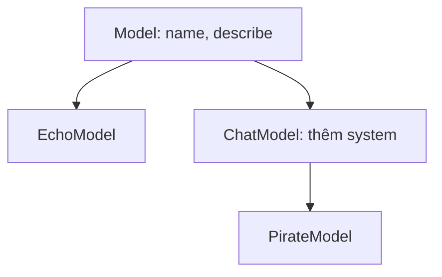
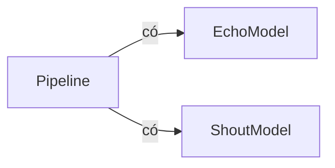

Trong code AI, hiếm khi bạn chỉ có một loại model. Bạn có model echo để test, model canned để demo, model chat để trả lời thật. Tất cả đều làm cùng một việc ("nhận prompt, trả về câu trả lời") nhưng theo cách khác nhau. **Kế thừa** (inheritance) cho phép bạn viết phần chung một lần rồi chỉ thêm phần khác biệt. **Composition** (kết hợp đối tượng) cho phép bạn dựng thứ lớn hơn, như một pipeline, từ các phần nhỏ. Bài này cho bạn thấy cả hai, và khi nào chọn cái nào.

## 1. Lớp con dùng lại một class

Bạn đã biết viết class với `__init__`, attribute (thuộc tính) và method (phương thức). Giờ hãy tưởng tượng bạn cần một class thứ hai giống class đầu, cộng thêm một thứ nữa. Copy và paste thì chạy được, nhưng mỗi lần sửa lỗi bạn phải sửa hai chỗ.

**Kế thừa** giải quyết việc này: một class mới có thể **kế thừa** (inherit) mọi thứ từ class có sẵn. Class có sẵn là **class cha** (parent, hay **base class**). Class mới là **class con** (child, hay **subclass**). Bạn viết tên class cha trong ngoặc, ngay sau tên class con.

```python
class Model:
    def __init__(self, name):
        self.name = name

    def describe(self):
        return f"I am {self.name}"


class LoudModel(Model):
    def shout(self, text):
        return text.upper() + "!"


m = LoudModel("loud-1")
print(m.name)            # loud-1
print(m.describe())      # I am loud-1
print(m.shout("hello"))  # HELLO!
```

`LoudModel` không hề viết `__init__` hay `describe`, vậy mà `m.name` và `m.describe()` vẫn chạy: chúng đến từ `Model`. Chỉ có `shout` là mới. (`.upper()` là method của chuỗi, trả về chữ viết hoa.)

Class con cũng có thể có class con của nó, nên các class tạo thành một **cây**:



Hãy đọc mỗi mũi tên là "là một loại": `ChatModel` là một loại `Model`, và `PirateModel` là một loại `ChatModel`.

## 2. super().__init__ dựng phần của class cha

Nếu class con cần thêm một attribute thì sao? Khi đó nó cần `__init__` riêng. Nhưng `__init__` của class con **thay thế** `__init__` của class cha, nên phần dựng của cha sẽ không chạy. Bạn tự gọi nó bằng `super()`, nghĩa là "class cha":

```python
class Model:
    def __init__(self, name):
        self.name = name


class ChatModel(Model):
    def __init__(self, name, system):
        super().__init__(name)   # để Model gán self.name
        self.system = system     # rồi thêm attribute của riêng mình


bot = ChatModel("chat-1", "be polite")
print(bot.name)     # chat-1
print(bot.system)   # be polite
```

Bấm **Visualize** ở khối code này để xem `self` trong hai frame `__init__` (đó là object mới sẽ trở thành `bot`) nhận `name` trước, từ `__init__` của cha, rồi mới đến `system`.

Để ý rằng trong ngoặc của `super().__init__(name)` không có `self`: `super()` đã biết bạn đang làm việc với object nào.

> [!TIP]
> Mẹo nhớ nhanh: nếu class con tự viết `__init__`, dòng đầu tiên của nó gần như luôn là `super().__init__(...)`.

## 3. Override: cùng tên, hành vi mới

Class con cũng có thể viết một method **trùng tên** với method của cha. Python sẽ dùng bản của con cho các object con. Việc này gọi là **override** (ghi đè).

Class cha thường có một method chỉ để nói "class con phải tự viết tôi". Nó làm vậy bằng `raise`, lệnh dừng chương trình với một lỗi do bạn chọn. `NotImplementedError` là lỗi có nghĩa "chưa được viết":

```python
class Model:
    def __init__(self, name):
        self.name = name

    def generate(self, prompt):
        raise NotImplementedError("write generate in a subclass")


class EchoModel(Model):
    def generate(self, prompt):
        return "echo: " + prompt


class CannedModel(Model):
    def __init__(self, name, reply):
        super().__init__(name)
        self.reply = reply

    def generate(self, prompt):
        return self.reply


models = [EchoModel("echo-1"), CannedModel("canned-1", "I am a demo.")]
for model in models:
    print(model.name, "->", model.generate("hi"))
# echo-1 -> echo: hi
# canned-1 -> I am a demo.
```

Vòng lặp gọi `model.generate("hi")` trên từng object, và mỗi object trả lời theo cách riêng. Nếu bạn gọi `Model("base").generate("hi")` thì sẽ nhận `NotImplementedError: write generate in a subclass`.

Đôi khi bạn muốn **mở rộng** method của cha thay vì thay thế nó. Hãy gọi bản của cha bằng `super()` rồi thêm vào kết quả. Ở đây `super()` đi tới class cha trực tiếp:

```python
class Model:
    def __init__(self, name):
        self.name = name

    def describe(self):
        return f"model {self.name}"


class ChatModel(Model):
    def __init__(self, name, system):
        super().__init__(name)
        self.system = system

    def describe(self):
        return super().describe() + f" (system: {self.system})"


print(Model("base").describe())                     # model base
print(ChatModel("chat-1", "be polite").describe())  # model chat-1 (system: be polite)
```

## 4. isinstance: object này có thuộc loại kia không?

`isinstance(obj, SomeClass)` trả về `True` hoặc `False`: `obj` có được tạo từ `SomeClass`, **hoặc từ bất kỳ class nào nằm dưới nó trong cây** không?

```python
class Model:
    def __init__(self, name):
        self.name = name


class EchoModel(Model):
    def generate(self, prompt):
        return "echo: " + prompt


class ChatModel(Model):
    def generate(self, prompt):
        return "chat: " + prompt


class PirateModel(ChatModel):
    def generate(self, prompt):
        return "arr! " + prompt


pirate = PirateModel("pirate-1")
print(isinstance(pirate, PirateModel))   # True
print(isinstance(pirate, ChatModel))     # True  (pirate là một loại chat model)
print(isinstance(pirate, Model))         # True  (và cũng là một loại model)
print(isinstance(pirate, EchoModel))     # False (khác nhánh)
print(isinstance("hello", Model))        # False (chuỗi không phải Model)
```

Nó chỉ đi **lên** trên cây: một `Model` thường không phải là `EchoModel`. Hãy dùng `isinstance` khi code nhận một thứ gì đó và cần kiểm tra đúng loại trước khi dùng.

## 5. Composition: object chứa các object khác

Kế thừa nghĩa là **is-a** (là một): `EchoModel` *là một* `Model`. Nhưng đôi khi quan hệ lại là **has-a** (có một). Pipeline không phải một loại model; nó *có* một list model (các bước) và cho văn bản đi qua từng bước. Để diễn tả "has-a", hãy lưu các object kia trong một attribute. Cách này gọi là **composition**.



```python
class Model:
    def __init__(self, name):
        self.name = name


class EchoModel(Model):
    def generate(self, prompt):
        return "echo: " + prompt


class ShoutModel(Model):
    def generate(self, prompt):
        return prompt.upper()


class Pipeline:
    def __init__(self, steps):
        self.steps = steps          # Pipeline CÓ một list model

    def run(self, text):
        for step in self.steps:
            text = step.generate(text)
        return text


pipe = Pipeline([EchoModel("echo-1"), ShoutModel("shout-1")])
print(pipe.run("hi"))      # ECHO: HI

other = Pipeline([ShoutModel("shout-1"), EchoModel("echo-1")])
print(other.run("hi"))     # echo: HI
```

Đây là cách `pipe.run("hi")` hoạt động. Cùng một văn bản đi qua từng bước, và đầu ra của bước này là đầu vào của bước sau:

| bước | `step.name` | `text` sau bước đó |
|---|---|---|
| bắt đầu | | `"hi"` |
| 1 | `echo-1` | `"echo: hi"` |
| 2 | `shout-1` | `"ECHO: HI"` |

Để ý việc đổi pipeline dễ thế nào: đổi chỗ hai phần tử trong list là hành vi thay đổi. Không cần class mới.

> [!NOTE]
> `self.steps = steps` lưu chính list của người gọi, không phải bản sao. Nếu người gọi sửa list đó về sau, pipeline cũng đổi theo. Đây là cùng hiện tượng dùng chung (aliasing) bạn đã gặp ở bài Class (§4).

## 6. Nên chọn cái nào?

| | Kế thừa | Composition |
|---|---|---|
| Quan hệ | **is-a**: `EchoModel` là một `Model` | **has-a**: `Pipeline` có các model |
| Cách viết | `class Child(Parent):` | một attribute: `self.steps = steps` |
| `isinstance(obj, Parent)` | `True` | `False` |
| Đổi các phần về sau | khó: con bị gắn chặt với cha | dễ: thay một phần tử trong list |
| Dùng khi | con thật sự là một loại đặc biệt của cha | object được dựng từ, hoặc dùng, các object khác |

Hãy hỏi một câu: "X có phải **một loại** Y không?" Nếu bạn nói tự nhiên được ("model echo là một model"), kế thừa phù hợp. Nếu bạn sẽ nói "X **có** Y" hoặc "X **dùng** Y", hãy dùng composition.

> [!NOTE]
> Khi cả hai cách đều có vẻ dùng được, hãy ưu tiên composition. Kế thừa gắn con với cha: đổi cha thì mọi con đều có thể hỏng. Composition giữ các phần tách biệt nên bạn thay chúng thoải mái.

## 7. Lỗi thường gặp

**Quên `super().__init__`.** `__init__` của con thay thế `__init__` của cha, nên attribute của cha không bao giờ được tạo:

```python
class Model:
    def __init__(self, name):
        self.name = name


class ChatModel(Model):
    def __init__(self, name, system):
        self.system = system     # quên super().__init__(name)


bot = ChatModel("chat-1", "be polite")
print(bot.name)   # AttributeError: 'ChatModel' object has no attribute 'name'
```

Cách sửa: thêm `super().__init__(name)` làm dòng đầu tiên trong `__init__` của con.

**Truyền `self` vào `super().__init__`.** `super()` đã lo phần `self`, nên bạn gửi nó hai lần:

```python
class Model:
    def __init__(self, name):
        self.name = name


class ChatModel(Model):
    def __init__(self, name, system):
        super().__init__(self, name)   # self không thuộc về đây
        self.system = system


bot = ChatModel("chat-1", "be polite")   # TypeError: Model.__init__() takes 2 positional arguments but 3 were given
```

Cách sửa: viết `super().__init__(name)`.

**Gõ sai tên method khi override.** Nếu tên khác đi thì đó là method mới, không phải override, và bản của cha vẫn chạy:

```python
class Model:
    def generate(self, prompt):
        raise NotImplementedError("write generate in a subclass")


class EchoModel(Model):
    def generat(self, prompt):    # gõ sai: thiếu chữ "e"
        return "echo: " + prompt


print(EchoModel().generate("hi"))   # NotImplementedError: write generate in a subclass
```

Cách sửa: viết đúng y hệt tên của cha: `generate`.

**Dùng kế thừa cho quan hệ has-a.** Code vẫn chạy, nhưng `isinstance` giờ nói sai sự thật:

```python
class EchoModel:
    def generate(self, prompt):
        return "echo: " + prompt


class Pipeline(EchoModel):    # pipeline không phải một loại echo model
    def __init__(self, steps):
        self.steps = steps


print(isinstance(Pipeline([]), EchoModel))   # True  (ý tưởng sai!)
```

Cách sửa: viết `class Pipeline:` và giữ các bước trong `self.steps`.

> [!WARNING]
> Đừng chọn kế thừa chỉ để "mượn" vài method. Chỉ chọn khi câu "con là một loại của cha" thật sự đúng.

## Tóm tắt

- `class Child(Parent):` tạo class con kế thừa mọi attribute và method của cha. Các class tạo thành một cây.
- Nếu class con viết `__init__`, hãy gọi `super().__init__(...)` trước để phần của cha được dựng.
- **Override** một method bằng cách viết cùng tên trong class con. Dùng `super().method()` để mở rộng thay vì thay thế.
- `isinstance(obj, Class)` là `True` với chính class đó và mọi class nằm trên nó trong cây.
- Kế thừa là **is-a**; composition là **has-a**: lưu các object khác trong một attribute (`self.steps`).
- Chưa chắc chọn cái nào? Ưu tiên composition: các phần độc lập và dễ thay thế.
