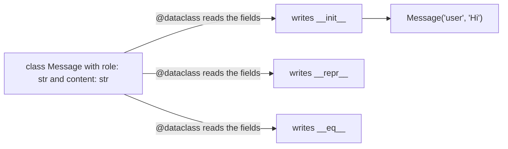

AI code moves small records around all day: a chat message with a role and a text, a settings object with a temperature and a token limit, a document with an id and its text. In the classes lesson you built such records with `__init__` and `__repr__`, and it took a lot of typing for very little data. A **dataclass** writes that boring code for you, so you only list the fields. You will meet dataclasses in almost every modern AI library, so this lesson pays off fast.

## 1. The boilerplate problem

Here is a chat message written as a plain class, the way you learned in the classes lesson:

```python
class Message:
    def __init__(self, role, content):
        self.role = role
        self.content = content

    def __repr__(self):
        return f"Message(role='{self.role}', content='{self.content}')"


a = Message("user", "Hi")
b = Message("user", "Hi")
print(a)        # Message(role='user', content='Hi')
print(a == b)   # False
```

The last line surprises many beginners. `a` and `b` hold the same data, but they are two different objects, and by default `==` only says `True` for the very same object.

To compare by data, you write one more special method. `a == b` calls `a.__eq__(b)`, where `other` is the object on the right:

```python
class Message:
    def __init__(self, role, content):
        self.role = role
        self.content = content

    def __repr__(self):
        return f"Message(role='{self.role}', content='{self.content}')"

    def __eq__(self, other):
        return self.role == other.role and self.content == other.content


print(Message("user", "Hi") == Message("user", "Hi"))   # True
```

It works, but look at the cost. Every field appears in `__init__`, in `__repr__` and in `__eq__`. Add a third field and you must edit three places, and forgetting one causes quiet bugs.

## 2. `@dataclass`: list the fields, get the rest

A dataclass keeps only the part that matters, the list of fields:

```python
from dataclasses import dataclass


@dataclass
class Message:
    role: str
    content: str


a = Message("user", "Hi")
b = Message("user", "Hi")
print(a)         # Message(role='user', content='Hi')
print(a == b)    # True
print(a.role)    # user
```

Two new pieces of syntax:

- `@dataclass` is a **decorator**: a line starting with `@` right above a class. It hands the class to a helper that adds features to it. (You will write your own decorators in a later lesson.)
- `role: str` is an **annotation**: `name: type` says what kind of value the field holds. The full story of types comes in a later lesson. For now, remember that each annotated line becomes a field.

Here is what the decorator does:



And as a picture in text:

```text
what you write                 what Python adds for you
--------------                 ------------------------
@dataclass
class Message:                 __init__(self, role, content)
    role: str                  __repr__  ->  Message(role='user', content='Hi')
    content: str               __eq__    ->  compares role and content
```

The dataclass is still a normal class. You can add your own methods, and they use `self` exactly as before:

| you want | plain class | `@dataclass` |
|---|---|---|
| a constructor | write `__init__` with one `self.x = x` per field | automatic |
| a readable printout | write `__repr__` | automatic |
| compare by data | write `__eq__` | automatic |
| add a field | edit three places | add one line |
| your own methods | yes | yes, the same way |

> [!NOTE]
> Annotations are labels, not checks. `Message(role=5, content=3)` runs without any error. The dataclass uses the annotations to find the fields, not to test the values.

## 3. Default values

Give a field a default with `= value`. Callers can then leave it out:

```python
from dataclasses import dataclass


@dataclass
class GenerationConfig:
    model: str
    temperature: float = 0.7
    max_tokens: int = 256

    def is_deterministic(self):
        return self.temperature == 0


fast = GenerationConfig("small")
precise = GenerationConfig("large", temperature=0.0, max_tokens=1024)
print(fast)                         # GenerationConfig(model='small', temperature=0.7, max_tokens=256)
print(precise)                      # GenerationConfig(model='large', temperature=0.0, max_tokens=1024)
print(precise.is_deterministic())   # True
```

Notice the order: `model` has no default, so it comes first. **Fields without a default must come before fields with a default**, just like the parameters of a function.

## 4. Lists as defaults: use `field(default_factory=list)`

What if every chat should start with its own empty list of messages? The obvious way, `messages: list = []`, is refused with an error. The reason is the same as `b = a` in the classes lesson (two names for one object): one list written in the class would be **shared** by every object, so adding a message to one chat would add it to all of them.

The fix is `field(default_factory=list)`. A **factory** is something that makes a new value on demand. `default_factory=list` tells the dataclass: "for each new object, call `list()` to make a fresh empty list". Write `list` without parentheses, because you hand over the recipe, not a finished list.

```python
from dataclasses import dataclass, field


@dataclass
class Chat:
    title: str
    messages: list = field(default_factory=list)

    def add(self, text):
        self.messages.append(text)


first = Chat("first")
second = Chat("second")
first.add("Hi")
first.add("Hello")
second.add("Bye")
print(first.messages)    # ['Hi', 'Hello']
print(second.messages)   # ['Bye']
```

Press **Visualize** on this block and watch the two `messages` lists grow separately.

| step | code | `first.messages` | `second.messages` |
|---|---|---|---|
| 1 | `first = Chat("first")` | `[]` | |
| 2 | `second = Chat("second")` | `[]` | `[]` |
| 3 | `first.add("Hi")` | `['Hi']` | `[]` |
| 4 | `first.add("Hello")` | `['Hi', 'Hello']` | `[]` |
| 5 | `second.add("Bye")` | `['Hi', 'Hello']` | `['Bye']` |

For a dict use `field(default_factory=dict)`. Numbers, strings and `True`/`False` can be written directly as defaults, because they cannot be changed in place.

> [!TIP]
> Rule of thumb: if the default is a list or a dict, reach for `field(default_factory=...)`.

## 5. Two more switches: `frozen` and `order`

You can pass options to `@dataclass`. Two are useful for beginners.

**`frozen=True`** makes the object read-only after it is built. This is perfect for settings that should not change by accident while they travel through your program:

```python
from dataclasses import dataclass


@dataclass(frozen=True)
class GenerationConfig:
    model: str
    temperature: float = 0.7


config = GenerationConfig("small")
try:
    config.temperature = 1.5
except AttributeError:
    print("config is read-only")   # config is read-only
print(config.temperature)          # 0.7
```

The real error is called `FrozenInstanceError`, which is a kind of `AttributeError`, so `except AttributeError` catches it. To get different settings, build a new object.

**`order=True`** lets you compare objects with `<` and `>`, and so `sorted` works. It compares the fields in the order you listed them: first field first, and the next field only to break a tie:

```python
from dataclasses import dataclass


@dataclass(order=True)
class Hit:
    score: float
    doc_id: str


hits = [Hit(0.4, "b"), Hit(0.9, "a"), Hit(0.4, "a")]
print(sorted(hits))
# [Hit(score=0.4, doc_id='a'), Hit(score=0.4, doc_id='b'), Hit(score=0.9, doc_id='a')]
```

## 6. `asdict`: from object to dict

APIs and JSON files speak dicts, not objects. The function `asdict` from the same module turns a dataclass object into a dict:

```python
import json
from dataclasses import asdict, dataclass


@dataclass
class Message:
    role: str
    content: str


messages = [Message("user", "Hi"), Message("assistant", "Hello!")]
payload = []
for message in messages:
    payload.append(asdict(message))

print(payload[0])             # {'role': 'user', 'content': 'Hi'}
print(json.dumps(payload))    # [{"role": "user", "content": "Hi"}, {"role": "assistant", "content": "Hello!"}]
```

This is the shape most chat APIs expect: a list of dicts with `role` and `content`.

## 7. Plain dict, plain class or dataclass?

| use this | when |
|---|---|
| dict | one-off data whose keys can vary, for example a JSON reply you just read |
| plain class | the object has real behavior and its own setup logic |
| dataclass | the object is mostly **a bundle of named fields**: messages, settings, documents, results |

## 8. Common mistakes

**A list as a default.** The dataclass refuses it:

```python
from dataclasses import dataclass


@dataclass
class Chat:
    title: str
    messages: list = []   # ValueError: mutable default <class 'list'> for field messages is not allowed: use default_factory
```

Fix: `messages: list = field(default_factory=list)` (and import `field`).

**Forgetting the annotation.** Without `: type`, the name is a plain class variable, not a field:

```python
from dataclasses import dataclass


@dataclass
class GenerationConfig:
    model: str
    temperature = 0.7    # no annotation, so not a field


GenerationConfig("small", temperature=0.2)
# TypeError: GenerationConfig.__init__() got an unexpected keyword argument 'temperature'
```

Fix: `temperature: float = 0.7`.

**A required field after a default.** The order matters, as with function parameters:

```python
from dataclasses import dataclass


@dataclass
class Doc:
    doc_id: str = "none"
    text: str            # TypeError: non-default argument 'text' follows default argument 'doc_id'
```

Fix: put `text: str` first, or give it a default too.

**Forgetting `@dataclass`.** The annotations alone do nothing, and the class has no `__init__`:

```python
class Message:
    role: str
    content: str


Message("user", "Hi")   # TypeError: Message() takes no arguments
```

Fix: add `@dataclass` above the class.

## Recap

- `@dataclass` reads the annotated fields (`name: type`) and writes `__init__`, `__repr__` and `__eq__` for you. You can still add your own methods.
- Annotations are labels, not checks, and a line without an annotation is not a field.
- Defaults use `= value`. Fields without a default come first.
- For a list or dict default, use `field(default_factory=list)` or `field(default_factory=dict)`, so every object gets its own copy.
- `frozen=True` makes objects read-only. `order=True` lets you compare and `sorted` them.
- `asdict(obj)` turns a dataclass object into a dict, ready for JSON or an API.
