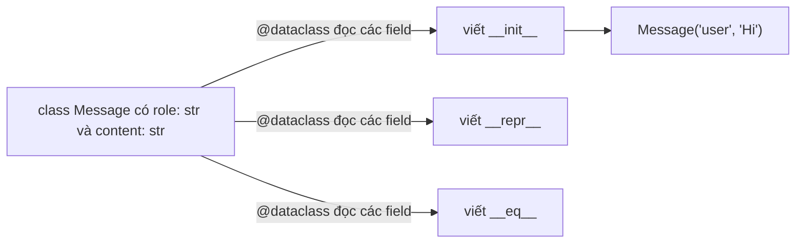

Code AI chuyển qua lại những bản ghi nhỏ suốt ngày: một tin nhắn chat gồm role và nội dung, một object cài đặt gồm temperature và giới hạn token, một tài liệu gồm id và văn bản. Ở bài về class, bạn đã tạo những bản ghi như vậy bằng `__init__` và `__repr__`, và phải gõ rất nhiều cho một lượng dữ liệu rất nhỏ. **Dataclass** viết giúp bạn đoạn code nhàm chán đó, bạn chỉ cần liệt kê các field (trường dữ liệu). Bạn sẽ gặp dataclass trong gần như mọi thư viện AI hiện đại, nên bài này có ích ngay.

## 1. Vấn đề code lặp đi lặp lại

Đây là một tin nhắn chat viết bằng class thường, theo cách bạn đã học ở bài về class:

```python
class Message:
    def __init__(self, role, content):
        self.role = role
        self.content = content

    def __repr__(self):
        return f"Message(role='{self.role}', content='{self.content}')"


a = Message("user", "Hi")
b = Message("user", "Hi")
print(a)        # Message(role='user', content='Hi')
print(a == b)   # False
```

Dòng cuối làm nhiều người mới bất ngờ. `a` và `b` chứa cùng dữ liệu, nhưng chúng là hai object khác nhau, và mặc định `==` chỉ cho `True` khi hai bên là chính xác cùng một object.

Muốn so sánh theo dữ liệu, bạn viết thêm một method đặc biệt nữa. `a == b` gọi `a.__eq__(b)`, trong đó `other` là object ở bên phải:

```python
class Message:
    def __init__(self, role, content):
        self.role = role
        self.content = content

    def __repr__(self):
        return f"Message(role='{self.role}', content='{self.content}')"

    def __eq__(self, other):
        return self.role == other.role and self.content == other.content


print(Message("user", "Hi") == Message("user", "Hi"))   # True
```

Chạy được, nhưng hãy nhìn cái giá phải trả. Mỗi field xuất hiện ở `__init__`, ở `__repr__` và ở `__eq__`. Thêm field thứ ba là bạn phải sửa ba chỗ, và quên một chỗ sẽ gây ra lỗi âm thầm.

## 2. `@dataclass`: liệt kê field, nhận phần còn lại

Dataclass chỉ giữ lại phần quan trọng, tức là danh sách field:

```python
from dataclasses import dataclass


@dataclass
class Message:
    role: str
    content: str


a = Message("user", "Hi")
b = Message("user", "Hi")
print(a)         # Message(role='user', content='Hi')
print(a == b)    # True
print(a.role)    # user
```

Hai cú pháp mới:

- `@dataclass` là một **decorator**: dòng bắt đầu bằng `@` nằm ngay trên class. Nó đưa class cho một hàm hỗ trợ để thêm tính năng vào class. (Bạn sẽ tự viết decorator ở một bài sau.)
- `role: str` là một **annotation** (chú thích kiểu): `name: type` cho biết field chứa loại giá trị nào. Kiến thức đầy đủ về kiểu nằm ở một bài sau. Bây giờ chỉ cần nhớ: mỗi dòng có annotation sẽ trở thành một field.

Đây là việc decorator làm:



Và dưới dạng hình vẽ bằng chữ:

```text
what you write                 what Python adds for you
--------------                 ------------------------
@dataclass
class Message:                 __init__(self, role, content)
    role: str                  __repr__  ->  Message(role='user', content='Hi')
    content: str               __eq__    ->  compares role and content
```

Dataclass vẫn là một class bình thường. Bạn có thể thêm method của riêng mình, và chúng dùng `self` y như trước:

| bạn muốn | class thường | `@dataclass` |
|---|---|---|
| một constructor | viết `__init__` với một `self.x = x` cho mỗi field | tự động |
| in ra dễ đọc | viết `__repr__` | tự động |
| so sánh theo dữ liệu | viết `__eq__` | tự động |
| thêm một field | sửa ba chỗ | thêm một dòng |
| method của riêng bạn | có | có, cùng cách viết |

> [!NOTE]
> Annotation là nhãn, không phải phép kiểm tra. `Message(role=5, content=3)` vẫn chạy mà không báo lỗi nào. Dataclass dùng annotation để tìm field, chứ không dùng để kiểm tra giá trị.

## 3. Giá trị mặc định

Cho field một giá trị mặc định bằng `= value`. Khi đó người gọi có thể bỏ qua nó:

```python
from dataclasses import dataclass


@dataclass
class GenerationConfig:
    model: str
    temperature: float = 0.7
    max_tokens: int = 256

    def is_deterministic(self):
        return self.temperature == 0


fast = GenerationConfig("small")
precise = GenerationConfig("large", temperature=0.0, max_tokens=1024)
print(fast)                         # GenerationConfig(model='small', temperature=0.7, max_tokens=256)
print(precise)                      # GenerationConfig(model='large', temperature=0.0, max_tokens=1024)
print(precise.is_deterministic())   # True
```

Hãy để ý thứ tự: `model` không có mặc định nên đứng trước. **Field không có mặc định phải đứng trước field có mặc định**, giống như tham số của hàm.

## 4. List làm giá trị mặc định: dùng `field(default_factory=list)`

Nếu mỗi cuộc chat phải bắt đầu với list tin nhắn rỗng của riêng nó thì sao? Cách hiển nhiên, `messages: list = []`, bị từ chối bằng một lỗi. Lý do giống `b = a` ở bài về class (hai tên cho cùng một object): một list viết trong class sẽ bị **dùng chung** bởi mọi object, nên thêm tin nhắn vào một cuộc chat là thêm vào tất cả.

Cách sửa là `field(default_factory=list)`. **Factory** (nhà máy) là thứ tạo ra một giá trị mới khi cần. `default_factory=list` bảo dataclass rằng: "với mỗi object mới, hãy gọi `list()` để tạo một list rỗng mới". Hãy viết `list` không có ngoặc, vì bạn đưa ra công thức chứ không phải một list đã làm xong.

```python
from dataclasses import dataclass, field


@dataclass
class Chat:
    title: str
    messages: list = field(default_factory=list)

    def add(self, text):
        self.messages.append(text)


first = Chat("first")
second = Chat("second")
first.add("Hi")
first.add("Hello")
second.add("Bye")
print(first.messages)    # ['Hi', 'Hello']
print(second.messages)   # ['Bye']
```

Bấm **Visualize** ở khối code này để xem hai list `messages` tăng dần riêng rẽ.

| bước | code | `first.messages` | `second.messages` |
|---|---|---|---|
| 1 | `first = Chat("first")` | `[]` | |
| 2 | `second = Chat("second")` | `[]` | `[]` |
| 3 | `first.add("Hi")` | `['Hi']` | `[]` |
| 4 | `first.add("Hello")` | `['Hi', 'Hello']` | `[]` |
| 5 | `second.add("Bye")` | `['Hi', 'Hello']` | `['Bye']` |

Với dict dùng `field(default_factory=dict)`. Số, chuỗi và `True`/`False` có thể viết thẳng làm giá trị mặc định, vì chúng không thể bị sửa tại chỗ.

> [!TIP]
> Mẹo nhớ nhanh: nếu giá trị mặc định là list hoặc dict, hãy dùng `field(default_factory=...)`.

## 5. Hai công tắc nữa: `frozen` và `order`

Bạn có thể truyền tùy chọn cho `@dataclass`. Hai tùy chọn hữu ích cho người mới.

**`frozen=True`** làm object chỉ đọc sau khi được tạo. Rất hợp cho các cài đặt không nên bị đổi nhầm khi chúng đi qua chương trình của bạn:

```python
from dataclasses import dataclass


@dataclass(frozen=True)
class GenerationConfig:
    model: str
    temperature: float = 0.7


config = GenerationConfig("small")
try:
    config.temperature = 1.5
except AttributeError:
    print("config is read-only")   # config is read-only
print(config.temperature)          # 0.7
```

Lỗi thật sự tên là `FrozenInstanceError`, một loại `AttributeError`, nên `except AttributeError` bắt được nó. Muốn có cài đặt khác, hãy tạo một object mới.

**`order=True`** cho phép so sánh object bằng `<` và `>`, nên `sorted` cũng dùng được. Nó so sánh các field theo thứ tự bạn liệt kê: field đầu tiên trước, và field kế tiếp chỉ dùng để phân xử khi hòa:

```python
from dataclasses import dataclass


@dataclass(order=True)
class Hit:
    score: float
    doc_id: str


hits = [Hit(0.4, "b"), Hit(0.9, "a"), Hit(0.4, "a")]
print(sorted(hits))
# [Hit(score=0.4, doc_id='a'), Hit(score=0.4, doc_id='b'), Hit(score=0.9, doc_id='a')]
```

## 6. `asdict`: từ object sang dict

API và file JSON nói chuyện bằng dict, không phải object. Hàm `asdict` từ cùng module biến một object dataclass thành dict:

```python
import json
from dataclasses import asdict, dataclass


@dataclass
class Message:
    role: str
    content: str


messages = [Message("user", "Hi"), Message("assistant", "Hello!")]
payload = []
for message in messages:
    payload.append(asdict(message))

print(payload[0])             # {'role': 'user', 'content': 'Hi'}
print(json.dumps(payload))    # [{"role": "user", "content": "Hi"}, {"role": "assistant", "content": "Hello!"}]
```

Đây là dạng mà hầu hết API chat mong đợi: một list các dict có `role` và `content`.

## 7. Dict thường, class thường hay dataclass?

| dùng cái này | khi |
|---|---|
| dict | dữ liệu dùng một lần mà key có thể thay đổi, ví dụ một phản hồi JSON bạn vừa đọc |
| class thường | object có hành vi thực sự và logic khởi tạo riêng |
| dataclass | object chủ yếu là **một gói các field có tên**: message, cài đặt, tài liệu, kết quả |

## 8. Lỗi thường gặp

**List làm giá trị mặc định.** Dataclass từ chối nó:

```python
from dataclasses import dataclass


@dataclass
class Chat:
    title: str
    messages: list = []   # ValueError: mutable default <class 'list'> for field messages is not allowed: use default_factory
```

Cách sửa: `messages: list = field(default_factory=list)` (và import `field`).

**Quên annotation.** Không có `: type`, cái tên chỉ là biến của class chứ không phải field:

```python
from dataclasses import dataclass


@dataclass
class GenerationConfig:
    model: str
    temperature = 0.7    # no annotation, so not a field


GenerationConfig("small", temperature=0.2)
# TypeError: GenerationConfig.__init__() got an unexpected keyword argument 'temperature'
```

Cách sửa: `temperature: float = 0.7`.

**Field bắt buộc đứng sau field có mặc định.** Thứ tự quan trọng, giống tham số của hàm:

```python
from dataclasses import dataclass


@dataclass
class Doc:
    doc_id: str = "none"
    text: str            # TypeError: non-default argument 'text' follows default argument 'doc_id'
```

Cách sửa: đặt `text: str` lên trước, hoặc cho nó một giá trị mặc định.

**Quên `@dataclass`.** Chỉ có annotation thì không làm gì cả, và class không có `__init__`:

```python
class Message:
    role: str
    content: str


Message("user", "Hi")   # TypeError: Message() takes no arguments
```

Cách sửa: thêm `@dataclass` phía trên class.

## Tóm tắt

- `@dataclass` đọc các field có annotation (`name: type`) và viết sẵn `__init__`, `__repr__` và `__eq__` cho bạn. Bạn vẫn có thể thêm method của riêng mình.
- Annotation là nhãn, không phải phép kiểm tra, và một dòng không có annotation thì không phải field.
- Giá trị mặc định dùng `= value`. Field không có mặc định đứng trước.
- Với giá trị mặc định là list hoặc dict, dùng `field(default_factory=list)` hoặc `field(default_factory=dict)`, để mỗi object nhận bản sao riêng.
- `frozen=True` làm object chỉ đọc. `order=True` cho phép so sánh và dùng `sorted`.
- `asdict(obj)` biến object dataclass thành dict, sẵn sàng cho JSON hoặc API.
