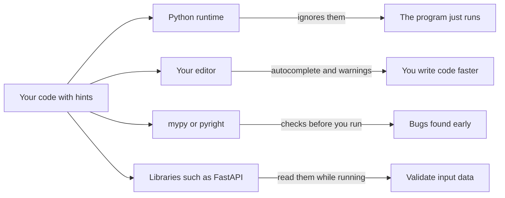

When you call an AI library, the hardest question is often "what do I pass in, and what do I get back?" Is `texts` one string or a list of strings? Does the function return a vector, or a list of vectors? **Type hints** answer this question right inside the code: `def embed(texts: list[str]) -> list[list[float]]` tells you everything before you read a single line of the body. They help your editor, they help your teammates, and later they will help libraries that read them (FastAPI and structured LLM output both do).

## 1. What is a type hint?

A **type hint** (or type annotation) is a small label that says what kind of value you expect. You write `: type` after a parameter and `-> type` after the parameter list for the return value:

```python
def greet(name: str, loud: bool = False) -> str:
    if loud:
        return "HELLO, " + name.upper()
    return "Hello, " + name


print(greet("Ada"))          # Hello, Ada
print(greet("Ada", True))    # HELLO, ADA
```

Read the first line as a sentence: "`greet` takes a `name` that is a `str` and a `loud` that is a `bool` (default `False`), and gives back a `str`." A default value goes after the hint: `loud: bool = False`.

You can also hint a plain variable: `count: int = 0`. Here are the hints you will use every day:

| hint | meaning | example value |
|---|---|---|
| `str` | text | `"hello"` |
| `int` | whole number | `42` |
| `float` | decimal number | `0.5` |
| `bool` | `True` or `False` | `True` |
| `None` as a return hint | nothing useful comes back | `None` |

> [!NOTE]
> A function that does its work but returns nothing (like `print`) gets `-> None`: `def log(line: str) -> None:`. It tells the reader "do not expect an answer".

## 2. Hints are not enforced

This is the most important fact of the lesson. Python **does not check** your hints when the program runs. Look:

```python
def double(n: int) -> int:
    return n * 2


print(double(4))      # 8
print(double("ab"))   # abab
```

We promised an `int`, then passed a `str`. Python did not complain and happily repeated the text, because `"ab" * 2` is a valid operation. The hint did not stop the call and did not convert the value.

Python only *stores* the hints. It keeps them in a dictionary called `__annotations__` on the function:

```python
def double(n: int) -> int:
    return n * 2


print(double.__annotations__)   # {'n': <class 'int'>, 'return': <class 'int'>}
```

So are hints useless? No. They are a **promise written down**, and other tools read that promise.

## 3. Who reads the hints?



- Your **editor** (VS Code) uses hints to suggest methods and underline mistakes.
- A **type checker** such as `mypy` or `pyright` reads the whole project and reports every place where a hint is broken, *without running the code*.
- **Libraries** can read `__annotations__` and act on it. You will see this when you build APIs and structured LLM output.
- Other **people** read hints as documentation that is less likely to go out of date than a comment.

Here is what `mypy` says about the call `double("ab")`. This is a terminal command, so it is **not runnable in the app**, and you do not need to install anything for this lesson:

```bash
mypy chat.py
# chat.py:6: error: Argument 1 to "double" has incompatible type "str"; expected "int"  [arg-type]
```

The error appears *before* the program runs. That is the whole value of hints: they move bugs from "crash in production" to "red underline while typing".

## 4. Hinting lists, dicts and tuples

For containers, you also say what is *inside* them, using square brackets:

| hint | meaning | example value |
|---|---|---|
| `list[str]` | a list where every item is a `str` | `["a", "b"]` |
| `list[list[float]]` | a list of lists of floats | `[[0.1, 0.2], [0.3, 0.4]]` |
| `dict[str, int]` | keys are `str`, values are `int` | `{"hi": 2}` |
| `tuple[int, str]` | exactly two items: an `int`, then a `str` | `(3, "cat")` |

A `tuple` hint lists **each position**, because a tuple has a fixed shape. A `list` or `dict` hint describes the kind of item (a dict names the key type first, then the value type).

```python
def count_tokens(tokens: list[str]) -> int:
    return len(tokens)


def word_lengths(words: list[str]) -> dict[str, int]:
    lengths = {}
    for word in words:
        lengths[word] = len(word)
    return lengths


def first_and_count(tokens: list[str]) -> tuple[str, int]:
    return tokens[0], len(tokens)


print(count_tokens(["Hello", "world"]))     # 2
print(word_lengths(["hi", "hello"]))        # {'hi': 2, 'hello': 5}
print(first_and_count(["Hello", "world"]))  # ('Hello', 2)
```

Now you can read the signature from the opening paragraph. An embedding function turns each text into a vector (a list of numbers), so many texts become a list of vectors:

```python
def embed(texts: list[str]) -> list[list[float]]:
    vectors = []
    for text in texts:
        vectors.append([float(len(text)), 1.0])   # a fake 2-number vector
    return vectors


print(embed(["hi", "hello"]))   # [[2.0, 1.0], [5.0, 1.0]]
```

## 5. Maybe nothing: `X | None`, and either-or: `X | Y`

Some values are optional, such as a system prompt for a chat model. Write `str | None` ("a `str` or `None`"). The `|` means "or". Give the parameter a default of `None`:

```python
def build_prompt(question: str, system: str | None = None) -> str:
    if system is None:
        return question
    return system + "\n" + question


print(build_prompt("What is a type hint?"))
# What is a type hint?
print(build_prompt("What is a type hint?", "Be brief."))
# Be brief.
# What is a type hint?
```

Press **Visualize** on this block and watch `system` be `None` in the first call and `"Be brief."` in the second one, which sends the code down a different path.

`system is None` asks "is this exactly `None`?". Because the hint says `system` might be `None`, you must check before you use it as text. Otherwise `system.upper()` would crash on `None`.

The same `|` works for any "either-or" hint: `int | float` means "a whole number or a decimal".

> [!TIP]
> In older code you will see the same idea spelled `Optional[str]` (with `from typing import Optional`), and `Union[int, float]` for `int | float`. They mean exactly the same thing. This course uses the shorter `|` form.

## 6. Hints in classes and dataclasses

Methods are hinted like any function. The `self` parameter gets **no** hint, because Python fills it in:

```python
class TokenCounter:
    def __init__(self, name: str) -> None:
        self.name = name
        self.total = 0

    def add(self, n: int) -> None:
        self.total += n

    def remaining(self, limit: int) -> int:
        return limit - self.total
```

By convention, `__init__` gets `-> None`. In a dataclass, the field annotations you already know **are** type hints. They are not checked either:

```python
from dataclasses import dataclass


@dataclass
class Message:
    role: str
    text: str


m = Message("user", 42)   # 42 is not a str, but Python does not check
print(m)                  # Message(role='user', text=42)
```

## 7. Common mistakes

**Thinking a hint converts or checks the value.** The hint is a label, not a converter:

```python
age: int = "12"
print(age + 1)   # TypeError: can only concatenate str (not "int") to str
```

Fix: convert the value yourself, `age = int("12")`.

**Promising a return value and forgetting `return`.** The hint says `str`, but the function gives back `None`:

```python
def clean(text: str) -> str:
    text.strip()


result = clean("  hi  ")
print(result.upper())   # AttributeError: 'NoneType' object has no attribute 'upper'
```

Fix: `return text.strip()`. A type checker would have warned you here.

**Using a `str | None` value without checking.** The hint warns you that `None` is possible:

```python
def shout(system: str | None) -> str:
    return system.upper()


print(shout(None))   # AttributeError: 'NoneType' object has no attribute 'upper'
```

Fix: check first with `if system is None: return ""`, then use it.

**A hint that tells a lie.** When the code and the hint disagree, one of them is wrong:

```python
def average(a: int, b: int) -> int:
    return (a + b) / 2


print(average(1, 2))   # 1.5, but the hint promised an int
```

Python prints `1.5` without any error, and a type checker would report the mismatch. Fix: `/` always gives a `float`, so change the hint to `-> float`.

> [!WARNING]
> A wrong hint is worse than no hint, because readers trust it. Whenever you change what a function takes or returns, update its hint in the same edit.

## Recap

- A type hint is a label: `name: str` for a parameter, `-> int` for the return value, `count: int = 0` for a variable.
- Python **does not enforce** hints at runtime. They are stored in `__annotations__` and ignored.
- Editors, type checkers (`mypy`, `pyright`) and libraries read hints to help you and catch bugs before you run the code.
- Containers say what is inside: `list[str]`, `dict[str, int]`, `tuple[int, str]`, `list[list[float]]`.
- `str | None` means "a `str` or `None`", and `X | Y` means "either". Check `is None` before using such a value. `Optional[str]` is the older spelling of the same thing.
- Keep hints and code in agreement: a wrong hint is worse than none.
