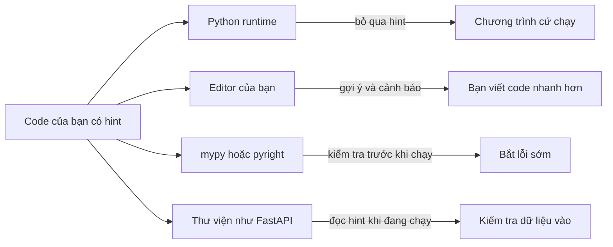

Khi gọi một thư viện AI, câu hỏi khó nhất thường là "mình truyền gì vào và nhận gì về?". `texts` là một chuỗi hay một list các chuỗi? Hàm trả về một vector hay một list các vector? **Type hint** (gợi ý kiểu) trả lời câu hỏi này ngay trong code: `def embed(texts: list[str]) -> list[list[float]]` cho bạn biết mọi thứ trước khi đọc một dòng nào của phần thân hàm. Type hint giúp editor, giúp đồng đội, và sau này còn giúp cả các thư viện đọc chúng (FastAPI và structured output của LLM đều làm vậy).

## 1. Type hint là gì?

**Type hint** (hay type annotation, chú thích kiểu) là một nhãn nhỏ cho biết bạn mong đợi loại giá trị nào. Bạn viết `: type` sau tham số và `-> type` sau danh sách tham số để chỉ giá trị trả về:

```python
def greet(name: str, loud: bool = False) -> str:
    if loud:
        return "HELLO, " + name.upper()
    return "Hello, " + name


print(greet("Ada"))          # Hello, Ada
print(greet("Ada", True))    # HELLO, ADA
```

Hãy đọc dòng đầu như một câu: "`greet` nhận `name` là một `str` và `loud` là một `bool` (mặc định `False`), rồi trả về một `str`." Giá trị mặc định viết sau hint: `loud: bool = False`.

Bạn cũng có thể gắn hint cho một biến thường: `count: int = 0`. Đây là những hint bạn sẽ dùng hằng ngày:

| hint | ý nghĩa | giá trị ví dụ |
|---|---|---|
| `str` | văn bản | `"hello"` |
| `int` | số nguyên | `42` |
| `float` | số thập phân | `0.5` |
| `bool` | `True` hoặc `False` | `True` |
| `None` làm hint trả về | không trả về gì hữu ích | `None` |

> [!NOTE]
> Hàm làm xong việc nhưng không trả về gì (như `print`) dùng `-> None`: `def log(line: str) -> None:`. Nó nói với người đọc "đừng mong có kết quả".

## 2. Hint không bị ép buộc

Đây là sự thật quan trọng nhất của bài. Python **không kiểm tra** hint khi chương trình chạy. Xem này:

```python
def double(n: int) -> int:
    return n * 2


print(double(4))      # 8
print(double("ab"))   # abab
```

Ta hứa là `int`, rồi lại truyền vào một `str`. Python không phàn nàn mà vẫn lặp lại chuỗi, vì `"ab" * 2` là phép tính hợp lệ. Hint không chặn lời gọi và cũng không đổi giá trị.

Python chỉ *lưu* các hint. Nó cất chúng trong một dictionary tên là `__annotations__` gắn trên hàm:

```python
def double(n: int) -> int:
    return n * 2


print(double.__annotations__)   # {'n': <class 'int'>, 'return': <class 'int'>}
```

Vậy hint vô dụng sao? Không. Nó là một **lời hứa được viết ra**, và các công cụ khác sẽ đọc lời hứa đó.

## 3. Ai đọc các hint?



- **Editor** (VS Code) dùng hint để gợi ý method và gạch chân lỗi.
- **Type checker** như `mypy` hoặc `pyright` đọc cả dự án và báo mọi chỗ vi phạm hint, *mà không cần chạy code*.
- **Thư viện** có thể đọc `__annotations__` rồi hành động theo. Bạn sẽ gặp điều này khi xây API và structured output của LLM.
- **Người khác** đọc hint như tài liệu, và hint khó bị lỗi thời hơn comment.

Đây là điều `mypy` nói về lời gọi `double("ab")`. Đó là lệnh terminal nên **không chạy được trong app**, và bạn không cần cài gì cho bài này:

```bash
mypy chat.py
# chat.py:6: error: Argument 1 to "double" has incompatible type "str"; expected "int"  [arg-type]
```

Lỗi hiện ra *trước khi* chương trình chạy. Đó là toàn bộ giá trị của hint: chuyển lỗi từ "sập trên production" thành "gạch đỏ khi đang gõ".

## 4. Hint cho list, dict và tuple

Với các container (kiểu chứa nhiều phần tử), bạn nói thêm *bên trong* có gì, bằng dấu ngoặc vuông:

| hint | ý nghĩa | giá trị ví dụ |
|---|---|---|
| `list[str]` | list mà mọi phần tử đều là `str` | `["a", "b"]` |
| `list[list[float]]` | list chứa các list số thực | `[[0.1, 0.2], [0.3, 0.4]]` |
| `dict[str, int]` | key là `str`, value là `int` | `{"hi": 2}` |
| `tuple[int, str]` | đúng hai phần tử: một `int`, rồi một `str` | `(3, "cat")` |

Hint của `tuple` liệt kê **từng vị trí**, vì tuple có hình dạng cố định. Hint của `list` hay `dict` mô tả loại phần tử (dict nêu kiểu key trước, rồi kiểu value).

```python
def count_tokens(tokens: list[str]) -> int:
    return len(tokens)


def word_lengths(words: list[str]) -> dict[str, int]:
    lengths = {}
    for word in words:
        lengths[word] = len(word)
    return lengths


def first_and_count(tokens: list[str]) -> tuple[str, int]:
    return tokens[0], len(tokens)


print(count_tokens(["Hello", "world"]))     # 2
print(word_lengths(["hi", "hello"]))        # {'hi': 2, 'hello': 5}
print(first_and_count(["Hello", "world"]))  # ('Hello', 2)
```

Giờ bạn đã đọc được chữ ký ở đoạn mở đầu. Hàm embedding biến mỗi văn bản thành một vector (list các số), nên nhiều văn bản cho ra một list các vector:

```python
def embed(texts: list[str]) -> list[list[float]]:
    vectors = []
    for text in texts:
        vectors.append([float(len(text)), 1.0])   # a fake 2-number vector
    return vectors


print(embed(["hi", "hello"]))   # [[2.0, 1.0], [5.0, 1.0]]
```

## 5. Có thể không có gì: `X | None`, và "hoặc": `X | Y`

Có những giá trị là tùy chọn, ví dụ system prompt cho một model chat. Viết `str | None` ("một `str` hoặc `None`"). Dấu `|` nghĩa là "hoặc". Hãy cho tham số giá trị mặc định `None`:

```python
def build_prompt(question: str, system: str | None = None) -> str:
    if system is None:
        return question
    return system + "\n" + question


print(build_prompt("What is a type hint?"))
# What is a type hint?
print(build_prompt("What is a type hint?", "Be brief."))
# Be brief.
# What is a type hint?
```

Bấm **Visualize** ở khối code này để xem `system` là `None` ở lời gọi đầu và là `"Be brief."` ở lời gọi thứ hai, khiến code đi theo nhánh khác.

`system is None` hỏi "giá trị này có đúng là `None` không?". Vì hint nói `system` có thể là `None`, bạn phải kiểm tra trước khi dùng nó như văn bản. Nếu không, `system.upper()` sẽ lỗi trên `None`.

Cùng dấu `|` đó dùng cho mọi hint "một trong hai": `int | float` nghĩa là "số nguyên hoặc số thập phân".

> [!TIP]
> Trong code cũ bạn sẽ thấy cùng ý đó viết là `Optional[str]` (kèm `from typing import Optional`), và `Union[int, float]` cho `int | float`. Chúng có nghĩa y hệt nhau. Khóa học này dùng dạng `|` ngắn hơn.

## 6. Hint trong class và dataclass

Method được gắn hint như mọi hàm. Tham số `self` **không** cần hint, vì Python tự điền:

```python
class TokenCounter:
    def __init__(self, name: str) -> None:
        self.name = name
        self.total = 0

    def add(self, n: int) -> None:
        self.total += n

    def remaining(self, limit: int) -> int:
        return limit - self.total
```

Theo quy ước, `__init__` có `-> None`. Trong dataclass, các field annotation bạn đã biết **chính là** type hint. Chúng cũng không bị kiểm tra:

```python
from dataclasses import dataclass


@dataclass
class Message:
    role: str
    text: str


m = Message("user", 42)   # 42 is not a str, but Python does not check
print(m)                  # Message(role='user', text=42)
```

## 7. Lỗi thường gặp

**Tưởng hint sẽ chuyển đổi hoặc kiểm tra giá trị.** Hint chỉ là nhãn, không phải bộ chuyển đổi:

```python
age: int = "12"
print(age + 1)   # TypeError: can only concatenate str (not "int") to str
```

Cách sửa: tự chuyển đổi giá trị, `age = int("12")`.

**Hứa trả về giá trị nhưng quên `return`.** Hint nói `str`, nhưng hàm trả về `None`:

```python
def clean(text: str) -> str:
    text.strip()


result = clean("  hi  ")
print(result.upper())   # AttributeError: 'NoneType' object has no attribute 'upper'
```

Cách sửa: `return text.strip()`. Type checker sẽ cảnh báo bạn ở đây.

**Dùng giá trị `str | None` mà không kiểm tra.** Hint đã cảnh báo rằng `None` có thể xảy ra:

```python
def shout(system: str | None) -> str:
    return system.upper()


print(shout(None))   # AttributeError: 'NoneType' object has no attribute 'upper'
```

Cách sửa: kiểm tra trước bằng `if system is None: return ""`, rồi mới dùng.

**Hint nói dối.** Khi code và hint mâu thuẫn nhau, một trong hai bị sai:

```python
def average(a: int, b: int) -> int:
    return (a + b) / 2


print(average(1, 2))   # 1.5, but the hint promised an int
```

Python in `1.5` mà không báo lỗi gì, còn type checker sẽ báo sự không khớp. Cách sửa: `/` luôn cho ra `float`, nên đổi hint thành `-> float`.

> [!WARNING]
> Hint sai còn tệ hơn không có hint, vì người đọc tin vào nó. Mỗi khi bạn đổi những gì hàm nhận vào hoặc trả về, hãy cập nhật hint ngay trong cùng lần sửa.

## Tóm tắt

- Type hint là một nhãn: `name: str` cho tham số, `-> int` cho giá trị trả về, `count: int = 0` cho biến.
- Python **không ép buộc** hint khi chạy. Chúng được lưu trong `__annotations__` và bị bỏ qua.
- Editor, type checker (`mypy`, `pyright`) và thư viện đọc hint để giúp bạn và bắt lỗi trước khi chạy code.
- Container nói rõ bên trong có gì: `list[str]`, `dict[str, int]`, `tuple[int, str]`, `list[list[float]]`.
- `str | None` nghĩa là "một `str` hoặc `None`", còn `X | Y` nghĩa là "một trong hai". Hãy kiểm tra `is None` trước khi dùng giá trị như vậy. `Optional[str]` là cách viết cũ của cùng ý đó.
- Giữ cho hint và code luôn khớp nhau: hint sai còn tệ hơn không có.
