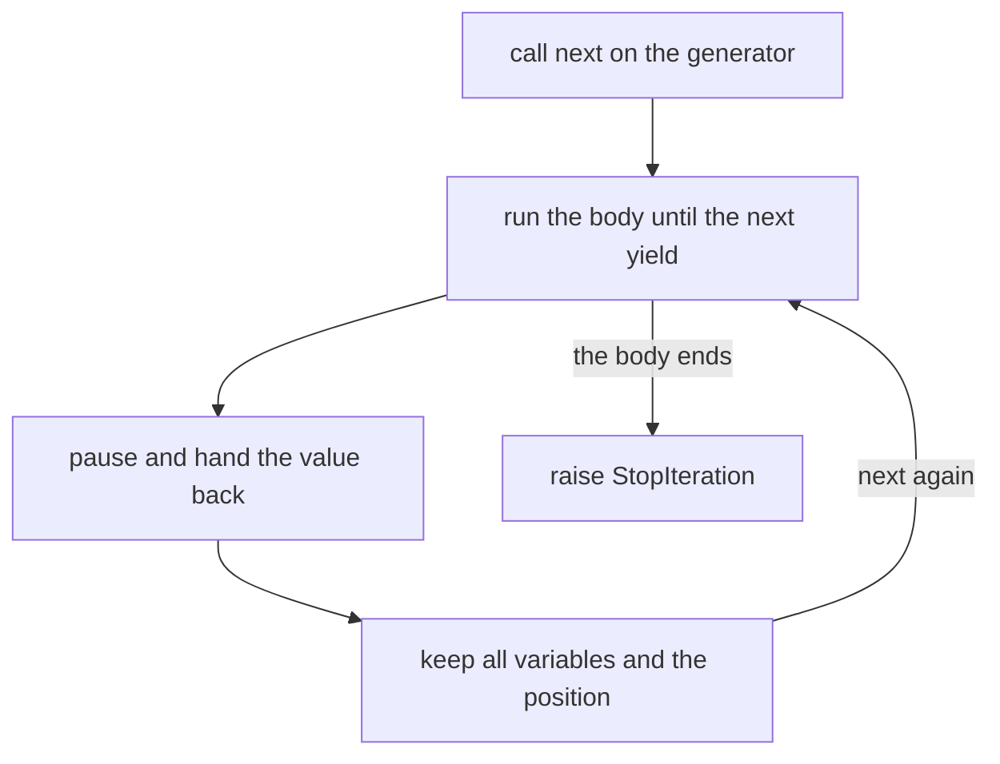
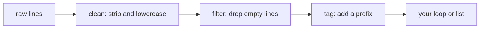

When a chatbot answers, the words appear one by one instead of all at once. When you prepare thousands of documents for an embedding model, you send them in small groups. When a log file is bigger than your memory, you cannot load it all. These jobs share one idea: do not build everything up front, produce items **one at a time, when asked**. Python's tool for this is the **generator**.

## 1. Iterable and iterator

An **iterable** is anything a `for` loop can walk through: a list, a string, a dict, `range(...)`. An **iterator** is a different object that remembers where you are and hands out one item each time you ask. Think of the iterable as a book and the iterator as a bookmark in it.

Two built-in functions connect them: `iter(x)` gives you a bookmark for `x`, and `next(it)` moves the bookmark and gives back the next item.

```python
colors = ["red", "green"]

it = iter(colors)
print(next(it))   # red
print(next(it))   # green
```

When there is nothing left, `next` raises an exception called `StopIteration`. It is Python's way of saying "the book is finished":

```python
colors = ["red", "green"]
it = iter(colors)
next(it)
next(it)

try:
    next(it)
except StopIteration:
    print("no more items")   # no more items
```

| | iterable | iterator |
|---|---|---|
| example | `["red", "green"]` | `iter(["red", "green"])` |
| can you loop over it? | yes, as many times as you like | yes, but only once |
| remembers a position? | no | yes |

## 2. What `for` really does

A `for` loop is just `iter`, `next` and `StopIteration` working together. These two pieces of code do the same thing:

```python
colors = ["red", "green"]

for color in colors:
    print(color)

it = iter(colors)
while True:
    try:
        color = next(it)
    except StopIteration:
        break
    print(color)
# both print: red, then green
```

This is also why `for line in f:` from the files lesson reads one line at a time: an open file is an iterator, and each `next` reads the next line.

## 3. Your own iterator with `yield`

Writing an iterator by hand takes a whole class. A **generator function** does it for you: it is a normal function that uses the keyword `yield` instead of `return`. `yield value` hands `value` to the caller and **pauses** the function right there. The next `next(...)` **resumes** it from the same spot, with all variables still alive.

```python
def count_up(limit):
    n = 1
    while n <= limit:
        yield n
        n += 1


gen = count_up(3)
print(next(gen))   # 1
print(next(gen))   # 2
print(next(gen))   # 3
```

Press **Visualize** on this block. Calling `count_up(3)` does not run the body: only `next(gen)` does. While the generator is paused, you can see its variables inside the generator object, for example `generator count_up(limit=3, n=1)`.

Calling `count_up(3)` does **not** run the body. It returns a **generator object**, which is an iterator. The body runs in small pieces, one `next` at a time:



Here is what happens for `count_up(3)`:

| call | what runs | `n` | result |
|---|---|---|---|
| 1st `next` | start, `n = 1`, reach `yield n` | `1` | returns `1` |
| 2nd `next` | resume, `n += 1`, loop, reach `yield n` | `2` | returns `2` |
| 3rd `next` | resume, `n += 1`, loop, reach `yield n` | `3` | returns `3` |
| 4th `next` | resume, `n += 1`, loop test fails, body ends | `4` | `StopIteration` |

A generator works with `for` like any iterator. The built-in `list(...)` collects all its items into a list:

```python
def count_up(limit):
    n = 1
    while n <= limit:
        yield n
        n += 1


for n in count_up(3):
    print(n)          # 1, 2, 3 on separate lines

print(list(count_up(3)))   # [1, 2, 3]
```

> [!NOTE]
> `return` ends a function for good and gives back one value. `yield` gives back a value and lets the function continue later. Every call of `count_up(...)` makes a new, independent generator.

## 4. Lazy: work only when asked

"Lazy" means a generator does no work until someone asks for the next item. Add `print` calls and you can see the order:

```python
def numbers():
    print("start")
    yield 1
    print("middle")
    yield 2
    print("end")


gen = numbers()
print("created")
print(next(gen))
print(next(gen))
# created
# start
# 1
# middle
# 2
```

Nothing printed `start` when `numbers()` was called. The text `end` never appears either, because we stopped asking after the second item.

This is the big win for memory. A list holds **all** items at the same time. A generator holds **one**, plus its position:

```python
total = sum(n * n for n in range(1000000))
print(total)   # 333332833333500000
```

This adds up a million squares, but never keeps more than one square at a time. Real examples: a log file with millions of lines, a stream of tokens from an LLM, a dataset read piece by piece.

## 5. Generator expressions

You know the list comprehension `[n * n for n in nums]`. Change the square brackets to round ones and you get a **generator expression**: the same idea, but lazy.

```python
squares_list = [n * n for n in range(5)]
squares_gen = (n * n for n in range(5))

print(squares_list)       # [0, 1, 4, 9, 16]
print(sum(squares_gen))   # 30
```

| | list comprehension `[...]` | generator expression `(...)` |
|---|---|---|
| when is the work done? | right now, all at once | one item at a time, when asked |
| memory | all items | one item |
| can you use `len(...)` or `x[0]`? | yes | no |
| can you loop twice? | yes | no, only once |

Many built-ins accept any iterable, so they work directly on a generator: `sum`, `max`, `min`, `sorted`, `list`, and `" ".join(...)`. When the generator expression is the only argument, you can drop the extra pair of brackets, as in `sum(n * n for n in range(5))`.

A new built-in is useful here: `any(...)` gives `True` if **at least one** item is true, and it stops reading as soon as it finds one.

```python
logs = ["ok", "ok", "ERROR disk", "ok"]

has_error = any("ERROR" in line for line in logs)
print(has_error)   # True

longest = max(len(line) for line in logs)
print(longest)     # 10
```

> [!TIP]
> If you only need the answer (a sum, a maximum, "is there any ...?"), use a generator expression. If you need to keep the items, look at them twice, or take `len`, build a list.

## 6. The one-shot trap

An iterator moves forward only. Once it has given all its items it is **exhausted**, and it does not rewind:

```python
gen = (n * 2 for n in [1, 2, 3])

print(sum(gen))   # 12
print(sum(gen))   # 0   (nothing is left)
```

The second `sum` is not an error, it just sees an empty iterator. This is the most common surprise with generators. Two fixes: create a new generator when you need another pass (call the function again), or store the items in a list if you need them many times.

## 7. Pipelines: stages that pull from each other

Because generators are lazy, you can chain them like stages on a factory line. Each stage asks the one before it for a single item:



```python
def tag(lines):
    for line in lines:
        yield "doc: " + line


raw = ["  Hello ", "", "WORLD  ", "   ", "Ai"]

cleaned = (line.strip().lower() for line in raw)
non_empty = (line for line in cleaned if line)
tagged = tag(non_empty)

print(next(tagged))   # doc: hello
print(list(tagged))   # ['doc: world', 'doc: ai']
```

After the first `next`, only the first raw line has been cleaned. The other lines wait until someone asks. The same shape works for a huge file: read a line, clean it, check it, send it on, and never hold the whole file in memory.

A very common last stage in AI code is **batching**: collect items into small lists of a fixed size and hand over one list at a time, for example to send 32 documents per call to an embedding model. A generator is perfect for it: keep a small list, `yield` it when it is full, then start a new one.

## 8. Common mistakes

**Printing a generator and expecting its items.** The object itself is not the values:

```python
def count_up(limit):
    n = 1
    while n <= limit:
        yield n
        n += 1


print(count_up(3))
# <generator object count_up at 0x...>
```

Fix: ask for the items with `list(count_up(3))` or a `for` loop.

**Using `return` instead of `yield`.** The function then gives back one plain value and is not a generator:

```python
def count_up(limit):
    for n in range(1, limit + 1):
        return n


for n in count_up(3):
    print(n)
# TypeError: 'int' object is not iterable
```

Fix: write `yield n`.

**Reading a generator twice.** The second pass is empty:

```python
gen = (word.upper() for word in ["a", "b"])
print(list(gen))   # ['A', 'B']
print(list(gen))   # []
```

Fix: build the generator again, or keep the first result in a list.

**Asking for the length of a generator.** It does not know how many items it will produce:

```python
gen = (n for n in range(3))
print(len(gen))
# TypeError: object of type 'generator' has no len()
```

Fix: use `len(list(gen))` only if the data is small, or count while you loop.

> [!WARNING]
> Do not turn everything into a generator. For a small list you will look at several times, a plain list is simpler and just as fast.

## Recap

- An **iterable** can be looped over. An **iterator** remembers its position and gives items with `next(...)`. `for` uses `iter`, `next` and `StopIteration` for you.
- A function with `yield` is a **generator function**. Calling it returns a generator object, and the body runs piece by piece, pausing at each `yield`.
- Generators are **lazy**: they work only when asked and keep one item in memory, not the whole collection.
- `(x for x in items)` is a generator expression. Use it with `sum`, `max`, `any` and similar when you only need one answer.
- A generator can be used **once**. A second pass is empty, and `len(...)` does not work on it.
- Chain generators into a pipeline (read, clean, filter, batch) so big data flows through one item at a time.
