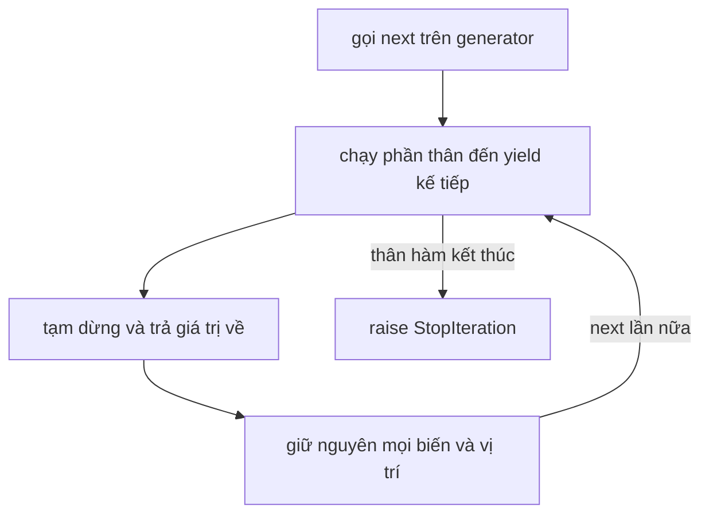
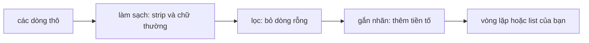

Khi chatbot trả lời, các chữ hiện ra từng chút một chứ không hiện hết cùng lúc. Khi chuẩn bị hàng nghìn tài liệu cho một embedding model, bạn gửi chúng theo từng nhóm nhỏ. Khi file log lớn hơn bộ nhớ, bạn không thể nạp hết vào. Các việc này có chung một ý tưởng: đừng dựng sẵn mọi thứ ngay từ đầu, hãy tạo ra **từng phần tử một, chỉ khi được hỏi**. Công cụ của Python cho việc này là **generator**.

## 1. Iterable và iterator

**Iterable** (thứ có thể lặp qua) là bất cứ thứ gì vòng `for` có thể duyệt qua: list, chuỗi, dict, `range(...)`. **Iterator** (bộ lặp) là một object khác, nó nhớ bạn đang ở đâu và đưa ra một phần tử mỗi lần bạn hỏi. Hãy hình dung iterable là cuốn sách, còn iterator là cái bookmark kẹp trong sách.

Hai hàm có sẵn nối chúng lại với nhau: `iter(x)` đưa cho bạn một bookmark cho `x`, còn `next(it)` dịch bookmark đi và trả về phần tử kế tiếp.

```python
colors = ["red", "green"]

it = iter(colors)
print(next(it))   # red
print(next(it))   # green
```

Khi không còn gì nữa, `next` raise một exception tên là `StopIteration`. Đó là cách Python nói "hết sách rồi":

```python
colors = ["red", "green"]
it = iter(colors)
next(it)
next(it)

try:
    next(it)
except StopIteration:
    print("no more items")   # no more items
```

| | iterable | iterator |
|---|---|---|
| ví dụ | `["red", "green"]` | `iter(["red", "green"])` |
| lặp qua nó được không? | được, bao nhiêu lần cũng được | được, nhưng chỉ một lần |
| có nhớ vị trí không? | không | có |

## 2. Vòng `for` thật sự làm gì

Vòng `for` chỉ là `iter`, `next` và `StopIteration` phối hợp với nhau. Hai đoạn code sau làm cùng một việc:

```python
colors = ["red", "green"]

for color in colors:
    print(color)

it = iter(colors)
while True:
    try:
        color = next(it)
    except StopIteration:
        break
    print(color)
# cả hai đều in: red, rồi green
```

Đây cũng là lý do `for line in f:` ở bài về file đọc từng dòng một: file đang mở là một iterator, và mỗi lần `next` nó đọc dòng kế tiếp.

## 3. Tự tạo iterator bằng `yield`

Tự viết iterator bằng tay phải tốn cả một class. **Hàm generator** (generator function) làm việc đó giúp bạn: nó là một hàm bình thường nhưng dùng từ khóa `yield` thay cho `return`. `yield value` đưa `value` cho nơi gọi và **tạm dừng** hàm ngay tại đó. Lần `next(...)` kế tiếp sẽ **chạy tiếp** từ đúng chỗ ấy, mọi biến vẫn còn nguyên.

```python
def count_up(limit):
    n = 1
    while n <= limit:
        yield n
        n += 1


gen = count_up(3)
print(next(gen))   # 1
print(next(gen))   # 2
print(next(gen))   # 3
```

Bấm **Visualize** ở khối code này. Gọi `count_up(3)` không chạy phần thân hàm: chỉ `next(gen)` mới chạy. Khi generator đang tạm dừng, bạn thấy các biến của nó ngay trong generator object, ví dụ `generator count_up(limit=3, n=1)`.

Gọi `count_up(3)` **không** chạy phần thân hàm. Nó trả về một **generator object**, tức là một iterator. Phần thân chạy từng đoạn nhỏ, mỗi lần một `next`:



Đây là những gì xảy ra với `count_up(3)`:

| lần gọi | cái gì chạy | `n` | kết quả |
|---|---|---|---|
| `next` lần 1 | bắt đầu, `n = 1`, tới `yield n` | `1` | trả về `1` |
| `next` lần 2 | chạy tiếp, `n += 1`, lặp, tới `yield n` | `2` | trả về `2` |
| `next` lần 3 | chạy tiếp, `n += 1`, lặp, tới `yield n` | `3` | trả về `3` |
| `next` lần 4 | chạy tiếp, `n += 1`, điều kiện vòng lặp sai, thân hàm kết thúc | `4` | `StopIteration` |

Generator dùng với `for` như mọi iterator. Hàm có sẵn `list(...)` gom tất cả phần tử của nó vào một list:

```python
def count_up(limit):
    n = 1
    while n <= limit:
        yield n
        n += 1


for n in count_up(3):
    print(n)          # 1, 2, 3 trên các dòng riêng

print(list(count_up(3)))   # [1, 2, 3]
```

> [!NOTE]
> `return` kết thúc hàm hẳn và trả về một giá trị. `yield` trả về một giá trị và cho phép hàm đi tiếp sau đó. Mỗi lần gọi `count_up(...)` tạo ra một generator mới, độc lập.

## 4. Lười (lazy): chỉ làm khi được hỏi

"Lười" nghĩa là generator không làm gì cho đến khi có người xin phần tử kế tiếp. Thêm vài lệnh `print` là thấy được thứ tự:

```python
def numbers():
    print("start")
    yield 1
    print("middle")
    yield 2
    print("end")


gen = numbers()
print("created")
print(next(gen))
print(next(gen))
# created
# start
# 1
# middle
# 2
```

Không có chữ `start` nào được in khi gọi `numbers()`. Chữ `end` cũng không bao giờ xuất hiện, vì ta ngừng xin sau phần tử thứ hai.

Đây là lợi thế lớn về bộ nhớ. List giữ **tất cả** phần tử cùng một lúc. Generator chỉ giữ **một**, cộng với vị trí của nó:

```python
total = sum(n * n for n in range(1000000))
print(total)   # 333332833333500000
```

Dòng này cộng một triệu số bình phương, nhưng không bao giờ giữ nhiều hơn một số bình phương tại một thời điểm. Ví dụ thật: file log có hàng triệu dòng, luồng token từ một LLM, bộ dữ liệu đọc từng đoạn một.

## 5. Generator expression

Bạn đã biết list comprehension `[n * n for n in nums]`. Đổi ngoặc vuông thành ngoặc tròn là bạn có một **generator expression**: cùng ý tưởng nhưng lười.

```python
squares_list = [n * n for n in range(5)]
squares_gen = (n * n for n in range(5))

print(squares_list)       # [0, 1, 4, 9, 16]
print(sum(squares_gen))   # 30
```

| | list comprehension `[...]` | generator expression `(...)` |
|---|---|---|
| việc được làm khi nào? | ngay lập tức, tất cả một lúc | từng phần tử một, khi được hỏi |
| bộ nhớ | tất cả phần tử | một phần tử |
| dùng được `len(...)` hay `x[0]` không? | được | không |
| lặp hai lần được không? | được | không, chỉ một lần |

Nhiều hàm có sẵn nhận bất kỳ iterable nào, nên dùng thẳng được với generator: `sum`, `max`, `min`, `sorted`, `list`, và `" ".join(...)`. Khi generator expression là đối số duy nhất, bạn có thể bỏ cặp ngoặc thừa, như `sum(n * n for n in range(5))`.

Có một hàm mới rất hữu ích ở đây: `any(...)` trả về `True` nếu **ít nhất một** phần tử đúng, và nó dừng đọc ngay khi tìm thấy phần tử đó.

```python
logs = ["ok", "ok", "ERROR disk", "ok"]

has_error = any("ERROR" in line for line in logs)
print(has_error)   # True

longest = max(len(line) for line in logs)
print(longest)     # 10
```

> [!TIP]
> Nếu bạn chỉ cần câu trả lời (một tổng, một giá trị lớn nhất, "có cái nào ... không?"), hãy dùng generator expression. Nếu cần giữ lại các phần tử, xem chúng hai lần, hoặc lấy `len`, hãy tạo list.

## 6. Cái bẫy "dùng một lần"

Iterator chỉ đi về phía trước. Khi đã đưa ra hết phần tử, nó bị **cạn** (exhausted) và không tua lại:

```python
gen = (n * 2 for n in [1, 2, 3])

print(sum(gen))   # 12
print(sum(gen))   # 0   (không còn gì)
```

`sum` lần hai không báo lỗi, nó chỉ thấy một iterator rỗng. Đây là điều bất ngờ phổ biến nhất với generator. Có hai cách sửa: tạo generator mới khi cần đi thêm một lượt (gọi lại hàm), hoặc lưu các phần tử vào list nếu cần dùng nhiều lần.

## 7. Pipeline: các công đoạn kéo dữ liệu từ nhau

Vì generator lười, bạn có thể nối chúng như các công đoạn trên dây chuyền. Mỗi công đoạn xin công đoạn trước đó từng phần tử một:



```python
def tag(lines):
    for line in lines:
        yield "doc: " + line


raw = ["  Hello ", "", "WORLD  ", "   ", "Ai"]

cleaned = (line.strip().lower() for line in raw)
non_empty = (line for line in cleaned if line)
tagged = tag(non_empty)

print(next(tagged))   # doc: hello
print(list(tagged))   # ['doc: world', 'doc: ai']
```

Sau `next` đầu tiên, mới chỉ có dòng thô đầu tiên được làm sạch. Các dòng còn lại chờ đến khi có người xin. Cùng khuôn này dùng được cho một file khổng lồ: đọc một dòng, làm sạch, kiểm tra, chuyển đi, và không bao giờ giữ cả file trong bộ nhớ.

Công đoạn cuối rất hay gặp trong code AI là **batching** (chia lô): gom các phần tử thành những list nhỏ có kích thước cố định và đưa từng list một, ví dụ gửi 32 tài liệu mỗi lần cho embedding model. Generator rất hợp cho việc này: giữ một list nhỏ, `yield` nó khi đầy, rồi bắt đầu list mới.

## 8. Lỗi thường gặp

**In một generator và mong thấy các phần tử.** Bản thân object không phải là các giá trị:

```python
def count_up(limit):
    n = 1
    while n <= limit:
        yield n
        n += 1


print(count_up(3))
# <generator object count_up at 0x...>
```

Cách sửa: xin các phần tử bằng `list(count_up(3))` hoặc vòng `for`.

**Dùng `return` thay cho `yield`.** Khi đó hàm trả về một giá trị thường và không phải generator:

```python
def count_up(limit):
    for n in range(1, limit + 1):
        return n


for n in count_up(3):
    print(n)
# TypeError: 'int' object is not iterable
```

Cách sửa: viết `yield n`.

**Đọc một generator hai lần.** Lượt thứ hai rỗng:

```python
gen = (word.upper() for word in ["a", "b"])
print(list(gen))   # ['A', 'B']
print(list(gen))   # []
```

Cách sửa: tạo lại generator, hoặc giữ kết quả lần đầu trong một list.

**Hỏi độ dài của generator.** Nó không biết mình sẽ tạo ra bao nhiêu phần tử:

```python
gen = (n for n in range(3))
print(len(gen))
# TypeError: object of type 'generator' has no len()
```

Cách sửa: chỉ dùng `len(list(gen))` khi dữ liệu nhỏ, hoặc đếm ngay trong lúc lặp.

> [!WARNING]
> Đừng biến mọi thứ thành generator. Với một list nhỏ mà bạn sẽ xem nhiều lần, list thường đơn giản hơn và nhanh không kém.

## Tóm tắt

- **Iterable** có thể lặp qua. **Iterator** nhớ vị trí của nó và đưa phần tử bằng `next(...)`. Vòng `for` dùng `iter`, `next` và `StopIteration` giúp bạn.
- Hàm có `yield` là **hàm generator**. Gọi nó trả về một generator object, và phần thân chạy từng đoạn, dừng lại ở mỗi `yield`.
- Generator **lười** (lazy): chỉ làm khi được hỏi và giữ một phần tử trong bộ nhớ, không phải cả tập dữ liệu.
- `(x for x in items)` là generator expression. Dùng nó với `sum`, `max`, `any` và các hàm tương tự khi bạn chỉ cần một câu trả lời.
- Generator chỉ dùng được **một lần**. Lượt đọc thứ hai rỗng, và `len(...)` không dùng được trên nó.
- Nối các generator thành pipeline (đọc, làm sạch, lọc, chia lô) để dữ liệu lớn chảy qua từng phần tử một.
