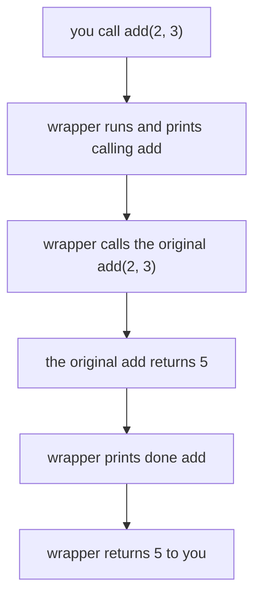

AI code talks to services that are slow, flaky and sometimes expensive: an LLM call can time out, an embedding step can take seconds, the same question can be asked ten times. You often want to add the same extra behavior to many functions: measure the time, try again on failure, remember old answers. Copying that code into every function is messy. A **decorator** lets you write it once and attach it with a single line.

## 1. Functions are values

In Python a function is a value, just like a number or a string. You can give it a second name, put it in a list, and pass it to another function. The important detail: `shout` is the function itself, and `shout("hi")` is the result of calling it.

```python
def shout(text):
    return text.upper() + "!"


yell = shout
print(yell("hi"))      # HI!
print(shout is yell)   # True
```

`yell = shout` does not call anything, so there are no brackets. Now `yell` and `shout` are two names for one function. `is` checks that two names point to the very same object.

A function can receive another function as a parameter and call it:

```python
def shout(text):
    return text.upper() + "!"


def apply_twice(func, value):
    return func(func(value))


print(apply_twice(shout, "hi"))   # HI!!
```

| you write | you get |
|---|---|
| `shout` | the function itself |
| `shout("hi")` | the result of calling it: `"HI!"` |

A decorator uses this idea twice: it **takes** a function, and it **returns** a function.

## 2. A function inside a function: closures

You can define a function inside another function. The inner one can read the variables of the outer one, and it **keeps them** even after the outer function has finished. Think of it as a small backpack: the inner function carries the values it needs. This is called a **closure**.

```python
def make_adder(n):
    def add(x):
        return x + n
    return add


add5 = make_adder(5)
add10 = make_adder(10)
print(add5(1))    # 6
print(add10(1))   # 11
```

Notice that `make_adder` returns `add` without brackets: it hands out the function, it does not call it. Each call to `make_adder` creates a new `n` and a new `add`, so the two adders do not disturb each other:

| step | what runs | `n` in the backpack | result |
|---|---|---|---|
| 1 | `add5 = make_adder(5)` | `5` | `add5` is a function |
| 2 | `add10 = make_adder(10)` | `10` | `add10` is another function |
| 3 | `add5(1)` | `5` | `1 + 5` gives `6` |
| 4 | `add10(1)` | `10` | `1 + 10` gives `11` |

This is the whole trick behind decorators: the function that wraps another one remembers it in its backpack.

## 3. `*args` and `**kwargs`

A wrapper does not know in advance which function it will wrap, so it must accept **any** arguments and pass them on. Python has two special parameters for that. In a `def`, `*args` collects all extra positional arguments into a tuple, and `**kwargs` collects all keyword arguments into a dict:

```python
def show(*args, **kwargs):
    print(args)
    print(kwargs)


show(1, 2, name="Ana")
# (1, 2)
# {'name': 'Ana'}
```

The stars also work in the other direction. In a call, `*args` spreads a tuple into separate arguments and `**kwargs` spreads a dict into keyword arguments:

```python
def add(a, b=0):
    return a + b


def call_it(func, *args, **kwargs):
    return func(*args, **kwargs)


print(call_it(add, 2, b=3))   # 5
```

| where | `*args` | `**kwargs` |
|---|---|---|
| in `def` | collects positional arguments into a tuple | collects keyword arguments into a dict |
| in a call | spreads a tuple into arguments | spreads a dict into keyword arguments |

The names `args` and `kwargs` are only a habit. The stars are what matter.

## 4. Your first decorator

A **decorator** is a function that takes a function and returns a new function (the **wrapper**) that does something extra around the original. Think of a gift wrapper: the gift inside is the same, but it travels with something added.

A good wrapper does three jobs: accept any arguments, call the original with them, and **return** what the original returned.

```python
def log_calls(func):
    def wrapper(*args, **kwargs):
        print("calling", func.__name__)
        result = func(*args, **kwargs)
        print("done", func.__name__)
        return result
    return wrapper


def add(a, b):
    return a + b


add = log_calls(add)
print(add(2, 3))
# calling add
# done add
# 5
```

Press **Visualize** on this block and watch the call stack: `add(2, 3)` first runs `wrapper`, and `func` inside it holds the original `add`, which `wrapper` then calls.

The line `add = log_calls(add)` replaces the name `add` with the wrapper. The original is not lost, it sits in the wrapper's backpack as `func`:

| step | what happens | `add` points to | `func` in the backpack |
|---|---|---|---|
| 1 | `def add` creates the original | original `add` | none yet |
| 2 | `log_calls(add)` runs | still the original | original `add` |
| 3 | the result is stored in `add` | `wrapper` | original `add` |
| 4 | `add(2, 3)` runs `wrapper(2, 3)` | `wrapper` | original `add` |

And here is the flow of one call:



## 5. The `@` shortcut

Writing `add = log_calls(add)` after every function is easy to forget. Python has a shortcut: put `@log_calls` on the line above the `def`.

```python
def log_calls(func):
    def wrapper(*args, **kwargs):
        print("calling", func.__name__)
        result = func(*args, **kwargs)
        print("done", func.__name__)
        return result
    return wrapper


@log_calls
def multiply(a, b):
    return a * b


print(multiply(4, 5))
# calling multiply
# done multiply
# 20
```

`@log_calls` above `def multiply` means exactly `multiply = log_calls(multiply)`. Nothing more happens.

> [!NOTE]
> The decorator runs **once**, when the `def` is executed. The wrapper runs **every time** you call the function.

## 6. Keep the name with `functools.wraps`

There is one side effect. After decoration the name `multiply` points to `wrapper`, so the function loses its own name and docstring:

```python
def log_calls(func):
    def wrapper(*args, **kwargs):
        return func(*args, **kwargs)
    return wrapper


@log_calls
def multiply(a, b):
    """Return a times b."""
    return a * b


print(multiply.__name__)   # wrapper
print(multiply.__doc__)    # None
```

This hurts when you read error messages or logs. The fix is a tool from the `functools` module: put `@wraps(func)` above the wrapper, and it copies the name and the docstring of `func` onto `wrapper`.

```python
from functools import wraps


def log_calls(func):
    @wraps(func)
    def wrapper(*args, **kwargs):
        return func(*args, **kwargs)
    return wrapper


@log_calls
def multiply(a, b):
    """Return a times b."""
    return a * b


print(multiply.__name__)   # multiply
print(multiply.__doc__)    # Return a times b.
```

> [!TIP]
> Make `@wraps(func)` a habit. Every decorator in this lesson from now on uses it.

## 7. A decorator that takes an argument

What if you want `@repeat(3)`, where the 3 is a setting? You need **one more level**. `repeat(3)` runs first and must return the real decorator, and that decorator then receives the function:

| level | receives | returns |
|---|---|---|
| `repeat(times)` | the setting, `3` | `decorator` |
| `decorator(func)` | the function | `wrapper` |
| `wrapper(*args, **kwargs)` | the call arguments | the result |

```python
from functools import wraps


def repeat(times):
    def decorator(func):
        @wraps(func)
        def wrapper(*args, **kwargs):
            result = None
            for _ in range(times):
                result = func(*args, **kwargs)
            return result
        return wrapper
    return decorator


@repeat(3)
def greet(name):
    print("hello", name)
    return name


print(greet("Ana"))
# hello Ana
# hello Ana
# hello Ana
# Ana
```

`@repeat(3)` means `greet = repeat(3)(greet)`: first call `repeat(3)`, then call what it returns with `greet`. The variable `times` lives in the backpack of `wrapper`, just like `func`.

## 8. Decorators you will actually use

Here is a stopwatch. `time.perf_counter()` from the `time` module returns a number of seconds from an arbitrary start, so only the difference between two readings is meaningful: it is how long something took.

```python
import time
from functools import wraps


def timed(func):
    @wraps(func)
    def wrapper(*args, **kwargs):
        start = time.perf_counter()
        result = func(*args, **kwargs)
        elapsed = time.perf_counter() - start
        print(f"{func.__name__} took {elapsed:.4f}s")
        return result
    return wrapper


@timed
def embed(texts):
    return [len(text) for text in texts]


print(embed(["hello", "ai"]))
# embed took 0.0000s
# [5, 2]
```

The time you see will differ on your computer. The same pattern gives you many useful tools:

| decorator | what it adds | typical AI use |
|---|---|---|
| `timed` | measures how long a call takes | find the slow step in a pipeline |
| `retry(times)` | tries again when a call raises | flaky LLM or network calls |
| `cache` | remembers results of earlier calls | do not embed the same text twice |
| `log_calls` | prints or records each call | see which prompts were sent |

## 9. Common mistakes

**Forgetting to `return` the result in the wrapper.** The call works, but you get `None`:

```python
def double_result(func):
    def wrapper(*args, **kwargs):
        func(*args, **kwargs) * 2
    return wrapper


@double_result
def add(a, b):
    return a + b


print(add(1, 2))   # None
```

Fix: write `return func(*args, **kwargs) * 2`.

**A wrapper that does not accept the arguments.** The decorated function is called with arguments, but `wrapper` takes none. This block fails on purpose:

```python
def log_calls(func):
    def wrapper():
        return func()
    return wrapper


@log_calls
def add(a, b):
    return a + b


add(2, 3)
# TypeError: log_calls.<locals>.wrapper() takes 0 positional arguments but 2 were given
```

Fix: `def wrapper(*args, **kwargs):` and `return func(*args, **kwargs)`.

**Leaving the brackets off a decorator with an argument.** `@repeat` is not `@repeat(3)`:

```python
from functools import wraps


def repeat(times):
    def decorator(func):
        @wraps(func)
        def wrapper(*args, **kwargs):
            for _ in range(times):
                func(*args, **kwargs)
        return wrapper
    return decorator


@repeat
def greet(name):
    print("hello", name)


print(greet("Ana"))
# <function repeat.<locals>.decorator.<locals>.wrapper at 0x...>
```

Nothing is printed by `greet` and no error appears: `greet` became `decorator`, so calling `greet("Ana")` just builds a wrapper. Fix: `@repeat(3)`.

> [!WARNING]
> Call the original function inside the wrapper, and put the work **around** it. Do not call it while the decorator is being set up, or it would run once at definition time.

## Recap

- A function is a value. `shout` is the function, `shout("hi")` is its result, and you can pass functions into other functions and return them.
- A **closure** is an inner function that remembers the variables of the outer function, even after the outer one has finished.
- A **decorator** takes a function and returns a wrapper. `@name` above a `def` means `f = name(f)`.
- A wrapper uses `*args, **kwargs` to accept any arguments, calls `func(*args, **kwargs)`, and **returns** the result.
- Put `@wraps(func)` above the wrapper to keep the original name and docstring.
- A decorator with an argument, like `@retry(3)`, has one more level: `retry(3)` returns the decorator.
