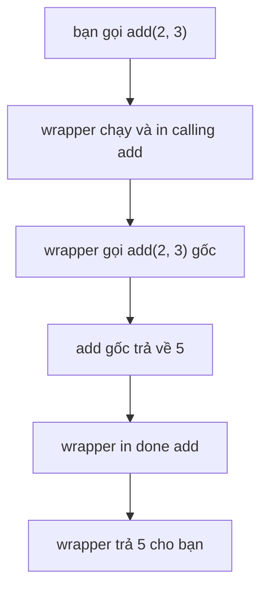

Code AI thường làm việc với các dịch vụ chậm, hay lỗi và đôi khi tốn tiền: một lần gọi LLM có thể bị timeout, một bước embedding có thể mất vài giây, cùng một câu hỏi có thể bị hỏi mười lần. Bạn hay muốn thêm cùng một hành vi cho nhiều hàm: đo thời gian, thử lại khi lỗi, nhớ các câu trả lời cũ. Chép đoạn code đó vào từng hàm thì rất lộn xộn. **Decorator** (bộ trang trí) cho phép bạn viết một lần rồi gắn vào bằng đúng một dòng.

## 1. Hàm là một giá trị

Trong Python, hàm là một giá trị, giống như số hay chuỗi. Bạn có thể đặt cho nó một tên thứ hai, bỏ nó vào list, và truyền nó cho hàm khác. Chi tiết quan trọng: `shout` là bản thân hàm, còn `shout("hi")` là kết quả của việc gọi nó.

```python
def shout(text):
    return text.upper() + "!"


yell = shout
print(yell("hi"))      # HI!
print(shout is yell)   # True
```

`yell = shout` không gọi gì cả, nên không có dấu ngoặc. Bây giờ `yell` và `shout` là hai cái tên của cùng một hàm. `is` kiểm tra hai tên có trỏ tới cùng một object hay không.

Một hàm có thể nhận hàm khác làm tham số và gọi nó:

```python
def shout(text):
    return text.upper() + "!"


def apply_twice(func, value):
    return func(func(value))


print(apply_twice(shout, "hi"))   # HI!!
```

| bạn viết | bạn nhận được |
|---|---|
| `shout` | bản thân hàm |
| `shout("hi")` | kết quả của việc gọi: `"HI!"` |

Decorator dùng ý tưởng này hai lần: nó **nhận** một hàm, và nó **trả về** một hàm.

## 2. Hàm trong hàm: closure

Bạn có thể định nghĩa một hàm bên trong hàm khác. Hàm bên trong đọc được các biến của hàm bên ngoài, và nó **giữ lại** chúng ngay cả khi hàm bên ngoài đã chạy xong. Hãy hình dung nó mang một cái ba lô nhỏ: hàm bên trong mang theo những giá trị nó cần. Cách này gọi là **closure**.

```python
def make_adder(n):
    def add(x):
        return x + n
    return add


add5 = make_adder(5)
add10 = make_adder(10)
print(add5(1))    # 6
print(add10(1))   # 11
```

Để ý rằng `make_adder` trả về `add` không có ngoặc: nó đưa ra chính hàm, chứ không gọi hàm. Mỗi lần gọi `make_adder` tạo ra một `n` mới và một `add` mới, nên hai bộ cộng không ảnh hưởng nhau:

| bước | cái gì chạy | `n` trong ba lô | kết quả |
|---|---|---|---|
| 1 | `add5 = make_adder(5)` | `5` | `add5` là một hàm |
| 2 | `add10 = make_adder(10)` | `10` | `add10` là một hàm khác |
| 3 | `add5(1)` | `5` | `1 + 5` ra `6` |
| 4 | `add10(1)` | `10` | `1 + 10` ra `11` |

Đây chính là mẹo đứng sau decorator: hàm bọc một hàm khác sẽ nhớ hàm đó trong ba lô của nó.

## 3. `*args` và `**kwargs`

Wrapper không biết trước nó sẽ bọc hàm nào, nên nó phải nhận **mọi** đối số và chuyển tiếp chúng. Python có hai tham số đặc biệt cho việc này. Trong `def`, `*args` gom mọi positional argument (đối số vị trí) thừa vào một tuple, còn `**kwargs` gom mọi keyword argument (đối số từ khóa) vào một dict:

```python
def show(*args, **kwargs):
    print(args)
    print(kwargs)


show(1, 2, name="Ana")
# (1, 2)
# {'name': 'Ana'}
```

Dấu sao cũng hoạt động theo chiều ngược lại. Trong một lời gọi, `*args` trải một tuple thành các đối số riêng, và `**kwargs` trải một dict thành các đối số từ khóa:

```python
def add(a, b=0):
    return a + b


def call_it(func, *args, **kwargs):
    return func(*args, **kwargs)


print(call_it(add, 2, b=3))   # 5
```

| ở đâu | `*args` | `**kwargs` |
|---|---|---|
| trong `def` | gom đối số vị trí vào một tuple | gom đối số từ khóa vào một dict |
| trong lời gọi | trải một tuple thành các đối số | trải một dict thành đối số từ khóa |

Tên `args` và `kwargs` chỉ là thói quen. Dấu sao mới là phần quan trọng.

## 4. Decorator đầu tiên của bạn

**Decorator** là một hàm nhận vào một hàm và trả về một hàm mới (gọi là **wrapper**, hàm bọc) làm thêm việc gì đó xung quanh hàm gốc. Hãy nghĩ đến việc gói quà: món quà bên trong vẫn như cũ, nhưng nó đi kèm thêm một thứ.

Một wrapper tốt làm ba việc: nhận mọi đối số, gọi hàm gốc với các đối số đó, và **return** thứ hàm gốc trả về.

```python
def log_calls(func):
    def wrapper(*args, **kwargs):
        print("calling", func.__name__)
        result = func(*args, **kwargs)
        print("done", func.__name__)
        return result
    return wrapper


def add(a, b):
    return a + b


add = log_calls(add)
print(add(2, 3))
# calling add
# done add
# 5
```

Bấm **Visualize** ở khối code này và xem call stack: `add(2, 3)` chạy `wrapper` trước, và `func` bên trong nó giữ `add` gốc, và `wrapper` sẽ gọi hàm đó.

Dòng `add = log_calls(add)` thay tên `add` bằng wrapper. Hàm gốc không bị mất, nó nằm trong ba lô của wrapper với tên `func`:

| bước | điều gì xảy ra | `add` trỏ tới | `func` trong ba lô |
|---|---|---|---|
| 1 | `def add` tạo hàm gốc | `add` gốc | chưa có |
| 2 | `log_calls(add)` chạy | vẫn là hàm gốc | `add` gốc |
| 3 | kết quả được lưu vào `add` | `wrapper` | `add` gốc |
| 4 | `add(2, 3)` chạy `wrapper(2, 3)` | `wrapper` | `add` gốc |

Và đây là luồng chạy của một lời gọi:



## 5. Lối tắt `@`

Viết `add = log_calls(add)` sau mỗi hàm rất dễ quên. Python có lối tắt: đặt `@log_calls` ở dòng ngay trên `def`.

```python
def log_calls(func):
    def wrapper(*args, **kwargs):
        print("calling", func.__name__)
        result = func(*args, **kwargs)
        print("done", func.__name__)
        return result
    return wrapper


@log_calls
def multiply(a, b):
    return a * b


print(multiply(4, 5))
# calling multiply
# done multiply
# 20
```

`@log_calls` phía trên `def multiply` có nghĩa chính xác là `multiply = log_calls(multiply)`. Không có gì thêm.

> [!NOTE]
> Decorator chạy **một lần**, khi câu lệnh `def` được thực thi. Wrapper chạy **mỗi lần** bạn gọi hàm.

## 6. Giữ tên hàm bằng `functools.wraps`

Có một tác dụng phụ. Sau khi decorate, tên `multiply` trỏ tới `wrapper`, nên hàm mất tên và docstring của chính nó:

```python
def log_calls(func):
    def wrapper(*args, **kwargs):
        return func(*args, **kwargs)
    return wrapper


@log_calls
def multiply(a, b):
    """Return a times b."""
    return a * b


print(multiply.__name__)   # wrapper
print(multiply.__doc__)    # None
```

Điều này gây khó khi bạn đọc thông báo lỗi hay log. Cách sửa là một công cụ trong module `functools`: đặt `@wraps(func)` phía trên wrapper, nó sẽ chép tên và docstring của `func` sang `wrapper`.

```python
from functools import wraps


def log_calls(func):
    @wraps(func)
    def wrapper(*args, **kwargs):
        return func(*args, **kwargs)
    return wrapper


@log_calls
def multiply(a, b):
    """Return a times b."""
    return a * b


print(multiply.__name__)   # multiply
print(multiply.__doc__)    # Return a times b.
```

> [!TIP]
> Hãy tập thói quen luôn viết `@wraps(func)`. Mọi decorator trong bài này từ đây về sau đều dùng nó.

## 7. Decorator nhận một tham số

Nếu bạn muốn `@repeat(3)`, với số 3 là một thiết lập thì sao? Bạn cần **thêm một tầng nữa**. `repeat(3)` chạy trước và phải trả về decorator thật, rồi decorator đó mới nhận hàm:

| tầng | nhận | trả về |
|---|---|---|
| `repeat(times)` | thiết lập, `3` | `decorator` |
| `decorator(func)` | hàm | `wrapper` |
| `wrapper(*args, **kwargs)` | các đối số của lời gọi | kết quả |

```python
from functools import wraps


def repeat(times):
    def decorator(func):
        @wraps(func)
        def wrapper(*args, **kwargs):
            result = None
            for _ in range(times):
                result = func(*args, **kwargs)
            return result
        return wrapper
    return decorator


@repeat(3)
def greet(name):
    print("hello", name)
    return name


print(greet("Ana"))
# hello Ana
# hello Ana
# hello Ana
# Ana
```

`@repeat(3)` có nghĩa là `greet = repeat(3)(greet)`: gọi `repeat(3)` trước, rồi gọi thứ nó trả về với `greet`. Biến `times` nằm trong ba lô của `wrapper`, giống như `func`.

## 8. Những decorator bạn sẽ thật sự dùng

Đây là một chiếc đồng hồ bấm giờ. `time.perf_counter()` trong module `time` trả về một số giây tính từ một mốc bất kỳ, nên chỉ hiệu của hai lần đọc mới có ý nghĩa: đó là thời gian một việc đã chạy.

```python
import time
from functools import wraps


def timed(func):
    @wraps(func)
    def wrapper(*args, **kwargs):
        start = time.perf_counter()
        result = func(*args, **kwargs)
        elapsed = time.perf_counter() - start
        print(f"{func.__name__} took {elapsed:.4f}s")
        return result
    return wrapper


@timed
def embed(texts):
    return [len(text) for text in texts]


print(embed(["hello", "ai"]))
# embed took 0.0000s
# [5, 2]
```

Thời gian bạn thấy sẽ khác trên máy của bạn. Cùng một khuôn mẫu cho bạn nhiều công cụ hữu ích:

| decorator | nó thêm gì | cách dùng thường gặp trong AI |
|---|---|---|
| `timed` | đo một lần gọi mất bao lâu | tìm bước chậm trong pipeline |
| `retry(times)` | thử lại khi lời gọi raise lỗi | các lời gọi LLM hoặc mạng hay lỗi |
| `cache` | nhớ kết quả của các lần gọi trước | không embed cùng một văn bản hai lần |
| `log_calls` | in hoặc ghi lại mỗi lần gọi | xem những prompt nào đã được gửi |

## 9. Lỗi thường gặp

**Quên `return` kết quả trong wrapper.** Lời gọi chạy được, nhưng bạn nhận về `None`:

```python
def double_result(func):
    def wrapper(*args, **kwargs):
        func(*args, **kwargs) * 2
    return wrapper


@double_result
def add(a, b):
    return a + b


print(add(1, 2))   # None
```

Cách sửa: viết `return func(*args, **kwargs) * 2`.

**Wrapper không nhận đối số.** Hàm được decorate bị gọi với đối số, nhưng `wrapper` không nhận cái nào. Khối này cố ý gây lỗi:

```python
def log_calls(func):
    def wrapper():
        return func()
    return wrapper


@log_calls
def add(a, b):
    return a + b


add(2, 3)
# TypeError: log_calls.<locals>.wrapper() takes 0 positional arguments but 2 were given
```

Cách sửa: `def wrapper(*args, **kwargs):` và `return func(*args, **kwargs)`.

**Bỏ ngoặc ở decorator có tham số.** `@repeat` không phải là `@repeat(3)`:

```python
from functools import wraps


def repeat(times):
    def decorator(func):
        @wraps(func)
        def wrapper(*args, **kwargs):
            for _ in range(times):
                func(*args, **kwargs)
        return wrapper
    return decorator


@repeat
def greet(name):
    print("hello", name)


print(greet("Ana"))
# <function repeat.<locals>.decorator.<locals>.wrapper at 0x...>
```

`greet` không in gì và cũng không có lỗi nào: `greet` đã trở thành `decorator`, nên gọi `greet("Ana")` chỉ tạo ra một wrapper. Cách sửa: `@repeat(3)`.

> [!WARNING]
> Hãy gọi hàm gốc bên trong wrapper, và đặt phần việc thêm vào **xung quanh** nó. Đừng gọi nó lúc decorator đang được dựng, nếu không nó sẽ chạy một lần ngay khi định nghĩa.

## Tóm tắt

- Hàm là một giá trị. `shout` là hàm, `shout("hi")` là kết quả của nó, và bạn có thể truyền hàm vào hàm khác hoặc return nó.
- **Closure** là hàm bên trong nhớ các biến của hàm bên ngoài, ngay cả khi hàm bên ngoài đã chạy xong.
- **Decorator** nhận một hàm và trả về một wrapper. `@name` phía trên `def` có nghĩa là `f = name(f)`.
- Wrapper dùng `*args, **kwargs` để nhận mọi đối số, gọi `func(*args, **kwargs)`, và **return** kết quả.
- Đặt `@wraps(func)` phía trên wrapper để giữ tên và docstring gốc.
- Decorator có tham số, như `@retry(3)`, có thêm một tầng: `retry(3)` trả về decorator.
