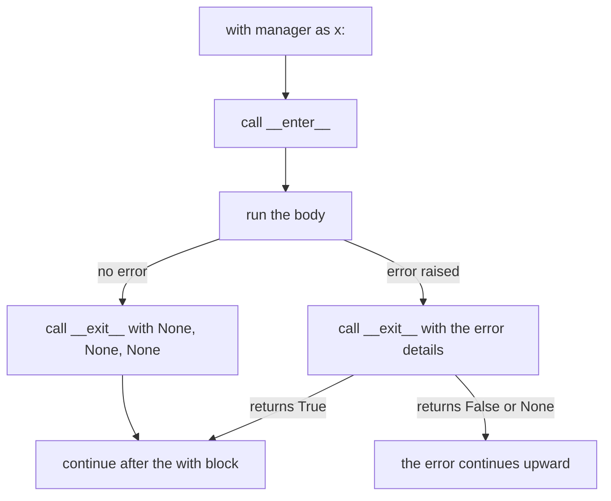

Calling an embedding service opens a connection. Writing results opens a file. Timing a slow step starts a clock. All of these must be **closed, saved or stopped at the end, even when something crashes in the middle**. Python's tool for "set up, do the work, always clean up" is the **context manager**, and you use it with the `with` statement.

## 1. The clean-up problem

When a program fails halfway, the lines after the error never run. If one of those lines was "close the connection", the connection stays open. The classic fix is `try` with `finally`, which you know from the exceptions lesson, because `finally` runs every time:

```python
def risky():
    print("open the connection")
    try:
        print("use it")
        raise ValueError("boom")
    finally:
        print("close the connection")


try:
    risky()
except ValueError:
    print("caught: boom")
# open the connection
# use it
# close the connection
# caught: boom
```

Notice that `close the connection` is printed before the error reaches the outer `except`. It works, but you have to remember to write the `try/finally` every single time. A `with` block is that same promise in a shorter form. You already use it for files:

```python
import tempfile

with tempfile.TemporaryDirectory() as tmp:
    path = f"{tmp}/notes.txt"

    try:
        with open(path, "w", encoding="utf-8") as f:
            f.write("saved")
            raise RuntimeError("crash while writing")
    except RuntimeError:
        print("crashed")   # crashed

    print(f.closed)        # True
    with open(path, encoding="utf-8") as g:
        print(g.read())    # saved
```

The program crashed inside the block, yet the file is closed and the text was saved. That is the guarantee of `with`: **the clean-up runs when the block ends, whether it ends normally or with an error.**

## 2. What `with` does

`open(...)` returns an object that follows a small protocol (a set of rules). Any object that follows it is a **context manager**. The `with` statement does three things:



The two special **methods** (functions that belong to an object) are `__enter__`, which runs when the block starts, and `__exit__`, which runs when it ends. Think of a hotel room: `__enter__` hands you the key, `__exit__` is the cleaner who always resets the room after you leave, even if you left in a hurry.

## 3. Your own context manager: a class

You need a class from the classes lesson with those two methods. `__enter__` returns the value that goes after `as`. `__exit__` takes three extra arguments that we look at in section 5; for now we ignore them.

```python
class Announce:
    def __init__(self, name):
        self.name = name

    def __enter__(self):
        print("enter", self.name)
        return self

    def __exit__(self, exc_type, exc_value, traceback):
        print("exit", self.name)
        return False


with Announce("job") as job:
    print("body", job.name)
print("after")
# enter job
# body job
# exit job
# after
```

Press **Visualize** on this block and watch the steps jump into `Announce.__enter__`, come back for the body, then jump into `Announce.__exit__` before `print("after")`.

Two details: `Announce("job")` runs `__init__` first, then `with` calls `__enter__`. And `job` is whatever `__enter__` **returned**. If you forget `return self`, `job` is `None` (see the mistakes section).

## 4. When the body fails

Now the important case. Let the body raise an error and follow what runs:

```python
class Announce:
    def __init__(self, name):
        self.name = name

    def __enter__(self):
        print("enter", self.name)
        return self

    def __exit__(self, exc_type, exc_value, traceback):
        print("exit", self.name)
        return False


try:
    with Announce("job"):
        print("body start")
        raise ValueError("boom")
        print("body end")
except ValueError:
    print("caught outside")
# enter job
# body start
# exit job
# caught outside
```

| step | what runs | printed |
|---|---|---|
| 1 | `__enter__` | `enter job` |
| 2 | first line of the body | `body start` |
| 3 | `raise ValueError("boom")`, the rest of the body is skipped | nothing |
| 4 | `__exit__` runs and receives the error | `exit job` |
| 5 | `__exit__` returned `False`, so the error continues to the outer `except` | `caught outside` |

`body end` never prints, but `exit job` does, and it prints **before** the outer `except` runs. That is the whole point.

## 5. The three arguments of `__exit__` and hiding errors

`__exit__` always receives three arguments. They describe the error, or are all `None` when there was none:

| argument | when the body had no error | when the body raised `ValueError("boom")` |
|---|---|---|
| `exc_type` | `None` | the class `ValueError` |
| `exc_value` | `None` | the error object |
| `traceback` | `None` | the traceback (you will rarely use it) |

The **return value** of `__exit__` decides what happens to the error. Return `True` and the error is **suppressed**: the program continues after the `with` block as if nothing happened. Return `False` (or nothing, which is `None`) and the error goes on upward. Here is a manager that ignores one kind of error. `isinstance(x, SomeType)` is `True` when `x` is an object of that type or a subclass (as in the inheritance lesson), and it is `False` for `None`:

```python
class Ignore:
    def __init__(self, error_type):
        self.error_type = error_type

    def __enter__(self):
        return self

    def __exit__(self, exc_type, exc_value, traceback):
        return isinstance(exc_value, self.error_type)


settings = {}

with Ignore(KeyError):
    print(settings["model"])
print("still running")   # still running
```

Reading the missing key raises `KeyError`. `__exit__` sees that `exc_value` is a `KeyError`, returns `True`, and the program goes on.

> [!WARNING]
> Hiding errors is powerful and dangerous. Suppress only the specific error you expect, and only around a small piece of code. A manager that always returns `True` hides real bugs.

## 6. The short way: `@contextmanager`

Writing a class for every small job is long. The standard module `contextlib` offers a decorator, `contextmanager`, that turns a **generator function** (from the generators lesson) with exactly one `yield` into a context manager:

```python
from contextlib import contextmanager


@contextmanager
def announce(name):
    print("enter", name)
    try:
        yield name
    finally:
        print("exit", name)


with announce("job") as who:
    print("body", who)

try:
    with announce("bad"):
        raise ValueError("boom")
except ValueError:
    print("caught outside")
# enter job
# body job
# exit job
# enter bad
# exit bad
# caught outside
```

The code before `yield` is the setup, the value after `yield` goes to `as`, and the code after `yield` is the clean-up. If the body raises an error, Python raises it **at the `yield` line**, so the `try/finally` around `yield` is what makes the clean-up run. Compare the two styles:

| class | `@contextmanager` generator |
|---|---|
| `__enter__` | the code before `yield` |
| value returned by `__enter__` | the value after `yield` |
| `__exit__` | the code after `yield`, inside `finally` |
| return `True` to hide an error | catch it with `except` around `yield` and do not raise it again |

> [!TIP]
> Use a generator for short, one-off helpers. Use a class when the manager keeps state you also want to read later, such as a counter.

## 7. Useful managers for AI code

**A timer.** It reads the clock before and after a block. The clock is a parameter (functions are values), so you can pass a fake one and get the same answer every time. `time.perf_counter()` is the real clock: it returns a number of seconds from an arbitrary start, so only the difference between two readings is meaningful.

```python
import time
from contextlib import contextmanager


@contextmanager
def timer(label, clock=time.perf_counter):
    start = clock()
    try:
        yield
    finally:
        elapsed = clock() - start
        print(f"{label}: {elapsed:.1f}s")


ticks = iter([10.0, 12.5])


def fake_clock():
    return next(ticks)


with timer("embed 100 docs", clock=fake_clock):
    pass   # imagine the embedding call here
# embed 100 docs: 2.5s
```

**Two dict tools first.** `key in d` is `True` when the key exists, and `del d[key]` removes it. You need both for the next manager:

```python
settings = {"model": "small"}

print("model" in settings)   # True
del settings["model"]
print("model" in settings)   # False
print(settings)              # {}
```

**A temporary setting.** Change a setting for one block, then put it back, even after an error. This is how you try a higher `temperature` for one call without forgetting to reset it:

```python
from contextlib import contextmanager

settings = {"temperature": 0.2}


@contextmanager
def use_temperature(value):
    old = settings["temperature"]
    settings["temperature"] = value
    try:
        yield
    finally:
        settings["temperature"] = old


with use_temperature(0.9):
    print(settings["temperature"])   # 0.9
print(settings["temperature"])       # 0.2

try:
    with use_temperature(1.5):
        raise RuntimeError("model call failed")
except RuntimeError:
    print(settings["temperature"])   # 0.2
```

The old value is saved before the change and restored in `finally`, so a failed call cannot leave the wrong temperature behind.

## 8. Several managers, and ready-made ones

Write more than one manager in a single `with`, separated by commas. They are entered **left to right** and exited **right to left**, like putting on a coat and then a scarf, and taking them off in reverse:

```python
from contextlib import contextmanager


@contextmanager
def announce(name):
    print("enter", name)
    try:
        yield name
    finally:
        print("exit", name)


with announce("outer"), announce("inner"):
    print("body")
# enter outer
# enter inner
# body
# exit inner
# exit outer
```

`contextlib` also has ready-made managers. For example, `with suppress(KeyError):` (after `from contextlib import suppress`) does what our `Ignore` did. Other libraries provide more, e.g. locks and database connections.

## 9. Common mistakes

**Forgetting `try/finally` around `yield`.** Without it, the clean-up is skipped when the body fails:

```python
from contextlib import contextmanager


@contextmanager
def announce(name):
    print("enter", name)
    yield
    print("exit", name)


try:
    with announce("job"):
        raise ValueError("boom")
except ValueError:
    print("caught")
# enter job
# caught
```

`exit job` is missing. Fix: put `yield` inside `try:` and the clean-up in `finally:`.

**Forgetting `return self` in `__enter__`.** Then `as` gives `None`. This block ends with an error on purpose:

```python
class Box:
    def __init__(self):
        self.name = "box"

    def __enter__(self):
        print("opened")

    def __exit__(self, exc_type, exc_value, traceback):
        return False


with Box() as b:
    print(b.name)
# opened
# AttributeError: 'NoneType' object has no attribute 'name'
```

Fix: add `return self` at the end of `__enter__`.

**Returning `True` from `__exit__` by accident.** The error vanishes and the program looks fine:

```python
class Guard:
    def __enter__(self):
        return self

    def __exit__(self, exc_type, exc_value, traceback):
        return True


with Guard():
    print(1 / 0)
print("looks fine")   # looks fine
```

The `ZeroDivisionError` is gone without a trace. Fix: return `False`, or return `True` only after checking that the error is the one you expect.

**Calling the manager without `with`.** Nothing runs, because calling a `@contextmanager` function only builds the manager:

```python
from contextlib import contextmanager


@contextmanager
def announce(name):
    print("enter", name)
    try:
        yield
    finally:
        print("exit", name)


announce("job")
print("done")   # done
```

Fix: write `with announce("job"):` and put the work in the block.

## Recap

- A **context manager** sets something up, lets you work, and always cleans up, even if an error happens. You use it with `with`.
- `with` calls `__enter__` at the start (its return value goes to `as`) and `__exit__` at the end, with three error arguments that are `None` when all is well.
- If `__exit__` returns `True`, the error is hidden. Return `False` or nothing to let it continue. Hide only the exact error you expect.
- `@contextmanager` turns a generator with one `yield` into a manager: setup before `yield`, clean-up after it. Wrap `yield` in `try/finally`.
- `with a, b:` enters left to right and exits right to left. `suppress` is a ready-made manager.
- Good uses in AI code: a timer with an injectable clock, a temporary setting, an open file that is always closed.
