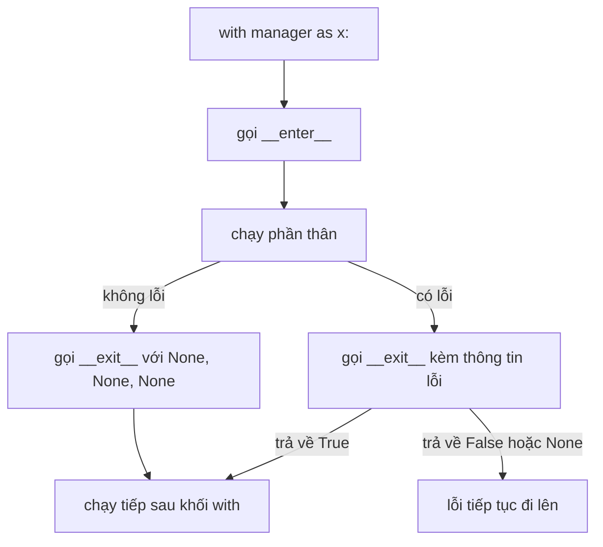

Gọi một dịch vụ embedding thì phải mở một kết nối. Ghi kết quả thì phải mở một file. Đo thời gian một bước chậm thì phải bật một chiếc đồng hồ. Tất cả những thứ này đều phải được **đóng, lưu hoặc dừng lại ở cuối, kể cả khi giữa chừng có chuyện hỏng**. Công cụ của Python cho việc "chuẩn bị, làm việc, luôn dọn dẹp" là **context manager** (bộ quản lý ngữ cảnh), và bạn dùng nó với câu lệnh `with`.

## 1. Bài toán dọn dẹp

Khi chương trình hỏng giữa chừng, những dòng sau chỗ lỗi sẽ không bao giờ chạy. Nếu một trong các dòng đó là "đóng kết nối", kết nối sẽ bị bỏ mở. Cách chữa kinh điển là `try` cùng `finally`, bạn đã biết từ bài exception, vì `finally` chạy mọi lần:

```python
def risky():
    print("open the connection")
    try:
        print("use it")
        raise ValueError("boom")
    finally:
        print("close the connection")


try:
    risky()
except ValueError:
    print("caught: boom")
# open the connection
# use it
# close the connection
# caught: boom
```

Hãy để ý `close the connection` được in ra trước khi lỗi đến được `except` bên ngoài. Cách này chạy tốt, nhưng bạn phải nhớ viết `try/finally` mỗi một lần. Khối `with` là cùng lời hứa đó nhưng viết ngắn hơn. Bạn đã dùng nó với file rồi:

```python
import tempfile

with tempfile.TemporaryDirectory() as tmp:
    path = f"{tmp}/notes.txt"

    try:
        with open(path, "w", encoding="utf-8") as f:
            f.write("saved")
            raise RuntimeError("crash while writing")
    except RuntimeError:
        print("crashed")   # crashed

    print(f.closed)        # True
    with open(path, encoding="utf-8") as g:
        print(g.read())    # saved
```

Chương trình đã hỏng bên trong khối, vậy mà file vẫn được đóng và nội dung vẫn được lưu. Đó là lời đảm bảo của `with`: **phần dọn dẹp luôn chạy khi khối kết thúc, dù nó kết thúc bình thường hay bằng lỗi.**

## 2. `with` làm gì

`open(...)` trả về một object (đối tượng) tuân theo một protocol (giao thức) nhỏ, tức là một bộ quy tắc. Bất cứ object nào tuân theo giao thức này đều là một **context manager**. Câu lệnh `with` làm ba việc:



Hai **method** (phương thức, tức hàm thuộc về một object) đặc biệt là `__enter__`, chạy khi khối bắt đầu, và `__exit__`, chạy khi khối kết thúc. Hãy nghĩ đến phòng khách sạn: `__enter__` đưa bạn chìa khóa, còn `__exit__` là người dọn phòng, lúc nào cũng dọn lại phòng sau khi bạn đi, kể cả khi bạn rời đi vội.

## 3. Context manager của riêng bạn: một class

Bạn chỉ cần một class (như ở bài về class) có hai method này. `__enter__` trả về giá trị nằm sau `as`. `__exit__` nhận thêm ba tham số, ta sẽ xem ở mục 5; tạm thời cứ bỏ qua chúng.

```python
class Announce:
    def __init__(self, name):
        self.name = name

    def __enter__(self):
        print("enter", self.name)
        return self

    def __exit__(self, exc_type, exc_value, traceback):
        print("exit", self.name)
        return False


with Announce("job") as job:
    print("body", job.name)
print("after")
# enter job
# body job
# exit job
# after
```

Bấm **Visualize** ở khối code này để xem các bước nhảy vào `Announce.__enter__`, quay lại chạy phần thân, rồi nhảy vào `Announce.__exit__` trước khi tới `print("after")`.

Hai chi tiết: `Announce("job")` chạy `__init__` trước, rồi `with` mới gọi `__enter__`. Và `job` chính là thứ `__enter__` **trả về**. Nếu bạn quên `return self` thì `job` là `None` (xem mục lỗi thường gặp).

## 4. Khi phần thân bị lỗi

Giờ là trường hợp quan trọng. Cho phần thân raise lỗi và theo dõi cái gì chạy:

```python
class Announce:
    def __init__(self, name):
        self.name = name

    def __enter__(self):
        print("enter", self.name)
        return self

    def __exit__(self, exc_type, exc_value, traceback):
        print("exit", self.name)
        return False


try:
    with Announce("job"):
        print("body start")
        raise ValueError("boom")
        print("body end")
except ValueError:
    print("caught outside")
# enter job
# body start
# exit job
# caught outside
```

| bước | cái gì chạy | in ra |
|---|---|---|
| 1 | `__enter__` | `enter job` |
| 2 | dòng đầu của phần thân | `body start` |
| 3 | `raise ValueError("boom")`, phần còn lại của thân bị bỏ qua | không in gì |
| 4 | `__exit__` chạy và nhận lỗi | `exit job` |
| 5 | `__exit__` trả về `False`, nên lỗi đi tiếp tới `except` bên ngoài | `caught outside` |

`body end` không bao giờ được in, nhưng `exit job` thì có, và nó được in **trước** khi `except` bên ngoài chạy. Đó chính là điểm mấu chốt.

## 5. Ba tham số của `__exit__` và việc giấu lỗi

`__exit__` luôn nhận ba tham số. Chúng mô tả lỗi, hoặc đều là `None` khi không có lỗi:

| tham số | khi thân không có lỗi | khi thân raise `ValueError("boom")` |
|---|---|---|
| `exc_type` | `None` | class `ValueError` |
| `exc_value` | `None` | object lỗi |
| `traceback` | `None` | traceback (bạn hiếm khi dùng tới) |

**Giá trị trả về** của `__exit__` quyết định số phận của lỗi. Trả về `True` thì lỗi bị **suppress** (nén lại, giấu đi): chương trình chạy tiếp sau khối `with` như chưa có gì xảy ra. Trả về `False` (hoặc không trả gì, tức là `None`) thì lỗi tiếp tục đi lên. Đây là một manager bỏ qua một loại lỗi. `isinstance(x, SomeType)` cho `True` khi `x` là object thuộc kiểu đó hoặc một subclass của nó (như ở bài về kế thừa), và cho `False` với `None`:

```python
class Ignore:
    def __init__(self, error_type):
        self.error_type = error_type

    def __enter__(self):
        return self

    def __exit__(self, exc_type, exc_value, traceback):
        return isinstance(exc_value, self.error_type)


settings = {}

with Ignore(KeyError):
    print(settings["model"])
print("still running")   # still running
```

Đọc key không tồn tại sẽ raise `KeyError`. `__exit__` thấy `exc_value` là một `KeyError`, trả về `True`, và chương trình đi tiếp.

> [!WARNING]
> Giấu lỗi vừa mạnh vừa nguy hiểm. Chỉ suppress đúng loại lỗi bạn đang chờ, và chỉ quanh một đoạn code nhỏ. Một manager luôn trả về `True` sẽ giấu cả bug thật.

## 6. Cách ngắn: `@contextmanager`

Viết một class cho mỗi việc nhỏ thì dài dòng. Module chuẩn `contextlib` có sẵn một decorator tên `contextmanager`, biến một **hàm generator** (từ bài generator) có đúng một `yield` thành context manager:

```python
from contextlib import contextmanager


@contextmanager
def announce(name):
    print("enter", name)
    try:
        yield name
    finally:
        print("exit", name)


with announce("job") as who:
    print("body", who)

try:
    with announce("bad"):
        raise ValueError("boom")
except ValueError:
    print("caught outside")
# enter job
# body job
# exit job
# enter bad
# exit bad
# caught outside
```

Code trước `yield` là phần chuẩn bị, giá trị đứng sau `yield` đi vào `as`, và code sau `yield` là phần dọn dẹp. Nếu phần thân raise lỗi, Python raise nó **ngay tại dòng `yield`**, nên `try/finally` bao quanh `yield` là thứ khiến phần dọn dẹp chạy. So sánh hai kiểu viết:

| class | generator với `@contextmanager` |
|---|---|
| `__enter__` | code trước `yield` |
| giá trị `__enter__` trả về | giá trị đứng sau `yield` |
| `__exit__` | code sau `yield`, nằm trong `finally` |
| trả về `True` để giấu lỗi | bắt lỗi bằng `except` quanh `yield` và không raise lại |

> [!TIP]
> Dùng generator cho các helper ngắn, dùng một lần. Dùng class khi manager giữ trạng thái mà bạn muốn đọc lại sau đó, ví dụ một bộ đếm.

## 7. Các manager hữu ích cho code AI

**Bộ đếm giờ (timer).** Nó đọc đồng hồ trước và sau một khối. Đồng hồ là một tham số (hàm cũng là giá trị), nên bạn có thể truyền vào đồng hồ giả để lần nào cũng ra cùng một kết quả. `time.perf_counter()` là đồng hồ thật: nó trả về một số giây tính từ một mốc bất kỳ, nên chỉ hiệu số giữa hai lần đọc mới có ý nghĩa.

```python
import time
from contextlib import contextmanager


@contextmanager
def timer(label, clock=time.perf_counter):
    start = clock()
    try:
        yield
    finally:
        elapsed = clock() - start
        print(f"{label}: {elapsed:.1f}s")


ticks = iter([10.0, 12.5])


def fake_clock():
    return next(ticks)


with timer("embed 100 docs", clock=fake_clock):
    pass   # hãy tưởng tượng lời gọi embedding nằm ở đây
# embed 100 docs: 2.5s
```

**Hai công cụ của dict trước đã.** `key in d` cho `True` khi key tồn tại, và `del d[key]` xóa key đó. Bạn cần cả hai cho manager kế tiếp:

```python
settings = {"model": "small"}

print("model" in settings)   # True
del settings["model"]
print("model" in settings)   # False
print(settings)              # {}
```

**Một setting tạm thời.** Đổi một setting trong một khối, rồi trả nó về như cũ, kể cả khi có lỗi. Đây là cách thử `temperature` cao hơn cho một lần gọi mà không quên đặt lại:

```python
from contextlib import contextmanager

settings = {"temperature": 0.2}


@contextmanager
def use_temperature(value):
    old = settings["temperature"]
    settings["temperature"] = value
    try:
        yield
    finally:
        settings["temperature"] = old


with use_temperature(0.9):
    print(settings["temperature"])   # 0.9
print(settings["temperature"])       # 0.2

try:
    with use_temperature(1.5):
        raise RuntimeError("model call failed")
except RuntimeError:
    print(settings["temperature"])   # 0.2
```

Giá trị cũ được lưu trước khi đổi và được khôi phục trong `finally`, nên một lần gọi thất bại không thể để lại temperature sai.

## 8. Nhiều manager cùng lúc, và manager có sẵn

Bạn có thể viết nhiều manager trong một `with`, ngăn cách bằng dấu phẩy. Chúng được vào **từ trái sang phải** và thoát **từ phải sang trái**, giống như mặc áo khoác rồi quàng khăn, và cởi ra theo thứ tự ngược lại:

```python
from contextlib import contextmanager


@contextmanager
def announce(name):
    print("enter", name)
    try:
        yield name
    finally:
        print("exit", name)


with announce("outer"), announce("inner"):
    print("body")
# enter outer
# enter inner
# body
# exit inner
# exit outer
```

`contextlib` cũng có sẵn vài manager. Ví dụ, `with suppress(KeyError):` (sau `from contextlib import suppress`) làm đúng việc `Ignore` của ta đã làm. Các thư viện khác cung cấp thêm, ví dụ lock và kết nối database.

## 9. Lỗi thường gặp

**Quên `try/finally` quanh `yield`.** Thiếu nó thì phần dọn dẹp bị bỏ qua khi thân bị lỗi:

```python
from contextlib import contextmanager


@contextmanager
def announce(name):
    print("enter", name)
    yield
    print("exit", name)


try:
    with announce("job"):
        raise ValueError("boom")
except ValueError:
    print("caught")
# enter job
# caught
```

Thiếu dòng `exit job`. Cách sửa: đặt `yield` trong `try:` và phần dọn dẹp trong `finally:`.

**Quên `return self` trong `__enter__`.** Khi đó `as` cho ra `None`. Khối này cố ý kết thúc bằng lỗi:

```python
class Box:
    def __init__(self):
        self.name = "box"

    def __enter__(self):
        print("opened")

    def __exit__(self, exc_type, exc_value, traceback):
        return False


with Box() as b:
    print(b.name)
# opened
# AttributeError: 'NoneType' object has no attribute 'name'
```

Cách sửa: thêm `return self` ở cuối `__enter__`.

**Vô tình trả về `True` từ `__exit__`.** Lỗi biến mất và chương trình trông vẫn ổn:

```python
class Guard:
    def __enter__(self):
        return self

    def __exit__(self, exc_type, exc_value, traceback):
        return True


with Guard():
    print(1 / 0)
print("looks fine")   # looks fine
```

`ZeroDivisionError` biến mất không để lại dấu vết. Cách sửa: trả về `False`, hoặc chỉ trả về `True` sau khi đã kiểm tra rằng đó đúng là loại lỗi bạn chờ.

**Gọi manager mà không có `with`.** Không có gì chạy, vì gọi một hàm `@contextmanager` chỉ tạo ra manager:

```python
from contextlib import contextmanager


@contextmanager
def announce(name):
    print("enter", name)
    try:
        yield
    finally:
        print("exit", name)


announce("job")
print("done")   # done
```

Cách sửa: viết `with announce("job"):` và đặt công việc vào trong khối.

## Tóm tắt

- **Context manager** chuẩn bị một thứ, để bạn làm việc, và luôn dọn dẹp, kể cả khi có lỗi. Bạn dùng nó với `with`.
- `with` gọi `__enter__` lúc đầu (giá trị trả về đi vào `as`) và `__exit__` lúc cuối, kèm ba tham số về lỗi, đều là `None` khi mọi thứ ổn.
- Nếu `__exit__` trả về `True`, lỗi bị giấu. Trả về `False` hoặc không trả gì để lỗi đi tiếp. Chỉ giấu đúng loại lỗi bạn chờ.
- `@contextmanager` biến generator có một `yield` thành manager: chuẩn bị trước `yield`, dọn dẹp sau nó. Hãy bọc `yield` trong `try/finally`.
- `with a, b:` vào từ trái sang phải và thoát từ phải sang trái. `suppress` là một manager có sẵn.
- Dùng tốt trong code AI: timer có đồng hồ truyền vào được, setting tạm thời, file đang mở luôn được đóng.
