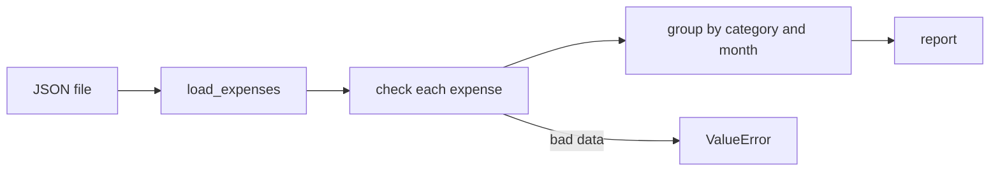

Every AI project keeps records: runs of an experiment, calls to an LLM API and what they cost, documents and their sources. You save them to a file, read them back, check that they are sane, and print a summary a person can read in ten seconds. In this lesson you build the personal version of that: an **expense tracker**. It is small, but it has the same shape as the cost trackers and eval loggers you will write at work.

There is almost nothing new to learn here. The point is to **combine** what you already know. The exercises use a frozen dataclass, type hints, JSON files, `ValueError` checks and a context manager. A generator is demonstrated in section 6 and a decorator in example 2; the exercises do not need them. Each piece has a small, clear job.

## 1. The plan

An expense is one purchase: a date, a category such as `"food"`, an amount and a short note. The program reads a list of expenses from a JSON file, checks them, adds them up, and prints a report. Here is the pipeline:



And here is the plan, with what goes in and out of every piece. Writing it down first is the most valuable habit in this lesson:

| Piece | Input | Output |
|---|---|---|
| `Expense` | date, category, amount, note | one frozen object |
| `check_expense(expense)` | an `Expense` | nothing, or `ValueError` |
| `save_expenses(path, expenses)` | a path and a list | a JSON file |
| `load_expenses(path)` | a path | a list of `Expense` |
| `edit_expenses(path)` | a path | a context manager that gives you the list and saves it afterwards |
| `totals_by_category(expenses)` | a list | `{"food": 23.75, ...}` |
| `totals_by_month(expenses)` | a list | `{"2024-01": 22.75, ...}` |
| `top_category(expenses)` | a list | the name of the biggest category |

The exercises ask for the pieces. Exercise 1 is the first five rows (the model, the file and the safe editing). Exercise 2 is the last three (the report).

## 2. Piece 1: the `Expense` model

An expense is a bundle of named fields, which is exactly what a dataclass is for. We make it **frozen**, because an expense that was recorded should not change by accident. The date is plain text in the ISO form `YYYY-MM-DD` (year-month-day), because that form sorts correctly as text and JSON can store it directly.

```python
from dataclasses import asdict, dataclass


@dataclass(frozen=True)
class Expense:
    date: str
    category: str
    amount: float
    note: str = ""


lunch = Expense("2024-03-05", "food", 4.5, "pho")
print(lunch)
# Expense(date='2024-03-05', category='food', amount=4.5, note='pho')
print(asdict(lunch))
# {'date': '2024-03-05', 'category': 'food', 'amount': 4.5, 'note': 'pho'}

try:
    lunch.amount = 9
except AttributeError:
    print("read-only")   # read-only
```

Notice `note: str = ""`. A field with a default value must come after the fields without one. `asdict` gives a plain dict, which is what JSON understands.

## 3. Piece 2: validation

Data from a file can be wrong in many ways. If bad data gets in, every later step may give a wrong answer without any error. So we **check at the door** and raise `ValueError` as soon as a rule is broken. The rules:

| Field | Rule |
|---|---|
| `date` | text in the form `YYYY-MM-DD`: three parts split by `-`, with 4, 2 and 2 digits |
| `category` | text that is not empty after `strip()` |
| `amount` | a number (`int` or `float`) greater than `0` |

Two small tools help. `text.split("-")`, from the strings lesson, cuts a string at every `-` and gives a list of parts: `"2024-03-05".split("-")` is `["2024", "03", "05"]`. The only new one is `text.isdigit()`, which is `True` when the string is made only of digits. Here is the date rule as a function that answers `True` or `False`. A value read from JSON may not be text at all (for example the number `20240305`), so the function asks `isinstance(text, str)` first. Calling `.split` on a number would crash with `AttributeError` instead of giving a clean refusal:

```python
def is_iso_date(text) -> bool:
    if not isinstance(text, str):
        return False
    parts = text.split("-")
    if len(parts) != 3:
        return False
    year, month, day = parts
    sizes_ok = (len(year), len(month), len(day)) == (4, 2, 2)
    return sizes_ok and (year + month + day).isdigit()


print(is_iso_date("2024-03-05"))   # True
print(is_iso_date("5/3/2024"))     # False
print(is_iso_date("2024-3-5"))     # False
print(is_iso_date(20240305))       # False
```

For the amount, `isinstance(amount, (int, float))` is `True` when `amount` is an `int` **or** a `float` (you can pass several types in a tuple). A rule that fails raises an error with a message that says what was wrong:

```python
def check_amount(amount) -> None:
    if not isinstance(amount, (int, float)) or amount <= 0:
        raise ValueError(f"amount must be a number above 0, got {amount!r}")


for value in [4.5, 0, "12"]:
    try:
        check_amount(value)
        print(value, "ok")
    except ValueError as err:
        print("refused:", err)
# 4.5 ok
# refused: amount must be a number above 0, got 0
# refused: amount must be a number above 0, got '12'
```

`!r` inside an f-string shows the value the way Python would write it, so the text `'12'` is easy to tell from the number `12`. The category rule has the same shape: check that it is text, then check that it is not empty after `strip()`:

```python
def check_category(category) -> None:
    if not isinstance(category, str) or not category.strip():
        raise ValueError(f"category must be text that is not empty, got {category!r}")


for value in ["food", "  ", 5]:
    try:
        check_category(value)
        print(repr(value), "ok")
    except ValueError as err:
        print("refused:", err)
# 'food' ok
# refused: category must be text that is not empty, got '  '
# refused: category must be text that is not empty, got 5
```

> [!TIP]
> Check the type first and the value second. In `not isinstance(...) or amount <= 0`, Python stops at the first `True`, so `"12" <= 0` is never evaluated (it would crash with `TypeError`).

## 4. Piece 3: save and load JSON

To save, turn every `Expense` into a dict with `asdict`, and write the list with `json.dump`. To load, read the list of dicts with `json.load` and turn each dict back into an `Expense`. `Expense(**record)` spreads the dict into keyword arguments, so `{"date": ..., "category": ...}` becomes `Expense(date=..., category=...)`. We use a temporary folder so that nothing is left on your disk:

```python
import json
import tempfile
from dataclasses import asdict, dataclass
from pathlib import Path


@dataclass(frozen=True)
class Expense:
    date: str
    category: str
    amount: float
    note: str = ""


def save_expenses(path, expenses: list[Expense]) -> None:
    data = [asdict(e) for e in expenses]
    with open(path, "w", encoding="utf-8") as f:
        json.dump(data, f, indent=2)


def load_expenses(path) -> list[Expense]:
    with open(path, encoding="utf-8") as f:
        data = json.load(f)
    return [Expense(**record) for record in data]


expenses = [Expense("2024-03-05", "food", 4.5, "pho"), Expense("2024-03-06", "fun", 9.0)]

with tempfile.TemporaryDirectory() as tmp:
    path = Path(tmp) / "expenses.json"
    save_expenses(path, expenses)
    print(path.read_text(encoding="utf-8").splitlines()[:4])
    # ['[', '  {', '    "date": "2024-03-05",', '    "category": "food",']
    loaded = load_expenses(path)
    print(loaded == expenses)   # True
```

The round trip works: what you load is equal to what you saved. A dataclass compares all of its fields, so `==` is `True`.

What can go wrong when you load? The file may not exist (`FileNotFoundError`), the text may not be JSON (`json.JSONDecodeError`, which is a kind of `ValueError`), or a record may have a missing or extra key. Then `Expense(**record)` raises `TypeError`. A caller of `load_expenses` should not need to know all of these details, so in the exercise you turn a bad record into one `ValueError`, using `try/except` as in the exceptions lesson. Inside the `except`, write `raise ValueError("...") from None`. The `from None` part tells Python to drop the original `TypeError` from the report, so the caller sees one clean error.

> [!NOTE]
> A saved file is not trusted data. Even your own file can be edited by hand. Run `check_expense` on every record you load, not only on the ones you save.

## 5. Piece 4: a context manager for safe edits

Almost every use of the tracker is "load the list, change it, save it". A **context manager** (see the context managers lesson) can do the load and the save for you, so the middle part is only the change. If something fails in the middle, we do not want to save half-finished work, so there is **no** `try/finally` around `yield` this time. Clean-up such as closing a file must always run, but saving half-finished work should not:

```python
import json
import tempfile
from contextlib import contextmanager
from pathlib import Path


@contextmanager
def ledger(path):
    path = Path(path)
    rows = json.loads(path.read_text(encoding="utf-8")) if path.exists() else []
    yield rows
    path.write_text(json.dumps(rows), encoding="utf-8")


with tempfile.TemporaryDirectory() as tmp:
    path = Path(tmp) / "rows.json"

    with ledger(path) as rows:
        rows.append({"category": "food", "amount": 4.5})
    with ledger(path) as rows:
        rows.append({"category": "fun", "amount": 9.0})

    try:
        with ledger(path) as rows:
            rows.append({"category": "oops", "amount": 999})
            raise RuntimeError("crash")
    except RuntimeError:
        pass

    with ledger(path) as rows:
        print(len(rows))   # 2
```

The first two sessions saved their rows. The third one crashed after appending, so the error was raised at `yield`, the line that saves was skipped, and `oops` never reached the file. The error still continued to the `except`: a generator-based manager does not hide errors unless you catch them.

Exercise 1 asks for the same shape for expenses, called `edit_expenses(path)`, written with `@contextmanager`. It has the same three parts:

| Part | What it does |
|---|---|
| before `yield` | load the expenses with `load_expenses` if the file exists, otherwise start with `[]` |
| `yield` | give the list to the `with` block, which adds or removes items |
| after `yield` | call `save_expenses`, which checks every expense first |

Because the save comes after `yield`, it runs only when the block ended without an error. If the block raises an error, or an expense in the list breaks a rule, the file keeps its old content.

## 6. Piece 5: stream with a generator

A report does not need a list of every big expense in memory. A **generator** hands out the matching items one by one, and a **generator expression** inside `sum` adds up without building a list:

```python
from dataclasses import dataclass


@dataclass(frozen=True)
class Expense:
    date: str
    category: str
    amount: float
    note: str = ""


def big_spends(expenses: list[Expense], limit: float):
    for expense in expenses:
        if expense.amount >= limit:
            yield expense


expenses = [
    Expense("2024-03-05", "food", 4.5),
    Expense("2024-03-06", "travel", 80.0),
    Expense("2024-03-09", "fun", 52.0),
]

total = sum(e.amount for e in expenses)
print(f"{total:.2f}")                       # 136.50
first = next(big_spends(expenses, 50))
print(first.category)                       # travel
print(len(list(big_spends(expenses, 50))))  # 2
```

`next(...)` takes only the first match, and the generator pauses there. `list(...)` takes all of them. The type hints of the generator function are left out on purpose: a generator has its own special type that you do not need yet.

## 7. Piece 6: group and add up

The heart of every report is the **accumulator**: a dict that starts empty, and for each item adds the amount to the entry of its group. `totals.get(category, 0)` means "the total so far, or `0` if this is the first time we see this category". To keep the idea clear, here it is on plain pairs of `(category, amount)`:

```python
pairs = [("food", 4.5), ("travel", 12.0), ("food", 6.25), ("fun", 9.0), ("food", 3.0)]

totals = {}
for category, amount in pairs:
    totals[category] = totals.get(category, 0) + amount

print(totals)   # {'food': 13.75, 'travel': 12.0, 'fun': 9.0}
for category in sorted(totals):
    print(f"{category}: {totals[category]:.2f}")
# food: 13.75
# fun: 9.00
# travel: 12.00
```

Press **Visualize** on this block and watch `totals` grow, one entry at a time, as `category` and `amount` change.

Here is the first part of the loop, step by step:

| step | category | amount | `totals` after the step |
|---|---|---|---|
| 1 | `"food"` | 4.5 | `{"food": 4.5}` |
| 2 | `"travel"` | 12.0 | `{"food": 4.5, "travel": 12.0}` |
| 3 | `"food"` | 6.25 | `{"food": 10.75, "travel": 12.0}` |
| 4 | `"fun"` | 9.0 | `{"food": 10.75, "travel": 12.0, "fun": 9.0}` |

Two details make a report pleasant to read. First, `sorted(totals)` gives the keys in alphabetical order, so the report looks the same every time, whatever order the data came in. Second, `f"{x:.2f}"` shows exactly two decimals.

**Grouping by month** uses the same loop with a different key. Because the date is `YYYY-MM-DD`, the first 7 characters are the year and the month, and a slice cuts them: `"2024-03-05"[:7]` is `"2024-03"`. ISO dates sort correctly as text, so `sorted` gives a chronological order for free:

```python
dates = ["2024-02-10", "2024-01-05", "2024-01-20"]
months = sorted({date[:7] for date in dates})
print(months)   # ['2024-01', '2024-02']
```

The **biggest** category is the "best so far" loop you know from the grade-report project. Walk through the keys in sorted order and replace the best one only when you see a **strictly bigger** total. Then a tie keeps the name that comes first in the alphabet:

```python
totals = {"food": 13.75, "fun": 9.0, "travel": 13.75}

best = None
best_total = 0
for category in sorted(totals):
    if totals[category] > best_total:
        best = category
        best_total = totals[category]
print(best)   # food
```

## 8. Putting it together

With the model, the file, the checks and the three report functions, a script is only a few lines: load, then print each summary. For six expenses in January and February 2024, the report looks like this:

```text
By category
food: 23.75
fun: 9.00
transport: 15.50

By month
2024-01: 22.75
2024-02: 25.50

Top category: food
```

## 9. Your turn

Open the two exercises. Exercise 1 is the model, the checks, the file and the safe editor (sections 2 to 5). Exercise 2 is the report (the grouping from section 7). The editor already holds function skeletons with `# TODO` steps. Write your code inside the functions and `return` the answer. Press **Check** often: one green test at a time is a good way to build a project.

## 10. Common mistakes

**Forgetting `**` when you rebuild an object.** `Expense(record)` gives the whole dict to the first field and leaves the others empty. This block ends with an error on purpose:

```python
from dataclasses import dataclass


@dataclass(frozen=True)
class Expense:
    date: str
    category: str
    amount: float
    note: str = ""


record = {"date": "2024-03-05", "category": "food", "amount": 4.5, "note": ""}
expense = Expense(record)
# TypeError: Expense.__init__() missing 2 required positional arguments: 'category' and 'amount'
```

Fix: `Expense(**record)`.

**Opening the file before checking the data.** Mode `"w"` empties the file the moment it opens. If a check fails afterwards, the old data is gone:

```python
import json
import tempfile
from pathlib import Path


def save_wrong(path, amounts):
    with open(path, "w", encoding="utf-8") as f:   # the old content is erased here
        for amount in amounts:
            if amount <= 0:
                raise ValueError("amount must be above 0")
        json.dump(amounts, f)


with tempfile.TemporaryDirectory() as tmp:
    path = Path(tmp) / "amounts.json"
    path.write_text("[4.5, 9.0]", encoding="utf-8")
    try:
        save_wrong(path, [3.0, -1.0])
    except ValueError:
        pass
    print(repr(path.read_text(encoding="utf-8")))   # ''
```

Fix: run all the checks in a loop **first**, and only then open the file.

**Printing raw float sums.** Decimal fractions do not fit exactly in a `float`, so sums can show tiny errors:

```python
amounts = [0.1, 0.2]
print(sum(amounts))               # 0.30000000000000004
print(round(sum(amounts), 2))     # 0.3
print(f"{sum(amounts):.2f}")      # 0.30
```

Fix: `round(total, 2)` for a number you keep, `:.2f` for text you show.

**Reading a generator twice.** A generator is used up after one pass:

```python
amounts = [5, 20, 30]
big = (x for x in amounts if x >= 10)
print(len(list(big)))   # 2
print(len(list(big)))   # 0
```

Fix: call the generator function again, or keep the result in a list if you need it twice.

## Recap

- A project is small pieces that each have one job: a model, a check, a save, a load, a grouping function. Write the plan (piece, input, output) before the code.
- A frozen dataclass models a record; `asdict` and `Expense(**record)` convert between objects and JSON-friendly dicts.
- Check data at the door and raise `ValueError` with a clear message. Check everything **before** you open a file for writing.
- The accumulator `totals[key] = totals.get(key, 0) + amount` groups anything; `sorted(totals)` gives stable output; `date[:7]` is the month of an ISO date.
- A context manager written with `@contextmanager` can load before a block and save after it, and skips the save when the block fails. A generator streams items lazily (example 2 also shows a decorator).
- `round(x, 2)` rounds a number you keep and `f"{x:.2f}"` formats text you show.

## Take it further

Done early? Try these on your own once the project works:

- Reject impossible dates such as `"2024-13-45"` (the `datetime` module can help you).
- Add a `top_expenses(expenses, n)` that returns the `n` biggest items.
- Write a `report(expenses)` function that returns the full text report of section 9.
- Read the expenses from a CSV file instead of JSON.
- Make the checks stricter: `True` counts as a number (`bool` is a kind of `int`), `float("nan")` slips past `amount <= 0`, and `note` is never checked. Decide what to refuse and add a test.
