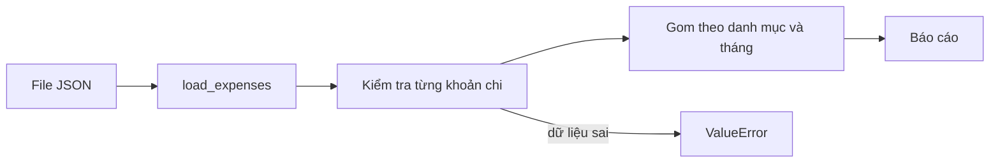

Dự án AI nào cũng lưu bản ghi: các lần chạy thí nghiệm, các lệnh gọi LLM API và chi phí của chúng, tài liệu và nguồn của tài liệu. Bạn lưu chúng vào file, đọc lại, kiểm tra xem chúng có hợp lý không, rồi in ra một bản tóm tắt mà người khác đọc trong mười giây là hiểu. Trong bài này bạn sẽ xây phiên bản cá nhân của việc đó: một **expense tracker** (công cụ quản lý chi tiêu). Nó nhỏ, nhưng có cùng cấu trúc với các công cụ theo dõi chi phí và ghi log eval mà sau này bạn sẽ viết khi đi làm.

Gần như không có kiến thức mới ở đây. Mục tiêu là **kết hợp** những gì bạn đã biết. Các bài tập dùng frozen dataclass, type hint, file JSON, các phép kiểm tra `ValueError` và context manager. Generator được minh họa ở phần 6 và decorator ở ví dụ 2; các bài tập không cần chúng. Mỗi phần đảm nhận một việc nhỏ, rõ ràng.

## 1. Kế hoạch

Một expense (khoản chi) là một lần mua: ngày, danh mục như `"food"`, số tiền và một ghi chú ngắn. Chương trình đọc danh sách khoản chi từ file JSON, kiểm tra, cộng lại và in báo cáo. Đây là pipeline:



Và đây là kế hoạch, với đầu vào và đầu ra của từng phần. Viết nó ra trước là thói quen quý nhất trong bài này:

| Phần | Đầu vào | Đầu ra |
|---|---|---|
| `Expense` | ngày, danh mục, số tiền, ghi chú | một object frozen |
| `check_expense(expense)` | một `Expense` | không có gì, hoặc `ValueError` |
| `save_expenses(path, expenses)` | đường dẫn và một list | một file JSON |
| `load_expenses(path)` | đường dẫn | list các `Expense` |
| `edit_expenses(path)` | đường dẫn | một context manager đưa list cho bạn rồi lưu lại sau đó |
| `totals_by_category(expenses)` | một list | `{"food": 23.75, ...}` |
| `totals_by_month(expenses)` | một list | `{"2024-01": 22.75, ...}` |
| `top_category(expenses)` | một list | tên danh mục lớn nhất |

Các bài tập yêu cầu những phần này. Bài tập 1 là năm dòng đầu (model, file và việc sửa an toàn). Bài tập 2 là ba dòng cuối (báo cáo).

## 2. Phần 1: model `Expense`

Một khoản chi là một bó các field có tên, đúng thứ mà dataclass sinh ra để làm. Ta cho nó **frozen** (đóng băng), vì một khoản chi đã ghi thì không nên bị đổi nhầm. Ngày là text thường theo dạng ISO `YYYY-MM-DD` (năm-tháng-ngày), vì dạng này sắp xếp đúng khi coi như text và JSON lưu được trực tiếp.

```python
from dataclasses import asdict, dataclass


@dataclass(frozen=True)
class Expense:
    date: str
    category: str
    amount: float
    note: str = ""


lunch = Expense("2024-03-05", "food", 4.5, "pho")
print(lunch)
# Expense(date='2024-03-05', category='food', amount=4.5, note='pho')
print(asdict(lunch))
# {'date': '2024-03-05', 'category': 'food', 'amount': 4.5, 'note': 'pho'}

try:
    lunch.amount = 9
except AttributeError:
    print("read-only")   # read-only
```

Để ý `note: str = ""`. Field có giá trị mặc định phải đứng sau các field không có. `asdict` cho ra dict thường, thứ mà JSON hiểu được.

## 3. Phần 2: validation (kiểm tra dữ liệu)

Dữ liệu từ file có thể sai theo nhiều cách. Nếu dữ liệu sai lọt vào, mọi bước sau có thể cho kết quả sai mà không báo lỗi nào. Vì vậy ta **kiểm tra ngay ở cửa** và raise `ValueError` ngay khi một quy tắc bị vi phạm. Các quy tắc:

| Field | Quy tắc |
|---|---|
| `date` | text dạng `YYYY-MM-DD`: ba phần cách nhau bởi `-`, có 4, 2 và 2 chữ số |
| `category` | text không rỗng sau khi `strip()` |
| `amount` | một số (`int` hoặc `float`) lớn hơn `0` |

Hai công cụ nhỏ sẽ giúp bạn. `text.split("-")`, mà bạn đã biết từ bài về chuỗi, cắt chuỗi tại mỗi dấu `-` và cho ra list các phần: `"2024-03-05".split("-")` là `["2024", "03", "05"]`. Công cụ duy nhất mới là `text.isdigit()`, là `True` khi chuỗi chỉ gồm chữ số. Đây là quy tắc ngày dưới dạng một hàm trả lời `True` hoặc `False`. Giá trị đọc từ JSON có thể không phải text (ví dụ số `20240305`), nên hàm hỏi `isinstance(text, str)` trước. Gọi `.split` trên một số sẽ crash với `AttributeError` thay vì từ chối gọn gàng:

```python
def is_iso_date(text) -> bool:
    if not isinstance(text, str):
        return False
    parts = text.split("-")
    if len(parts) != 3:
        return False
    year, month, day = parts
    sizes_ok = (len(year), len(month), len(day)) == (4, 2, 2)
    return sizes_ok and (year + month + day).isdigit()


print(is_iso_date("2024-03-05"))   # True
print(is_iso_date("5/3/2024"))     # False
print(is_iso_date("2024-3-5"))     # False
print(is_iso_date(20240305))       # False
```

Với số tiền, `isinstance(amount, (int, float))` là `True` khi `amount` là `int` **hoặc** `float` (bạn có thể đưa nhiều kiểu trong một tuple). Khi một quy tắc không đạt, ta raise lỗi với thông báo nói rõ cái gì sai:

```python
def check_amount(amount) -> None:
    if not isinstance(amount, (int, float)) or amount <= 0:
        raise ValueError(f"amount must be a number above 0, got {amount!r}")


for value in [4.5, 0, "12"]:
    try:
        check_amount(value)
        print(value, "ok")
    except ValueError as err:
        print("refused:", err)
# 4.5 ok
# refused: amount must be a number above 0, got 0
# refused: amount must be a number above 0, got '12'
```

`!r` trong f-string hiển thị giá trị theo cách Python viết nó, nên text `'12'` dễ phân biệt với số `12`. Quy tắc cho category có cùng dạng: kiểm tra nó là text, rồi kiểm tra nó không rỗng sau khi `strip()`:

```python
def check_category(category) -> None:
    if not isinstance(category, str) or not category.strip():
        raise ValueError(f"category must be text that is not empty, got {category!r}")


for value in ["food", "  ", 5]:
    try:
        check_category(value)
        print(repr(value), "ok")
    except ValueError as err:
        print("refused:", err)
# 'food' ok
# refused: category must be text that is not empty, got '  '
# refused: category must be text that is not empty, got 5
```

> [!TIP]
> Kiểm tra kiểu trước, giá trị sau. Trong `not isinstance(...) or amount <= 0`, Python dừng ở giá trị `True` đầu tiên, nên `"12" <= 0` không bao giờ được tính (nó sẽ crash với `TypeError`).

## 4. Phần 3: lưu và đọc JSON

Để lưu, đổi mỗi `Expense` thành dict bằng `asdict`, rồi ghi list bằng `json.dump`. Để đọc, lấy list các dict bằng `json.load` rồi đổi từng dict về `Expense`. `Expense(**record)` trải dict thành các keyword argument, nên `{"date": ..., "category": ...}` trở thành `Expense(date=..., category=...)`. Ta dùng thư mục tạm để không để lại gì trên ổ đĩa của bạn:

```python
import json
import tempfile
from dataclasses import asdict, dataclass
from pathlib import Path


@dataclass(frozen=True)
class Expense:
    date: str
    category: str
    amount: float
    note: str = ""


def save_expenses(path, expenses: list[Expense]) -> None:
    data = [asdict(e) for e in expenses]
    with open(path, "w", encoding="utf-8") as f:
        json.dump(data, f, indent=2)


def load_expenses(path) -> list[Expense]:
    with open(path, encoding="utf-8") as f:
        data = json.load(f)
    return [Expense(**record) for record in data]


expenses = [Expense("2024-03-05", "food", 4.5, "pho"), Expense("2024-03-06", "fun", 9.0)]

with tempfile.TemporaryDirectory() as tmp:
    path = Path(tmp) / "expenses.json"
    save_expenses(path, expenses)
    print(path.read_text(encoding="utf-8").splitlines()[:4])
    # ['[', '  {', '    "date": "2024-03-05",', '    "category": "food",']
    loaded = load_expenses(path)
    print(loaded == expenses)   # True
```

Lưu rồi đọc lại cho kết quả đúng: thứ bạn đọc ra bằng thứ bạn đã lưu. Dataclass so sánh tất cả field của nó, nên `==` cho `True`.

Khi đọc file, điều gì có thể hỏng? File có thể không tồn tại (`FileNotFoundError`), nội dung có thể không phải JSON (`json.JSONDecodeError`, một loại `ValueError`), hoặc một record có thể thiếu key hay thừa key. Khi đó `Expense(**record)` raise `TypeError`. Người gọi `load_expenses` không nên phải biết hết các chi tiết này, nên trong bài tập bạn đổi một record sai thành một `ValueError` duy nhất, bằng `try/except` như trong bài exception. Bên trong `except`, hãy viết `raise ValueError("...") from None`. Phần `from None` bảo Python bỏ `TypeError` gốc khỏi báo cáo, để người gọi chỉ thấy một lỗi gọn gàng.

> [!NOTE]
> File đã lưu không phải dữ liệu đáng tin. Ngay cả file của chính bạn cũng có thể bị sửa tay. Hãy chạy `check_expense` trên mọi record bạn đọc vào, không chỉ trên những record bạn lưu.

## 5. Phần 4: context manager để sửa an toàn

Gần như mọi lần dùng tracker đều là "đọc list, sửa, lưu lại". Một **context manager** (xem bài về context manager) có thể làm hộ phần đọc và lưu, để phần ở giữa chỉ còn là việc sửa. Nếu giữa chừng có gì hỏng, ta không muốn lưu công việc dang dở, nên lần này **không** có `try/finally` quanh `yield`. Việc dọn dẹp như đóng file phải luôn chạy, nhưng việc lưu công việc dang dở thì không:

```python
import json
import tempfile
from contextlib import contextmanager
from pathlib import Path


@contextmanager
def ledger(path):
    path = Path(path)
    rows = json.loads(path.read_text(encoding="utf-8")) if path.exists() else []
    yield rows
    path.write_text(json.dumps(rows), encoding="utf-8")


with tempfile.TemporaryDirectory() as tmp:
    path = Path(tmp) / "rows.json"

    with ledger(path) as rows:
        rows.append({"category": "food", "amount": 4.5})
    with ledger(path) as rows:
        rows.append({"category": "fun", "amount": 9.0})

    try:
        with ledger(path) as rows:
            rows.append({"category": "oops", "amount": 999})
            raise RuntimeError("crash")
    except RuntimeError:
        pass

    with ledger(path) as rows:
        print(len(rows))   # 2
```

Hai phiên đầu đã lưu các dòng của chúng. Phiên thứ ba crash sau khi append, nên lỗi được raise tại `yield`, dòng lưu bị bỏ qua, và `oops` không bao giờ vào file. Lỗi vẫn đi tiếp tới `except`: manager viết bằng generator không giấu lỗi, trừ khi bạn tự bắt nó.

Bài tập 1 yêu cầu cùng cấu trúc đó cho các khoản chi, tên là `edit_expenses(path)`, viết bằng `@contextmanager`. Nó có ba phần giống vậy:

| Phần | Việc làm |
|---|---|
| trước `yield` | đọc các khoản chi bằng `load_expenses` nếu file tồn tại, nếu không thì bắt đầu bằng `[]` |
| `yield` | đưa list cho khối `with`, khối này thêm hoặc bớt phần tử |
| sau `yield` | gọi `save_expenses`, hàm này kiểm tra mọi khoản chi trước |

Vì việc lưu nằm sau `yield`, nó chỉ chạy khi khối kết thúc mà không có lỗi. Nếu khối raise lỗi, hoặc một khoản chi trong list vi phạm quy tắc, file giữ nguyên nội dung cũ.

## 6. Phần 5: đọc luồng bằng generator

Một báo cáo không cần giữ trong bộ nhớ list mọi khoản chi lớn. Một **generator** lần lượt đưa ra từng phần tử khớp, và một **generator expression** trong `sum` cộng lại mà không tạo list:

```python
from dataclasses import dataclass


@dataclass(frozen=True)
class Expense:
    date: str
    category: str
    amount: float
    note: str = ""


def big_spends(expenses: list[Expense], limit: float):
    for expense in expenses:
        if expense.amount >= limit:
            yield expense


expenses = [
    Expense("2024-03-05", "food", 4.5),
    Expense("2024-03-06", "travel", 80.0),
    Expense("2024-03-09", "fun", 52.0),
]

total = sum(e.amount for e in expenses)
print(f"{total:.2f}")                       # 136.50
first = next(big_spends(expenses, 50))
print(first.category)                       # travel
print(len(list(big_spends(expenses, 50))))  # 2
```

`next(...)` chỉ lấy kết quả khớp đầu tiên, và generator tạm dừng ở đó. `list(...)` lấy tất cả. Type hint của hàm generator được bỏ qua có chủ ý: generator có một kiểu đặc biệt riêng mà bạn chưa cần biết.

## 7. Phần 6: gom nhóm và cộng lại

Trái tim của mọi báo cáo là **accumulator** (bộ cộng dồn): một dict bắt đầu rỗng, và với mỗi phần tử thì cộng số tiền vào mục của nhóm đó. `totals.get(category, 0)` nghĩa là "tổng cho đến lúc này, hoặc `0` nếu đây là lần đầu thấy danh mục này". Để ý tưởng rõ ràng, đây là nó trên các cặp `(category, amount)` đơn giản:

```python
pairs = [("food", 4.5), ("travel", 12.0), ("food", 6.25), ("fun", 9.0), ("food", 3.0)]

totals = {}
for category, amount in pairs:
    totals[category] = totals.get(category, 0) + amount

print(totals)   # {'food': 13.75, 'travel': 12.0, 'fun': 9.0}
for category in sorted(totals):
    print(f"{category}: {totals[category]:.2f}")
# food: 13.75
# fun: 9.00
# travel: 12.00
```

Bấm **Visualize** ở khối code này để xem `totals` lớn dần, từng mục một, khi `category` và `amount` thay đổi.

Đây là phần đầu của vòng lặp, từng bước:

| bước | category | amount | `totals` sau bước đó |
|---|---|---|---|
| 1 | `"food"` | 4.5 | `{"food": 4.5}` |
| 2 | `"travel"` | 12.0 | `{"food": 4.5, "travel": 12.0}` |
| 3 | `"food"` | 6.25 | `{"food": 10.75, "travel": 12.0}` |
| 4 | `"fun"` | 9.0 | `{"food": 10.75, "travel": 12.0, "fun": 9.0}` |

Hai chi tiết giúp báo cáo dễ đọc. Thứ nhất, `sorted(totals)` cho các key theo thứ tự bảng chữ cái, nên báo cáo luôn trông giống nhau, dù dữ liệu đến theo thứ tự nào. Thứ hai, `f"{x:.2f}"` hiển thị đúng hai chữ số thập phân.

**Gom theo tháng** dùng cùng vòng lặp với một key khác. Vì ngày có dạng `YYYY-MM-DD`, 7 ký tự đầu là năm và tháng, và một phép slice cắt chúng ra: `"2024-03-05"[:7]` là `"2024-03"`. Ngày ISO sắp xếp đúng khi coi như text, nên `sorted` tự động cho thứ tự thời gian:

```python
dates = ["2024-02-10", "2024-01-05", "2024-01-20"]
months = sorted({date[:7] for date in dates})
print(months)   # ['2024-01', '2024-02']
```

Danh mục **lớn nhất** là vòng lặp "tốt nhất cho đến lúc này" mà bạn biết từ project bảng điểm. Đi qua các key theo thứ tự đã sắp xếp và chỉ thay thế cái tốt nhất khi gặp tổng **lớn hơn hẳn**. Như vậy khi hòa, tên đứng trước trong bảng chữ cái được giữ lại:

```python
totals = {"food": 13.75, "fun": 9.0, "travel": 13.75}

best = None
best_total = 0
for category in sorted(totals):
    if totals[category] > best_total:
        best = category
        best_total = totals[category]
print(best)   # food
```

## 8. Ghép lại

Với model, file, các phép kiểm tra và ba hàm báo cáo, một script chỉ còn vài dòng: đọc, rồi in từng bản tóm tắt. Với sáu khoản chi trong tháng 1 và tháng 2 năm 2024, báo cáo trông như sau:

```text
By category
food: 23.75
fun: 9.00
transport: 15.50

By month
2024-01: 22.75
2024-02: 25.50

Top category: food
```

## 9. Đến lượt bạn

Mở hai bài tập. Bài tập 1 là model, các phép kiểm tra, file và trình sửa an toàn (phần 2 đến 5). Bài tập 2 là báo cáo (việc gom nhóm ở phần 7). Editor đã có sẵn khung hàm với các bước `# TODO`. Hãy viết code bên trong hàm và `return` kết quả. Bấm **Kiểm tra** thường xuyên: từng test xanh một là cách tốt để xây một project.

## 10. Lỗi thường gặp

**Quên `**` khi dựng lại object.** `Expense(record)` đưa cả dict cho field đầu tiên và để các field khác trống. Khối này kết thúc bằng lỗi một cách có chủ ý:

```python
from dataclasses import dataclass


@dataclass(frozen=True)
class Expense:
    date: str
    category: str
    amount: float
    note: str = ""


record = {"date": "2024-03-05", "category": "food", "amount": 4.5, "note": ""}
expense = Expense(record)
# TypeError: Expense.__init__() missing 2 required positional arguments: 'category' and 'amount'
```

Cách sửa: `Expense(**record)`.

**Mở file trước khi kiểm tra dữ liệu.** Mode `"w"` xóa sạch file ngay khi mở. Nếu sau đó một phép kiểm tra thất bại, dữ liệu cũ mất:

```python
import json
import tempfile
from pathlib import Path


def save_wrong(path, amounts):
    with open(path, "w", encoding="utf-8") as f:   # the old content is erased here
        for amount in amounts:
            if amount <= 0:
                raise ValueError("amount must be above 0")
        json.dump(amounts, f)


with tempfile.TemporaryDirectory() as tmp:
    path = Path(tmp) / "amounts.json"
    path.write_text("[4.5, 9.0]", encoding="utf-8")
    try:
        save_wrong(path, [3.0, -1.0])
    except ValueError:
        pass
    print(repr(path.read_text(encoding="utf-8")))   # ''
```

Cách sửa: chạy hết các phép kiểm tra trong một vòng lặp **trước**, rồi mới mở file.

**In thẳng tổng float.** Số thập phân không biểu diễn chính xác trong `float`, nên tổng có thể lệch một chút:

```python
amounts = [0.1, 0.2]
print(sum(amounts))               # 0.30000000000000004
print(round(sum(amounts), 2))     # 0.3
print(f"{sum(amounts):.2f}")      # 0.30
```

Cách sửa: `round(total, 2)` cho số bạn giữ lại, `:.2f` cho text bạn hiển thị.

**Đọc generator hai lần.** Generator dùng hết sau một lượt:

```python
amounts = [5, 20, 30]
big = (x for x in amounts if x >= 10)
print(len(list(big)))   # 2
print(len(list(big)))   # 0
```

Cách sửa: gọi lại hàm generator, hoặc giữ kết quả trong list nếu cần dùng hai lần.

## Tóm tắt

- Một project là những phần nhỏ, mỗi phần một việc: model, phép kiểm tra, lưu, đọc, hàm gom nhóm. Hãy viết kế hoạch (phần, đầu vào, đầu ra) trước khi viết code.
- Frozen dataclass mô hình hóa một bản ghi; `asdict` và `Expense(**record)` chuyển qua lại giữa object và dict thân thiện với JSON.
- Kiểm tra dữ liệu ngay ở cửa và raise `ValueError` với thông báo rõ ràng. Kiểm tra mọi thứ **trước khi** mở file để ghi.
- Accumulator `totals[key] = totals.get(key, 0) + amount` gom nhóm được mọi thứ; `sorted(totals)` cho đầu ra ổn định; `date[:7]` là tháng của một ngày ISO.
- Context manager viết bằng `@contextmanager` có thể đọc trước một khối và lưu sau khối đó, và bỏ qua việc lưu khi khối bị lỗi. Generator đọc luồng lazily (ví dụ 2 còn cho thấy một decorator).
- `round(x, 2)` làm tròn số bạn giữ và `f"{x:.2f}"` định dạng text bạn hiển thị.

## Tìm hiểu thêm

Làm xong sớm? Hãy tự thử những việc này khi project đã chạy:

- Từ chối ngày không thể có như `"2024-13-45"` (module `datetime` có thể giúp bạn).
- Thêm `top_expenses(expenses, n)` trả về `n` khoản chi lớn nhất.
- Viết hàm `report(expenses)` trả về toàn bộ báo cáo dạng text ở phần 9.
- Đọc các khoản chi từ file CSV thay vì JSON.
- Làm các phép kiểm tra chặt hơn: `True` được tính là số (`bool` là một loại `int`), `float("nan")` lọt qua `amount <= 0`, và `note` chưa bao giờ được kiểm tra. Hãy quyết định cần từ chối gì và thêm một test.
