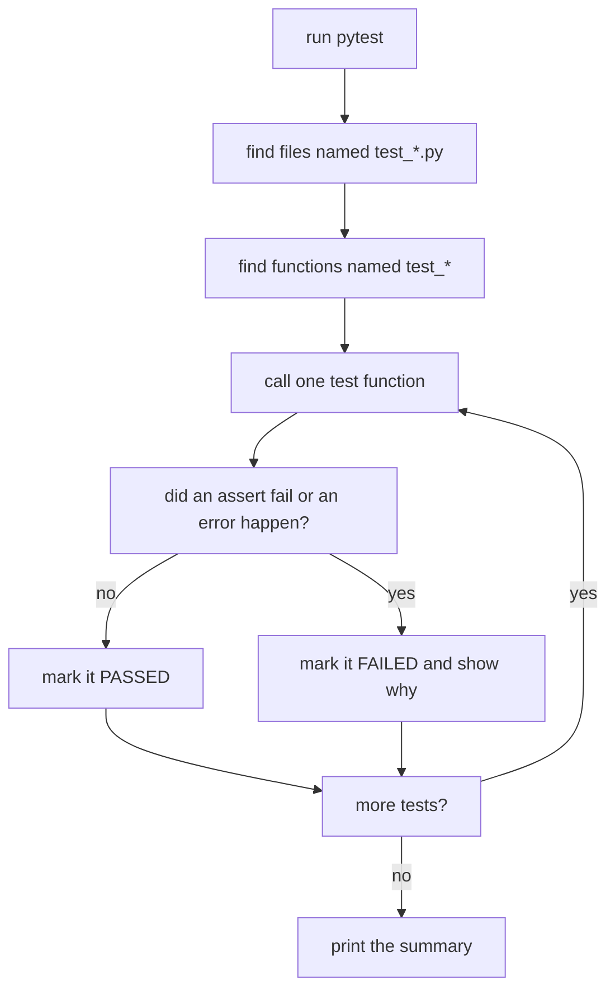
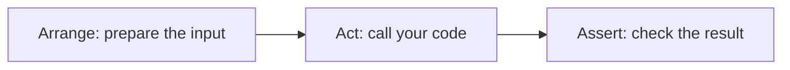

Code that talks to an AI model rarely crashes when it is wrong. A broken prompt builder still sends a prompt, a broken text cleaner still returns text, and the model still answers, just worse. **Tests** are small programs that check your code for you, so a silent bug turns into a loud red failure. The standard tool for this in Python is **pytest**.

## 1. Why not just run it and look?

You can check a function by printing a few results and reading them:

```python
def count_tokens(text):
    return len(text.split())


print(count_tokens("hello brave new world"))   # 4
print(count_tokens(""))                         # 0
print(count_tokens("a  b"))                     # 2
```

This works once. But next week you change the function, and you must run it again, read every line again and remember what each number should be. A test writes the expected answer down, so the computer does the checking every time.

## 2. Your first test

A test is a function whose name starts with `test_`. Inside it you call your code and use `assert`, a new keyword: `assert condition` does nothing when the condition is `True`, and raises `AssertionError` (an exception, like the ones in the exceptions lesson) when it is `False`.

```python
def clean_text(text):
    return " ".join(text.split()).lower()


def test_clean_text_lowercases():
    assert clean_text("Hello") == "hello"


test_clean_text_lowercases()
print("no error means the test passed")   # no error means the test passed
```

Here we call the test by hand. With pytest you do not: you put tests in a file called `test_something.py` (the name starts with `test_`) and pytest finds and runs every `test_` function for you.



One test failing does not stop the others. You get one green or red mark per test.

> [!NOTE]
> The exercises in this app are checked by pytest-style tests too. The red and green list under your code is exactly this report.

## 3. Running pytest and reading a failure

pytest is a program you run in the terminal (these commands are not runnable in the app):

```bash
pytest
pytest -q
pytest -x
pytest -k clean
pytest test_clean.py
```

| command | what it does |
|---|---|
| `pytest` | find and run all tests in the current folder |
| `pytest -q` | quiet: shorter output |
| `pytest -x` | stop at the first failing test |
| `pytest -k clean` | run only tests whose name contains `clean` |
| `pytest test_clean.py` | run one file |

Now a function with a bug: it forgets to collapse repeated spaces. Plain Python tells you very little when the assert fails:

```python
def clean_text(text):
    return text.strip().lower()


assert clean_text("Hello   World") == "hello world"
# AssertionError
```

This block ends with an error on purpose. The message is empty. pytest is smarter: it looks inside the `assert` and shows you both sides of the comparison.

```text
>       assert clean_text("Hello   World") == "hello world"
E       AssertionError: assert 'hello   world' == 'hello world'
E         - hello world
E         + hello   world

test_clean.py:5: AssertionError
FAILED test_clean.py::test_clean_text_collapses_spaces
1 failed, 1 passed in 0.02s
```

Read it from the `>` line: it marks the line that failed. The `E` lines say what the two sides were. Here the result has three spaces where you expected one. You can also add your own message after a comma: `assert total == 6, "add every number, not just the last one"`.

## 4. Arrange, Act, Assert

A readable test has three steps. **Arrange**: prepare the input. **Act**: call the code you test, once. **Assert**: check the result.



```python
def clean_text(text):
    return " ".join(text.split()).lower()


def test_clean_text_removes_extra_spaces():
    # Arrange
    raw = "  Hello    AI   World  "
    # Act
    cleaned = clean_text(raw)
    # Assert
    assert cleaned == "hello ai world"


test_clean_text_removes_extra_spaces()
print("passed")   # passed
```

Press **Visualize** on this block and watch `raw` turn into `cleaned` before the assert checks it.

Name every test as a **sentence** that says what should be true. When a test fails, the name is the first thing you read, so it should tell you the story:

| bad name | good name |
|---|---|
| `test_1` | `test_clean_text_removes_extra_spaces` |
| `test_empty` | `test_returns_zero_tokens_for_empty_text` |
| `test_error` | `test_negative_limit_raises_value_error` |

> [!TIP]
> Keep one idea per test. If `test_clean_text` has six asserts and the third fails, you never learn whether the last three would have passed.

## 5. What to test

One happy-path test is not enough. Bugs live at the edges, so think about these inputs every time:

| kind | question | for `clean_text` |
|---|---|---|
| typical | does the normal case work? | `"Hello World"` |
| empty | what if there is nothing? | `""` |
| boundary | what is the smallest or the exact-limit case? | `"a"`, only spaces |
| odd input | what else looks like the input? | tabs and newlines |
| bad input | what must be refused? | covered in the next section |

```python
def clean_text(text):
    return " ".join(text.split()).lower()


def test_empty_text_stays_empty():
    assert clean_text("") == ""


def test_only_spaces_becomes_empty():
    assert clean_text("   ") == ""


def test_tabs_and_newlines_count_as_spaces():
    assert clean_text("a\tb\nc") == "a b c"


test_empty_text_stays_empty()
test_only_spaces_becomes_empty()
test_tabs_and_newlines_count_as_spaces()
print("3 passed")   # 3 passed
```

When you find a bug in real life, first write a test that fails because of it, then fix the code. That test now guards against the bug coming back.

## 6. Checking for errors: `pytest.raises`

Some inputs must be **refused**. A score parser should raise `ValueError` for `"abc"`. Here is the function, and a check written with the `try/except` you know:

```python
def parse_score(text):
    """Turn '8/10' into 0.8. Raise ValueError for anything else."""
    parts = text.split("/")
    if len(parts) != 2:
        raise ValueError(f"expected 'a/b', got {text}")
    return int(parts[0]) / int(parts[1])


try:
    parse_score("abc")
    print("no error: the test would FAIL")
except ValueError:
    print("ValueError: the test would PASS")   # ValueError: the test would PASS
```

pytest has a shorter way. `pytest.raises(ValueError)` is a `with` block (as in the files lesson) that passes when the code inside raises that error, and fails when it does not:

```text
import pytest


def test_text_without_slash_raises_value_error():
    with pytest.raises(ValueError):
        parse_score("abc")
```

The block above is a test file, not something to run in the app. If `parse_score("abc")` returned a number instead, the test would fail with `DID NOT RAISE`.

## 7. Numbers with decimals: `pytest.approx`

Computers store decimals in binary, so tiny rounding errors appear. Never compare floats with `==`:

```python
print(0.1 + 0.2)                        # 0.30000000000000004
print(0.1 + 0.2 == 0.3)                 # False
print(abs((0.1 + 0.2) - 0.3) < 1e-9)    # True
```

The last line is the idea. The built-in `abs(x)` gives the size of `x` without its sign, so `abs(a - b) < 1e-9` asks "is the gap between `a` and `b` tiny?" (`1e-9` is `0.000000001`). Two floats are "equal" when their gap is tiny. `pytest.approx` does that for you:

```text
import pytest


def test_one_third_is_about_0_333():
    assert parse_score("1/3") == pytest.approx(0.3333, abs=1e-3)
```

`abs=1e-3` means "within 0.001". Without it, `approx` uses a very small default tolerance that fits most cases.

| use this | when |
|---|---|
| `assert a == b` | the result is exact: strings, ints, lists, dicts |
| `with pytest.raises(E):` | the code must refuse with error `E` |
| `assert x == pytest.approx(y)` | the result is a float |
| `@pytest.mark.parametrize` | the same check for many inputs (next section) |

## 8. Many cases, one test: `parametrize`

Writing five almost identical tests is boring. `parametrize` runs one test function once per row of a table. The line starting with `@` is a **decorator**: it labels the function below it. You do not need to know how decorators work to use it.

```text
import pytest


@pytest.mark.parametrize(
    "text, expected",
    [
        ("8/10", 0.8),
        ("0/5", 0.0),
        ("5/5", 1.0),
    ],
)
def test_parse_score_value(text, expected):
    assert parse_score(text) == pytest.approx(expected)
```

pytest runs this as three separate tests and reports each one, so you see exactly which row failed:

```text
test_scores.py::test_parse_score_value[8/10-0.8] PASSED
test_scores.py::test_parse_score_value[0/5-0.0] PASSED
test_scores.py::test_parse_score_value[5/5-1.0] PASSED
```

(That detailed list appears with `pytest -v`.) Adding a case is one new line in the table, which makes it cheap to cover the edges.

## 9. Fixtures: shared setup

If several tests need the same prepared data, a **fixture** builds it once per test. Mark a function with `@pytest.fixture`, then ask for it by adding its name as a parameter:

```text
import pytest


@pytest.fixture
def sample_docs():
    return ["  First doc ", "SECOND   doc", ""]


def test_cleans_every_document(sample_docs):
    assert [clean_text(d) for d in sample_docs] == ["first doc", "second doc", ""]


def test_sample_has_three_documents(sample_docs):
    assert len(sample_docs) == 3
```

Each test gets a **fresh** copy, so one test cannot spoil the data of another. pytest also gives you ready-made fixtures. You only name them as parameters:

| fixture | what you get |
|---|---|
| `tmp_path` | a new empty temporary folder for this test, deleted afterwards |
| `capsys` | a way to read what the code printed |
| `monkeypatch`, `caplog` | change a value for one test, read log messages (more in the logging lesson) |

```text
def show_prompt(text):
    print(f"Prompt: {text}")


def test_saves_cleaned_text_to_a_file(tmp_path):
    path = f"{tmp_path}/out.txt"
    with open(path, "w", encoding="utf-8") as f:
        f.write(clean_text("  Hi "))
    with open(path, encoding="utf-8") as f:
        assert f.read() == "hi"


def test_prints_the_prompt(capsys):
    show_prompt("Hi")
    assert capsys.readouterr().out == "Prompt: Hi\n"
```

Use a fixture when the setup is more than a line or two and several tests share it. For a single value, just write it inside the test.

## 10. Tests are the spec

A list of test names reads like a description of what the code promises: "removes extra spaces", "empty text stays empty", "bad score raises ValueError". New teammates, and you in three months, can read the tests to learn what the function must do. If you change the code and a test goes red, either you broke the promise or the promise changed, and then you update the test on purpose.

> [!WARNING]
> Green tests do not prove there are no bugs. They only prove the cases you wrote work. The quality of your tests is the quality of the cases you thought of.

## 11. Common mistakes

**A test name that does not start with `test_`.** pytest silently skips it:

```text
def check_clean_text():
    assert clean_text("A") == "a"
```

pytest prints `collected 0 items` and "passes" with nothing run. Fix: rename it `test_clean_text_lowercases`, and name the file `test_*.py` too.

**Only testing the happy path.** This test is green, yet the function crashes on an empty string. This block ends with an error on purpose:

```python
def first_word(text):
    return text.split()[0]


def test_first_word():
    assert first_word("hello world") == "hello"


test_first_word()
print(first_word(""))
# IndexError: list index out of range
```

Fix: add the empty case, decide what the answer should be (maybe `""`), and change the code until the test passes.

**Putting code after the failing line inside `pytest.raises`.** Once the error is raised, the rest of the block is skipped:

```text
with pytest.raises(ValueError):
    parse_score("abc")
    assert False   # never runs
```

Fix: keep only the one line that should raise inside the `with`, and put other asserts outside it.

**Tests that share data.** Here the second test sees what the first one left behind. This block ends with an error on purpose:

```python
history = []


def add_message(text):
    history.append(text)
    return len(history)


def test_first_message_is_number_one():
    assert add_message("hi") == 1


def test_another_first_message_is_number_one():
    assert add_message("hello") == 1


test_first_message_is_number_one()
test_another_first_message_is_number_one()
# AssertionError
```

Fix: build the data inside each test, or return it from a fixture so every test gets a fresh one. Tests should work in any order.

## Recap

- A test is a function named `test_...` in a file named `test_*.py`. It calls your code and uses plain `assert`. pytest finds and runs them all and shows one mark per test.
- A failing report shows both sides of the comparison. Use `-q`, `-x` and `-k name` to control a run.
- Write tests as Arrange, Act, Assert, with a sentence for a name. Cover typical, empty, boundary and bad input.
- Use `with pytest.raises(E):` for errors, `pytest.approx` for floats, and `@pytest.mark.parametrize` to run one test over a table of cases.
- A `@pytest.fixture` gives each test fresh shared setup; `tmp_path` and `capsys` come built in.
- Tests are an executable spec, but they only check the cases you wrote.
